# Explainable deep reinforcement learning for resilient and battery-aware microgrid control

- 期刊：Energy Conversion and Management
- DOI：10.1016/j.enconman.2026.121215
- 版本：出版社正式版
- 原文页数：26
- 文本解析：MinerU 4.0.12 / basic / 全文
- [原始 PDF](../../01_ECM_2026_Explainable_RL_battery_aware.pdf)
- [逐页截图](screenshots.html)

> 以下为机器解析的原文，未翻译、未改写。公式、表格和双栏阅读顺序可能存在识别误差，请以原始 PDF 和逐页截图为准。

## 论文首页

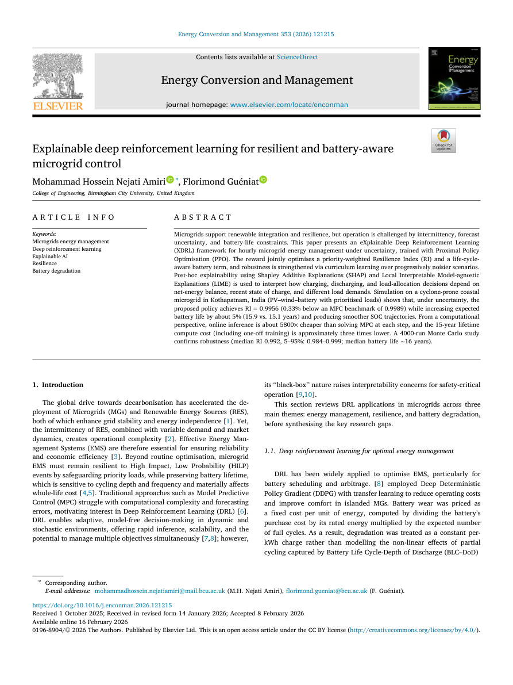

## 全文

Mohammad Hossein Nejati Amiri ∗, Florimond Guéniat

College of Engineering, Birmingham City University, United Kingdom

A R T I C L E I N F O

Keywords: Microgrids energy management Deep reinforcement learning Explainable AI Resilience Battery degradation

## Abstract

Microgrids support renewable integration and resilience, but operation is challenged by intermittency, forecast uncertainty, and battery-life constraints. This paper presents an eXplainable Deep Reinforcement Learning (XDRL) framework for hourly microgrid energy management under uncertainty, trained with Proximal Policy Optimisation (PPO). The reward jointly optimises a priority-weighted Resilience Index (RI) and a life-cycleaware battery term, and robustness is strengthened via curriculum learning over progressively noisier scenarios. Post-hoc explainability using Shapley Additive Explanations (SHAP) and Local Interpretable Model-agnostic Explanations (LIME) is used to interpret how charging, discharging, and load-allocation decisions depend on net-energy balance, recent state of charge, and different load demands. Simulation on a cyclone-prone coastal microgrid in Kothapatnam, India (PV–wind–battery with prioritised loads) shows that, under uncertainty, the proposed policy achieves RI = 0.9956 (0.33% below an MPC benchmark of 0.9989) while increasing expected battery life by about 5% (15.9 vs. 15.1 years) and producing smoother SOC trajectories. From a computational perspective, online inference is about 5800× cheaper than solving MPC at each step, and the 15-year lifetime compute cost (including one-off training) is approximately three times lower. A 4000-run Monte Carlo study confirms robustness (median RI 0.992, 5–95%: 0.984–0.999; median battery life ∼16 years).

## 1. Introduction

The global drive towards decarbonisation has accelerated the deployment of Microgrids (MGs) and Renewable Energy Sources (RES), both of which enhance grid stability and energy independence [1]. Yet, the intermittency of RES, combined with variable demand and market dynamics, creates operational complexity [2]. Effective Energy Management Systems (EMS) are therefore essential for ensuring reliability and economic efficiency [3]. Beyond routine optimisation, microgrid EMS must remain resilient to High Impact, Low Probability (HILP) events by safeguarding priority loads, while preserving battery lifetime, which is sensitive to cycling depth and frequency and materially affects whole-life cost [4,5]. Traditional approaches such as Model Predictive Control (MPC) struggle with computational complexity and forecasting errors, motivating interest in Deep Reinforcement Learning (DRL) [6]. DRL enables adaptive, model-free decision-making in dynamic and stochastic environments, offering rapid inference, scalability, and the potential to manage multiple objectives simultaneously [7,8]; however, its ‘‘black-box’’ nature raises interpretability concerns for safety-critical operation [9,10].

This section reviews DRL applications in microgrids across three main themes: energy management, resilience, and battery degradation, before synthesising the key research gaps.

### 1.1. Deep reinforcement learning for optimal energy management

DRL has been widely applied to optimise EMS, particularly for battery scheduling and arbitrage. [8] employed Deep Deterministic Policy Gradient (DDPG) with transfer learning to reduce operating costs and improve comfort in islanded MGs. Battery wear was priced as a fixed cost per unit of energy, computed by dividing the battery’s purchase cost by its rated energy multiplied by the expected number of full cycles. As a result, degradation was treated as a constant perkWh charge rather than modelling the non-linear effects of partial cycling captured by Battery Life Cycle-Depth of Discharge (BLC–DoD)

<small>∗ Corresponding author.</small>

<small>E-mail addresses: [mohammadhossein.nejatiamiri@mail.bcu.ac.uk](mailto:mohammadhossein.nejatiamiri@mail.bcu.ac.uk) (M.H. Nejati Amiri), [florimond.gueniat@bcu.ac.uk](mailto:florimond.gueniat@bcu.ac.uk) (F. Guéniat).</small>

<small>[https://doi.org/10.1016/j.enconman.2026.121215](https://doi.org/10.1016/j.enconman.2026.121215)</small>

<small>Available online 16 February 2026</small>

<small>Received 1 October 2025; Received in revised form 14 January 2026; Accepted 8 February 2026</small>

<small>0196-8904/© 2026 The Authors. Published by Elsevier Ltd. This is an open access article under the CC BY license ([http://creativecommons.org/licenses/by/4.0/](http://creativecommons.org/licenses/by/4.0/)).</small>

Nomenclature

<table><tr><td>Abbrev.</td><td>Definition</td><td>Abbrev.</td><td>Definition</td></tr><tr><td>A2C</td><td>Advantage Actor-Critic</td><td>MPC</td><td>Model Predictive Control</td></tr><tr><td>A3C</td><td>Asynchronous Advantage Actor-Critic</td><td>MLP</td><td>Multi-Layer Perceptron</td></tr><tr><td>BESS</td><td>Battery Energy Storage System</td><td>PV</td><td>Photovoltaic</td></tr><tr><td>BLC</td><td>Battery Life Cycles</td><td>RES</td><td>Renewable Energy Sources</td></tr><tr><td>DDPG</td><td>Deep Deterministic Policy Gradient</td><td>RI</td><td>Resilience Index</td></tr><tr><td>DDQL</td><td>Double Deep Q-Learning</td><td>MARL</td><td>Multi-Agent Reinforcement Learning</td></tr><tr><td>DoD</td><td>Depth of Discharge</td><td>SAC</td><td>Soft Actor-Critic</td></tr><tr><td>DRL</td><td>Deep Reinforcement Learning</td><td>SB3</td><td>Stable-Baselines3</td></tr><tr><td>EMS</td><td>Energy Management System</td><td>SHAP</td><td>Shapley Additive Explanations</td></tr><tr><td>EY</td><td>Expected Years (expected battery life)</td><td>SOC</td><td>State of Charge</td></tr><tr><td>FedSAC</td><td>Federated Soft Actor-Critic</td><td>TD3</td><td>Twin Delayed DDPG</td></tr><tr><td>FLOPs</td><td>Floating Point Operations</td><td>WT</td><td>Wind Turbine</td></tr><tr><td>FP32</td><td>32-bit floating point precision</td><td>XAI</td><td>Explainable Artificial Intelligence</td></tr><tr><td>LIME</td><td>Local Interpretable Model-agnostic Explanations</td><td>XDRL</td><td>eXplainable Deep Reinforcement Learning</td></tr><tr><td>HILP</td><td>High-Impact, Low-Probability</td><td>MG</td><td>Microgrid</td></tr><tr><td>LSTM</td><td>Long Short-Term Memory</td><td>MILP</td><td>Mixed-Integer Linear Programming</td></tr><tr><td>RMS</td><td>Root Mean Square</td><td>STD</td><td>Standard Deviation</td></tr><tr><td colspan="4">Symbols and Parameters</td></tr><tr><td> $\mathbf { s } _ { t }$ </td><td>Environment state at time step t</td><td> $\mathbf { a } _ { t }$ </td><td>Action vector at time step t</td></tr><tr><td> $\mathbf { o } _ { t }$ </td><td>Observation (stacked history window)</td><td> $\pi _ { \theta } ( \mathbf { a } \mid \mathbf { s } )$ </td><td>Policy parametrised by θ</td></tr><tr><td> $\theta$ </td><td>Policy (actor) network parameters</td><td> $V _ { \phi } ( \mathbf { s } )$ </td><td>Value function approximation</td></tr><tr><td> $\phi$ </td><td>Value (critic) network parameters</td><td> $r _ { t }$ </td><td>Immediate reward at time step t</td></tr><tr><td> $\gamma$ </td><td>Discount factor</td><td> $N _ { s }$ </td><td>Steps per episode (= 216)</td></tr><tr><td> $L _ { i }$ </td><td>Demand of load class i ∈ {1, 2,3} [kW]</td><td> $L _ { : } ^ { \mathrm { m a x } }$ </td><td>Peak/normalisation constant for load i [kW]</td></tr><tr><td> $S _ { i }$ </td><td>Unmet demand for load class i [kWh]</td><td> $P _ { \mathrm { r e n } }$ </td><td>Total renewable generation (PV+WT) [kW]</td></tr><tr><td> $P ^ { \mathrm { m a x } }$  - ren</td><td>Peak/normalisation constant for renewable</td><td> $P ^ { \mathrm { m a x } }$  net</td><td>Peak/normalisation constant for net balance</td></tr><tr><td> $P _ { \mathrm { n e t } }$ </td><td>generation [kW] [kW] Net balance:  $\begin{array} { r } { P _ { \mathrm { r e n } } - \sum _ { i } L _ { i } } \end{array}$ </td><td> $P _ { s }$ </td><td>magnitude [kW] Available supply: [kW]  $P _ { \mathrm { r e n } } + P _ { \mathrm { d i s } } - P _ { \mathrm { c h } }$ </td></tr><tr><td> $P _ { s , i }$ </td><td>Supplied power allocated to load class i [kW]</td><td> $a _ { \mathrm { c h } } , a _ { \mathrm { d i s } }$ </td><td>Normalised charge/discharge commands</td></tr><tr><td> $P _ { \mathrm { c h } } , P _ { \mathrm { d i s } }$ </td><td>Charge/discharge power after scaling [kW]</td><td> $P _ { \mathrm { c o n v m a x } }$ </td><td>Converter rated power (scaling constant) [kW]</td></tr><tr><td></td><td>Raw allocation logits for load weights</td><td> $f _ { i }$ </td><td>Softmax allocation fraction for load i</td></tr><tr><td> $w _ { 1 } , w _ { 2 } , w _ { 3 }$ </td><td>Stage-dependent shortfall penalty factor</td><td></td><td>Weight of resilience component in reward</td></tr><tr><td></td><td>Weight of battery-life component in reward</td><td> $w _ { \mathrm { R I } }$   $R _ { \mathrm { R I } }$ </td><td>Resilience sub-reward</td></tr><tr><td> $w _ { \mathrm { b a t } }$ </td><td>Battery-health sub-reward</td><td></td><td>Episode-level Resilience Index</td></tr><tr><td> $R _ { \mathrm { b a t } }$   $\mathbf { E Y }$ </td><td>Expected battery lifetime [years]</td><td> $\mathrm { R I } _ { \mathrm { e p i s o d e } }$ </td><td></td></tr><tr><td></td><td></td><td> $R _ { \mathrm { f i n a l } }$ </td><td>Terminal bonus reward (end of episode)</td></tr><tr><td> $s o c$ </td><td>Battery state of charge [p.u.]</td><td> $\mathrm { D o D }$ </td><td>Depth of discharge [p.u.]</td></tr><tr><td>BLC(DoD)</td><td>Battery life cycles as a function of DoD</td><td> $n _ { \mathrm { s t e p s } }$ </td><td>PPO rollout length per update [steps]</td></tr><tr><td>batch size</td><td>PPO minibatch size [samples]</td><td> $f$ </td><td>Perturbation factor</td></tr><tr><td> $n$ </td><td>Variants per perturbation level [integer]</td><td> $\varepsilon$ </td><td>Near-zero threshold (avoid perturbing idle values)</td></tr><tr><td> $L _ { j } ^ { \mathrm { m a x } }$ </td><td>Instantaneous cap for load j [kW]</td><td> $E _ { i } ^ { \mathrm { m a x } }$ </td><td>Daily energy cap for load j [kWh/day]</td></tr><tr><td> $\rho$ </td><td>Pearson correlation with original dataset</td><td> $P ( t )$ </td><td>Normalised Perlin noise signal [-1 to 1]</td></tr><tr><td> $\alpha$ </td><td>Perlin noise scaling factor (generic)</td><td> $\alpha _ { s } , \alpha _ { w }$ </td><td>Perlin scaling for solar/wind</td></tr><tr><td>fade(t)</td><td>Quintic fade function used in Perlin noise</td><td> $t _ { r , i }$ </td><td>Wall-clock time of step i in run r [s]</td></tr><tr><td> $R$ </td><td>Number of repeated timing runs [integer]</td><td> $t _ { 1 } , \sigma _ { 1 }$ </td><td>Mean and sample std. dev. per step [s]</td></tr><tr><td> $T _ { 1 } , \Sigma _ { 1 }$ </td><td>Mean and sample std. dev. per episode [s] Maximum reported CPU frequency [Hz]</td><td> $F _ { \mathrm { p e a k } }$ </td><td> $[ \mathrm { F L O P }   s ^ { - 1 } ]$  Theoretical FP32 peak throughput Number of physical CPU cores [integer]</td></tr><tr><td> $f _ { \mathrm { m a x } }$   $C$ </td><td>Lifetime compute budget estimate [FLOPs]</td><td> $n _ { \mathsf { c o r e s } }$ </td><td></td></tr></table>

curves. Similarly, [11] introduced DeepTwin, a digital twin with DRL agents for scheduling and load balancing, reporting revenue gains but without integrating battery life into the reward function. Other studies addressed energy arbitrage and load shifting [12,13], yet their focus remained economic rather than multi-objective.

To address stochasticity, [14] developed a PPO-based dispatch strategy using a prediction–decision integrated approach for isolated microgrids, while [15] applied Bayesian DRL for resilient control in a multi-energy microgrid. Both approaches improved adaptability but did not report a formal resilience index. Only [14] priced battery wear via a simple DoD/cycle-life term rather than a detailed ageing model.

Growing system complexity has also encouraged multi-agent DRL (MADRL/MARL) research. [16] developed a trading-oriented MARL framework, and [17] applied MARL for distributed energy management. Recent work has moved towards robust decentralised coordination across multiple microgrids, particularly by learning spatiotemporal patterns that preserve control performance under missing or noisy measurements [18], and by embedding graph surrogate models within distributed MADRL to coordinate coupled heat–electricity multi-microgrid systems under measurement anomalies and modelling errors [19]. Although these works advanced decentralised optimisation, they did not unify economic objectives with resilience or asset longevity. In summary, while DRL has shown strong performance in EMS, most approaches treat cost, uncertainty, or coordination in isolation, with limited consideration of resilience or long-term battery health.

### 1.2. Deep reinforcement learning for enhancing microgrid resilience

Resilience, defined as the capacity to withstand, adapt to, and recover from HILP events [20], is a growing application area for DRL [21,22]. Many studies focus on service restoration and microgrid formation. [23] applied Twin Delayed DDPG (TD3) for sequential restoration, while [24] used deep Q-learning for coordinating mobile emergency generators. These frameworks accelerated recovery but neglected the long-term effects of battery cycling. Similar contributions to restoration [25,26] echo this limitation.

DRL has also been applied to resource allocation and post-event recovery logistics. For example, [27] proposed a hierarchical MARL framework that coordinates repair-crew routing and repair decisions across interdependent transportation and power–gas networks to accelerate load restoration after disruptions. Damaged components were modelled through discrete outage/repair states that were progressively restored by crew actions, with the objective of reducing load-shedding impacts under an operational network model. While recovery-focused research naturally prioritises restoration speed and logistics, explicit modelling of gradual asset ageing and degradation is often not incorporated in resilience-oriented DRL formulations.

Cyber-resilience has received increasing attention. [28] developed a DRL framework to defend against false data injection, while [29] proposed a Federated Soft Actor–Critic (FedSAC) model for adversarial resilience in networked MGs. Other works explored distributed defence [30], resilient energy trading [31], and adaptive defence against rootkit attacks [32]. These approaches strengthened security but rarely connected cyber resilience to physical constraints such as battery life.

Overall, DRL studies have advanced resilience by enabling adaptive recovery and cyber defence. Yet, integration with long-term asset management remains scarce, leaving a gap in sustainable resilience strategies.

### 1.3. Integrating battery degradation and lifetime

Battery energy storage systems (BESS) are central to microgrid operation, but their limited lifetime significantly affects system economics [4]. Degradation is driven mainly by charge–discharge cycling and Depth of Discharge (DoD) [5]. Neglecting these factors in EMS design can accelerate failure and replacement costs [4].

Some studies incorporated degradation explicitly. Cycle and calendar ageing were modelled within a DRL-driven expansion-planning framework [5], enforcing resilience via planning-stage reliability limits (e.g., LOLP) rather than an operational, HILP-aware metric. Related planning-oriented DRL studies have further embedded resilience, environmental objectives, and long-term uncertainty in expansion decisions [33], and extended the planning scope to multi-energy microgrids with explicit reliability considerations [34]. At the operational level, [8] priced battery wear in the EMS reward via a fixed per-kWh degradation coefficient, and [1] assessed energy security using total unmet load with battery lifetime represented by a fixed service life and replacements. In both cases, the degradation cost is predetermined (flat per-kWh or fixed lifetime) rather than modelled via non-linear BLC– DoD ageing, and neither couples it with a formal resilience metric. Other related works (e.g., [35,36]) highlighted battery-aware control strategies but stopped short of linking degradation systematically with resilience in DRL reward design.

### 1.4. Research gaps and novelties

The foregoing review shows that DRL advances cost-effective EMS, outage recovery, and battery-aware operation, but these strands remain largely separated. The following four practical gaps emerge:

1. Battery life jointly optimised with resilience. Ageing is frequently simplified to SOC limits or priced via flat per-kWh surrogates, while resilience is often treated implicitly through penalties rather than with an explicit operational metric; few operational DRL formulations capture non-linear BLC–DoD effects alongside a formal resilience objective.

Contribution: a priority-weighted resilience objective is combined with a BLC–DoD-aware battery term within the PPO reward, stabilised by a staged training scheme.

2. Explainability for operator trust in safety-critical EMS. DRL policies generally remain opaque; integrated interpretability is uncommon, limiting trust, auditing, and troubleshooting in critical microgrid operation. As summarised in Fig. 1, post-hoc tools offer two practical advantages: first, they can be applied to already developed DRL controllers; second, they provide explanations without sacrificing control accuracy which is essential in critical infrastructure [37].

Contribution: post-hoc SHAP is used for global explanation, aggregating feature attributions across episodes to rank which inputs most influence the learned policy, whereas LIME provides local interpretability at the decision level, revealing which features drove a specific action in a given state.

3. Real-world validation and HILP replay under renewable uncertainty. Studies using measured data and reproductions of actual HILP events are comparatively infrequent, with many works relying on simulated microgrids or generic uncertainty injections.

Contribution: evaluation builds on the dataset and set-up from the authors’ prior study [4], using measured geography and demand with replayed Cyclone Laila conditions and structured perturbations, and introduces temporally coherent renewable uncertainty via Perlin-noise perturbations for realistic forecast-error stress testing..

4. Benchmarking against established controllers for nearoptimal, fast solutions. Direct comparisons with classical controllers (i.e., MPC) are relatively scarce, weakening claims of near-optimality and deployability.

Contribution: a head-to-head MPC benchmark is conducted under identical data, horizons, and uncertainty settings.

The main contributions of this paper are threefold. It proposes an operational XDRL controller that jointly optimises a priority-weighted resilience index and a battery-life term based on non-linear BLC–DoD behaviour. Robustness to renewable uncertainty is strengthened using temporally correlated Perlin-noise perturbations and curriculum learning over progressively more challenging scenarios, and performance is benchmarked head-to-head against MPC under matched deterministic and uncertain conditions (including computational-cost analysis). Finally, SHAP and LIME provide global and local explanations that make the learned dispatch and load-allocation behaviour auditable for safety-critical operation.

Through a Scopus search using the query ‘‘TITLE-ABS-KEY ((reinforcement AND learning OR deep AND reinforcement AND learning OR DRL OR machine AND learning) AND (microgrid OR micro AND grid) AND (resilience OR resilient OR resiliency))’’, a total of 61 articles were identified, with 58 being accessible. This set includes 7 review papers, 19 conference papers, and 31 journal papers. Table 1 presents a selection of relevant studies, comparing them based on the algorithms used, rewards, scope of the resilience study, comparison with classical methods, explainability, inclusion of real-world case studies, and battery life consideration.

### 1.5. Paper organisation

The remainder of the article is structured as follows. Section 2 describes the case study and methods: it outlines the coastal microgrid configuration and load hierarchy, details the curriculum-based

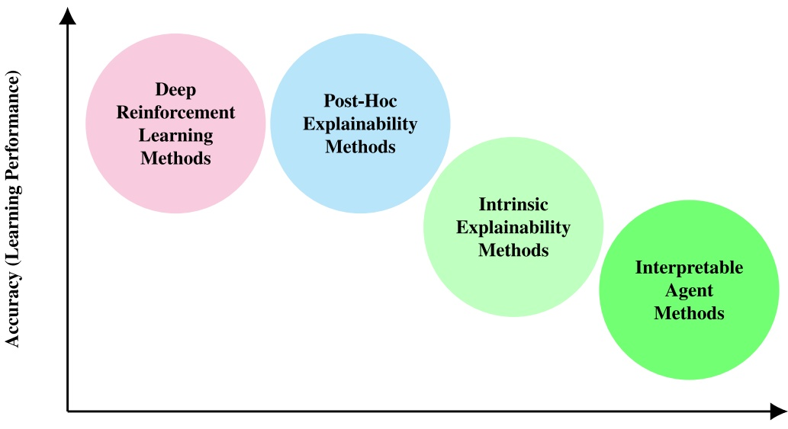

Fig. 1. Trade-off between accuracy and explainability in DRL-based control systems (qualitative comparison).

Comparative review of DRL-based microgrid studies.

| Ref. | Algorithm | Reward(s) | Resilience Domain | Comparison with Classical | Explainability | Real-world Case | Battery degradation in reward |
| --- | --- | --- | --- | --- | --- | --- | --- |
| This Paper | PPO | Priority-weighted resilience + expected | EMS (HILP-aware) | √(MPC) | √(SHAP, LIME) | √(India; Cyclone Laila) | √(non-linear BLC-DoD) |
| [23] | Improved | battery life Sequential service | Load |  |  | - (IEEE test |  |
| [28] | TD3 A3C | restoration; comfort DR profit; FDI detection | restoration Cyber resilience/ |  |  | feeders) - (IEEE test feeders) |  |
| [31] | LSTM-SAC | Trading profit/loss; power balance;fault | EMS Energy trading /resilience |  |  | - (IEEE test |  |
| [16] | MASAC | duration Profit; energy efficiency | Trading/ coordination |  |  | feeders) – (public real data; synthesised |  |
| [7] | PPO, DDPG | Operating cost; loss/over-gen | - (EMS) | ✓(MPC, RBC) | √(permutation importance) | microgrid case) – (simulated) |  |
| [11] | PPO, SAC (DeepTwin) | penalties Revenue/cost | - (EMS) | - (baseline |  | √(Finland |  |
| [24] | DQN | Load restoration; post-event reliability Operating cost + | MG formation /restoration | scheduler) √(MILP) |  | datasets) - (IEEE feeders) |  |
| [14] | PPO (distributed) | constraint penalties; flat per-kWh battery wear | - (EMS) | ✓(MILP, PSO, DRL baselines) |  | √(island MG, China) | √(flat per-kWh proxy) |
| [5] | DDQL (planning) | Total cost; resilience; outages | Expansion planning |  |  | √(Atlantic City data) | √(cycle &amp; calendar ageing) |
| [18] | MADRL | Cost + voltage deviation | - (EMS); (measurement anomalies) |  |  | - (test systems) |  |
| [19] | MADRL | Cost + voltage deviation | -(EMS); (heat- electricity) |  |  | – (test systems) |  |
| [34] | DoubleDQN (planning) | Planning cost + reliability constraints | Expansion planning (reliability) | -(greedy baseline) |  | √(Westhampton, NY) |  |

Case-study microgrid configuration and aggregated tier-load model used in the EMS.

<table><tr><td colspan="3">Microgrid components (HOMER Pro sizing)</td></tr><tr><td>PV capacity</td><td>140</td><td>kW</td></tr><tr><td>Wind capacity</td><td>80</td><td>kW</td></tr><tr><td>Li-ion storage (energy)</td><td>780</td><td>kWh</td></tr><tr><td>Bidirectional converter</td><td>52</td><td>kW</td></tr><tr><td>Control time step</td><td>1</td><td>h</td></tr><tr><td colspan="3">Aggregated load tiers (three loads in EMS)</td></tr><tr><td>Tier (priority)</td><td>Daily energy (kWh/day)</td><td>Peak power (kW)</td></tr><tr><td>Essential  $( L _ { 1 } )$ </td><td>222</td><td>51.2</td></tr><tr><td>Business  $( L _ { 2 } )$ </td><td>212</td><td>39.4</td></tr><tr><td>Agricultural  $( L _ { 3 } )$ </td><td>58.6</td><td>68.6</td></tr></table>

The EMS represents demand using three aggregated priority tiers rather than individual loads. In this paper, $L _ { 3 }$ (agricultural) is not modelled as deferrable; it is treated as an aggregated hourly demand profile with the lowest priority weighting. The underlying tier-load profiles and their construction are reported in [4].

PPO controller and reward design, and introduces the SHAP/LIME framework used for global and local explainability. Section 3 presents the numerical analysis, beginning with the Perlin-noise uncertainty model and MPC benchmark, then reporting deterministic and stochastic evaluations of the DRL policy, a 4000-run Monte Carlo robustness study, and a comprehensive interpretability assessment. Finally, Section 4 summarises the main findings, discusses practical implications for resilient microgrid operation, and highlights directions for future research.

## 2. Modelling of microgrid, control strategy, and explainability techniques

This section begins by introducing the microgrid’s location, components, and key characteristics. In addition, the load profile and renewable generation patterns, particularly during the HILP event are examined. Subsequently, the DRL algorithm employed in the study is described, including the formulation of actions, states, and the reward structure within the environment. Finally, the explainability methods used to interpret the DRL decisions are presented, encompassing both local and global perspectives.

### 2.1. Microgrid description

This study adopts the sizing and MPC methodology presented in our previous work [4] as a solid baseline. This provides a foundation for comparing the performance of the proposed XDRL framework.

Case-study microgrid and load model. The case study represents a rural coastal village near Ongole/Kothapatnam in Andhra Pradesh, India $( 1 5 ^ { \circ } 2 8 ^ { \prime } 3 6 . 3 ^ { \prime \prime } \mathrm { N } ,   8 0 ^ { \circ } 1 1 ^ { \prime } 5 4 . 0 ^ { \prime \prime } \mathrm { E } )$ , which has experienced repeated cyclone events. HOMER Pro is used to obtain a techno-economic configuration comprising 140 kW PV, 80 kW wind, a 52 kW bidirectional converter, and 780 kWh Li-ion storage. For operational control (both MPC and DRL), the demand is represented by three aggregated load tiers $( L _ { 1 }$ to $L _ { 3 } ) _ { 3 }$ , i.e., three loads in total in the EMS model, reflecting priority levels for resilient operation: essential, business, and agricultural demand. Essential loads have a daily energy demand of 222 kWh with a peak of 51.2 kW; business loads have a daily demand of 212 kWh with a peak of 39.4 kW; and agricultural demand has a daily consumption of 58.6 kWh. Table 2 summarises the component ratings and the tier-level load statistics used in the EMS [4].

Experiments in the present paper are simulation-based. Additionally, ten days of meteorological data from Cyclone Laila (May 2010) were used to derive the PV and WT generation profiles. Irradiance, wind speed, and ambient conditions were converted offline into hourly

PV and WT power using physics-informed models in Python (pvlib and windpowerlib); the resulting renewable power time series were then provided to the DRL environment as exogenous inputs for energy management [38,39]. Accordingly, the learning problem targets operational decisions (storage dispatch and load allocation) conditioned on renewable availability, rather than learning PV/WT conversion dynamics. Further dataset-generation and parameterisation details are reported in [4].

For DRL, the tier-level load signals $( L _ { 1 } \mathbin { \mathrm {  ~ t o ~ } } L _ { 3 } )$ are normalised using fixed scaling applied consistently across training and evaluation, improving learning stability and supporting generalisation across operating conditions.

The right blue box in Fig. 2 illustrates the configuration of the microgrid as implemented in the Gymnasium framework. This forms the environment used in the DRL-based control framework, which is discussed in detail in the following section.

Data augmentation. To improve generalisation in DRL training, a systematic data augmentation procedure was implemented to simulate variability and uncertainty in renewable energy generation and load demand. Starting from three base datasets, representing extreme (EX), nominal variant 1 (NO\_V1), and nominal variant 2 (NO\_V2) conditions, multiple perturbed versions were generated by applying random scaling to solar, wind, and load signals.

The procedure introduces controlled stochasticity using uniformly sampled scaling factors within a predefined range of ±5% to ±50%. For each perturbation factor, ten variants were produced. The perturbation is only applied to non-zero values above a small threshold $( \varepsilon = 0 . 0 1 )$ to avoid modifying idle periods, and both instantaneous power caps and daily energy limits were enforced to ensure physical feasibility. After perturbation, the total renewable generation (Sum\_Extreme) is recalculated as the sum of solar and wind profiles. Each 24-hour block of load data is also rescaled if the daily energy sum exceeds the corresponding limit. Finally, each perturbed dataset is labelled with metadata indicating its scenario type, perturbation factor, variant index, and correlation coefficients with the original dataset. These variations provide the DRL agent with a wide range of realistic operating conditions, enhancing robustness under uncertainty, particularly during HILP events such as Cyclone Laila. The augmentation procedure is formally described in Algorithm 1.

### 2.2. Proximal Policy Optimisation

The Proximal Policy Optimisation (PPO) is a policy gradient method that optimises a policy $\pi _ { \theta } ( \mathbf { a } | \mathbf { s } )$ parametrised by 𝜃. The action taken by the agent (𝐚) and its current state (𝐬) are denoted accordingly. Alongside the policy, a value function $V _ { \phi } ( s ) ,$ , parametrised by $\phi ,$ is learned to estimate expected returns when following 𝜋:

$$
V ^ { \pi } ( s ) = \mathbb { E } _ { \pi } \left[ \sum _ { k = 0 } ^ { \infty } \gamma ^ { k } r _ { t + k } \left| \mathbf { s } _ { t } = \mathbf { s } \right] \right. .\tag{1}
$$

Here, $V _ { \phi } ( \mathbf { s } )$ denotes the learned approximation of the true value function $V ^ { \pi } ( \mathbf { s } ) ,$ , which represents the expected return when following policy 𝜋 from state 𝐬. The rewards $r _ { t }$ provide an immediate signal that quantifies the desirability of action $\mathbf { a } _ { t }$ in state $\mathbf { s } _ { t }$ at time 𝑡. Value refers to the expected return (state-value), i.e., the discounted cumulative reward from a given state, which is approximated by the learned value function $V _ { \phi } ( \mathbf { s } )$ . The agent aims at selecting actions to maximise long-term performance rather than optimising only the immediate reward. Typically, the objective is to maximise the expected return. PPO achieves this with a clipped surrogate objective that constrains policy updates for stability [40].

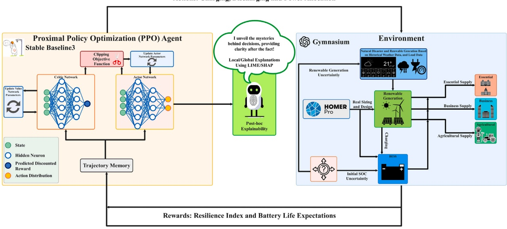

Fig. 2. XDRL framework overview: the PPO agent (left) interacts with the simulation environment (right), which includes the microgrid schematic and returns state and reward, while SHAP/LIME provide post-hoc explanations of the learned decisions.

Algorithm 1 Perturb_and_Augment
Require: Three input datasets $D = \{ \mathrm{EX}, \mathrm{NO}\_\mathrm{V1}, \mathrm{NO}\_\mathrm{V2} \}$ , perturbation
factors $F = \{ 0 . 0 5 , 0 . 1 0 , \ldots , 0 . 5 0 \} ,$ , number of variants $n _ { \flat }$ per-row zero
threshold 𝜀, instantaneous limits $L _ { j } ^ { \mathrm { m a x } }$ , daily energy limits $E _ { j } ^ { \mathrm { m a x } }$ for
loads $j \in \{ 1 , 2 , 3 \}$
Ensure: Augmented table containing every perturbed variant, meta-
data columns, and correlations.
1: for all $D \in D$ do ⊳ loop over scenarios
2: for all $f \in F$ do ⊳ loop over factor levels
3: for $v \gets 1$ to 𝑛 do ⊳ generate 𝑛 variants
4: $P \gets \mathsf { c o p y } ( D )$
5: for all row 𝑖 in 𝑃 do
6: for all signal $c \in$ {Solar, Wind, Load1, Load2, Load3}
do
7: if $P _ { i } [ c ] &gt; \varepsilon$ then
8: draw $r \sim \mathcal { V } ( 1 - f ,   1 + f )$
9: $P _ { i } [ c ] \gets P _ { i } [ c ] \cdot r$
10: if 𝑐 is a load then
11: cap $P _ { i } [ c ] \leftarrow \operatorname* { m i n } ( P _ { i } [ c ] , L _ { c } ^ { \operatorname* { m a x } } )$
12: recompute 𝑃 [Sum_Extreme] ← 𝑃 [Solar] + 𝑃 [Wind]
13: for all day 𝑑 in 𝑃 do ⊳ 24 consecutive rows
14: for all load $j \in \{ 1 , 2 , 3 \}$ do
15: $S \leftarrow \sum _ { t \in d } \widetilde { P _ { t } [ \mathrm { L o a d } _ { j } ] }$
16: i $\textbf { f } S &gt; \widetilde { E _ { j } ^ { \mathrm { m a x } } }$ then
17: scale factor $\alpha \gets E _ { i } ^ { \mathrm { m a x } } / S$
18: 𝑃𝑡[Load𝑗 ] ← 𝛼 ⋅ 𝑃𝑡[Load𝑗 ] ∀𝑡 ∈ 𝑑
19: compute Pearson correlations 𝜌 ← cor r(𝑃 , 𝐷) on all five
signals
20: append 𝑃 (with columns Scenario, Perturb_Fac-
$\mathtt { t o r } = f ,   \rho ,$ etc.) to master list
21: concatenate all variants into one DataFrame
22: stable-sort by desired scenario order $\tt E X \prec N O _ { - } V 1 \prec N O _ { - } V 2$
23: write result to Augmented_data_all_factors.csv

### 2.3. Deep reinforcement learning environment

For microgrids in hazard-prone regions, control policies must remain effective across the entire operating domain, from usual variability to HILP extremes such as cyclones. Accordingly, the training workflow (Sections 2.4 and 3.1) exposes the agent to a spectrum of realistic disturbances, so that robustness is learned in domain. A custom DRL environment was implemented using the Gymnasium framework, allowing simulation of microgrid operations. Episodes consist of running the environment over 9-day episodes (216 hourly steps) during which the agent must manage battery storage and load prioritisation to optimise performance.

State space. Each observation includes six normalised features over a rolling history window of five time steps (history length = 5), resulting in a 30-dimensional input vector. The features at each time step include the battery SOC, load demands for three categories $( L _ { 1 } ,   L _ { 2 } ,$ and $L _ { 3 } ) ,$ total renewable generation $( P _ { \mathrm { r e n } } ) _ { \mathrm { i } }$ and the net energy balance defined as $P _ { \mathrm { n e t } } = P _ { \mathrm { r e n } } - L _ { 1 } - L _ { 2 } - L _ { 3 } .$ All values are normalised based on their respective historical maxima. This improves learning stability by keeping state magnitudes within comparable ranges, reduces sensitivity to absolute demand levels, and supports generalisation across scenarios with different load scales and alternative microgrid configurations. The stacked observation vector is defined as:

$$
\mathbf{o}_{t}=\left[\operatorname{SOC}, \frac{L_{1}}{L_{1}^{\max }}, \frac{L_{2}}{L_{2}^{\max }}, \frac{L_{3}}{L_{3}^{\max }}, \frac{P_{\text {ren }}}{P_{\text {ren }}^{\max }}, \frac{P_{\text {net }}}{P_{\text {net }}^{\max }}\right]_{t-4}^{t}\tag{2}
$$

Action space. The agent produces a continuous 5-dimensional action vector defined as:

$$
\mathbf { a } _ { t } = \left[ a _ { \mathrm { c h } } , a _ { \mathrm { d i s } } , w _ { 1 } , w _ { 2 } , w _ { 3 } \right] .\tag{3}
$$

Here, $a _ { \mathrm { c h } }$ and $a _ { \mathrm { d i s } } \; \in \; [ - 1 , 1 ]$ represent the charging and discharging commands, respectively, scaled to the rated power of the converter $(P_{\mathrm{conymax}} = 52\ \mathrm{kW})$ . Only one of these actions is active at a given time. This mutual exclusivity is enforced in the environment implementation at each step, ensuring that the controller cannot charge and discharge simultaneously. The remaining components $w _ { 1 } ,   w _ { 2 } ,$ and $w _ { 3 }   \in   [ - 1 ,$ 1] are raw values that are passed through a softmax function to allocate the available power fractionally to the three load categories $L _ { 1 } , L _ { 2 } ,$ and $L _ { 3 }$

Battery operational model. The environment updates the battery state of charge using a standard energy-balance model with charge/discharge efficiencies and SOC bounds:

$$
\mathrm{SOC}_{t+1}=\mathrm{clip}\left(\mathrm{SOC}_{t}+\frac{\eta_{\mathrm{ch}} P_{\mathrm{ch}, t}-P_{\mathrm{dis}, t} / \eta_{\mathrm{dis}}}{E_{\max }} \Delta t, \mathrm{SOC}_{\min }, \mathrm{SOC}_{\max }\right),\tag{4}
$$

where $E _ { \mathrm { m a x } }$ is the useable battery energy capacity, 𝛥𝑡 is the hourly step, and 𝑃 h,𝑡 and $P _ { \mathrm { c h } , t }$ $P _ { \mathrm { d i s } , t }$ are limited by the converter rating and available charge/discharge energy.

Load dispatch and constraints. The available power at each time step is calculated as:

$$
P _ { s } = P _ { \mathrm { r e n } } + P _ { \mathrm { d i s } } - P _ { \mathrm { c h } } .\tag{5}
$$

Here, $P _ { \mathrm { c h } }$ and $P _ { \mathrm { d i s } }$ are control decisions produced by the agent at each time step, and are applied subject to SOC limits and the converter power constraint (thereby reflecting the remaining battery energy and maximum charge/discharge rate). Full load satisfaction is not enforced under islanded/HILP operation; instead, controlled load shedding is permitted and penalised through the priority-weighted resilience term in the reward. This power is then distributed among the loads using normalised weights derived from the softmax of the action vector:

$$
f _ { i } = \frac { e ^ { w _ { i } } } { \sum _ { j = 1 } ^ { 3 } e ^ { w _ { j } } } , \quad \mathrm { f o r } \; i = 1 , 2 , 3 .\tag{6}
$$

The allocated power to each load is given by:

$$
P _ { s , i } = f _ { i } \cdot P _ { s } .\tag{7}
$$

Power imbalances are determined as $P _ { s , i } - L _ { i } ,$ and any shortages are penalised based on the predefined priority of each load.

Reward function. The reward at each time step contributes to improving the system’s resilience. Resilience reward $( R _ { \mathrm { R I } } )$ is calculated based on weighted unmet demand:

$$
R _ { \mathrm { R I } } = 1 - \lambda \cdot \frac { 7 \cdot S _ { 1 } + 2 \cdot S _ { 2 } + 1 \cdot S _ { 3 } } { 7 \cdot L _ { 1 } + 2 \cdot L _ { 2 } + 1 \cdot L _ { 3 } } ,\tag{8}
$$

where $S _ { i }$ and $L _ { i }$ represent unmet and total load for class 𝑖. A stagedependent penalty factor (𝜆) is applied to amplify the impact of shortfalls during curriculum training. The time-step reward is defined as the normalised resilience reward:

$$
r _ { t } = \frac { w _ { \mathrm { R I } }   R _ { \mathrm { R I } } } { T } ,\tag{9}
$$

where $T$ denotes the episode length (horizon). This normalisation ensures that the cumulative return remains comparable across episodes of different durations.

This reward is adopted from the general class of weighted, priorityaware operational resilience indices that aggregate load supply (or unmet demand) across tiers and normalise by total demand; here it is tailored to the present case study with three load tiers [20]. The weights (7, 2, 1) encode the relative criticality of the three tiers (higher weight implies higher penalty for curtailment) and are chosen to match the prioritisation adopted in the MPC benchmark for a consistent comparison [4]. The normalisation by $( 7 L _ { 1 } + 2 L _ { 2 } + L _ { 3 } )$ yields a dimensionless measure of supply adequacy that is comparable across scenarios with different load magnitudes.

Battery reward $( R _ { \mathrm { b a t } } )$ reflects the impact of charging and discharging actions on battery health. This is evaluated using the DoD, which significantly influences the number of achievable battery life cycles. Fig. 3 illustrates the nonlinear relationship between DoD and $\mathbf { B } \mathbf { L } \mathbf { C } ,$ where deeper discharge results in substantially fewer life cycles. To prevent excessive degradation, the agent is encouraged to operate the battery within moderate DoD levels.

The cycle-life degradation is quantified using Fig. 3. For an hourly control interval, the instantaneous DoD (in percent) is computed from the discharge power as

$$
\mathrm { D o D } _ { t } \; = \; \frac { P _ { \mathrm { d i s } , t } } { E _ { \mathrm { m a x } } } \times 1 0 0 .\tag{10}
$$

To aggregate variable-depth cycling over an episode, an equivalent-life measure is computed via accumulated cycle damage:

$$
C _ { \mathrm { h a r m } } = \left( \sum _ { t :   \mathrm { D O D } _ { t } > 0 } \frac { 1 } { \mathrm { B L C } ( \mathrm { D O D } _ { t } ) } \right) ^ { - 1 } ,\tag{11}
$$

where $C _ { \mathrm { h a r m } }$ is the harmonic aggregator produces equivalent full cycles. With an episode spanning $\begin{array} { r } { \infty } \\ { n _ { \mathrm { d a y s } } = \frac { \tilde { T } } { 2 4 } } \end{array}$ days, the expected battery lifetime in years is then

$$
\mathrm{EY} = \frac{C_{\mathrm{harm}} n_{\mathrm{days}}}{365}.\tag{12}
$$

Finally, the lifetime reward is defined as a normalised score

$$
R _ { \mathrm { b a t } } \; = \; \frac { \mathrm { E Y } } { \mathrm { E Y } _ { \mathrm { r e f } } } ,\tag{13}
$$

where $\mathrm { E Y _ { r e f } }$ denotes the reference lifetime used for scaling (set to 16 in this work).

Episode termination and final reward. At the end of each episode, two primary performance metrics are reported: the episode resilience index $( \mathrm { R I } _ { \mathrm { e p i s o d e } } )$ and the expected battery lifetime (EY). In addition, the episode return $\textstyle \sum _ { t = 1 } ^ { T } r _ { t }$ is logged as a diagnostic during training to monitor learning progress and reward scaling. To promote long-term performance, an additional bonus reward is provided at the final step, defined as:

$$
R _ { \mathrm { f i n a l } } = { \frac { w _ { \mathrm { b a t } } \cdot R _ { \mathrm { b a t } } + w _ { \mathrm { R I } } \cdot \mathrm { R I } _ { \mathrm { e p i s o d e } } } { 2 } } .\tag{14}
$$

This formulation ensures that short-term operational decisions remain aligned with long-term system objectives.

### 2.4. Curriculum-based training stages

To train the DRL agent for robust microgrid control under uncertainty, the PPO algorithm is employed using the Stable-Baselines3 framework. The training followed a four-stage curriculum learning strategy, with increasing perturbation complexity and evolving reward structure. Each stage exposes the agent to scenarios of varying uncertainty levels, allowing gradual adaptation and improved policy generalisation.

The training is divided into four stages:

1. Stage 1: Includes only low-perturbation scenarios $( f   =   0 . 0 5$ or $f = 0 . 1 0 )$ , with a shortfall penalty factor of $\lambda = 1$ . The reward function focuses exclusively on resilience $( w _ { \mathrm { R I } } = 1 . 0 ,   w _ { \mathrm { b a t } } = 0 . 0 ) .$

2. Stage 2: Uses medium-perturbation scenarios $\left( f \quad = \quad 0 . 2 0 \right.$ or $f = 0.30)$ and $\lambda ~ = ~ 2 .$ The reward function remains purely resiliency-based.

3. Stage 3: Trains the agent on high-perturbation scenarios $( f   =$ 0.40 or $f   =   0 . 5 0 )$ , applying a stronger penalty factor of $\lambda = 4 .$ Reward remains focused on resiliency.

4. Stage 4: Combines all previous scenarios and adjusts the reward structure to consider both resilience and battery health equally $( w _ { \mathrm { R I } } = 0 . 5 ,   w _ { \mathrm { b a t } } = 0 . 5 )$ , with the shortfall penalty factor reset to $\lambda = 1$

This progression is designed to first teach the agent to maintain load reliability and resilience under gradually increasing uncertainty and then optimise for long-term battery health once resilience is stabilised. A visual summary of the curriculum stages is provided in Fig. 4.

The PPO algorithm was configured using a Multi-Layer Perceptron (MLP) architecture, consisting of two hidden layers with 256 units each for both the policy and value networks. Key hyperparameters included a batch size of $2 1 6 \times 1 2   =   2 5 9 2 ,$ , a rollout length of $n _ { \mathrm { s t e p s } } \; = \; 2 1 6 0$ , a discount factor of $\gamma = 0 . 9 9 5 ,$ , and a learning rate of $3 \times 1 \dot { 0 } ^ { - 4 }$ . Training proceeded in sequential stages, with the checkpoint from each stage loaded into the next to enable continued learning. The final policy obtained from Stage 4 represents a model optimised for both system resilience and battery longevity. Additionally, Fig. 5 plots the episode reward across the four curriculum stages. Stages 1 to 3 use almost the same normalised reward, whereas Stage 4 employs a different reward definition for the final phase; as a result, its curve is on a different scale and is not directly comparable to Stages 1 to 3.

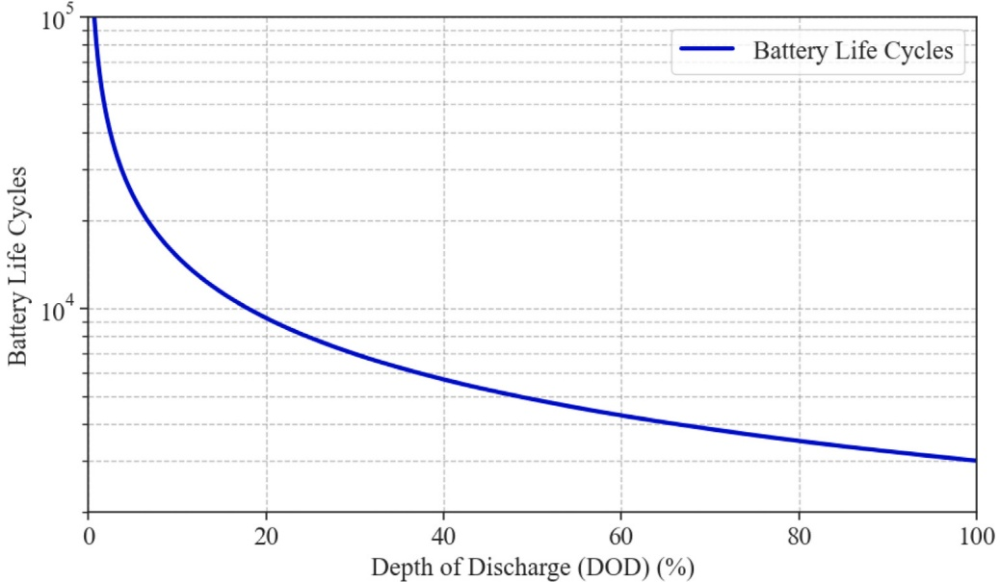

Fig. 3. Battery life cycles as a function of Depth of Discharge (DoD) [4].

Table 3

Trend summary of curriculum learning performance across stages.

| Stage | Noise Level | Performance | Stability | Reward level | Mean ± Std |
| --- | --- | --- | --- | --- | --- |
| Stage 1 | Low (f5/f10) | Rapid learning, more noise | Moderate variance | ∼0.959 | 0.952 ± 0.0374 |
| Stage 2 | Medium(f20/f30) | Stable learning | Lower variance | ∼0.965 | 0.965 ± 0.0127 |
| Stage 3 | High (f40/f50) | Best and most stable | Very low variance | ∼0.965 | 0.965 ± 0.0081 |
| Stage 4 | All scenarios | Optimised for | Low variance | ∼0.975 | 0.974 ± 0.0146 |
| (not normalised) |  | resilience and battery life |  |  |  |

Table 3 presents a comparative trend analysis of the DRL training performance among all stages. Each stage introduces increasing levels of noise through data perturbation, progressing from low to high. In Stage 1, although rapid learning is observed, the training exhibits higher variability due to the lower penalty factor and more frequent reward fluctuations. Stage 2 demonstrates improved learning stability and reduced variance, reflecting the agent’s better adaptation to moderate noise levels. Stage 3 achieves the most stable and consistent performance, with the lowest reward variance and the highest average reward, indicating effective generalisation to challenging scenarios. Stage 4 introduces a combined reward structure by assigning equal weight to resilience and battery life. As a result, the reward scale in this stage differs from the earlier stages and cannot be directly normalised or compared. Nevertheless, it reflects the agent’s ability to balance trade-offs between resilience and battery health, offering a more realistic and holistic objective in microgrid operation. The Mean ± Std column quantitatively supports these trends, showing decreasing standard deviation and increasing average reward as the curriculum progresses.

### 2.5. Computational-cost protocol

All timing tests were carried out offline. The mixed-integer controller was executed on an Intel Core i7-6700HQ laptop (4 physical cores, 3.5 GHz max turbo).<strong>1</strong> The deep-learning controller was executed on an Intel Core i7-14700 desktop (16 physical cores, 5.3 GHz max turbo). Only the core decision routine was timed: the Gurobi solve() call for MPC and the neural-network forward pass model.pre-dict() for DRL. Each episode contains $N _ { s } = 2 1 6$ hourly steps, which represents nine days of rolling operation.

Step-level statistics. Let $t _ { r , i }$ be the wall-clock time of step 𝑖 in run 𝑟 and let 𝑅 be the number of runs. The mean and sample standard deviation per step are

$$
\begin{aligned} &t_{1} = \frac{1}{RN_{s}} \sum_{r=1}^{R} \sum_{i=1}^{N_{s}} t_{r,i}, \qquad \sigma_{1} = \sqrt{\frac{1}{RN_{s}-1} \sum_{r=1}^{R} \sum_{i=1}^{N_{s}} (t_{r,i} - t_{1})^{2}}.\\ \end{aligned}\tag{15}
$$

Episode-level statistics. The episode metrics are obtained by summing the same step times:

$$
T _ { 1 } = \frac { 1 } { R } \sum _ { r = 1 } ^ { R } \sum _ { i = 1 } ^ { N _ { s } } t _ { r , i } , \qquad \varSigma _ { 1 } = \sqrt { \frac { 1 } { R - 1 } \sum _ { r = 1 } ^ { R } \Bigl ( \sum _ { i = 1 } ^ { N _ { s } } t _ { r , i } - T _ { 1 } \Bigr ) ^ { 2 } } .\tag{16}
$$

Lifetime Floating Point Operations (FLOPs). The fifteen-year compute budget is

$$
C = T _ { 1 }   \left( \frac { 2 4 \times 3 6 5 } { N _ { s } } \right) \times 1 5 \times F _ { \mathrm { p e a k } } ,\tag{17}
$$

<small>1 The academic licence of Gurobi used in this study is node-locked and may be installed on only one machine, therefore a dedicated laptop was chosen as the solver host.</small>

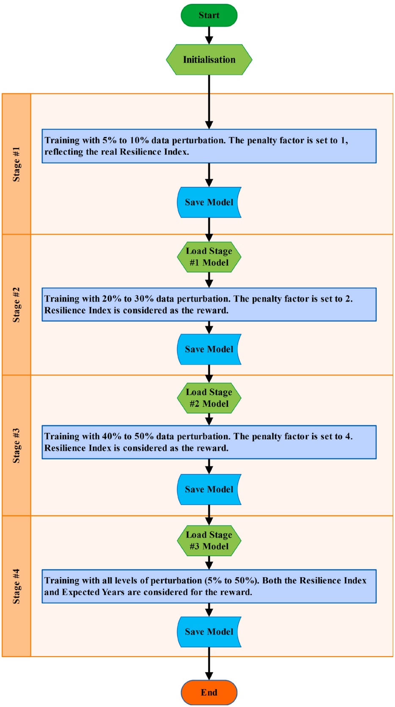

Fig. 4. Curriculum learning structure used in DRL training.

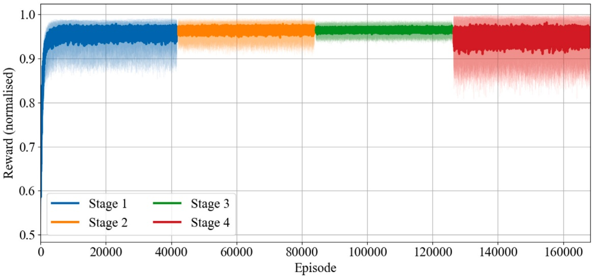

Fig. 5. Episode-reward trajectories across the four curriculum stages. Each curve reports the stage-wise normalised reward under progressively higher scenario uncertainty; shaded bands show variability across training runs, and the solid line marks the corresponding mean reward.

where $F _ { \mathrm { p e a k } }$ is the theoretical FP32 peak of the host CPU. This peak is estimated at run time by $F _ { \mathrm { p e a k } } = f _ { \mathrm { m a x } }   n _ { \mathrm { c o r e s } } \times 1 6   \mathrm { F L O P }   \mathrm { s } ^ { - 1 }$ , with $f _ { \mathrm { m a x } }$ the maximum reported frequency. All tests were repeated $R = 5$ times; Table 5 shows the means and standard deviations.

### 2.6. Explainability model

Explainability is implemented at both global and local levels using SHAP and LIME, respectively. The aim is to increase transparency in both the policy (actor network) and value estimation (critic network).

Global explanations. SHAP is a model-agnostic interpretability technique based on cooperative game theory. In the context of PPO with actor–critic architecture, SHAP helps explain both the critic’s value predictions and the actor’s action preferences [41]. Each feature’s importance $\phi _ { i }$ is computed based on how its inclusion changes the model 𝑓 output across all feature subsets:

$$
\phi _ { i } = \sum _ { S \subseteq F \setminus \{ i \} } w _ { S } \left[ f _ { S \cup \{ i \} } ( x _ { S \cup \{ i \} } ) - f _ { S } ( x _ { S } ) \right] .\tag{18}
$$

where $\begin{array} { r } { w _ { S } \; = \; \frac { | S | ! ( | F | - | S | - 1 ) ! } { | F | ! } } \end{array}$ is the weighted probability of a subset $S ,$ and the marginal contribution $\left[ f _ { S \cup \{ i \} } ( x _ { S \cup \{ i \} } ) - f _ { S } ( x _ { S } ) \right]$ estimates how much adding the feature 𝑖 improves the subset 𝑆 output. Practically, $f$ is either the actor’s prediction (e.g., action probabilities) or critic’s prediction (e.g., value estimate $V _ { \pi } ) .$

SHAP’s KernelExplainer is employed to approximate Shapley values by fitting a weighted linear regression model over locally perturbed samples. The method adheres to three key properties: local accuracy, missingness, and consistency. In this EMS setting, these properties support reliable interpretation of the learned dispatch policy. Local accuracy means that, for a given state 𝐬, the sum of the feature attributions plus a baseline equals the model output being explained (here, the critic estimate $V _ { \phi } ( \mathbf { s } )$ or an actor output). This ensures that the explanation faithfully reconstructs the local prediction. Missingness means that features that are absent (or set to the baseline) receive zero attribution. Consistency guarantees that when a feature’s influence increases in the model $( \mathbf { e . g . } ,$ , under higher uncertainty), its attribution does not decrease, supporting comparisons across scenarios. In the context of PPO, SHAP facilitates global interpretation by identifying the most influential features in both the agent’s value estimation and action selection across multiple states. The following steps summarise the procedure:

1. Sample 5000 state observations from the evaluation environment; each state is a 30-dimensional vector containing SOC, three loads, total renewable generation, and net energy over a 5-step history window.

2. Wrap actor and critic networks to produce outputs given a batch of observations:

• critic\_value\_model: predicts scalar value estimates.

• actor\_policy\_model: predicts 5-dimensional action values (raw logits).

3. Use SHAP’s Explainer as a model-agnostic wrapper to compute SHAP values for both the critic (producing a 30-feature explainability) and each of the five actor outputs.

4. Visualise results via:

• SHAP summary plots (top 10 features).

• Actor-specific summary plots (top 10 features per action).

Fig. 6 summarises the global explainability process used in this study. In particular, Kernel SHAP (implemented via KernelExplainer) generates feature-perturbed samples around evaluation states, queries the actor/critic, and solves a weighted linear surrogate to approximate Shapley attributions for both the critic estimate $V _ { \phi } ( \mathbf { s } )$ and each actor output dimension.

These analyses reveal which historical features, $\mathbf { e . g . } ,$ recent $\scriptstyle { \mathrm { S O C } } ,$ renewable surplus, or specific load demands, most influence value estimation and action selection, providing insight into how the policy prioritises charging, discharging, and load dispatch.

Local explanations. LIME explains individual predictions by fitting a sparse, interpretable surrogate model around the prediction of interest. In PPO, LIME is applied to both the actor and the critic.

Given a state $\mathbf { s } _ { z }$ LIME generates perturbed versions $z ,$ queries the model $f ( z ) ,$ and fits a local linear model $g ( z ^ { \prime } ) = w \cdot z ^ { \prime }$ using proximitybased weights [42]:

$$
\omega _ { x } ( z ) = \exp \left( - \frac { D ( \mathbf { s } , z ) ^ { 2 } } { \sigma ^ { 2 } } \right) .\tag{19}
$$

This ensures the surrogate model focuses on the behaviour of $f$ near 𝐬. In the PPO framework, state inputs such as SOC, load demands, and net energy are standardised. LIME is applied separately to each actor output and to the critic’s value estimate, with 𝑓 representing either the actor outputs or the critic value estimate $V _ { \phi } ( \mathbf { s } ) .$ The resulting feature attributions provide fine-grained, time-specific insights into the most influential inputs driving the agent’s decisions and value estimations.

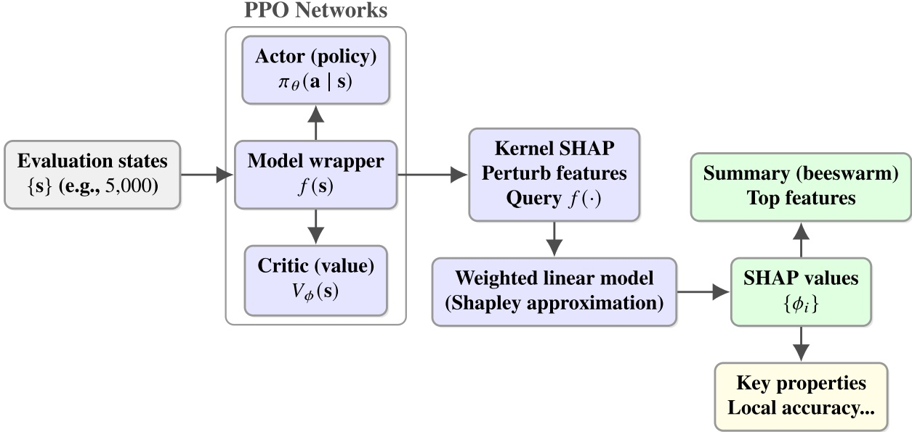

Fig. 6. Global explainability workflow using SHAP for the PPO actor and critic.

LIME offers local, interpretable insights into individual decisions made by the DRL agent:

1. Run one full 216-step evaluation episode with a fixed initial SOC to generate a trajectory of states.

2. Standardise the 30-dimensional states using StandardScaler.

3. Select a single timestep (e.g., step 94) for explanation.

4. Build LIME regression explainers for each actor output and the critic value:

• For each action (e.g., charging power, supply weights), generate 10,000 local samples and fit a linear surrogate model.

5. Present the following for each model:

• The actual state (de-normalised) used for explanation.

• Bars showing top contributing features and their relative weights.

Fig. 7 illustrates the local explainability workflow. Starting from a selected decision point $\mathbf { s } ^ { \star }$ , LIME generates a neighbourhood of perturbed samples, queries the black-box actor/critic, and fits a sparse local surrogate 𝑔 using the proximity kernel in Eq. (19) to obtain per-feature contributions for that specific decision.

LIME explanations allow inspection of how small perturbations to individual features, like SOC or recent load, affect the chosen action or estimated value at a specific time step, providing insight into the agent’s local decision logic.

By combining SHAP for global understanding with LIME for local interpretability, the framework ensures the DRL agent operates with both robustness and explainability in microgrid management.

## 3. Simulation results and discussions

This section builds upon our previous work [4], where a deterministic optimisation framework based on MPC was used to manage battery scheduling in a microgrid. In that study, different weighting factors were assigned to objectives such as battery lifetime and resilience, and the best-performing configuration was identified through extensive parametric analysis.

3.1. Uncertainty modelling of renewable energy generation using Perlin noise

To evaluate the robustness of the scheduling strategy under realistic forecasting errors, input uncertainty is introduced using Perlin noise. Perlin noise, a form of coherent gradient noise, is particularly suited for temporal processes due to its smooth and spatially correlated fluctuations, unlike purely random noise models.

In this work, one-dimensional Perlin value noise is employed to introduce smooth, bounded fluctuations to the solar and wind generation profiles. These perturbations are applied multiplicatively to preserve the signal structure while simulating realistic variability. Fig. 8 contrasts a standard white-noise signal with a Perlin-noise signal: white noise changes abruptly because each value is drawn independently.

Perlin noise, by contrast, is temporally coherent and produces gradual ramps in PV/WT power that better reflect weather-driven forecast deviations. This difference is operationally important because battery dispatch and load-shedding depend on the persistence and ramping of shortfalls and surpluses, rather than isolated pointwise errors. Accordingly, Perlin-noise perturbations provide a more realistic robustness test for microgrid EMS policies.

The noise formulation is defined as follows:

$$
\mathbf { f a d e } ( t ) = 6 t ^ { 5 } - 1 5 t ^ { 4 } + 1 0 t ^ { 3 } ,\tag{20}
$$

where 𝑡 is the fractional distance between lattice points. This fade function ensures smooth transitions between noise values. For each signal, the perturbed time series ̃𝑥(𝑡) is computed as:

$$
\tilde { x } ( t ) = x ( t ) \cdot \operatorname* { m a x } \left( 0 , 1 + \alpha \cdot P ( t ) \right) ,\tag{21}
$$

where $x ( t )$ is the original input (solar or wind), $P ( t ) \in [ - 1 , 1 ]$ is the normalised Perlin noise, and 𝛼 is the noise scaling factor. The Sum\_Extreme feature is recomputed after perturbation. The implementation steps are detailed in Algorithm 2.

The resulting dataset with perturbed solar and wind generation is then passed into the evaluation environment to assess the performance of the control strategy under uncertain conditions.

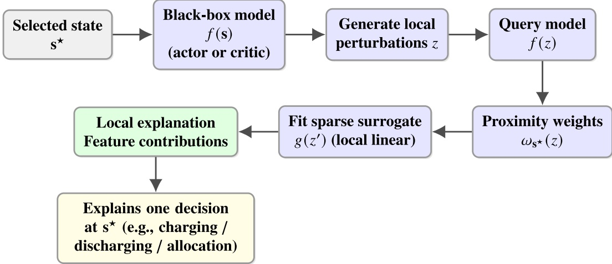

Fig. 7. Local explainability workflow using LIME for a selected PPO decision point.

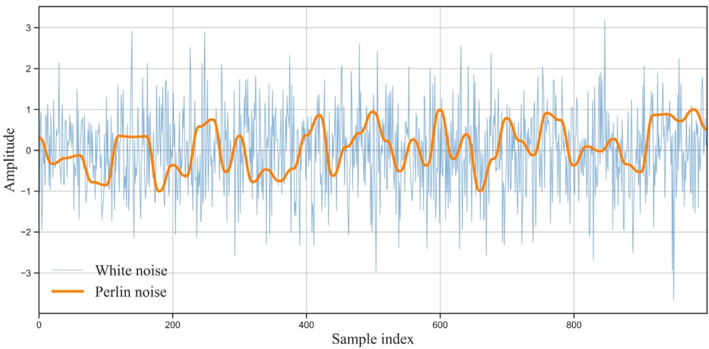

Fig. 8. Illustrative time–series comparison of a white-noise signal and Perlin-noise signal.

Algorithm 2 Data Perturbation with Perlin Noise for Uncertainty
Modelling
Require: Original dataset df, scaling factors $\alpha _ { s } , \alpha _ { w } ,$ and noise
frequencies scale
1: Generate 1D Perlin noise vectors noise_solar, noise_wind of
same length as dataset
2: for each time index 𝑖 do
3: solar_nom ← df["Solar(140Kwh)_Extreme"][𝑖]
4: wind_nom ← df["Wind(80kwh)_Extreme"][𝑖]
5: factor_s ← max(0, 1 + 𝛼 ⋅ noise_solar[𝑖])
6: factor_w ← max(0, 1 + 𝛼 ⋅ noise_wind[𝑖])
7: df["Solar(140Kwh)_Extreme"][𝑖] ← solar_nom
factor_s
8: df["Wind(80kwh)_Extreme"][𝑖] ← wind_nom ⋅ fac-
tor_w
9: Recompute Sum_Extreme as sum of perturbed solar and wind
10: return Modified df

This perturbation process is repeated using different seeds and scaling levels for ensemble simulation and robustness evaluation. A 10-day evaluation window from the Laila cyclone event is used for all comparisons. Each test is run twice: once with the original data and once with the Perlin-perturbed version, and the results (e.g., SOC profile, load coverage, renewable utilisation) are stored and plotted for side-by-side analysis.

3.2. Benchmark: model predictive control performance under deterministic and uncertain scenarios

To establish a baseline, the microgrid operation is first simulated using the MPC strategy under two conditions:

• Deterministic case: Inputs (solar, wind, and loads) are known in advance for the entire scheduling horizon.

• Uncertain case: Input data are perturbed using the Perlin noise model to simulate realistic forecasting errors.

In both scenarios, the MPC optimisation uses the previously identified optimal weighting factors to balance resilience and battery longevity. Additionally, a special case focused solely on prioritising resilience is simulated (i.e., assigning a zero weight to battery lifetime). Fig. 9 presents a comparative analysis of the MPC results under different weightings in the objective function, evaluated in both deterministic and uncertain scenarios.

Table 4 summarises the quantitative results for both MPC and DRL under deterministic and uncertain scenarios, enabling a consistent, side-by-side comparison. For MPC, the best-weighted cases maintain near-unity resilience (RI ≈ 0.999) in both settings, whereas the resiliency-only case reduces EY markedly, indicating more intensive cycling. Across both controllers, the imbalance values show that most curtailment is absorbed by lower-priority tiers, consistent with the priority-weighted formulation used in the MPC benchmark and the DRL reward. Overall, Table 4 establishes the benchmark context and motivates assessing whether DRL can preserve near-benchmark RI while improving EY under uncertainty.

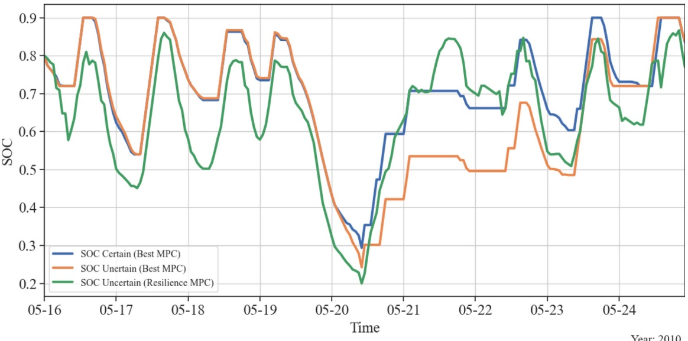

Fig. 9. Battery state of charge under MPC with different objective weightings.

Table 4

Comparison of DRL and MPC results under certain and uncertain scenarios.

| Method | Scenario | RI | EY | 𝑆1 (kWh) | 𝑆2 (kWh) | 𝑆3 (kWh) | Total 𝑆 (kWh) |
| --- | --- | --- | --- | --- | --- | --- | --- |
| DRL | Stage 3 | 0.9986 | 13.49 | 2.84 | 0.00 | 2.20 | 5.04 |
| DRL | Stage 4 (Certain) | 0.9961 | 15.90 | 0.00 | 31.58 | 1.20 | 32.78 |
| DRL | Stage 4 (Uncertain) | 0.9956 | 15.88 | 0.00 | 35.96 | 1.59 | 37.55 |
| MPC | Certain (Best) | 0.9991 | 14.44 | 0.00 | 0.00 | 14.00 | 14.00 |
| MPC | Uncertain (Best) | 0.9989 | 15.06 | 0.00 | 0.81 | 15.37 | 16.18 |
| MPC | Resilience Only | 0.9947 | 10.78 | 1.44 | 23.36 | 30.66 | 55.46 |

### 3.3. Deep reinforcement learning -based policy evaluation

For a fair comparison across all evaluation cases, including both MPC and DRL policies under deterministic and uncertain conditions, the initial SOC is set to 0.8 in all simulations. This ensures that performance differences arise from the control strategies rather than from different initial storage levels. The same evaluation framework then tests robustness under temporally correlated renewable deviations introduced via Perlin noise, which more closely resemble practical forecast errors than time-uncorrelated perturbations.

To evaluate the performance of the trained DRL agent, its operation is assessed under both deterministic and uncertain scenarios. The total renewable generation, including perturbed solar and wind data using Perlin noise, is depicted in Fig. 10(a), highlighting the impact of uncertainty on energy availability. Correspondingly, the battery’s SOC evolution for each scenario is presented in Fig. 10(b), showcasing how the agent responds to fluctuations in supply.

To complement the renewable-side trajectories already reported in Figs. 10(a) and 14(b), Fig. 11 summarises the corresponding dispatch behaviour on the storage and demand sides for the same evaluation window. Fig. 11a shows that the controller charges the battery during periods of net surplus and discharges during deficits, maintaining SOC within the operational bounds while avoiding persistent deep discharge. The use of $P _ { \mathrm { c h } }$ (positive) and $- P _ { \mathrm { d i s } }$ (negative) clarifies the alternating operating modes and highlights the temporal alignment between battery actions and SOC evolution.

Fig. 11b visualises how available supply is allocated across the three demand tiers. The essential tier $( L _ { 1 } )$ remains prioritised, whereas mid-/lower-priority tiers $( L _ { 2 } – L _ { 3 } )$ absorb most of the shortfall when supply is insufficient, consistent with the priority-weighted resilience formulation used in the reward.

Fig. 11c reports the resulting curtailment by tier. Curtailment events are concentrated in short intervals (spikes) where renewable availability and/or stored energy are insufficient, and they predominantly occur in $L _ { 2 } { - } L _ { 3 }$ rather than $L _ { 1 } ,$ which confirms that the learned policy implements the intended prioritisation structure in operation. This dispatchlevel view also provides a behavioural explanation for the modest load-tier imbalance patterns reported in the quantitative comparison: the policy trades limited curtailment in mid-/lower-priority demand against smoother battery operation to preserve expected battery life.

Fig. 12 further illustrates the difference in SOC trajectories between Stage 3 and Stage 4 of the curriculum learning. While Stage 3 focuses solely on maximising resilience, it leads to more aggressive charge and discharge patterns. In contrast, Stage 4 introduces battery life considerations into the reward function, resulting in a more moderated SOC profile with smoother transitions. This reflects the agent’s learned trade-off between maintaining resilience and preserving battery health, indicating more sustainable usage behaviour in Stage 4. This behavioural shift is consistent with the quantitative change from Stage 3 (resilience-only) to Stage 4 reported in Table 4.

Fig. 13 presents a comparative analysis of the battery’s SOC dynamics and their temporal derivatives under MPC and DRL policies. As shown in Fig. 13(a), both controllers are initialised with the same SOC of 0.8 to ensure a fair comparison. The trajectories reveal that DRL exhibits smoother charging and discharging transitions over time, whereas MPC tends to perform more aggressive and binary shifts between charging and discharging, which is especially evident during solar peaks and load dips. The first derivative of SOC, illustrated in Fig. 13(b), captures the charging/discharging rates. Quantitatively, the DRL policy yields an average||𝑑𝑆𝑂𝐶∕𝑑𝑡||of $0 . 0 1 5 5   \mathrm { ~ h ^ { - 1 } ~ }$ (Root Mean Square $( \mathrm { R M S } ) = 0 . 0 2 2 5 ~ \mathrm { h } ^ { - 1 } ) ,$ compared to 0.0177 $\mathbf { h } ^ { - 1 }$ (RMS = $0 . 0 2 7 7 ~ \mathrm { h ^ { - 1 } ) }$ under MPC, a reduction of about 12% in mean rate and

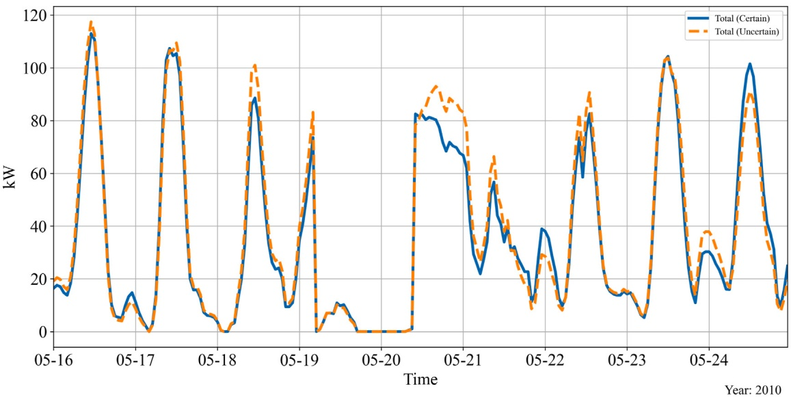

(a)

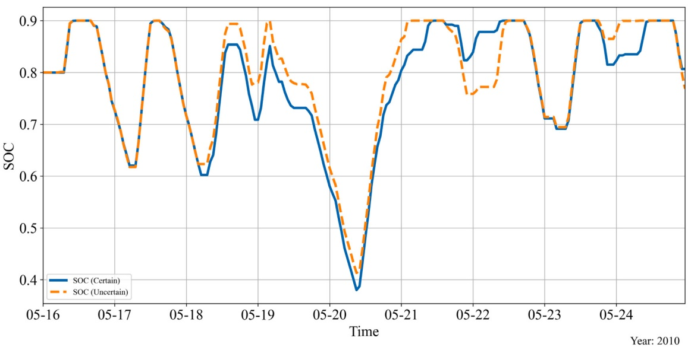

(b)

Fig. 10. Perlin noise effects on (a) renewable generation and (b) battery SOC.

19% in RMS rate, showing more moderate and sustained adjustments. In contrast, MPC displays numerous abrupt and maximal changes in $\scriptstyle { \mathrm { S O C } } ,$ reflecting its responsiveness to short-term optimisation objectives rather than long-term battery wear. Moreover, the second derivative in Fig. 13(c) quantifies the fluctuation in SOC change rates, i.e., how sharply the battery alternates between charging and discharging modes. Here again, DRL maintains a more stable profile with an average $\left| d ^ { 2 } S O C / d t ^ { 2 } \right|$ of 0.0087 $\mathrm{h}^{-2} \left( \mathrm{RMS} = 0.0141 \mathrm{h}^{-2} \right)$ versus $0 . 0 1 1 8 ~ \mathrm { h } ^ { - 2 }$ $\mathrm{(RMS=0.0229~h^{-2})}$ for MPC—reductions of roughly 26% in mean and 38% in RMS, suggesting improved smoothness and predictability. MPC shows higher-frequency oscillations and sharper curvatures, which may lead to higher battery stress and degradation.

Overall, the visualisations affirm that DRL, despite yielding slightly lower resilience in some scenarios, provides superior battery-friendly operations, likely extending battery lifetime due to smoother control actions. These characteristics can be particularly advantageous in systems where battery longevity is as critical as energy delivery continuity.

3.4. Uncertainty quantification of DRL performance via Monte Carlo analysis

To evaluate the robustness and reliability of the proposed DRL policy under uncertain renewable generation, a Monte Carlo-based uncertainty quantification was performed. A total of 4000 stochastic scenarios were generated using Perlin noise to perturb the solar and wind generation profiles. This method maintains temporal coherence in the data while introducing controlled variability to simulate realworld fluctuations. Each scenario was evaluated using the trained DRL policy, and key performance metrics, RI, Expected Years (EY), average SOC, and average renewable generation, were recorded.

A critical advantage of DRL emerges in the Monte Carlo study: once training is complete, each control step reduces to a lightweight neural-network inference. Consequently, the entire set of 4000 nineday scenarios finished in roughly twenty minutes on a standard laptop. In contrast, the MPC formulation must solve a constrained optimisation at every step; one episode can take several minutes and under difficult forecasts or weightings can take several hours [4].

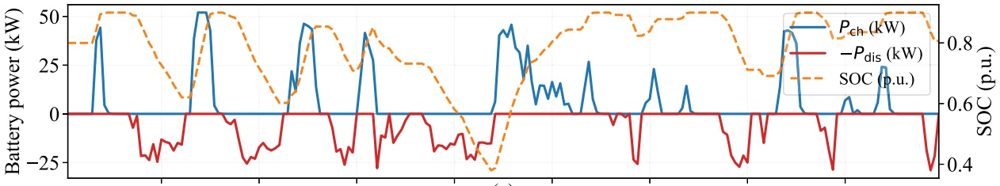

(a)

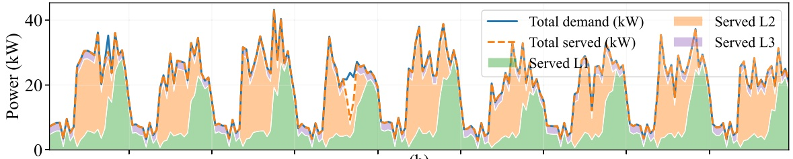

(b)

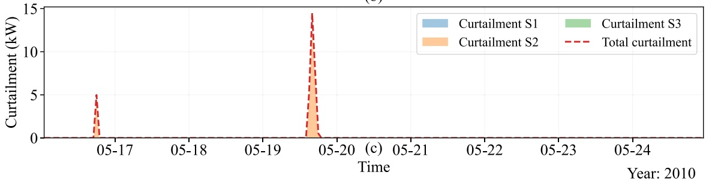

Fig. 11. Operational dispatch overview of the DRL policy over the evaluation window. (a) Battery charging power $P _ { \mathrm { c h } }$ (positive), discharging power $- P _ { \mathrm { d i s } }$ (negative), and SOC, (b) Total demand and total served power, with served power decomposed across prioritised tiers $( L _ { 1 } { - } L _ { 3 } ) ,$ and (c) Curtailment per tier and total curtailment.

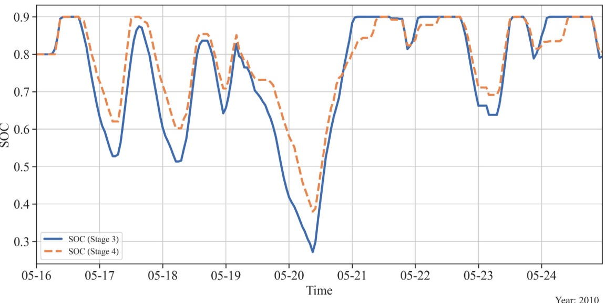

Fig. 12. SOC comparison: Stage 3 prioritises resilience; Stage 4 balances resilience and battery life.

Table 5 summarises the computational cost of the two controllers under the benchmarking protocol in Section 2.5, with all values normalised to peak-equivalent FP32 operations on the host CPU. On the reference laptop, MPC requires $7 . 5 9 4 \times 1 0 ^ { 1 1 }$ operations per step, while the DRL policy needs only 1.318×108, making inference around 5.8×103 times lighter. At the episode scale, MPC uses $1 . 6 5 0 \times 1 0 ^ { 1 4 }$ operations compared with DRL’s $2 . 8 4 6 \times 1 0 ^ { 1 0 }$ , a reduction of approximately three orders of magnitude. For the fifteen-year lifetime estimate, DRL accounts for both the one-off training cost and the cumulative inference cost, giving a total about 2.9 times lower than MPC.

Scaling MPC to thousands of trajectories would therefore require days of CPU time or a computing cluster, making routine robustness assessment impractical. This clear difference in computational scalability is the key practical advantage of DRL over MPC.

The statistical summary in Table 6 shows that the DRL policy consistently performs well across all 4000 uncertain scenarios. The average RI is approximately 0.9915 with a standard deviation of only

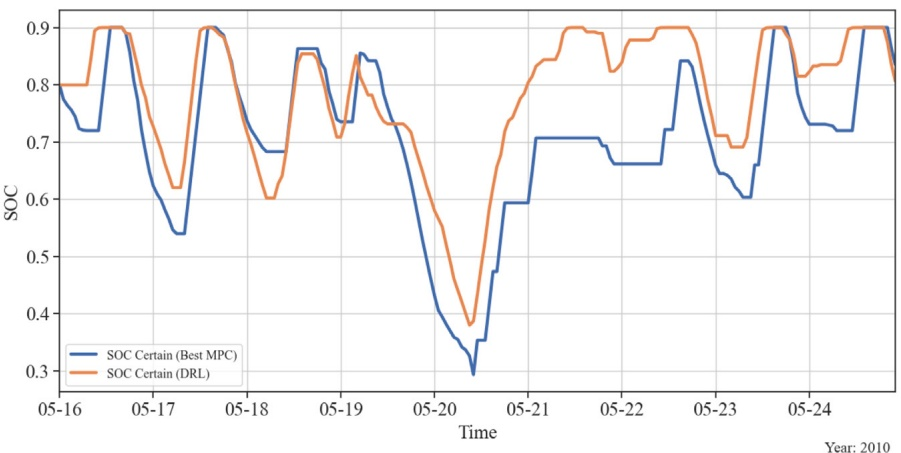

(a)

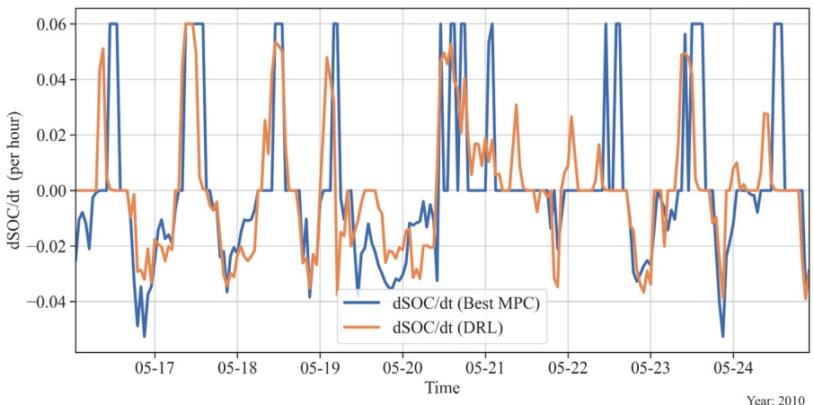

(b)

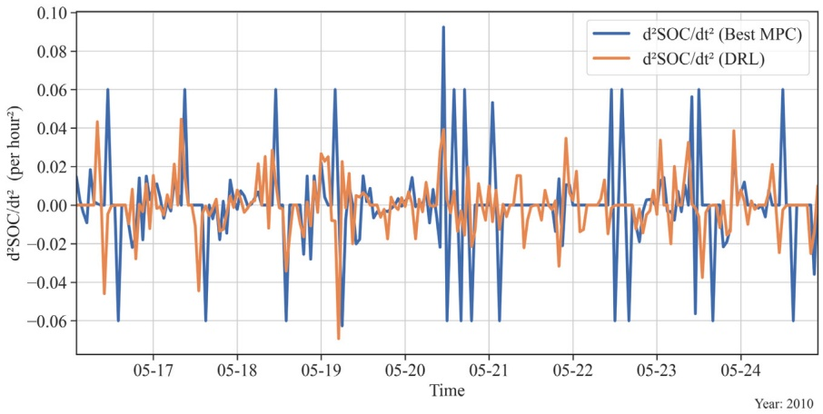

(c)

Fig. 13. Comparison of battery state of charge (SOC) under model predictive control (MPC) and deep reinforcement learning (DRL): (a) SOC, (b) first derivative, and (c) second derivative.

Table 5

Computation cost comparison of MPC and DRL controllers [FLOPs].

| Method | Training time | Inference per step | Inference per episode | Lifetime cost |
| --- | --- | --- | --- | --- |
| MPC |  | $( 7 . 5 9 4 ~ \pm ~ 2 1 . 8 4 0 ) \times 1 0 ^ { 1 1 }$ | $( 1 . 6 5 0 ~ \pm ~ 0 . 0 4 8 ) \times 1 0 ^ { 1 4 }$ | $( 1 . 0 0 4 \pm 0 . 0 3 0 ) \times 1 0 ^ { 1 7 }$ |
| DRL | $( 3 . 4 8 9 ~ \pm ~ 0 . 0 5 9 ) \times 1 0 ^ { 1 6 }$ | $( 1 . 3 1 8 ~ \pm ~ 0 . 0 4 7 ) \times 1 0 ^ { 8 }$ | $( 2 . 8 4 6 ~ \pm ~ 0 . 1 0 2 ) \times 1 0 ^ { 1 0 }$ | $( 3 . 4 9 1 ~ \pm ~ 0 . 0 5 9 ) \times 1 0 ^ { 1 6 }$ |

Table 6

Statistical summary of 4000 Monte Carlo runs for DRL policy performance.

| Metric | RI | EY | Average SOC | Average renewable generation |
| --- | --- | --- | --- | --- |
| Mean | 0.9915 | 15.95 | 0.7512 | 35.67 |
| Std. Dev. | 0.0047 | 0.5165 | 0.0233 | 1.32 |
| Min | 0.9729 | 14.37 | 0.6593 | 31.25 |
| 5% Percentile | 0.9836 | 15.14 | 0.7090 | 33.44 |
| 25% Percentile | 0.9884 | 15.59 | 0.7359 | 34.75 |
| Median (50%) | 0.9916 | 15.93 | 0.7540 | 35.66 |
| 75% Percentile | 0.9950 | 16.28 | 0.7688 | 36.60 |
| 95% Percentile | 0.9988 | 16.83 | 0.7849 | 37.81 |
| Max | 1.0000 | 17.81 | 0.8028 | 39.84 |

Table 7

Performance of the DRL policy in selected extreme scenarios.

| Case | Resilience index (RI) | Expected years (EY) |
| --- | --- | --- |
| Sum-Best (RI + EY) | 0.9995 | 17.40 |
| Best Expected Years | 0.9938 | 17.81 |
| Best Resilience Index | 1.0000 | 15.41 |
| Worst Expected Years | 0.9862 | 14.37 |
| Worst Resilience Index | 0.9729 | 15.43 |

0.0047, indicating a high level of system resilience and low variability across runs. The EY metric, reflecting battery longevity, has a mean of 15.95 years with modest variability, suggesting the policy avoids excessive cycling even under fluctuating generation.

Average SOC across the scenarios centres around 0.75, which indicates a balanced use of battery storage without frequent deep discharges. Additionally, the average renewable generation falls around 35.67 kW, confirming that the policy adapts well to the given stochastic resource profiles. The interquartile range of all metrics remains tight, further highlighting the model’s robustness.

Table 7 summarises the DRL policy’s behaviour under selected extreme cases. The best combined case (‘‘Sum-Best’’) achieves both high resilience $( \mathrm{RI} = 0.9995 )$ and long battery life (EY = 17.40 years), indicating a well-balanced operational strategy. The scenario with the maximum battery lifespan reaches 17.81 years with slightly reduced resilience $( \mathrm{RI} = 0.9938 )$ , suggesting a conservative charging pattern. Conversely, the best resilience (RI = 1.0) is achieved at the cost of a shorter lifespan (EY = 15.41 years), likely due to more frequent charge– discharge cycles. Even in the worst-performing scenarios, the policy maintains RI above 0.97 and EY above 14.3 years, which highlights the robustness of the DRL agent under adverse and uncertain conditions.

Fig. 14 illustrates the impact of uncertainty on the system’s dynamics across 4000 Monte Carlo simulations. Fig. 14(a) shows the SOC of the battery, while Fig. 14(b) presents the total renewable generation. The black curve in both plots represents the deterministic base case, and the blue shaded region captures the 5th to 95th percentile range of the ensemble runs. The SOC trajectories in 14(a) reveal a consistent charging and discharging pattern aligned with renewable availability, with most scenarios remaining within a stable band, indicating robust control behaviour. In 14(b), the renewable generation exhibits significant variability due to the applied Perlin noise, especially during peak generation hours. Despite this variation, the DRL policy demonstrates effective adaptation, maintaining the SOC within desirable limits throughout the uncertain scenarios.

Fig. 15 visualises the marginal distributions of RI and EY over 4000 Monte Carlo realisations. RI is concentrated near its upper bound, indicating that the learned policy maintains high resilience for most uncertainty realisations, with only a small tail of degraded cases. EY exhibits a nearly symmetric bell-shaped distribution, suggesting consistent lifetime outcomes across scenarios. Numerical summaries (mean, percentiles, and extrema) are reported in Table 6.

Fig. 16 depicts the relationship between the RI and EY. Although a slight positive trend is visually observable, the overall scatter indicates a weak linear correlation, suggesting that improvements in one metric do not necessarily lead to proportional improvements in the other. This indicates that resilience and battery longevity are somewhat decoupled in performance, motivating a deeper exploration into the underlying influencing factors.

Fig. 17 presents the correlations between RI and internal variables. First, as shown in Fig. 17(a), higher average SOC correlates positively with higher RI, indicating that systems maintaining a consistently high charge state are more resilient. Fig. 17(b) reveals a negative trend between SOC standard deviation and RI. This implies that systems with more stable charge profiles (lower SOC variability) tend to be more resilient. In Fig. 17(c), average renewable generation also shows a weak but positive association with RI, suggesting that a higher availability of renewable energy slightly improves resilience. These trends reinforce the importance of stable and adequately charged battery states, as well as reliable renewable input, in enhancing system resilience.

Complementarily, Fig. 18 also includes two plots focusing on EY. Fig. 18(a) demonstrates a moderate positive trend between EY and average renewable generation, confirming that higher energy availability contributes to extended battery life. Interestingly, Fig. 18(b) shows a subtle positive trend, suggesting that a small degree of SOC fluctuation might actually promote longer expected battery life, potentially due to more active cycling that avoids over-discharging. However, this relationship is relatively weak, and further investigation would be needed to determine the operational implications.

### 3.5. Explainability analysis

To enhance the interpretability of the DRL agent’s decision-making process, explainability methods are employed using both global and local perspectives. This two-fold approach not only ensures transparency but also provides insights into whether the agent aligns with domain knowledge and expected control behaviours in microgrid management.

Explainability figure convention: SHAP summary (beeswarm) plots provide global attributions over a set of evaluation states, showing the distribution of SHAP values per feature. For the actor, SHAP explains the policy output for each action dimension (normalised charging/discharging commands and allocation logits); for the critic, SHAP explains the value estimate $V _ { \phi } ( s )$ . In contrast, LIME provides local explanations by fitting an interpretable surrogate model in a neighbourhood of selected representative states; here, LIME is reported for three operating regimes (charging, discharging, and idle) using one representative time step for each regime.

## Shapley Additive Explanations Results:

Fig. 19 illustrates the global feature importance using SHAP values from the critic network. The results highlight that the current and recent states of key variables, SOC, Load $2 ,$ and renewable generation, play a dominant role in shaping the agent’s decisions. Higher values of SOC at t, t-2, t-3 contribute positively, indicating that a well-maintained SOC in recent steps supports better long-term outcomes. In contrast, high SOC at t-4 shows a negative impact, possibly reflecting underutilisation over time. Business loads, the second-priority load, also ranks highly in both current and past values, suggesting the agent has learned to manage high-priority loads effectively and now focuses on optimising intermediate ones. Renewable energy inputs, particularly recent net energy and past generation, further support the agent’s reliance on short-term availability trends.

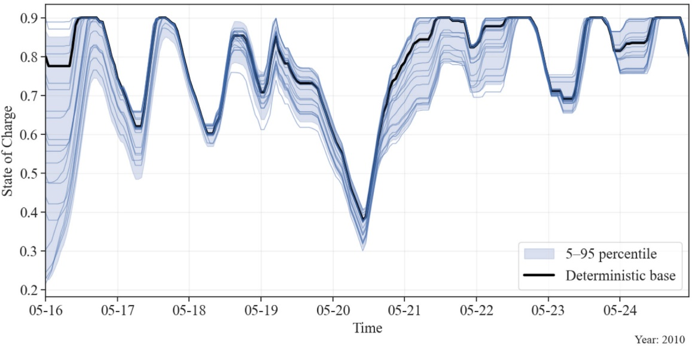

(a)

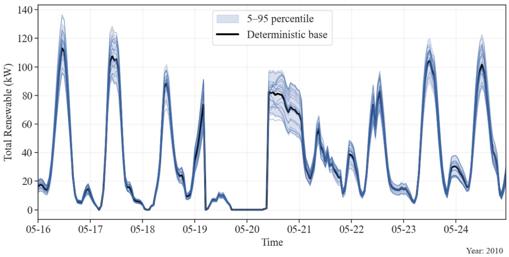

(b)

Fig. 14. (a) Battery state of charge and (b) Renewable generation under uncertainty.

To further interpret the learned policies, SHAP summary plots were generated for the actor network’s charging and discharging actions, as illustrated in Fig. 20. For discharging 20(b), the most influential features include both current and past values of the second-priority load (Load\_2) and net energy. High values of Load\_2 across multiple time steps (particularly $t ,   t - 1$ , and $t - 2 )$ generally contribute negatively to the decision to discharge, suggesting the agent strategically avoids excessive discharging during sustained medium-priority demand, possibly to reserve energy for higher-priority loads. For charging 20(a), the most dominant features are the current net energy and renewable generation, both showing strong positive influence, as expected. High net energy availability $( \mathbf { i . e . } ,$ surplus supply) promotes battery charging. Interestingly, the current values of first-priority (Load\_1) and secondpriority (Load\_2) loads also appear as influential, indicating the agent considers immediate demand alongside surplus conditions.

Overall, these findings highlight that the agent’s actions are highly sensitive to current system states, especially $\mathrm { N e t E n \_ ( t ) } ,$ SumRen\_(t), and load values, demonstrating context-aware behaviour that prioritises energy management based on both supply and tiered demand structure.

Fig. 21 illustrates the global SHAP explanation for the weighting of supply decisions across three load types: essential (a), business (b), and agricultural (c). Across all subplots, Load\_2 appears most frequently and prominently, indicating its critical influence in the agent’s allocation decisions. For essential loads (Ps1), both current and historical values of Load\_1 and Load\_2 significantly influence the output, highlighting the model’s ability to balance competing priorities when essential services are at stake. In the case of business loads (Ps2), the model places emphasis on recent NetEn and Load\_2 states, reinforcing the importance of immediate supply–demand balance. Interestingly, for agricultural loads (Ps3), the SHAP values are more passive, and Load\_3 does not prominently feature, suggesting limited influence, likely due to its lower priority during supply allocation. This aligns with the agent’s learned policy to prioritise critical and semi-critical loads under constrained resources. Across all three, the high impact of current state variables demonstrates the model’s strong reliance on present conditions when making real-time allocation decisions.

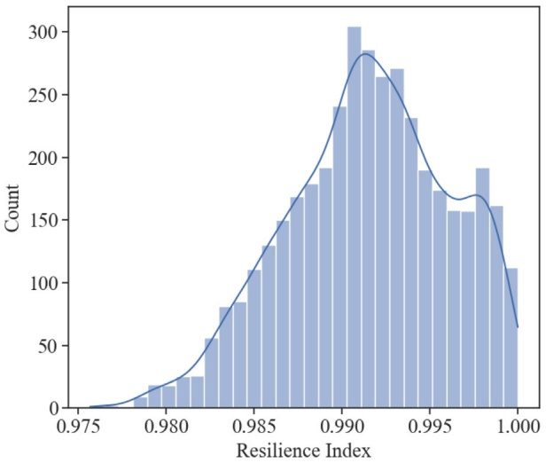

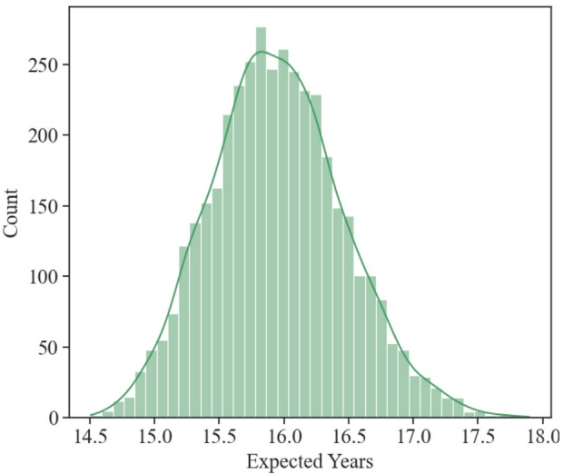

Fig. 15. Distribution of resilience index (RI) and expected years (EY) under uncertainty.

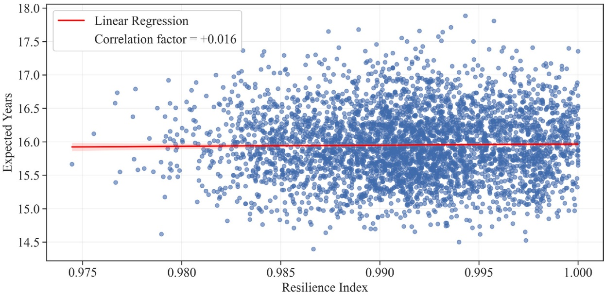

Fig. 16. Relationship between resilience index (RI) and expected years (EY).

## Local Interpretable Model-agnostic Explanations Results:

To provide interpretability for individual decisions of the DRL agent, the LIME algorithm was applied to three representative decision steps corresponding to charging, discharging, and idle actions. In this environment, the agent controls five actions: two continuous actions related to battery charging and discharging, and three scalar weights determining the distribution of power supply across essential, business, and agricultural loads. For the first instance (charging), the weighting actions are also analysed. Fig. 22 illustrates the trajectory of the SOC over time, where battery operation modes are distinguished using colour: blue for charging, red for discharging, and green for idle. Three specific time steps are highlighted in pink to indicate representative decisions corresponding to charging (hour 13), discharging (hour 94), and idle (hour 162). These instances are selected to provide insight into the local decision-making process of the DRL agent, allowing for a detailed examination of the features that contributed most significantly to each type of action.

Fig. 23 presents the LIME explanation for step 13, where the agent selects a positive charging power. The charging action (Fig. 23(a)) is positively influenced by high values of current and past net energy and renewable generation (NetEn\_(t), SumRen\_(t), NetEn\_(t-2)), suggesting that surplus renewable energy motivates battery charging. In contrast, past high loads—particularly from Load 2—discourage charging due to anticipated demand. The discharging action (Fig. 23(b)) is dominated by negative contributions, confirming that the agent finds no incentive to discharge at this step.

The weighting actions for power supply are depicted in Fig. 24. Among the three, the business load (Ps\_2) receives the highest weighting (0.682), followed by essential (0.209) and agricultural (0.109) loads. These choices correspond to the current system state: a relatively low demand from Load 1 (essential) and high anticipated demand from Load 2 (business) justify higher priority for business loads.

In step 94, shown in Fig. 25, the agent chooses to discharge the battery. As depicted in Fig. 25(b), this decision is driven primarily by high current demand from Load 1 and low net energy availability, which indicate a supply shortage. The agent reacts to this by discharging stored energy. The corresponding charging action (Fig. 25(a)) is discouraged, mainly due to low net energy and low renewable generation, along with past high load values. These features push the decision away from charging and reinforce the discharging behaviour.

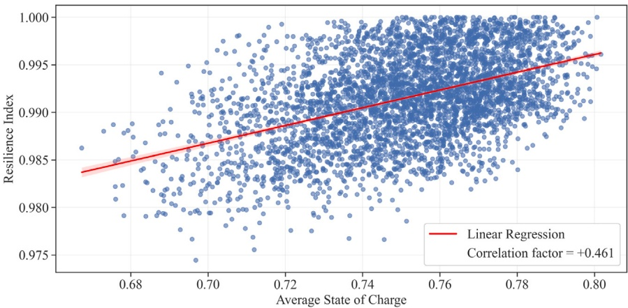

(a)

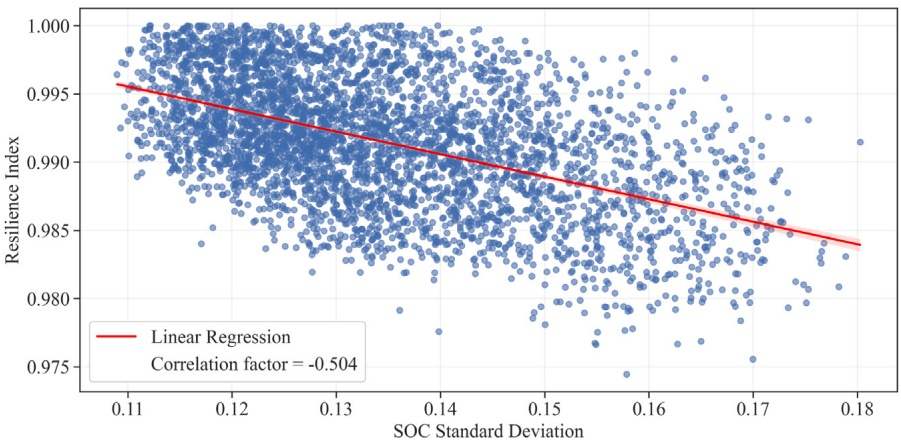

(b)

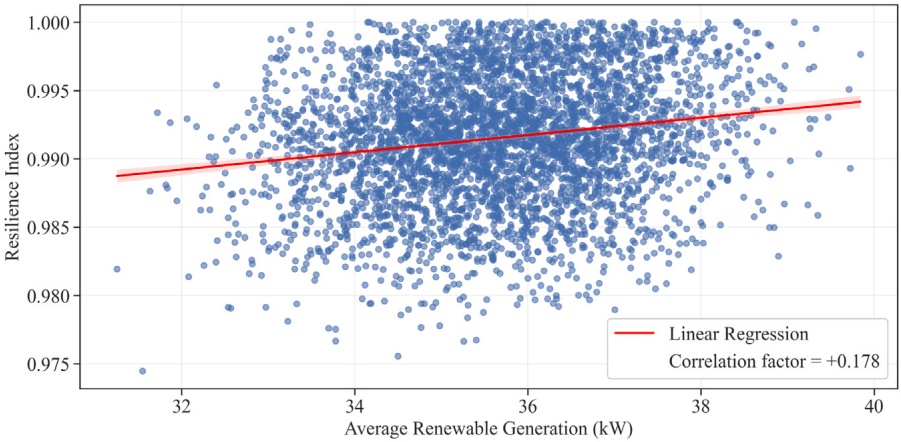

(c)

Fig. 17. Resilience index vs. (a) average SOC, (b) SOC Standard Deviation (STD), (c) average renewable generation.

Fig. 26 shows a decision instance where the agent refrains from both charging and discharging. As seen in Fig. 26(a), the charging action is negatively influenced by low net energy and renewable supply. Similarly, Fig. 26(b) reveals that discharging is also discouraged due to a combination of recent high loads and lack of surplus renewable energy. The simultaneous discouragement of both charging and discharging indicates an idle action, where the agent finds it optimal to maintain the current battery state without any operation.

The comparison in Table 8 reveals strong alignment between SHAP and LIME in identifying key features affecting charging and discharging decisions. Both methods consistently emphasise the importance of NetEn(t), SumRen(t), and Load\_2(t), underscoring the model’s responsiveness to real-time energy availability and load prioritisation. Historical patterns in NetEn and SOC contribute additional context for proactive decisions, while LIME uniquely highlights critical load triggers such as Load\_1(t) in local discharging events. This agreement between global and local explanations affirms the robustness and interpretability of the learned DRL policy.

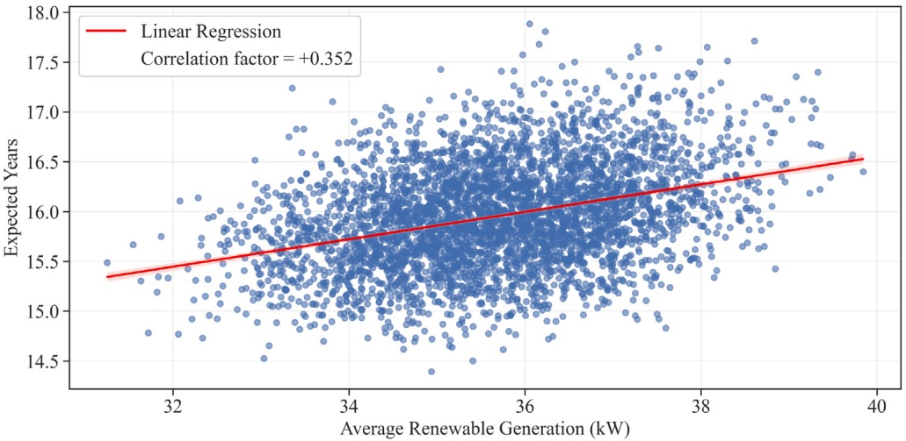

(a)

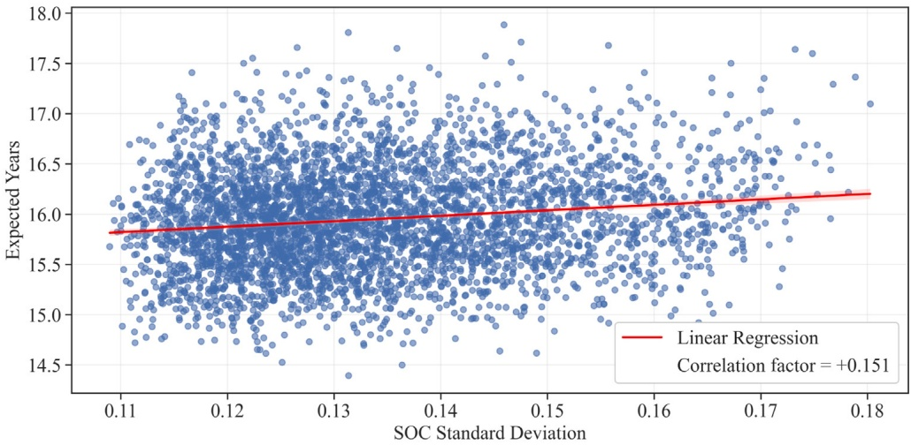

(b)

Fig. 18. Expected years vs. (a) average renewable generation, (b) SOC Standard Deviation.

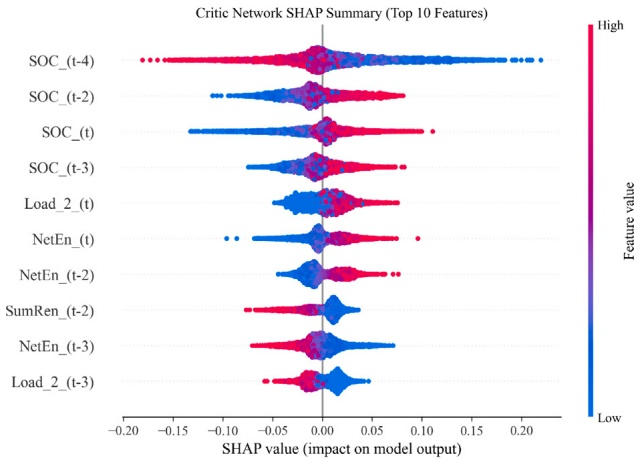

Fig. 19. Global SHAP summary (beeswarm) for the critic network value estimate $V _ { \phi } ( s ) .$

## 4. Conclusion

This paper developed an XDRL framework for microgrid energy management that jointly addresses operational resilience and battery longevity under uncertainty. The framework couples a PPO agent with a reward structure that penalises priority-weighted load shortfalls while moderating depth-of-discharge stress to extend battery life. Curriculum learning across escalating levels of stochastic perturbation improved policy robustness, and evaluation on a cyclone-prone coastal microgrid in India, enabled testing under realistic extreme-weather data.

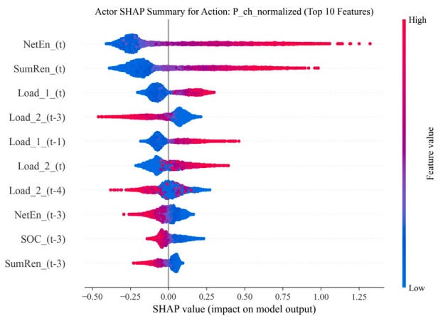

(a)

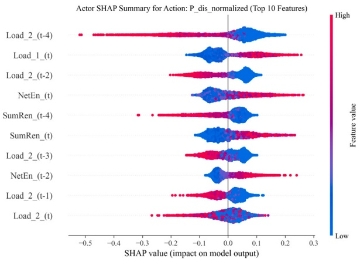

(b)

Fig. 20. Global SHAP summary (beeswarm) for actor battery dispatch outputs (policy outputs): (a) normalised charging command, (b) normalised discharging command.

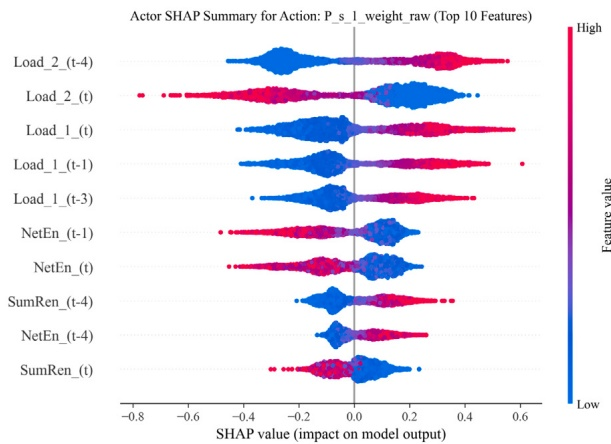

(a)

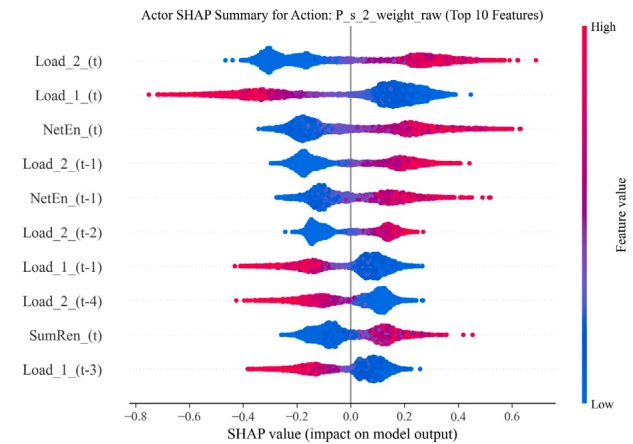

(b)

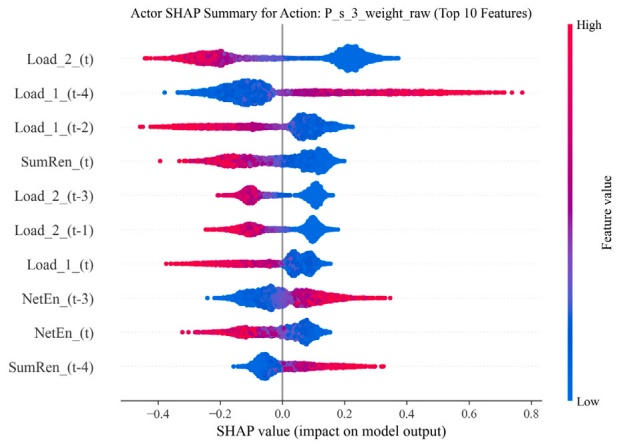

(c)

Fig. 21. Global SHAP summary (beeswarm) for actor load allocation outputs (policy logits before softmax): (a) essential load, (b) business load, (c) agricultural load.

Three outcome-level observations emerge. First, the PPO agent delivered resilience performance close to that of an MPC benchmark: under uncertain forecasts, the RI was 0.9956 compared with 0.9989 for MPC (a reduction of about 0.33%). Second, the learned policy extended expected battery life by roughly 5% (15.9 vs. 15.1 years) and produced smoother charge/discharge trajectories, which are expected to reduce degradation-related costs. Third, Monte Carlo analysis (using Perlin noise) confirmed robustness, with a median RI of 0.992 (5–95%: 0.984–0.999) and a median expected battery lifetime of approximately 16 years. Extreme cases help bound performance: favourable scenarios combined near-perfect resilience (RI ≈1.0) with expected lifetimes exceeding 17 years, whereas adverse scenarios still retained RI above

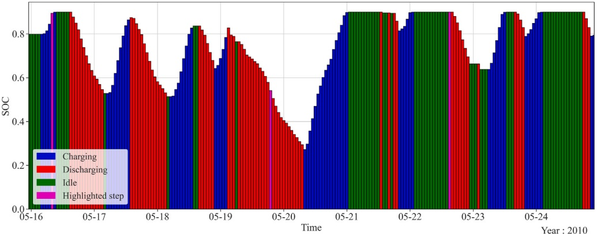

Fig. 22. Battery state of charge trajectory used to select representative decision points for LIME: charging (hour 13), discharging (hour 94), and idle (hour 162).

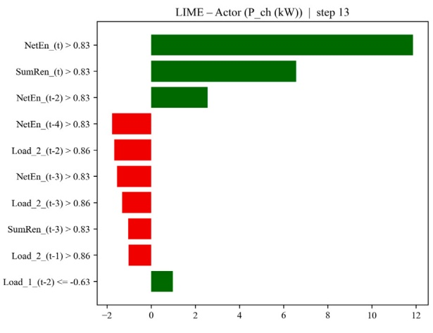

(a)

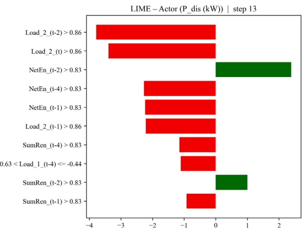

(b)

Fig. 23. Local LIME explanation for the actor battery dispatch outputs at the representative charging step (step 13): (a) charging action, (b) discharging action.

Table 8

Comparison of influential features identified by SHAP and LIME.

| Feature | SHAP (Global) | LIME (Local) | Role in Decision |
| --- | --- | --- | --- |
| NetEn(t) | Strong positive impact on charging | Negative contribution to charging (low net energy discouraged charging, while high value encouraged it) | Indicates energy surplus or deficit |
| SumRen(t)/(t-2) | Positively impacts charging decisions | Strong negative in low- renewable conditions during charging steps | Reflects available renewable energy |
| Load_2(t) | Influential especially for prioritisation | Appears in discharging and charging (low load encouraged discharge, high load discouraged it) | Determines priority- based supply need |
| SOC(t)/(t-3) | Relevant as current state memory | Rarely appears in LIME but occasionally in later time steps (e.g., SOC(t-4)) | Captures battery capacity context |
| Load_1(t) | Not among top SHAP, but appears in some LIME steps | Important in discharging decisions (e.g., step 94) | Triggers discharge when essential load is high |
| NetEn(t-2 to t-4) | Captured in both explanations | Appears in charging and discharging LIME explanations | Reflects trend in energy availability |

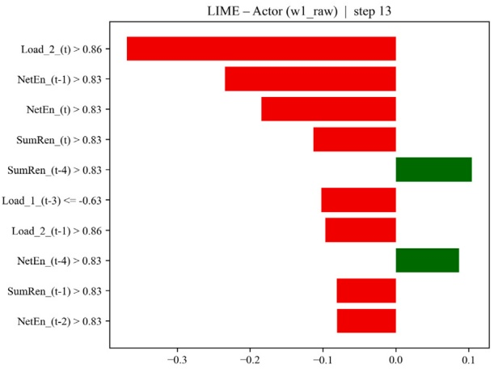

(a)

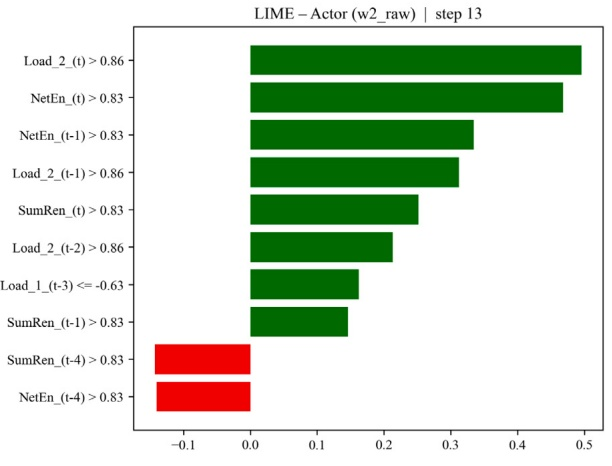

(b)

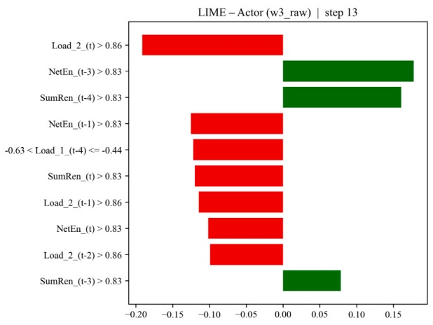

(c)

Fig. 24. Local LIME explanation for the actor load allocation outputs at the representative charging step (step 13): (a) essential load, (b) business load, (c) agricultural load.

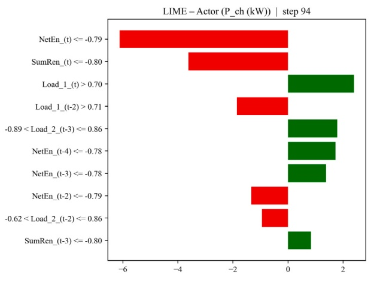

(a)

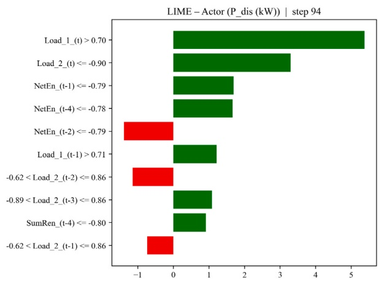

(b)

Fig. 25. Local LIME explanation for the actor battery dispatch outputs at the representative discharging step (step 94): (a) charging action, (b) discharging action.

0.97 and lifetimes above 14 years, indicating acceptable performance under degradation.

Dependency analyses across the Monte Carlo ensemble provided operational insight. Higher average state of charge was associated with improved resilience, while increased SOC variability tended to decrease it. Expected battery life rose with greater average renewable availability and showed only weak sensitivity to SOC variability, suggesting that moderate cycling within managed depth limits does not essentially shorten life. These trends can guide operators in setting reserve targets and dispatch priorities.

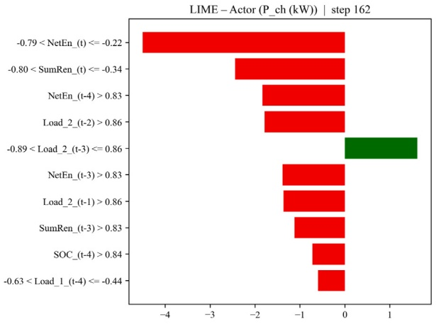

(a)

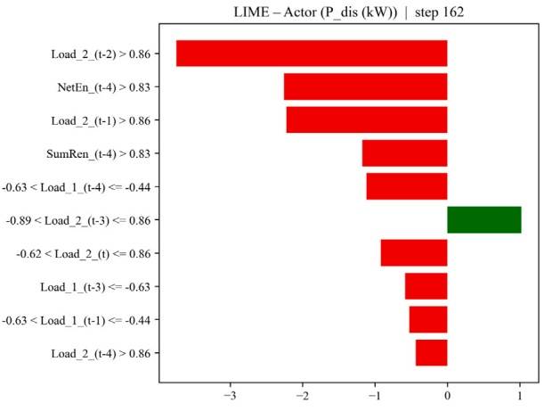

(b)

Fig. 26. Local LIME explanation for the actor battery dispatch outputs at the representative idle step (step 162): (a) charging action, (b) discharging action.

Results also clarify the relative strengths of DRL and MPC. When accurate 24-hour forecasts are available, MPC retains a slight resilience edge because it explicitly optimises over the full look-ahead horizon. The PPO agent, by contrast, operates with only short historical context (four past hourly observations) and no forecast, yet approaches MPC performance while offering near real-time inference once trained. This property is attractive for edge deployments and bandwidth-limited or forecast-poor settings.

Explainability is critical for industrial adoption. Post-hoc SHAP and LIME analyses exposed consistent decision drivers across global and local scales, linking control actions to net-energy balance, recent state of charge, and different load priorities. Such transparency supports operator trust, model validation, and regulatory acceptance in critical infrastructure.

Future work may extend the present framework in two complementary directions. First, incorporating multi-agent, multi-microgrid coordination would allow peer-to-peer energy trading and cooperative resilience services across interconnected microgrids. Second, intrinsic interpretability can be embedded directly into the learning architecture so that the controller’s logic is transparent without relying solely on post-hoc explanations.

## CRediT authorship contribution statement

Mohammad Hossein Nejati Amiri: Writing – review & editing, Writing – original draft, Visualization, Validation, Software, Resources, Methodology, Formal analysis, Data curation, Conceptualization. Florimond Guéniat: Writing – review & editing, Writing – original draft, Visualization, Supervision, Methodology, Investigation, Formal analysis, Conceptualization.

## Declaration of competing interest

The authors declare that they have no known competing financial interests or personal relationships that could have appeared to influence the work reported in this paper.

## Data availability

Data will be made available on request.

## References

[1] [Caputo C, Cardin M-A, Ge P, Teng F, Korre A, del Rio Chanona EA. Design and planning of flexible mobile micro-grids using deep reinforcement learning. Appl Energy 2023;335:120707.](http://refhub.elsevier.com/S0196-8904%2826%2900184-6/sb1)

[2] [Goswami AK, Deb S, Jha N, Das N, Das BK. Machine learning based wind energy forecasting for energy mangement in microgrid system. In: 2023 IEEE 3rd international conference on smart technologies for power, energy and control. IEEE; 2023, p. 1–6.](http://refhub.elsevier.com/S0196-8904%2826%2900184-6/sb2)

[3] [Jones G, Li X, Sun Y. Robust energy management policies for solar microgrids via reinforcement learning. Energies 2024;17(12):2821.](http://refhub.elsevier.com/S0196-8904%2826%2900184-6/sb3)

[4] [Amiri MHN, Dhundhara S, Annaz F, De Oliveira M, Guéniat F. Two-stage microgrid resilience and battery life-aware planning and operation for cyclone prone areas in India. Sustain Cities Soc 2025;124:106290.](http://refhub.elsevier.com/S0196-8904%2826%2900184-6/sb4)

[5] [Pang K, Zhou J, Tsianikas S, Ma Y. Deep reinforcement learning for resilient microgrid expansion planning with multiple energy resource. Qual Reliab Eng Int 2024;40(1):34–56.](http://refhub.elsevier.com/S0196-8904%2826%2900184-6/sb5)

[6] [Mohammadi P, Darshi R, Shamaghdari S, Siano P. Comparative analysis of control strategies for microgrid energy management with a focus on reinforcement learning. IEEE Access 2024.](http://refhub.elsevier.com/S0196-8904%2826%2900184-6/sb6)

[7] [Halev A, Liu Y, Liu X. Microgrid control under uncertainty. Eng Appl Artif Intell 2024;138:109360.](http://refhub.elsevier.com/S0196-8904%2826%2900184-6/sb7)

[8] [Tightiz L, Dang LM, Yoo J. Novel deep deterministic policy gradient technique for automated micro-grid energy management in rural and islanded areas. Alex Eng J 2023;82:145–53.](http://refhub.elsevier.com/S0196-8904%2826%2900184-6/sb8)

[9] [Zideh MJ, Chatterjee P, Srivastava AK. Physics-informed machine learning for data anomaly detection, classification, localization, and mitigation: A review, challenges, and path forward. IEEE Access 2023;12:4597–617.](http://refhub.elsevier.com/S0196-8904%2826%2900184-6/sb9)

[10] [Dinata NFP, Ramli MAM, Jambak MI, Sidik MAB, Alqahtani MM. Designing an optimal microgrid control system using deep reinforcement learning: A systematic review. Eng Sci Technol Int J 2024;51:101651.](http://refhub.elsevier.com/S0196-8904%2826%2900184-6/sb10)

[11] Özkan E, Kök İ, Özdemr S. DeepTwin: A deep reinforcement learning supported digital twin model for micro-grids. IEEE Access 2024;12:196432–41. [http://dx.doi.org/10.1109/ACCESS.2024.3521124](http://dx.doi.org/10.1109/ACCESS.2024.3521124).

[12] [Nakabi TA, Toivanen P. Deep reinforcement learning for energy management in a microgrid with flexible demand. Sustain Energy, Grids Netw 2021;25:100413.](http://refhub.elsevier.com/S0196-8904%2826%2900184-6/sb12)

[13] [Yang X, Fan L, Li X, Meng L. Day-ahead and real-time market bidding and scheduling strategy for wind power participation based on shared energy storage. Electr Power Syst Res 2023;214:108903.](http://refhub.elsevier.com/S0196-8904%2826%2900184-6/sb13)

[14] [Guoping S, Yece Q, Longsheng W, Yujuan L, Yufeng Z. Dispatching isolated off-grid microgrids considering uncertainty: a prediction-decision integrated approach. J Control Decis 2024;1–17.](http://refhub.elsevier.com/S0196-8904%2826%2900184-6/sb14)

[15] [Zhang T, Sun M, Qiu D, Zhang X, Strbac G, Kang C. A Bayesian deep reinforcement learning-based resilient control for multi-energy micro-gird. IEEE Trans Power Syst 2023;38(6):5057–72.](http://refhub.elsevier.com/S0196-8904%2826%2900184-6/sb15)

[16] [Ahsan SM, Gholizadeh N, Musilek P. Multi-agent systems in networked microgrids: Reinforcement learning and strategic pricing mechanisms. Renew Energy 2025;123678.](http://refhub.elsevier.com/S0196-8904%2826%2900184-6/sb16)

[17] [Deshpande K, Möhl P, Hämmerle A, Weichhart G, Zörrer H, Pichler A. Energy management simulation with multi-agent reinforcement learning: An approach to achieve reliability and resilience. Energies 2022;15(19):7381.](http://refhub.elsevier.com/S0196-8904%2826%2900184-6/sb17)

[18] [Li S, Hu W, Cao D, Hu J, Huang Q, Chen Z, Blaabjerg F. A novel MADRL with spatial-temporal pattern capturing ability for robust decentralized control of multiple microgrids under anomalous measurements. IEEE Trans Sustain Energy 2024;15(3):1872–84.](http://refhub.elsevier.com/S0196-8904%2826%2900184-6/sb18)

[19] [Li S, Hu W, Cao D, Hu J, Chen Z, Blaabjerg F. Coordinated operation of multiple microgrids with heat–electricity energy based on graph surrogate model-enabled robust multiagent deep reinforcement learning. IEEE Trans Ind Inform. 2024.](http://refhub.elsevier.com/S0196-8904%2826%2900184-6/sb19)

[20] [Amiri MHN, Guéniat F. Towards a framework for measurements of power systems resiliency: Comprehensive review and development of graph and vector-based resilience metrics. Sustain Cities Soc 2024;105517.](http://refhub.elsevier.com/S0196-8904%2826%2900184-6/sb20)

[21] [Zahraoui Y, Korõtko T, Rosin A, Mekhilef S, Seyedmahmoudian M, Stojcevski A, Alhamrouni I. AI applications to enhance resilience in power systems and microgrids—A review. Sustainability 2024;16(12):4959.](http://refhub.elsevier.com/S0196-8904%2826%2900184-6/sb21)

[22] [Kumar D, Kumar A. A reliable hybrid autoregressive integrated moving average and deep reinforcement machine learning strategy for resiliency enhancement in microgrid. Sustain Energy, Grids Netw 2024;39:101424.](http://refhub.elsevier.com/S0196-8904%2826%2900184-6/sb22)

[23] [Ma C, Lei S, Chen D, Wang C, Hatziargyriou ND, Song Z. Sequential service restoration with grid-interactive flexibility from building AC systems for resilient microgrids under endogenous and exogenous uncertainties. Appl Energy 2025;377:124351.](http://refhub.elsevier.com/S0196-8904%2826%2900184-6/sb23)

[24] [Momen H, Jadid S. Resilience enhancement of power distribution system using fixed and mobile emergency generators based on deep reinforcement learning. Eng Appl Artif Intell 2024;137:109118.](http://refhub.elsevier.com/S0196-8904%2826%2900184-6/sb24)

[25] [Jeyaraj PR, Asokan SP, Kathiresan AC, Nadar ERS. Deep reinforcement learningbased network for optimized power flow in islanded DC microgrid. Electr Eng 2023;105(5):2805–16.](http://refhub.elsevier.com/S0196-8904%2826%2900184-6/sb25)

[26] [Fan R, Sun R, Liu Y, Hassan Ru. An online decision-making method based on multi-agent interaction for coordinated load restoration. Front Energy Res 2022;10:992966.](http://refhub.elsevier.com/S0196-8904%2826%2900184-6/sb26)

[27] [Qiu D, Wang Y, Zhang T, Sun M, Strbac G. Hierarchical multi-agent reinforcement learning for repair crews dispatch control towards multi-energy microgrid resilience. Appl Energy 2023;336:120826.](http://refhub.elsevier.com/S0196-8904%2826%2900184-6/sb27)

[28] [Sinha A, Vyas R, Alasali F, Holderbaum W, Vyas O. A deep reinforcement learning-based approach for cyber resilient demand response optimization. Front Energy Res 2025;12:1494164.](http://refhub.elsevier.com/S0196-8904%2826%2900184-6/sb28)

[29] [Mukherjee S, Hossain RR, Liu Y, Du W, Adetola V, Mohiuddin SM, Huang Q, Yin T, Singhal A. Enhancing cyber resilience of networked microgrids using vertical federated reinforcement learning. In: 2023 IEEE power & energy society general meeting. IEEE; 2023, p. 1–5.](http://refhub.elsevier.com/S0196-8904%2826%2900184-6/sb29)

[30] [Zhang H, Yue D, Dou C, Hancke GP. Resilient optimal defensive strategy of micro-grids system via distributed deep reinforcement learning approach against FDI attack. IEEE Trans Neural Netw Learn Syst 2022;35(1):598–608.](http://refhub.elsevier.com/S0196-8904%2826%2900184-6/sb30)

[31] [Sharma DD, Bansal RC. LSTM-SAC reinforcement learning based resilient energy trading for networked microgrid system. AIMS Electron Electr Eng 2025;9(2):165–91.](http://refhub.elsevier.com/S0196-8904%2826%2900184-6/sb31)

[32] [Rath S, Das T, Sengupta S. Improvise, adapt, overcome: Dynamic resiliency against unknown attack vectors in microgrid cybersecurity games. IEEE Trans Smart Grid 2024.](http://refhub.elsevier.com/S0196-8904%2826%2900184-6/sb32)

[33] [Pang K, Zhou J, Tsianikas S, Coit DW, Ma Y. Long-term microgrid expansion planning with resilience and environmental benefits using deep reinforcement learning. Renew Sustain Energy Rev 2024;191:114068.](http://refhub.elsevier.com/S0196-8904%2826%2900184-6/sb33)

[34] [Tsianikas S, Zhou J, Yousefi N, Rodgers MD, Coit DW. Multi-energy microgrid expansion planning with reliability consideration based on deep reinforcement learning. Comput Ind Eng 2025;111283.](http://refhub.elsevier.com/S0196-8904%2826%2900184-6/sb34)

[35] [Jonban MS, Romeral L, Marzband M, Abusorrah A. A reinforcement learning approach using Markov decision processes for battery energy storage control within a smart contract framework. J Energy Storage 2024;86:111342.](http://refhub.elsevier.com/S0196-8904%2826%2900184-6/sb35)

[36] [Panda M, Al Zaabi O, Al Jaafari K, Kumar P, Al Hosani K, Muduli UR. Stateof-charge droop control for efficient power sharing and transient response in microgrids. In: 2023 IEEE IAS global conference on emerging technologies. IEEE; 2023, p. 1–5.](http://refhub.elsevier.com/S0196-8904%2826%2900184-6/sb36)

[37] [Bekkemoen Y. Explainable reinforcement learning (XRL): a systematic literature review and taxonomy. Mach Learn 2024;113(1):355–441.](http://refhub.elsevier.com/S0196-8904%2826%2900184-6/sb37)

[38] [Anderson KS, Hansen CW, Holmgren WF, Jensen AR, Mikofski MA, Driesse A. Pvlib python: 2023 project update. J Open Source Softw 2023;8(92):5994.](http://refhub.elsevier.com/S0196-8904%2826%2900184-6/sb38)

[39] [WindPowerLib–Developers. WindPowerLib: A python library for wind power simulation and analysis. 2024, \[Accessed 03 September 2024\].](http://refhub.elsevier.com/S0196-8904%2826%2900184-6/sb39)

[40] Schulman J, Wolski F, Dhariwal P, Radford A, Klimov O. Proximal policy optimization algorithms. 2017, arXiv preprint [arXiv:1707.06347](http://arxiv.org/abs/1707.06347).

[41] Lundberg S. A unified approach to interpreting model predictions. 2017, arXiv preprint [arXiv:1705.07874](http://arxiv.org/abs/1705.07874).

[42] [Ribeiro MT, Singh S, Guestrin C. " why should i trust you?" explaining the predictions of any classifier. In: Proceedings of the 22nd ACM SIGKDD international conference on knowledge discovery and data mining. 2016, p. 1135–44.](http://refhub.elsevier.com/S0196-8904%2826%2900184-6/sb42)
