# Mixture-of-experts based multi-critic deep reinforcement learning for sustainable management of data center microgrids

Qiong Liua [**iD**](https://orcid.org/0000-0002-5244-7096), Zhanhua Pana [**iD**](https://orcid.org/0000-0002-7627-090X), Ye Guo b [**iD**](https://orcid.org/0000-0002-5268-5289), Yue Chenc [**iD**](https://orcid.org/0000-0002-7594-7587), Goran Strbac d, Dawei Qiua,∗ [**iD**](https://orcid.org/0000-0003-0497-6089)

a Department of Engineering, University of Exeter, Exeter EX4 4PY, UK

b Department of Building Environment and Energy Engineering, Hong Kong Polytechnic University, Kowloon, Hong Kong, China

c Department of Mechanical and Automation Engineering, The Chinese University of Hong Kong, Shatin, New Territories, Hong Kong, China

d Department of Electrical and Electronic Engineering, Imperial College London, SW7 2AZ London, UK

## H I G H L I G H T S

• Formulate the sustainable management of a DC microgrid as a multi-reward MDP.

• Propose a multi-critic DRL framework with each reward assigned to a dedicated critic.

• Design a multi-head architecture with a shared MoE structure within the multi-critic DRL framework.

## A R T I C L E I N F O

Keywords: Data center microgrid Multi-critic deep reinforcement learning Mixture-of-experts Multi-reward Markov decision process

## A B S T R A C T

The rapid expansion of data centers (DCs) has led to substantial increases in global energy consumption and carbon emissions. Moreover, the strong coupling among workload scheduling, IT, cooling, and energy subsystems makes sustainable DC microgrids highly complex, especially given the difficulty of accurate modeling and the presence of significant uncertainties and rapid dynamics. To address these challenges, this paper proposes a multi-critic deep reinforcement learning (DRL) approach based on a mixture-of-experts (MoE) with multi-head architecture. The problem is formulated as a multi-reward Markov Decision Process (MDP) with independent reward signals for workload efficiency, energy consumption, and carbon footprint, providing richer feedback compared to traditional single-reward formulations. In the proposed approach, each reward is assigned a dedicated critic, thereby avoiding the conflicts and interference that arise when a single critic attempts to learn multiple competing rewards simultaneously. The shared MoE foundation with the multi-head architecture enables each critic head to focus on learning the value function for its specific optimization target, while the integrated adaptive gating mechanisms facilitate dynamic leveraging of both common and task-specific knowledge. This architecture improves learning stability, accelerates convergence, and enhances adaptability to complex, multi-objective learning tasks. Extensive experiments on a DC microgrid show that the proposed method outperforms state-of-the-art DRL and rule-based baselines in reducing the overall energy consumption and carbon emissions. All codes can be found at [https://github.com/ikelq/Mixture-of-experts-based-Multi-Critic-DRL-for-Sustainable-Management-of-Data-Center-Microgrids](https://github.com/ikelq/Mixture-of-experts-based-Multi-Critic-DRL-for-Sustainable-Management-of-Data-Center-Microgrids).

## 1 . Introduction

## 1.1 . Background and motivation

Data centers (DCs) have become one of the fastest-growing sources of global energy consumption and carbon emissions in the digital revolution and artificial intelligence (AI) era. They now account for approximately 1.5% of global electricity demand and are expected to rise to 3%–4% by 2030 [1]. Correspondingly, the carbon footprint from DC electricity usage is projected to increase from around 180 Mt today to a peak of 320 Mt by 2030 [1]. In certain regions, such as the U.S., DC energy consumption could potentially reach 12% of national electricity demand as AI and cloud infrastructure continue to expand [2]. With the rapid expansion of AI and cloud services, and the growing dependence on computationally intensive technologies, the sustainable management of DCs has become an urgent priority for global decarbonization and the achievement of net-zero targets. In response, major cloud providers and DC operators (e.g., Google) aim to power their DCs with carbonfree energy 24/7 by 2030, leveraging AI-enabled workload scheduling, cooling, renewable energy, and energy storage technologies in DC microgrids [3].

<small>∗ Corresponding author.</small>

<small>Email address: [d.qiu@exeter.ac.uk](mailto:d.qiu@exeter.ac.uk) (D. Qiu).</small>

<small>[https://doi.org/10.1016/j.apenergy.2026.127561](https://doi.org/10.1016/j.apenergy.2026.127561)</small>

<small>Received 14 August 2025; Received in revised form 19 January 2026; Accepted 11 February 2026</small>

<small>0306-2619/© 2026 The Authors. Published by Elsevier Ltd. This is an open access article under the CC BY license ([http://creativecommons.org/licenses/by/4.0/](http://creativecommons.org/licenses/by/4.0/)).</small>

The DC microgrid is a complex cyber-physical energy system comprising tightly coupled subsystems, including computational workload scheduling, IT equipment, cooling, and microgrid infrastructure [4]. Specifically, workload scheduling determines when and where computational tasks are executed; the IT system consumes energy to process these tasks; and the cooling system dissipates the heat generated by IT equipment to ensure reliable operation. The microgrid integrates renewable generation, e.g., solar and wind, battery energy storage systems (ESS), and connections to the external power grid, collectively supplying energy to the IT and cooling systems. To enhance sustainability, renewable energy sources are increasingly deployed to reduce the carbon footprint [5]. However, their inherent intermittency and variability introduce significant operational uncertainties. The ESS provides temporal flexibility by enabling load shifting, but its optimal utilization requires careful coordination with workload patterns and grid carbon intensity. Because different subsystems pursue distinct objectives, conflicts naturally arise for sustainable DC management. For example, minimizing electricity costs may incentivize consumption during periods of low energy prices, which may not coincide with low grid carbon intensity, while prioritizing clean energy often results in higher operational costs. These challenges are compounded by the nonlinear and dynamic interactions among workload execution, cooling demand, renewable generation, and storage operation, as well as the multi-timescale nature of these processes. Consequently, holistic management strategies are required to jointly coordinate these heterogeneous subsystems, multi-objective trade-offs, and renewable uncertainties to achieve reliable workload scheduling, cost-efficient power consumption, and low-carbon operations.

## 1.2 . Literature review

Model-based optimization has been widely applied to DC management [6], yet most studies treat workload scheduling and cooling systems in isolation, with frameworks tailored to a single operational aspect rather than the integrated whole. Workload scheduling is typically formulated as a family of model-based optimization problems that capture task-arrival dynamics, server heterogeneity, and operational constraints, and is solved via integer programming to minimize the number of active servers under service-time limits [7]; this line has also been extended to market-integrated settings to align execution with regulation-service commitments [8], and to geo-distributed multi-DC scenarios to co-optimize task migration with peer-to-peer energy trading [9]. Cooling efficiency has been improved using thermal models of air and liquid-cooled systems, employing model predictive control for CRAC operations [10] and evolutionary optimization for cold-plate liquid cooling [11]. Although these methods achieve notable gains within individual subsystems, their independent design limits cross-subsystem synergies. To address this, integrated optimization co-ordinates multiple subsystems—such as joint workload-cooling [12], workload-renewable [13], and workload-renewable-storage [14], to pursue holistic performance improvements. However, the effectiveness of model-based approaches hinges on accurate system models and thus degrades in high-dimensional, uncertain, and time-varying environments, e.g., IT energy use depends on heterogeneous, time-varying workloads, while cooling performance reflects nonlinear thermodynamics and ambient variability [15]. Such multi-scale dynamics are difficult to capture with fixed-parameter formulations, often leading to performance loss under distributional shift; moreover, few works fully integrate workload scheduling, cooling, renewable energy, and storage under explicit carbon objectives and operational uncertainty.

Deep reinforcement learning (DRL) [16], as a model-free approach, has emerged as a promising alternative for data center energy management and operational optimization. By learning control policies directly from interaction data without relying on mathematical models, DRL can capture complex multi-system dynamics, adapt to uncertainties, and make real-time, multi-objective decisions for sustainable and integrated DC operations, with strong generalization to unseen scenarios. Workload scheduling has been formulated as multi-objective sequential decisionmaking problems that jointly consider energy consumption, operational cost, and carbon emissions, where a deep deterministic policy gradient (DDPG) variant is employed to adaptively allocate computing resources under dynamic electricity prices and carbon factors [17]. When job dependency constraints are present, directed acyclic graph-based workload representations can be integrated to ensure execution order feasibility [18]. For workloads assignment and migration, an online DRL framework based on deep Q-learning has been developed to minimize energy consumption under QoS constraints [19]. In geo-distributed DCs, privacy-preserving workload scheduling has been achieved via a federated DRL approach, enabling collaborative scheduling and energy sharing among service providers while addressing data privacy and system heterogeneity [20]. Beyond scheduling, DRL has been applied to cooling optimization, where a soft actor-critic (SAC) framework has been developed to optimize CRAC operations, achieving additional energy savings in air-cooled systems [21]. A benchmark paper [22] also show that SAC is among the most effective model-free algorithms for DC cooling management in balancing energy efficiency with thermal constraint satisfaction. For liquid-cooled DCs, an advanced SAC-based framework with dynamic control interval adjustment and a combined-value state representation has been proposed, outperforming conventional controllers in both energy efficiency and thermal stability [23]. In DCs integrated with aquifer thermal energy storage, a context-aware RL approach has been introduced, incorporating domain knowledge for reward redistribution to accelerate training and improve operational performance [24]. However, most of these DRL efforts still optimize either workload or cooling in isolation and do not explicitly consider the strong couplings among subsystems, limiting their applicability to fully integrated, carbon-aware DC operations.

Recent research has demonstrated the potential of DRL for integrated optimization of data center operations through coordinated management of multiple subsystems, thereby enhancing overall operational efficiency. Workload allocation and battery management have been formulated as a multi-objective DRL problem and solved by SAC to minimize energy consumption and operational cost [25]. In geodistributed DCs, multi-agent DRL frameworks have been developed to coordinate workload placement and migration, maximizing renewable utilization and minimizing execution delays, while demonstrating scalability for large workflow graphs [26]. For integrated workload-cooling optimization, SAC-based HVAC control strategies have been proposed that leverage real-time electricity prices to jointly adjust IT load and cooling setpoints, reducing operational costs while maintaining thermal safety [27]. To simultaneously address workload scheduling and renewable energy utilization, adaptive overload detection has been combined with DQN-based VM migration across geo-distributed DCs, explicitly considering time-varying electricity prices and spatial carbon intensity to balance energy costs and emissions while avoiding unnecessary migrations [28]. Nevertheless, these methods generally focus on optimizing two subsystems, without considering the strong couplings among workload scheduling, cooling, and energy systems. In addition, the above literature usually use single-critic DRL framework, that sum all objectives into a single reward function, which is prone to interference among competing objectives, leading to slow convergence and sample inefficiency.

## 1.3 . Research gaps and contributions

Based on the comprehensive literature review, two critical research gaps persist in DRL-based sustainable DC management: (1) At the formulation level, most DRL methods focus on optimizing individual subsystems [17–24], while those considering multiple subsystems typically encompass only two components [25–28], lacking comprehensive coordination across workload scheduling, cooling, and energy systems; (2) At the algorithmic level, existing DRL approaches predominantly aggregate multiple objectives into a unified reward function and employ single-critic architectures [25–28]. Although this simplification facilitates the learning process, a single critic approximating a composite reward function may potentially obscure the agent’s understanding of individual objective contributions and their interrelationships, thereby resulting in slower convergence rates and diminished sample efficiency, particularly in scenarios characterized by high-dimensional state spaces or conflicting reward structures.

To address these challenges, this paper proposes a novel DRL framework that combines a mixture-of-experts (MoE) with a multi-critic architecture, tailored for sustainable DC microgrid operation. The main contributions are as follows:

(1) To address the first research gap, we formulate sustainable DC microgrid management as a multi-reward Markov Decision Process (MDP), capturing interactions among workload scheduling, IT, cooling, and energy subsystems. This formulation enables the simultaneous optimization of workload efficiency, energy consumption, and carbon footprint, thereby aligning operational decisions with both performance and sustainability goals.

(2) To address the second research gap, we propose a novel multi-critic DRL framework that assigns a dedicated critic to each reward. This explicit multi-critic structure allows the agent to learn from multiple reward signals concurrently, providing richer and more disentangled feedback. By mitigating interference among competing objectives, the framework significantly improves learning efficiency and convergence compared to conventional single-critic approaches.

(3) To further enhance the learning performance, we design a multi-head architecture augmented with a shared MoE structure within the multi-critic DRL framework. Each critic head leverages shared expert modules and adaptive gating mechanisms to balance generalization and specialization. This design enhances model expressiveness, reduces parameter redundancy, and facilitates scalable, parallel learning across heterogeneous subsystems in complex DC microgrid environments.

## 1.4 . Paper organization

The remainder of this paper is structured as follows. Section 2 introduces the mathematical models for the DC microgrid, including workload, IT equipment, cooling, and energy subsystems, and formulates the overall optimization problem. Section 3 reformulates the sustainable management task as a multi-reward MDP and details the state, action, and reward design. Section 4 presents the proposed multi-critic DRL algorithm with a MoE architecture. Section 5 describes the experimental setup, evaluates the learning performance and the control behaviors of the proposed method. Finally, Section 6 concludes the paper and discusses future research directions.

## 2 . Preliminarily of the data center microgrid

The DC microgrid is a complex cyber-physical energy system that integrates multiple tightly coupled subsystems, including workload scheduling, IT, cooling, and energy management. As illustrated in Fig. 1, these subsystems work together to efficiently process computational tasks and optimize energy consumption while ensuring a reliable and sustainable power supply. Specifically, the DC acts as a processing hub for diverse external computational tasks, such as training large-scale AI models, search engine indexing, and online transaction management, which require substantial energy. IT equipment alone accounts for approximately 40–60% of total consumption, while cooling systems, essential for dissipating heat generated by IT equipment, contribute an additional 20%–40%. Other auxiliary systems, e.g., lighting and monitoring, typically use less than 10% [1].

To support a sustainable energy supply, the DC microgrid integrates distributed renewable energy sources (RESs), specifically solar and wind power. However, the inherently intermittent and weather-dependent nature of these resources introduces significant uncertainties, posing challenges to the reliability of the power supply. To address these challenges, an ESS is deployed as a critical component to enhance power reliability and operational flexibility. The ESS enables energy arbitrage by charging during periods of low electricity prices or high renewable output, and discharging during times of peak demand. These intelligent charging and discharging strategies, aligned with demand patterns and renewable availability, help reduce both energy consumptions and carbon footprints, thereby supporting the microgrid’s reliability and sustainability objectives.

The operational objective of the DC microgrid is to achieve the following goals: (1) ensure timely workload completion by scheduling tasks to coincide with periods of low electricity carbon intensity and high renewable energy availability; (2) optimize cooling system operation by maintaining the IT equipment at ideal temperatures while minimizing energy consumption; and (3) manage ESS charging and discharging strategies to reduce the overall carbon footprint of the DC microgrid.

## 2.1 . Workload model

Workloads in DCs are typically classified as either flexible or inflexible. Flexible workloads, often referred to as “batch processing” or “shiftable” tasks, can be strategically scheduled to reduce energy costs and carbon emission. Examples include training large language models, data analytics, and other compute-intensive services that are not time-critical. These tasks can be deferred to periods of low electricity demand, aligning with times of high renewable generation to further minimize carbon footprint. In contrast, inflexible workloads, also known as “latency-sensitive” tasks, require immediate execution. These include real-time applications such as large language model inference, online transactions, and web browsing, which demand rapid response times ranging from microseconds to seconds. Due to their stringent timing requirements, these tasks cannot be delayed for energy or cost optimization.

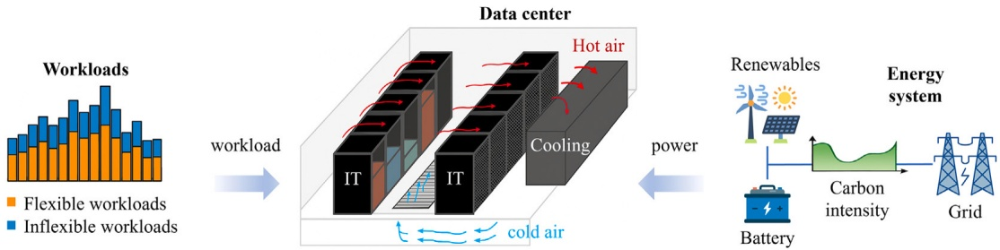

Fig. 1. Integrated operation and interconnection of workload, IT, cooling, and energy subsystems in a DC microgrid.

To mathematically model DC workload, we define the total workload at time 𝑡 as $L _ { v }$ which is composed of flexible workload $L _ { t } ^ { \mathrm { f l e x } }$ and inflexible workload $L _ { t } ^ { \mathrm { i n f l e x } }$

$$
L _ { t } = L _ { t } ^ { \mathrm { f l e x } } + L _ { t } ^ { \mathrm { i n f l e x } } , \forall t \in T .\tag{1}
$$

The inflexible workload $L _ { t } ^ { \mathrm { i n f l e x } }$ must be processed immediately upon arrival. In contrast, the flexible workload $\bar { L } _ { t } ^ { \mathrm { f l e x } }$ is stored to a workload queue, which allows for deferred scheduling. At each time step $t ,$ this queue may store newly arrived flexible workloads or dispatch previously stored ones for processing. The evolution of the workload queue over time is governed by the following dynamics:

$$
Q _ { t } = Q _ { t - 1 } + L _ { t } ^ { \mathrm { f l e x } } - L _ { t } ^ { \mathrm { s c h e } } , \forall t \in T .\tag{2}
$$

where $Q _ { t }$ denotes the total number of tasks in the queue at time $t ,$ and $L _ { t } ^ { \mathrm { s c h e } }$ represents the amount of flexible workload scheduled for processing at time 𝑡. This processing system is subject to the following constraints:

$$
0 \leq Q _ { t } \leq Q ^ { \operatorname* { m a x } } , \forall t \in T .\tag{3}
$$

$$
0 \leq L _ { t } ^ { \mathrm { s c h e } } \leq \min \left( \left( Q _ { t - 1 } + L _ { t } ^ { \mathrm { f l e x } } \right) , L ^ { \mathrm { m a x } } \right) , \forall t \in T .\tag{4}
$$

where $Q ^ { \mathrm { m a x } }$ is the maximum queue capacity, and $L ^ { \mathrm { m a x } }$ is the maximum flexible workload processing capability of the DC per time step. As a result, the total workload processed at time $t ,$ denoted $L _ { t } ^ { \mathrm { t a s k } }$ , include both scheduled flexible tasks and inflexible tasks:

$$
L _ { t } ^ { \mathrm { t a s k } } = L _ { t } ^ { \mathrm { s c h e } } + L _ { t } ^ { \mathrm { i n f l e x } } , \forall t \in T .\tag{5}
$$

## 2.2 . IT equipment model

IT equipment consumes a substantial portion of power within DCs, primarily driven by key components such as processors, including both central processing units (CPUs) and graphics processing units (GPUs), fans, and random-access memory (RAM), alongside secondary components including motherboards, hard disk drives (HDDs), and network interface cards (NICs), etc. Processors include CPU and GPU serve as the core computational units, executing both serial and parallel tasks, and typically account for 50%–70% of total IT power consumption. Fans play a crucial role in internal thermal management, dynamically adjusting speed to maintain safe operating temperatures. In high-heat scenarios, they can consume approximately 10%–25% of IT energy. RAM, which provides fast access to volatile data during processing, draws relatively stable power and contributes around 5%–10% to overall power consumption. The remaining 10%–20% of IT energy is attributed to secondary components such as motherboards, HDDs, and NICs.

Mathematically, the total IT power consumption at time 𝑡, denoted $P _ { t } ^ { \mathrm { I I } }$ , is decomposed into the power usage of four key component groups:

$$
P _ { t } ^ { \mathrm { I T } } = P _ { t } ^ { \mathrm { p r o c } } + P _ { t } ^ { \mathrm { I T , f a n } } + P _ { t } ^ { \mathrm { m e m } } + P _ { t } ^ { \mathrm { s e c } } , \forall t \in T ,\tag{6}
$$

where $P _ { t } ^ { \mathrm { p r o c } }$ represents the power consumed by processors (CPUs and GPUs); $\dot { P } _ { t } ^ { \mathrm { I T , f a n } }$ and $P _ { t } ^ { \mathrm { m e m } }$ represent the power used by internal fans and memory (RAM), respectively; and $P _ { t } ^ { \mathrm { s e c } }$ accounts for all secondary energy-consuming components.

Specifically, the processor power consumption model includes idle and workload-dependent dynamic power, as well as temperatureinduced leakage:

$$
\begin{aligned}P_{t}^{\mathrm{proc}} & = N^{\mathrm{proc}} \cdot \left(P_{\mathrm{idle}}^{\mathrm{proc}} + u_{t}^{\mathrm{proc}} \cdot (P_{\mathrm{peak}}^{\mathrm{proc}} - P_{\mathrm{idle}}^{\mathrm{proc}})\right) \\& \quad + \alpha^{\mathrm{proc}} \cdot \max {(0, T_{t}^{\mathrm{proc}} - T^{\mathrm{base}})}^2, \forall t \in T,\end{aligned}\tag{7}
$$

where $N ^ { \mathrm { p r o c } }$ represents the total number of processors; $u _ { t } ^ { \mathrm { p r o c } } \in [ 0 , 1 ]$ is the processor utilization ratio at time 𝑡 related to the workload process $L _ { t } ^ { \mathrm { t a s k } } ; ~ P _ { \mathrm { i d l e } } ^ { \mathrm { p r o c } }$ and $P _ { \mathrm { p e a k } } ^ { \mathrm { p r o c } }$ are respectively the idle and peak power of a single processor; $\dot { T } _ { t } ^ { \mathrm { p r o c } }$ is the processor temperature at time 𝑡; and $\alpha ^ { \mathrm { p r o c } }$ is the temperature-induced leakage power coefficient. 𝑇base is the baseline temperature threshold below which the leakage power is considered negligible, typically corresponding to the design ambient temperature of the processor. The max(0, ⋅) operator ensures that the temperature-induced leakage power is only applied when the processor temperature exceeds the baseline temperature $T ^ { \mathrm { b a s e } }$ , which is physically correct as leakage current increases significantly with temperature above a threshold.

The power consumed by fans is modeled as a cubic function of normalized fan velocity:

$$
P _ { t } ^ { \tt I T , f a n } = N ^ { \tt p r o c } \cdot \left( P _ { \tt i d l e } ^ { \tt f a n } + { ( v _ { t } ^ { \tt f a n } ) } ^ { 3 } \cdot ( P _ { \tt p e a k } ^ { \tt f a n } - P _ { \tt i d l e } ^ { \tt f a n } ) \right) , \forall t \in T ,\tag{8}
$$

where $P _ { \mathrm { i d l e } } ^ { \mathrm { f a n } }$ and $P _ { \mathrm { p e a k } } ^ { \mathrm { f a n } }$ are the idle and peak power of a single fan, respectively. Here, $v _ { t } ^ { \mathrm { f a n } }$ is the normalized velocity of fans, which is determined by the deviation from a target temperature:

$$
v _ { t } ^ { \mathrm { f a n } } = \min \left( 1 , \beta ^ { \mathrm { f a n } } \cdot \max \left( 0 , T _ { t } ^ { \mathrm { p r o c } } - T _ { \mathrm { t a r g e t } } ^ { \mathrm { p r o c } } \right) \right) , \forall t \in T ,\tag{9}
$$

where $\beta ^ { \mathrm { f a n } }$ is the gain coefficient; and $T _ { \mathrm { t a r g e t } } ^ { \mathrm { p r o c } }$ is the target temperature threshold of processors.

The power consumed by memory is modeled as:

$$
P _ { t } ^ { \mathrm { m e m } } = N ^ { \mathrm { m e m } } \cdot P _ { \mathrm { u n i t } } ^ { \mathrm { m e m } } + \alpha ^ { \mathrm { m e m } } \cdot \mu _ { t } ^ { \mathrm { m e m } } , \forall t \in T ,\tag{10}
$$

where $N ^ { \mathrm { m e m } }$ is the number of memory modules; $P _ { \mathrm { u n i t } } ^ { \mathrm { m e m } }$ is the power per memory module; $\mu _ { t } ^ { \mathrm { m e m } }$ represents the memory bandwidth utilization at time $t ,$ here it is assumed equal to the processor utilization ratio $u _ { t } ^ { \mathrm { p r o c } } ;$ and $\alpha ^ { \mathrm { m e m } }$ is the corresponding memory access power coefficient.

Secondary components include motherboards, hard drives, and network interfaces, of which their power consumption is modeled as:

$$
P _ { t } ^ { \mathrm { s e c } } = P _ { t } ^ { \mathrm { m b } } + P _ { t } ^ { \mathrm { h d d } } + P _ { t } ^ { \mathrm { n e t } } + \epsilon , \forall t \in T ,\tag{11}
$$

where $P _ { t } ^ { \mathrm { m b } }$ is the power of the motherboard, $P _ { t } ^ { \mathrm { h d d } }$ is the power of the hard disk drives, $P _ { \mathrm { n e t } }$ is the power of the network interface cards, and 𝜖 represents the unmodeled residual power (e.g., PCIe cards, sensors). Generally, the power consumption of memory and secondary components can be proportionally allocated to CPU power consumption for simplified calculation.

## 2.3 . Cooling model

Fig. 2 illustrates the cooling system of the $\mathbf { D } \mathbf { C } ,$ which comprises a Computer Room Air Conditioner (CRAC), a chiller, a chilled water pump, a cooling tower, and a condenser water pump. These components work together to regulate airflow and temperature through a multi-loop cooling process. As IT equipment processes workloads, it generates heat, causing warm air to rise via convection. This heated air is drawn into the CRAC for cooling (indicated by red arrows in the figure). Within the CRAC, the heat is transferred to a primary chilled water loop, which is circulated by the chilled water pump. The primary loop exchanges thermal energy with a secondary chilled water loop via the chiller. The secondary loop then conveys the heat to the cooling tower through the condenser water pump, where a variable-speed fan dissipates it into the external environment. Simultaneously, cooled air (blue arrows) is circulated back to ensure consistent thermal conditions for IT operations.

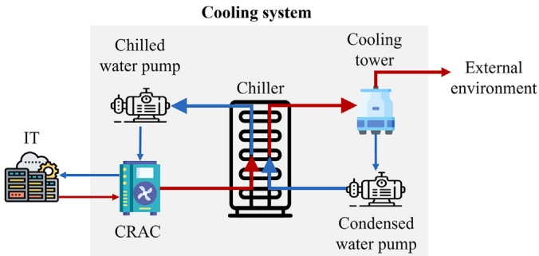

Fig. 2. Schematic diagram of the DC cooling system.

The total cooling load required to maintain optimal IT operating conditions can be modeled as a function of IT power consumption, system losses, and the temperature difference between the ambient environment and the CRAC setpoint. Specifically, the cooling load $Q _ { \mathrm { c o o l } }$ is given by:

$$
Q _ { \mathrm { c o o l } } = P _ { \mathrm { I T } } \left[ 1 + \alpha _ { \mathrm { c r a c } } + \gamma _ { \mathrm { c r a c } } ( T _ { \mathrm { a m b } } - T _ { \mathrm { C R A C } } ) \right]\tag{12}
$$

where $P _ { \mathrm { I T } }$ is the IT power consumption, $\alpha _ { \mathrm { c r a c } }$ is the base loss coefficient that accounts for fan, motor, and building heat losses independent of temperature difference, $\gamma _ { \mathrm { c r a c } }$ is the temperature sensitivity coefficient that represents the linear response of cooling load to ambient-CRAC temperature difference, $T _ { \mathrm { a m b } }$ is the ambient temperature, and $T _ { \mathrm { C R A C } } \in$ $[ \underline { { T } } _ { \mathrm { C R A C } } , \bar { T } _ { \mathrm { C R A C } } ]$ is the CRAC supply air temperature setpoint.

The efficiency of the cooling system is characterized by the Coefficient of Performance (COP), which quantifies the ratio of cooling provided to electrical energy consumed. The COP of the chiller is modeled as a function of the temperature difference between the ambient environment and the CRAC setpoint:

$$
\mathrm{COP} = a - b \cdot \max(0, T_{\mathrm{amb}} - T_{\mathrm{CRAC}}) + 0.0005 \cdot \max(0, T_{\mathrm{amb}} - T_{\mathrm{CRAC}})^2\tag{13}
$$

where 𝑎 represents the baseline COP under ideal conditions, 𝑏 is the linear degradation coefficient, $T _ { \mathrm { a m b } }$ is the ambient temperature, and $T _ { \mathrm { C R A C } }$ is the CRAC supply air temperature setpoint. The quadratic term captures the accelerated efficiency degradation at higher temperature differentials, reflecting the thermodynamic principle that chiller performance deteriorates non-linearly as the temperature lift increases. This model represents the real-world operational characteristics where chiller efficiency decreases as the system must work harder to maintain the desired cooling temperature against higher ambient conditions.

The actual electrical power consumed by the cooling system, denoted as $P _ { \mathrm { c o o l i n g } } ,$ is calculated as the ratio of the required cooling load to the system’s coefficient of performance (COP):

$$
P _ { \mathrm { c o o l i n g } } = { \frac { Q _ { \mathrm { c o o l } } } { \mathrm { C O P } } }\tag{14}
$$

This equation provides a direct and intuitive link between the thermodynamic efficiency of the cooling system and its operational energy use, and is widely adopted in DC energy modeling.

## 2.4 . Energy model

To ensure a reliable and sustainable power supply for the $\mathbf { D } \mathbf { C } ,$ an ESS and distributed RESs are deployed within the microgrid. The renewable resources include solar photovoltaic (PV) panels and wind turbines, with their total power generation denoted as $P _ { t } ^ { \mathrm { r e s } }$ . The ESS enables load shifting between off-peak and peak periods by storing surplus renewable energy for later use, especially during periods of high electricity prices and/or demand peaks. The ESS operation is governed by the following constraints:

$$
0 \leq P _ { t } ^ { \mathrm { e s c } } \leq \overline { { P } } ^ { \mathrm { e s } } , \forall t \in T ,
$$

$$
- \overline { { P } } ^ { \mathrm { e s } } \leq P _ { t } ^ { \mathrm { e s d } } \leq 0 , \forall t \in T ,\tag{15}
$$

(16)

$$
0 \leq E _ { t } ^ { \mathrm { e s } } \leq \overline { { E } } ^ { \mathrm { e s } } , \forall t \in T ,\tag{17}
$$

$$
E _ { t + 1 } ^ { \mathrm { e s } } = E _ { t } ^ { \mathrm { e s } } + P _ { t } ^ { \mathrm { e s c } } \cdot \Delta t \cdot \eta ^ { \mathrm { e s } } + \frac { P _ { t } ^ { \mathrm { e s d } } \cdot \Delta t } { \eta ^ { \mathrm { e s } } } , \forall t \in T .\tag{18}
$$

Her $\mathbf { e } _ { z }$ constraints (15) and (16) impose limits on charging $P _ { t } ^ { \mathrm { e s c } }$ and discharging $P _ { t } ^ { \mathrm { e s d } }$ power, ensuring they remain within the rated ESS power capacity $\dot { \overline { { P } } ^ { \mathrm { e s } } }$ . Constraint (17) bounds the stored energy within the ESS energy capacity $\overline { { E } } ^ { \mathrm { e s } }$ . The balance Eq. (18) governs the energy dynamics, accounting for both charging and discharging processes, while incorporating energy conversion losses through the efficiency factor $\eta ^ { \mathrm { e s } }$ ∈ (0, 1].

The overall power balance in the DC microgrid, incorporating IT load, cooling load, renewable generation, grid connections, and ESS operations, is given by:

$$
P _ { _ { t } } ^ { \mathrm { I T } } + P _ { _ { t } } ^ { \mathrm { c o o l } } + P _ { _ { t } } ^ { \mathrm { e s c } } = P _ { _ { t } } ^ { \mathrm { g r i d } } + P _ { _ { t } } ^ { \mathrm { r e s } } - P _ { _ { t } } ^ { \mathrm { e s d } } , \forall t \in T ,\tag{19}
$$

where $P _ { t } ^ { \mathrm { g r i d } }$ represents the electricity imports from the main grid. Noted $P _ { t } ^ { \mathrm { g r i d } }$ can be negative, indicating that excess local energy from RES and ESS is exported back to the grid when supply exceeds local demand.

## 2.5 . Sustainable management

The Microgrid Central Controller (MGCC) is responsible for scheduling the flexible workload $L _ { t } ^ { \mathrm { s c h e } }$ of the DC; adjusting the CRAC setpoint temperature $T _ { t } ^ { \mathrm { s u p p l y } }$ of the cooling system; and dispatching the ESS charging $P _ { t } ^ { \mathrm { e e s c } }$ and discharging $P _ { t } ^ { \mathrm { e e s d } }$ power. These control decisions are made based on real-time inputs from four main sources: 1) DC information, including workload volume, IT equipment temperatures, and CRAC operational status; 2) grid signals of carbon intensity; 3) microgrid status of renewable generation and ESS state-of-charge; and 4) environmental data of ambient temperature.

The MGCC objective is to minimize both grid power import $c _ { t } ^ { \mathrm { E C } }$ and carbon footprint $c _ { t } ^ { \mathrm { C F } }$ of DC microgrid operations while ensuring efficient workload processing. These objectives are mathematically expressed as:

$$
c _ { t } ^ { \mathrm { E C } } = P _ { t } ^ { \mathrm { g r i d } } , \forall t \in T ,\tag{20}
$$

$$
c _ { t } ^ { \mathrm { c a r b o n } } = P _ { t } ^ { \mathrm { g r i d } } \cdot \lambda _ { t } ^ { \mathrm { c } } , \forall t \in T ,\tag{21}
$$

where $\lambda _ { t } ^ { \mathrm { c } }$ represent the carbon intensity price.

To ensure service quality, the MGCC must also guarantee that all flexible tasks are completed within the operational horizon. This is enforced by the terminal constraint:

$$
Q _ { t } = 0 \quad \mathrm { w h e n } \quad t = T .\tag{22}
$$

## 3 . Problem formulation as a multi-reward Markov decision process

Solving the above MGCC optimization problem for a DC microgrid is challenging due to several inherent complexities. First, accurately modeling the power consumption of IT equipment and cooling systems presents significant difficulties. IT power usage exhibits high variability based on workload characteristics such as CPU/GPU utilization patterns and task scheduling decisions. Similarly, cooling systems, including CRAC units and chiller plants, feature intricate thermal dynamics that are influenced by both IT load variations and ambient environmental conditions. The absence of precise thermal models further complicates real-time control decisions. Second, the MGCC optimization problem is subject to substantial exogenous uncertainties, including workload demand variability, ambient temperature fluctuations, and intermittent renewable generation patterns. These stochastic factors introduce significant variability into the system dynamics, making reliable and adaptive decision-making particularly challenging for traditional optimization approaches. Third, the MGCC must navigate multiple conflicting objectives simultaneously, making it a typical multi-objective control problem. For instance, lowering cooling temperatures to enhance IT efficiency and performance often requires increased cooling power consumption, thereby increasing overall energy consumption. Similarly, optimizing workload scheduling for energy efficiency may conflict with maintaining service quality and meeting performance requirements.

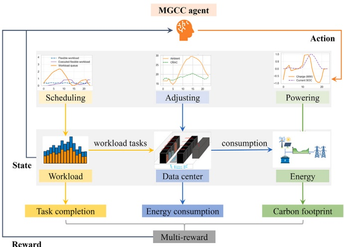

Fig. 3. Framework of the proposed multi-reward Markov decision process for DC microgrid management.

To address these challenges, we formulate the MGCC optimization problem as a multi-reward Markov Decision Process (MDP), with the overall framework illustrated in Fig. 3. Specifically, the MDP formulation enables a learning-based control paradigm that operates without requiring precise system models, accommodates exogenous uncertainties through probabilistic transitions, and supports multi-objective optimization via multiple reward signals. This facilitates adaptive, real-time decision-making across the complex, dynamic, and interdependent subsystems of a sustainable data center microgrid.

A MDP is formally defined as a tuple $\langle S , \mathcal { A } , \mathcal { R } , \mathcal { T } , \gamma \rangle ,$ where $S \mathrm { d } e$ notes the state space of the environment; A represents the action space for agent. R represent the reward function, while the state transition function $s ^ { \prime }   \sim   \mathcal { T } ( s , a )$ governs environment evolution based on the actions of DRL agents. The discount factor $\gamma$ accounts for the importance of future rewards. The following sections provide the dynamic processes and detailed components of the formulated MDP.

## 3.1 . Dynamic decision-making process

The decision-making process unfolds over discrete time steps as a sequence of interactions between the DRL agent and the microgrid environment. The system starts in an initial state $s _ { 0 } \in S$ for initial time step $t   =   0 .$ At each step $t ,$ the DRL agent receives a state $s _ { t }$ and then selects an action $a _ { t } \in \mathcal { A }$ according to the policy 𝜋: $a _ { t } \sim \pi ( a _ { t } | \mathbf { s } _ { t } ) ,$ where 𝜋 is a stochastic policy that maps an agent’s observation to a probability distribution over actions. After the state transition, the agent receive a reward $r _ { t } = \mathcal { R } ( \mathrm { s } _ { t + 1 } )$ based on the new system state. The decision-making loop continues in the next time step until the end of the episode. Each episode spans one complete day, representing a full operational cycle of the DC microgrid. The learning objective $\pi_{i}^{*}$ is maximizing the expected cumulative reward over the entire horizon max𝜋 $\begin{array} { r } { \mathbb { E } \left[ \sum _ { t = 0 } ^ { T } \gamma ^ { t } r _ { t } \right] } \end{array}$

## 3.2 . State

The environment state $s _ { t }$ includes the state of workload scheduling, cooling, and energy systems of DCs:

$$
\begin{aligned} &s _ { t } = \{ \underbrace { L _ { 1 : t } ^ { \mathrm { f i x } } , \tilde { L } _ { t + 1 : T } ^ { \mathrm { f i x } } , L _ { 1 : t } ^ { \mathrm { i n f i x } } , \tilde { L } _ { t + 1 : T } ^ { \mathrm { i n f i x } } , Q _ { t } } _ { \mathrm { w o r k o a d } } , \underbrace { P _ { t } ^ { \mathrm { I T } } , T _ { 1 : t } ^ { \mathrm { a m p } } , \tilde { T } _ { t + 1 : T } ^ { \mathrm { a m p } } , T _ { t } ^ { \mathrm { C R A C , s u p p b y } } , P _ { t } ^ { \mathrm { c o o l i n g } } } _ { \mathrm { d a t a }   \mathrm { c e n t e r } } , \\& \underbrace { E _ { t } ^ { \mathrm { e s } } , P _ { t } ^ { \mathrm { r e s } } , P _ { t } ^ { \mathrm { m g } } , \lambda _ { 1 : t } ^ { \mathrm { c } } , \tilde { \lambda } _ { t + 1 : T } ^ { \mathrm { c } } } _ { \mathrm { c e n c r y } } , t _ { 1 } , t _ { 2 } \} \in S ,\\ \end{aligned}\tag{23}
$$

which are categorized into: 1) the workload states of the flexible and inflexible workload demand $L _ { 1 : t } ^ { \mathrm { f l x } } , \; \tilde { L } _ { t + 1 : T } ^ { \mathrm { f l x } } , \; L _ { 1 : t } ^ { \mathrm { i n f l x } } , \; \tilde { L } _ { t + 1 : T } ^ { \mathrm { i n f l x } } ,$ the workload queue $Q _ { t }$ storing deferred workloads, and the IT equipment power consumption $P _ { t } ^ { \mathrm { I T } } ;   \bar { 2 ) }$ the cooling system states of the ambient temperature $T _ { 1 : t } ^ { \mathrm { a m p } } , \; \tilde { T } _ { t + 1 : T } ^ { \mathrm { a m p } } ,$ the supply air temperature $T _ { t } ^ { \mathrm { C R A C , s u p p l y } }$ , and the cooling system power consumption $P _ { t } ^ { \mathrm { c o l i n g } } ;$ and 3) the microgrid states of the battery stored energy $E _ { t } ^ { \mathrm { e s } }$ , the renewable generation $P _ { t } ^ { \mathrm { r e s } }$ , the power injection of main grid $P _ { t } ^ { \mathrm { m } \vec { \mathbf { g } } } ,$ , and the carbon intensity $\lambda _ { 1 : t } ^ { \mathsf { c } } ,   \tilde { \lambda } _ { t + 1 : T } ^ { \mathsf { c } } .$ Note that in the state representation, historical sequences are denoted by the subscript {1 ∶ 𝑡} (from time step 1 to current time $t ) ,$ while predicted future sequences are denoted by $\{ t + 1 \: : \: T \}$ (from next time step to episode end 𝑇 ) with a tilde (∼) to distinguish predicted values from historical observations.

The time encoding components $t _ { 1 } , t _ { 2 }$ are computed as:

$$
t _ { 1 } = \cos ( \pi t / 1 2 ) \cdot 0 . 5 + 0 . 5
$$

$$
t _ { 2 } = \sin ( \pi t / 1 2 ) \cdot 0 . 5 + 0 . 5\tag{24}
$$

(25)

where 𝑡 represents the current time step within the episode (ranging from 0 to 23 for a 24-hour horizon). The argument $\pi t / 1 2$ ensures a full 24-hour period, while the scaling factor of 0.5 ensures that both $t _ { 1 }$ and $t _ { 2 }$ remain within the range [0, 1], providing normalized temporal representations that capture the periodic nature of daily operational patterns in the DC microgrid. Sinusoidal time encoding captures the periodic nature of daily operational patterns in DC microgrids more effectively than integer representation. Sine and cosine functions naturally represent the 24-hour cyclical patterns of workload demand, electricity prices, renewable generation, and ambient temperature, whereas integer time values do not inherently encode this cyclical relationship. Additionally, sinusoidal encoding provides smooth transitions between adjacent time steps, facilitating gradient-based learning. One-hot encoding, by comparison, creates discontinuous representations that can hinder optimization. The encoding values also remain bounded within [0, 1] after scaling, making them directly compatible with neural network inputs without additional normalization. This encoding approach has since been adapted in various time-series forecasting models [29], demonstrating its effectiveness in capturing temporal dependencies. Note that variables without the time subscript 𝑡 $( \mathrm { e . g . , ~ } L ^ { \mathrm { f l x } } , ~ L ^ { \mathrm { i n f l x } } , ~ \lambda ^ { \mathrm { e } } )$ represent episode-level data that remain constant throughout the entire episode, while future values beyond the current time step are supplemented by predicted values based on historical patterns and forecasting models. Here, we assume perfect forecasts for workload, ambient temperature, and carbon intensity to establish baseline performance. The robustness analysis under prediction errors is presented in Section 5.6.

## 3.3 . Action

The action $a _ { t }$ is defined as

$$
a _ { t } = \{ a _ { t } ^ { \mathrm { l } } , a _ { t } ^ { \mathrm { c o o l } } , a _ { t } ^ { \mathrm { e s } } \} \in \mathcal { A } ,\tag{26}
$$

where includes workload scheduling action $a _ { t } ^ { \mathrm { l } } \in [ - 1 , 1 ] ,$ cooling system action $a _ { t } ^ { \mathrm { c o o l } } \in [ - 1 , 1 ] ,$ and energy storage action $a _ { t } ^ { \mathrm { e s } } \in [ - 1 , 1 ] .$ The actual control signals executed in the DC microgrid are computed by mapping the normalized action values from the range [−1, 1] to their respective physical control ranges.

## 3.4 . State transition

The state transition process from time step $t { \mathrm { ~ t o ~ } } t + 1$ is governed by $s _ { t + 1 } = \mathcal { T } ( s _ { t } , a _ { t } ) ,$ , which depends on the current state $s _ { t }$ and the joint actions of all agents $a _ { t } .$ . At time step $t ,$ the DRL agent executes its action $a _ { t } ,$ leading to updates in the job queue $Q _ { t + 1 } ,$ the IT equipment power consumption $P _ { t + 1 } ^ { \bar { \mathrm { I I I } } }$ , the cooling system states of the supply air temperature $T _ { t + 1 } ^ { \mathrm { C R A C , s u p p l y } }$ , the cooling system power consumption $P _ { t + 1 } ^ { \mathrm { c o o l i n g } }$ , and the microgrid states of the battery stored energy $E _ { t + 1 } ^ { \mathrm { e s } }$ , and the power injection of main grid $P _ { t + 1 } ^ { \mathrm { m g } }$

In contrast, state features of workload demand $L _ { t } ^ { \mathrm { f l x } }$ and $L _ { t } ^ { \mathrm { i n f l x } }$ , electricity price $\lambda _ { t } ^ { \mathrm { e } } ,$ carbon intensity $\lambda _ { t } ^ { \mathrm { c } } ,$ renewable power generation $P _ { t } ^ { \mathrm { r e s } }$ and the ambient temperature $T _ { t } ^ { \mathrm { i m p } }$ are exogenous, meaning they are independent of the agents’ actions and exhibit intrinsic variability. RL addresses this variability by leveraging a data-driven approach that learns these characteristics directly from the dataset [16].

## 3.5 . Reward function

The objective of the studied MGCC agent is minimizing both energy consumption and carbon footprint of the DC microgrid operation, while ensuring efficient workload scheduling. The corresponding rewards can be respectively written as

$$
r _ { t } ^ { 1 } = - P _ { t } ^ { \mathrm { m g } }\tag{27}
$$

$$
r _ { t } ^ { 2 } = - P _ { t } ^ { \mathrm { m g } } \lambda _ { t } ^ { \mathrm { c } }\tag{28}
$$

$$
r _ { t } ^ { 3 } = - Q _ { T }\tag{29}
$$

## 4 . Multi-critic reinforcement learning method

Existing DRL methods often address multi-objective problems by scalarizing multiple objectives into a single aggregated reward, which is then used to train a single critic network. While this approach simplifies the learning process, it suffers from several key disadvantages. First, scalarization merges all objectives into a single reward signal, causing the agent to lose access to the individual contributions and trade-offs between objectives, making it difficult to learn nuanced policies that balance competing goals. Second, a single critic must approximate a complex, entangled value function that combines multiple objectives, which can slow down convergence and reduce sample efficiency, particularly in high-dimensional or conflicting reward settings. Third, with only a single critic, it is challenging to interpret how each objective influences the learned policy, hindering the ability to analyze or adjust the agent’s behavior with respect to specific objectives.

To address these limitations and efficiently solve the above multi-reward MDP problem, we propose a novel multi-critic DRL method based on a MoE with multi-head architecture, as illustrated in Fig. 4. This approach addresses the fundamental challenges of traditional scalarized DRL methods by providing dedicated critics for each optimization objective, thereby enabling more effective learning of complex, multi-objective policies in DC microgrid environments.

Specifically, the multi-critic DRL method incorporates three key design elements: 1) Featuring an actor-critic architecture based on the soft actor-critic (SAC) method [35], with a stochastic policy network outputting continuous action distributions and twin Q-value networks correcting the policy network weights while incorporating entropy regularization for enhanced exploration; 2) Integrating a multi-critic DRL framework, in which each reward is assigned a dedicated critic network, enabling the agent to learn from multiple reward signals simultaneously, providing richer and more informative feedback to the actor network while avoiding the conflicts that arise when a single critic attempts to learn multiple competing objectives; and 3) Introducing a MoE with multi-head architecture for the multi-critic DRL framework, where shared expert subnetworks are dynamically combined through adaptive gating mechanisms, enabling each critic to focus on its specific optimization target while leveraging common knowledge across objectives;

For a better understanding of the proposed multi-critic DRL framework illustrated in Fig. 4, we summarize the core algorithmic steps as follows:

Step 1: The actor network $\pi _ { \phi } ( a | s )$ generates a stochastic action 𝑎 based on the current observation 𝑠 from the DC microgrid environment.

Step 2: Upon executing action $a _ { \flat }$ the environment updates the workload scheduling, IT equipment power consumption, cooling system behavior, and energy system operations according to the DC microgrid models (Sections 2.1–2.3). The MGCC agent then observes the new environment state and computes the multi-reward functions as defined in Sections 3.1–3.5.

Step 3: The experience tuple $( s , a , r _ { t } ^ { 1 } , r _ { t } ^ { 2 } , r _ { t } ^ { 3 } , s ^ { \prime } )$ is stored in the replay buffer. Unlike standard replay buffers that store only $( s , a , r , s ^ { \prime } )$ tuples with a single scalar reward, our custom buffer is specifically designed for multi-critic training that it stores the decomposed sub-rewards $( r _ { t } ^ { 1 } , r _ { t } ^ { 2 } , r _ { t } ^ { 3 } )$ for each objective separately, along with the standard state-action-next state information.

Step 4: The multi-critic DRL agent samples mini-batches from the replay buffer to update both the multi-critic networks and the actor network. Target networks are updated using soft updates to ensure training stability.

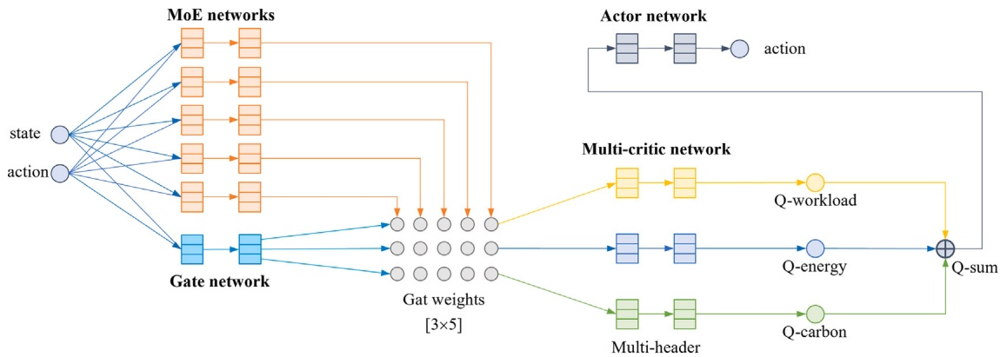

Fig. 4. Architecture of the proposed mixture-of-experts based multi-critic DRL method.

In the following, we design a practical multi-critic DRL algorithm based on one of the state-of-the-art DRL methods, SAC.

## 4.1 . Mixture-of-experts based multi-critic soft actor-critic

The proposed method, denoted as SAC-MoE, is a multi-critic extension of SAC with MoE architecture, specifically designed to handle multiple reward signals simultaneously. SAC was chosen as the primary base algorithm because it is one of the state-of-the-art DRL algorithms for continuous action spaces. Compared with DDPG, SAC incorporates entropy regularization that encourages exploration, which is beneficial for learning in complex multi-objective environments. Additionally, the stochastic policy of SAC provides better exploration capability than the deterministic policy of DDPG. Compared with PPO, SAC is an off-policy algorithm that can reuse past experiences stored in a replay buffer, making it more sample-efficient for our data center control task.

The objective function of SAC-MoE is to maximize the total values of the expected workload penalty, energy consumption, and carbon footprint return and the entropy of the policy:

$$
J ( \pi ) = \mathbb { E } _ { \pi } \left[ \sum _ { t = 0 } ^ { \infty } \gamma ^ { t } \left( r _ { t } ^ { 1 } + r _ { t } ^ { 2 } + r _ { t } ^ { 3 } + \alpha \mathcal { H } ( \pi ( \cdot | s _ { t } ) ) \right) \right]\tag{30}
$$

where $\mathcal { H } ( \pi ( \cdot | s _ { t } ) )   =   - \log \pi ( \cdot | s _ { t } )$ is the entropy of the policy at state $s _ { t ^ { \star } }$ and 𝛼 is the entropy temperature parameter.

Correspondingly, three critic networks are defined to approximate the expected discounted sum of each sub-reward plus the entropy term:

$$
Q _ { \theta _ { i } } ( s , a ) = \mathbb { E } _ { \pi } \left[ \sum _ { t = 0 } ^ { \infty } \gamma ^ { t } r _ { t } ^ { i } + \sum _ { t = 1 } ^ { \infty } \gamma ^ { t } \alpha \mathcal { H } ( \pi ( \cdot | s _ { t } ) ) \mid s _ { 0 } = s , a _ { 0 } = a \right]\tag{31}
$$

where $i   \in   \{ 1 , 2 , 3 \}$ indicates the index of energy consumption, carbon footprint, and workload penalty, respectively. Each critic network is responsible for estimating the Q-function for a specific objective, allowing the agent to evaluate actions with respect to multiple criteria simultaneously.

Then, the objective of RL is to find a policy 𝜋 to maximize the sum of all state-action value functions while maintaining exploration through entropy regularization:

$$
\pi ^ { * } = \arg \max _ { a \sim \pi } \left[ \sum _ { i = 1 } ^ { 3 } Q _ { i } ^ { \pi } ( s , a ) + \alpha \mathcal { H } ( \pi ( \cdot | s ) ) \right]\tag{32}
$$

## 4.2 . Mixture-of-experts with multi-head architecture for multi-critic networks

Considering the three critic share the same input $( s , a )$ but require different outputs for each reward, we employ a single MoE critic network with three output heads, where each head corresponds to a specific reward. This design enables simultaneous learning of all critics within a unified architecture and allows the model to leverage specialized knowledge from multiple expert subnetworks, each focusing on different aspects of the input space.

For a given state-action pair $( s , a ) ,$ , the MoE network computes a set of expert features:

$$
E _ { j } = \mathrm { E x p e r t } ^ { ( j ) } ( [ s , a ] ) , \quad j = 1 , \ldots , N .\tag{33}
$$

where $\mathbf { E x p e r t } ^ { ( j ) } ( \cdot )$ is the 𝑗-th expert network, which is a neural network that takes the state-action pair (𝑠, 𝑎) as input and outputs a feature vector $E _ { j } .$

For each head $i \in \{ 1 , 2 , 3 \}$ , a dedicated gating network dynamically assigns weights to the outputs of the experts. This dynamic weighting mechanism enables the model to adaptively combine expert knowledge for each head. Each gating network produces a softmax distribution over the experts:

$$
G_{i} =  softmax ( Gate ^{(i)}([s, a]) / T)\tag{34}
$$

where $G _ { i }$ is the gating weight vector for head $i , \; \mathrm { G a t e } ^ { ( i ) } ( \cdot )$ is the corresponding gating network, and 𝑇 is a temperature parameter for balancing expert usage.

The task-specific feature for head 𝑖 is a weighted sum of the expert outputs:

$$
F _ { i } = \sum _ { j = 1 } ^ { N } G _ { i , j } E _ { j } .\tag{35}
$$

Following the shared MoE, task-specific heads are employed, each designed to output the Q-values for their respective tasks. This multi-head architecture allows the model to maintain a clear separation between tasks, ensuring that the learning process for one task does not adversely affect the others. The task head maps the task-specific feature to a scalar Q-value:

$$
Q _ { i } ( s , a ) = \mathrm { H e a d } ^ { ( i ) } ( F _ { i } )\tag{36}
$$

## 4.3 . Parameter update for soft actor multi-critic

The parameter update process for MoE-based critic follows the clip double Q-learning technology, which maintains a pair of MoE-based Qnetworks $Q _ { \theta _ { 1 } } ^ { i }$ and $Q _ { \theta _ { 2 } } ^ { i }$ for each critic $i \in \{ 1 , 2 , 3 \}$ . This design utilizes the minimum of the two Q-values to form the targets in the Bellman error loss functions, effectively preventing overestimation bias commonly observed in single Q-network approaches. The Bellman error loss for each critic is:

$$
\mathcal { L } _ { \mathrm { B e l l m a n } } ^ { i } ( \theta _ { m } ) = \mathbb { E } _ { ( s , a , r ^ { i } , s ^ { \prime } , d ) \sim D } \left[ \left( y ^ { i } - Q _ { \theta _ { m } } ^ { i } ( s , a ) \right) ^ { 2 } \right] ,\tag{37}
$$

where $m \in \{ 1 , 2 \}$ is the index of the Q-network, and $y ^ { i }$ is the target Q value:

$$
y ^ { i } = r ^ { i } + \gamma \mathbb { E } _ { a ^ { \prime } \sim \pi _ { \phi } } \left[ \min _ { m = 1 , 2 } Q _ { \theta _ { m } ^ { \prime } } ^ { i } ( s ^ { \prime } , a ^ { \prime } ) - \alpha \log \pi _ { \phi } ( a ^ { \prime } | s ^ { \prime } ) \right]\tag{38}
$$

where $r ^ { i }$ is the reward for critic $i , d$ is the done flag, and 𝛼 is the entropy temperature. $Q _ { \theta _ { m } ^ { \prime } } ^ { i }$ is the target network. Target networks provide stable learning targets by maintaining slowly-updated copies of the main networks, preventing training instability caused by the correlation between current and target Q-values. The target networks are updated using soft updates to ensure training stability:

$$
\theta _ { m } ^ { \prime } \gets \tau \theta _ { m } + ( 1 - \tau ) \theta _ { m } ^ { \prime }\tag{39}
$$

where 𝜏 is the soft update coefficient, typically 0.005.

To prevent expert collapse and ensure balanced usage of all experts in the MoE architecture, an expert usage balancing loss is computed based on the current batch’s gating weights:

$$
\mathcal { L } _ { \mathrm { u s a g e } } ( \theta _ { m } ) = \sum _ { i = 1 } ^ { 3 } \sum _ { j = 1 } ^ { N } \left| G _ { i , j , m } - \frac { 1 } { N } \right|\tag{40}
$$

where $G _ { i , j , m }$ is the gating weight for expert 𝑗 in head 𝑖 of network $m _ { z }$ and $N$ is the number of experts. This loss encourages uniform expert utilization across all critics.

The overall critic loss for the 𝑚-th MoE-based critic network is the sum of the critic loss and the expert usage balancing loss:

$$
\mathcal { L } _ { \mathrm { c r i t i c } } ( \theta _ { m } ) = \sum _ { i = 1 } ^ { 3 } \mathcal { L } _ { \mathrm { c r i t i c } } ^ { i } ( \theta _ { m } ) + \mathcal { L } _ { \mathrm { u s a g e } } ( \theta _ { m } ) ,\tag{41}
$$

where $\lambda _ { \mathrm { c r i t i c } }$ and $\lambda _ { \mathrm { u s a g e } }$ are weighting coefficients that balance the contribution of each loss component.

The actor is reparameterized as a Gaussian distribution

$$
\pi _ { \phi } ( \cdot \mid s ) = \operatorname { t a n h } \left( \mu _ { \phi } ( s ) + \sigma _ { \phi } ( s ) \odot \xi \right) , \quad \xi \sim \mathcal { N } ( 0 , I ) ,\tag{42}
$$

where $\mu _ { \phi }$ and $\sigma _ { \phi }$ are neural networks to approximate mean and standard deviations. It is updated to maximize the sum of all critic Q-values while maintaining exploration through entropy regularization:

$$
\mathcal { L } _ { \mathrm { a c t o r } } ( \phi ) = - \mathbb { E } _ { s \sim \mathcal { D } , a \sim \pi _ { \phi } } \left[ \min _ { m = 1 , 2 } \sum _ { i = 1 } ^ { 3 } Q _ { \theta _ { m } } ^ { i } ( s , a ) - 3 \alpha \log \pi _ { \phi } ( a | s ) \right]\tag{43}
$$

where 𝛼 is the entropy temperature.

The entropy temperature parameter 𝛼 is automatically adjusted to maintain a target entropy level:

$$
\mathcal { L } _ { \alpha } = - \alpha \mathbb { E } _ { s \sim D , a \sim \pi _ { \phi } } \left[ \log \pi _ { \phi } ( a | s ) + \mathcal { H } _ { \mathrm { t a r g e t } } \right]\tag{44}
$$

where $\mathcal { H } _ { \mathrm { t a r g e t } }$ is the desired entropy level, typically set to − dim(A) for continuous action spaces.

## 4.4 . Multi-critic SAC with MoE algorithm pseudocode

Algorithm 1 presents the complete pseudocode for the proposed SAC-MoE algorithm, which incorporates the MoE architecture with expert usage balancing and multi-critic learning framework.

## 5 . Case studies

## 5.1 . Data source

The simulations were conducted using an open-source dataset provided by the UK’s National Energy System Operator (NESO) [30]. The dataset included one year of hourly carbon intensity and PV generation data with normalized to the DC microgrid level. The DC was assumed to be located in London, UK, with corresponding external data comprising carbon intensity, PV generation, and outdoor temperature data collected from [31].

For the workload environment, we utilized the Alibaba CPU trace dataset [32] at an hourly resolution. The workload data were normalized to the range [0, 1] to represent realistic DC computational demand.

Algorithm 1 Mixture-of-experts based multi-critic Soft Actor-Critic
(SAC-MoE).
1: Initialize actor network $\pi _ { \phi }$ and critic networks $Q _ { \theta _ { 1 } } , Q _ { \theta _ { 2 } }$ with MoE
architecture
2: Initialize target networks $Q _ { \theta _ { 1 } ^ { \prime } } , Q _ { \theta _ { 2 } ^ { \prime } }$ with $\theta _ { 1 } ^ { \prime } = \theta _ { 1 } , \theta _ { 2 } ^ { \prime } = \theta _ { 2 }$
3: Initialize replay buffer D
4: Initialize entropy temperature 𝛼
5: for episode = 1 to $N _ { \mathrm { e p i s o d e s } }$ do
6: Initialize state $s _ { 0 }$
7: for step = 1 to 𝑇 do
8: Sample action $a _ { t } \sim \pi _ { \phi } ( \cdot | s _ { t } )$
9: Execute $a _ { t } ,$ observe rewards $r _ { 1 , t } , r _ { 2 , t } , r _ { 3 , t }$ and next state $s _ { t + 1 }$
10: Store experience $( s _ { t } , a _ { t } , r _ { 1 , t } , r _ { 2 , t } , r _ { 3 , t } , s _ { t + 1 } )$ in D
11: if episode $\geq N _ { \mathrm { w a r m u p } }$ then
12: Sample mini-batch $\mathcal { B } = \{ ( s , a , r _ { 1 } , r _ { 2 } , r _ { 3 } , s ^ { \prime } ) \}$ from D
13: Calculate next action $a ^ { \prime } \sim \pi _ { \phi } ( \cdot | s ^ { \prime } )$
14: Calculate target Q-values $y ^ { i }$ using Eq. (38)
15: Update critic networks using Bellman error loss (37)
16: Compute expert usage balancing loss (40)
17: Update total critic loss (41)
18: Update actor network using (43)
19: Update entropy temperature 𝛼 using (44)
20: Soft update target networks using (39)
21: end if
22: end for
23: end for

Table 1

Key hyperparameters of the proposed SAC-MoE algorithm.

| Hyperparameter | Value |
| --- | --- |
| Actor | (256,128), ReLU |
| Number of experts (MoE) | 5 |
| MoE | (256,128), ReLU |
| Head | (64,1) ReLU |
| Gating network | (128,128), ReLU |
| Replay buffer size | 1e6 |
| Batch size | 256 |
| Discount factor (𝛾) | 0.99 |
| Soft target update rate (𝜏) | 0.005 |
| Policy learning rate | 3 × 10-4 |
| Q-network learning rate | 1 × 10-3 |
| Entropy coefficient learning rate | 3 × 10-4 |
| Total training steps | 1e6 |
| Optimizer | Adam |

The flexible workload accounted for 70% of the total workload. The IT infrastructure was modeled as consisting of 250 racks, each containing 40 servers equipped with Intel Xeon 8468 CPUs [33]. Each server had an idle power consumption of 110 W and a peak power consumption of 350 W. The workload was proportional to the CPU utilization. The temperature-induced leakage power coefficient was set as $\alpha ^ { \mathrm { p r o c } }   =   0 . 3 _ { \mathrm { i } }$ with a base temperature $T ^ { \mathrm { b a s e } } = 2 0 ^ { \circ } \mathbf { C }$ . The fan airflow model parameters were specified as $k _ { 0 } = 2 5 \: \mathrm { C F M }$ (cubic feet per minute), $k _ { u } = 8 0   \mathrm { C F M } _ { z }$ $k_{T}=3\ \mathrm{CFM/^{\circ}C},$ and the maximum fan airflow rate $V ^ { \mathrm { f a n , m a x } } = 1 1 1 ~ \mathrm { C F M }$

For the cooling system, the coefficient of performance (COP) of the CRAC unit was parameterized with $a = 7 . 0 8$ and $b = 0 . 2 5 ,$ , while the base heat loss coefficient and temperature sensitivity coefficient were set to $\alpha _ { \mathrm { c r a c } } = 0 . 0 9$ and $\gamma ^ { \mathrm { c r a c } } = 0 . 0 2 ,$ respectively.

For the energy system model, the PV generation capacity was assumed to be 2 MW. The PV generation data from NESO were normalized to [0, 1] and scaled by 2 MW to simulate the actual PV output in the microgrid. The battery storage system had a total capacity of 2 MWh, with a maximum charge/discharge power of 0.5 MW and a round-trip efficiency of 98%.

## 5.2 . Analysis of the learning performance of the proposed SAC-MoE algorithm

In the proposed SAC-MoE algorithm, the actor network was designed as a Gaussian policy, consisting of two fully connected hidden layers with (256,128) units each and ReLU activation. It output the mean and log standard deviation of the action distribution, followed by a tanh squashing function to ensure bounded actions. The critic network featured a shared encoder composed of five expert subnetworks, each implemented with two fully connected layers with (256,128) units and ReLU activation, respectively. For each objective, a dedicated gating network dynamically combined the outputs of the expert subnetworks, which were then processed by a task-specific head comprising two fully connected layers with (64, 1) units. Each gating network was implemented with two fully connected layers with (128, 128) units and ReLU activation. To mitigate overestimation bias, two independent Q-networks (twin Q) were utilized. The key hyperparameters of the proposed SAC-MoE algorithm are listed in Table 1.

To validate the generalizability of the proposed MoE-based multi-critic framework, we also implemented DDPG-MoE by integrating the proposed architecture with the DDPG algorithm. The DDPG-MoE variant uses a deterministic actor network while maintaining the same MoEbased multi-critic structure as SAC-MoE.

To validate the proposed soft actor multi-critic with MoE architecture’s superior performance in achieving economic and environmental benefits, we compared it to a rule-based control and two benchmark DRL algorithms:

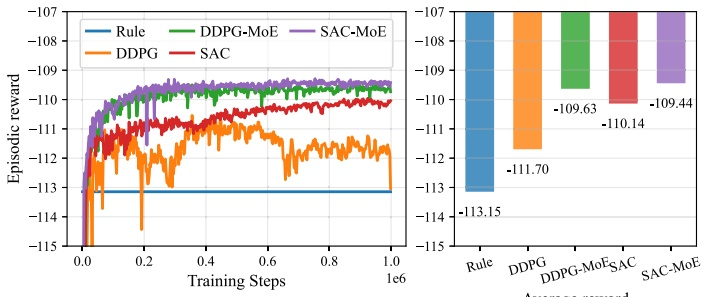

Fig. 5. Learning curves of episodic reward for different methods.

(1) Rule: Rule-Based Controller set the workload executed using a First-Come-First-Served rules. The cooling system operates according to the ASHRAE standard, while the battery system functions as an Uninterruptible Power Supply to provide backup power and do not charge or discharge in the operations [34]. Rule-based controllers are widely adopted in industry due to their simplicity and intuitive design. This baseline serves as a practical reference for evaluating the performance of learning-based methods.

(2) SAC: The SAC is a state-of-the-art DRL algorithm for continuous action spaces. Our proposed SAC-MoE algorithm was developed based on the standard SAC algorithm. Comparing our approach with standard SAC highlighted the advantages of our multi-critic architecture with MoE [35]. In our benchmarks, both the actor and critic networks were fully connected. The reward function was a sum of three sub-rewards, $r = r _ { 1 } + r _ { 2 } + r _ { 3 }$

(3) DDPG: Deep Deterministic Policy Gradient (DDPG) is one of SOTA DRL algorithm with a deterministic policy [36]. For fair comparison, DDPG used the same reward function as in SAC. This baseline helped demonstrate the benefits of stochastic versus deterministic policies in our setting.

To evaluate training and test performance, we split one year of data into separate training and test sets. Specifically, the first day of each month is used as the test set, representing unseen scenarios, while the remaining 353 days form the training set. This setup ensures meaningful generalization evaluation of the learned policies.

Fig. 5 presented the learning curves of episodic rewards over 1𝑒6 training steps. Here, the episodic reward is computed as the average return over the 12 test days, obtained by evaluating the trained policies during the training process. The first observation from Fig. 5 was that all DRL algorithms exhibited an upward trend in episodic rewards over 1𝑒6 training steps, and all outperformed the rule-based control, indicating that the agents progressively learned to optimize the sustainable management task. Notably, both MoE-enhanced methods (SAC-MoE and DDPG-MoE) outperform their respective baselines (SAC and DDPG), with SAC-MoE achieving the best overall performance in terms of total reward. The superior performance of SAC-MoE over

DDPG-MoE can be attributed to SAC’s entropy regularization and stochastic policy, which encourage more effective exploration in complex multi-objective environments. This consistent improvement across different actor-critic algorithms validates that the proposed MoE-based multi-critic framework is a general architectural enhancement applicable to various actor-critic paradigms.

As a result, to further evaluate the learning performance of the DRL algorithms, we illustrated the evolution of three key sub-reward components: carbon reward, energy reward, and workload penalty reward, as shown in Figs. 6 and 7. It could be observed that the MoE-enhanced methods (SAC-MoE and DDPG-MoE), leveraging the mixture-of-experts based multi-critic structure, achieved higher carbon rewards than their respective baselines, indicating superior effectiveness in reducing carbon footprint. In terms of energy consumption reward, SAC-MoE achieved slightly lower energy consumption than SAC, while DDPG-MoE showed comparable performance to DDPG. For the workload penalty reward, which quantifies the degree of constraint violation where a value closer to zero indicates better constraint satisfaction, both SAC-MoE and DDPG-MoE achieved the lowest average penalty value (−0.05), significantly outperforming their baselines SAC (−0.36) and DDPG (−1.65), respectively. These results further validate the effectiveness of the multi-critic architecture in addressing workload scheduling constraints. Additionally, it was noteworthy that in SAC-MoE, carbon reward improved during training while energy reward showed a tiny decrease, which indirectly demonstrated the inherent conflicts between energy efficiency and carbon reduction objectives. This trade-off phenomenon highlighted the complexity of multi-objective optimization in sustainable DC management, where improving one objective may come at the cost of another.

To better understand the internal mechanisms of the proposed SAC-MoE algorithm, we analyze how the gating network controls expert utilization and weighting in the mixture-of-experts (MoE) critic network during training and policy execution.

Fig. 8 showed the evolution of expert usage frequencies, computed as the average selection rate of each expert by the gating network when updating the critic with mini-batches of sampled data. The usage patterns revealed that the gating network balanced expert utilization well during training, converging to a predetermined utilization rate of 0.2, preventing over-concentration on specific experts and encouraging all experts to contribute, which enhanced model capacity utilization and training stability.

Fig. 9 depicted the dynamic adjustment of expert weights assigned by the gating network during online policy execution, i.e., when the actor generated actions while interacting with the environment. We selected the weight of the first expert for detailed analysis to demonstrate the gating network’s adaptive behavior. The variations in expert weights reflected the gating network’s task-adaptive selection behavior: depending on the current state and operational conditions, the gating network dynamically determined how much each expert should contribute to the value estimation, effectively leveraging expert specialization in different operational regimes. This adaptive behavior demonstrated the MoE architecture’s capability to respond to changing environmental conditions and optimize the contribution of each expert based on the specific requirements of the current state.

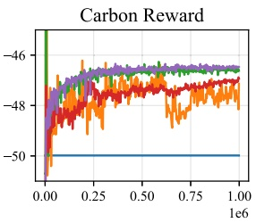

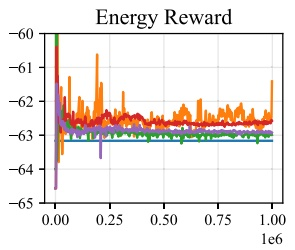

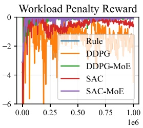

Fig. 6. Evaluation of sub-rewards during training process for different methods.

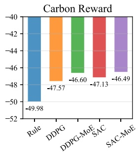

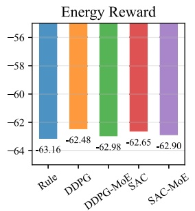

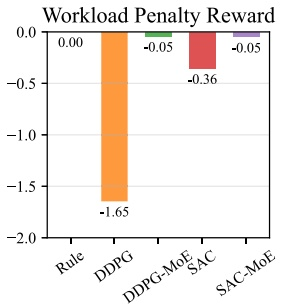

Fig. 7. Comparison of sub-rewards for different methods in the final 100 episodes.

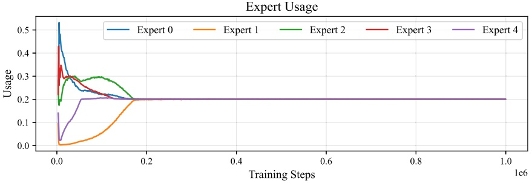

Fig. 8. Expert usage frequency in the MoE critic network during training.

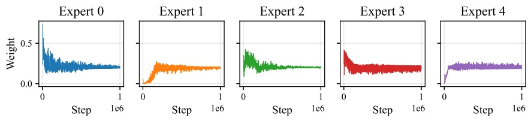

Fig. 9. Dynamic adjustment of expert weights in the MoE critic network during training.

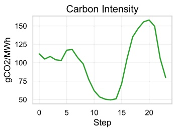

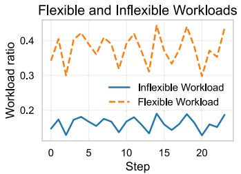

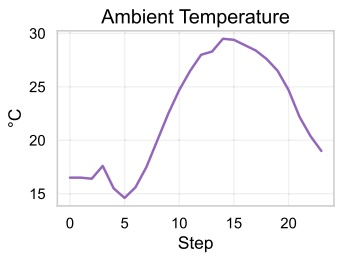

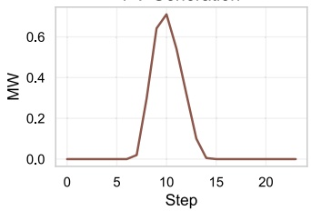

Fig. 10. CPU utilization and carbon intensity metrics over time steps for four control strategies.

## 5.3 . Analysis of the control behavior of DC microgrid

This section analyzed the detailed control behavior of the proposed SAC-MoE algorithm in managing the DC microgrid, examining the dynamic interactions among workload scheduling, cooling control, and energy system operation during a representative operational day (July 1st, 2024).

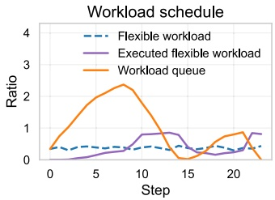

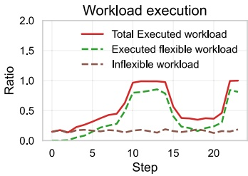

Fig. 11. CPU workload processing patterns and energy consumption.

Fig. 10 presented key external environmental and workload characteristics, including grid carbon intensity, flexible and inflexible CPU workloads, ambient temperature, and PV power generation. These variables exhibited significant temporal fluctuations and provided the context for the system’s operational decisions.

The behavior of flexible workload scheduling was illustrated in Fig. 11. By comparing it with the carbon intensity profile in Fig. 10, it could be observed that flexible workloads were deferred during periods of high carbon intensity, resulting in queue accumulation, and were subsequently executed in greater volumes during periods of low carbon intensity to reduce overall emissions. The right subplot presented the total CPU workload execution pattern, which was the sum of executed flexible workloads and inflexible workloads. The overall trend of total workload execution was primarily driven by the flexible workload dynamics.

Fig. 12 depicted the cooling system’s response. When ambient temperature decreased, the cooling system reduced its setpoint temperature and power consumption accordingly. By referencing the total workload trend in Fig. 11, it was evident that IT power consumption closely followed the total workload pattern. Conversely, when ambient temperature increased, the cooling system correspondingly adjusted its setpoint and increased cooling power consumption. However, as shown in the right subplot, the total power consumption was dominated by IT power consumption, while the cooling power consumption exhibited similar trends to IT power consumption but remained relatively smaller. This was because cooling system power was mainly proportional to IT power consumption, with a coefficient determined by the coefficient of performance (COP), which itself was only weakly affected by ambient temperature variations.

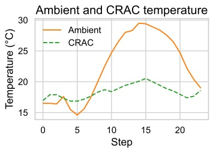

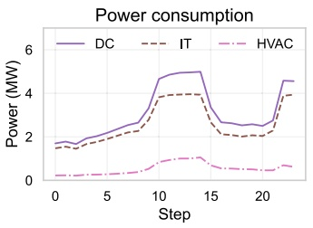

Fig. 12. DC system performance metrics including IT power, cooling efficiency, and system coordination.

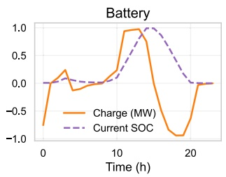

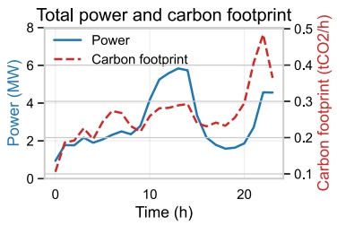

Fig. 13. Microgrid performance metrics including renewable utilization, battery dynamics, and grid interaction.

Finally, Fig. 13 illustrated the operation of the microgrid, including battery charge/discharge behavior, state of charge (SOC), and overall power consumption and carbon footprint. The battery was predominantly charged during periods of low carbon intensity and discharged during periods of high carbon intensity, contributing effectively to carbon footprint reduction. The coordinated use of battery storage further complemented workload scheduling and cooling control, enabling the system to optimize energy use and minimize emissions in response to dynamic environmental conditions.

## 5.4 . Analysis of the coupling effects of workload, cooling, and energy systems

In DC microgrid, the workload, cooling system, and energy system are coupled with each other. Optimizing one component solely tend to not achieve the optimal performance from the whole system. To validate the superiority of the proposed approach that jointly optimized the three components, we compare the following four experiments:

Case 1 Rule-Based Controller: This baseline has been described in Section 5.2 and serves as the reference for comparison.

Case 2 The SAC-MoE with only optimized the cooling system. The control of workload and the battery was the same as in case 1 where the workload was executed using a First-Come-First-Served rules and the battery system neither charged nor discharged during operations.

Case 3 The SAC-MoE with only optimized the workload and cooling system. The control of the battery was the same as in case 2.

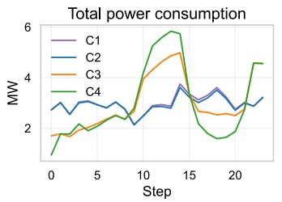

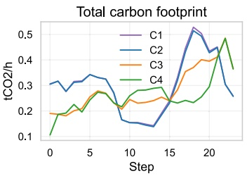

Fig. 14. Comparison of total power consumption and carbon footprint.

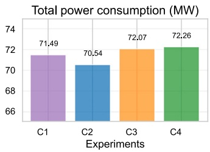

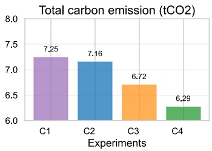

Fig. 15. Daily cumulative comparison of energy consumption and carbon footprint for different algorithms.

Case 4 The proposed SAC-MoE algorithm that jointly optimized the workload, cooling system, and energy system.

Fig. 14 illustrated the temporal evolution of power consumption and carbon footprint under the four control strategies. Compared to case 1 (rule-based control), case 2 only optimized the cooling system and achieved a slight reduction in both power consumption and carbon footprint, demonstrating the limited impact of cooling optimization when decoupled from workload and battery management. Case 3 introduced workload scheduling optimization, allowing flexible shifting of workloads from one time period to another. As a result, power consumption was reduced during certain periods but correspondingly increased during others, reflecting the time-shifting nature of workload management. Case 4, the proposed approach, jointly optimized workload scheduling, cooling and battery dispatch, thereby unlocking greater operational flexibility. Consequently, case 4 exhibited more pronounced variations in both power consumption and carbon footprint compared to case 3 and case 2. This increased variability indicated that the integrated control strategy actively leveraged workload and energy storage flexibility to adaptively manage energy use and carbon footprint, leading to overall superior performance.

Fig. 15 presented the total daily energy consumption and carbon footprint for the different control strategies. In terms of power consumption, case 2 achieved reductions in both power and carbon footprint compared to the rule-based baseline (case 1). However, case 3 resulted in an increase in total power consumption relative to case 2, while simultaneously achieving a notable reduction in carbon footprint. This outcome reflected the effect of workload scheduling: more workloads were shifted to periods with lower carbon intensity, which increased power usage per workload during these periods but reduced the overall carbon footprint due to cleaner electricity sources. Case 4 further improved upon case 3 by incorporating battery dispatch optimization. Although the presence of charging and discharging inefficiencies led to a slight increase in total power consumption, the battery was strategically charged during periods of low carbon intensity and discharged during periods of high carbon intensity. As a result, case 4 achieved the lowest overall carbon footprint among all strategies, highlighting the benefit of jointly optimizing workload scheduling, cooling, and battery management with consideration of carbon intensity dynamics.

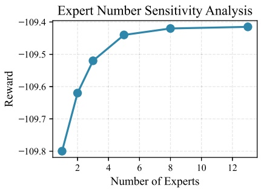

Fig. 16. Sensitivity analysis of the number of experts.

## 5.5 . Sensitivity analysis of the number of experts

The rationale for selecting 5 experts is twofold. First, since our framework addresses three distinct objectives (energy cost, carbon emissions, and workload penalty), the number of experts should be greater than the number of objectives to allow sufficient specialization while enabling some experts to capture shared patterns across objectives. Second, we conducted a sensitivity analysis by varying the number of experts $N \in \{ 1 , 2 , 3 , 5 , 8 , 1 3 \}$ to empirically validate this choice.

As shown in Fig. 16, performance improves significantly when increasing from 1 to 5 experts, as more experts provide greater representational capacity for capturing diverse patterns across the three objectives. However, the improvement plateaus beyond 5 experts. Since the computational cost scales linearly with the number of experts, we selected $N = 5$ as it achieves near-optimal performance while maintaining computational efficiency.

## 5.6 . Robustness analysis under prediction errors

In the main experiments, we assume perfect forecasts for workload, ambient temperature, and carbon intensity to establish baseline performance. To evaluate the robustness under realistic conditions, we introduced Gaussian noise to the predictions in the observation space. The noisy prediction is computed as $\tilde { p } = p \cdot ( 1 + \epsilon ) ,$ where $\epsilon \sim \mathcal { N } ( 0 , \sigma )$ and 𝜎 represents the noise level. Importantly, while the agent observes the noisy predictions during decision-making, the reward is computed using true values to evaluate actual performance. We tested noise levels of 0%, 5%, 10%, 15%, and 20%.

As shown in Fig. 17, the proposed SAC-MoE method demonstrates strong robustness to prediction errors. The total reward degrades gracefully from −109.44 at 0% noise to −110.12 at 20% noise, with only 0.62% performance degradation, indicating that the method can effectively handle realistic prediction errors without significant performance loss.

This robustness can be attributed to two factors: (1) the MoE architecture allows different experts to specialize in different operating conditions, providing inherent adaptability to input variations; and (2) the multi-critic framework separately evaluates energy, carbon, and penalty objectives, preventing prediction errors from catastrophically affecting the overall policy through error propagation across objectives. These results suggest that the proposed method is suitable for practical deployment where perfect predictions are unavailable.

## 5.7 . Extension to multi-objective reinforcement learning with dynamic weights

Our MoE-based multi-critic framework can be naturally extended to support dynamic weight adaptation by integrating with existing MORL techniques. Traditional MORL methods, such as the dynamic weights approach [37], typically focus on learning a set of policies that approximate the Pareto front, enabling users to select different trade-offs at deployment time without retraining. These methods condition the policy on a preference weight vector and use standard neural network architectures for their value functions.

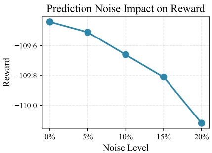

Fig. 17. Robustness analysis under different prediction noise levels. The proposed SAC-MoE method maintains stable performance, with only 0.62% degradation even at 20% noise level.

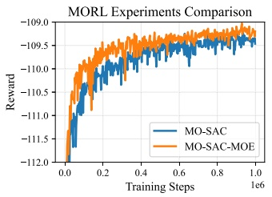

(a) Training curves

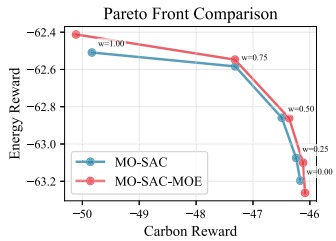

(b) Pareto front comparison

Fig. 18. Comparison of MO-SAC and MO-SAC-MoE: (a) training curves; (b) Pareto front showing trade-offs between carbon and energy rewards at different weight settings, where 𝑤 denotes the weight for energy reward and (1 − 𝑤) for carbon reward with 𝑤 $\in \{ 0 , 0 . 2 5 , 0 . 5 , 0 . 7 5 , 1 . 0 \}$ , computed from the average of the last 100 episodes.

In contrast, our proposed method introduces a mixture-of-experts (MoE) structure into the critic networks, which enables dynamic expert specialization and provides stronger representational capacity, leading to improved learning performance and faster convergence. Importantly, our MoE-based multi-critic architecture is complementary to traditional MORL methods and can be naturally integrated with them to further enhance learning performance.

To demonstrate this, we extend the dynamic weights approach proposed by Abels et al. [37] from the DQN framework to our actor-critic framework. The resulting method, denoted as MO-SAC-MoE, not only adapts instantly to any user-specified objective weights at deployment time without retraining, but also further improves the learning performance of dynamic-weight MORL methods by leveraging the strong representational capacity of the MoE-based multi-critic architecture. Specifically, MO-SAC-MoE takes the preference weight vector 𝐰 as an additional input to both the actor and critic networks. The actor produces weight-conditioned actions $\pi ( a | s , \mathbf { w } ) _ { z }$ while the critic employs the MoE-based multi-critic architecture to learn weight-conditioned Qvalues $Q _ { i } ( s , a , \mathbf { w } )$ for each objective. During training, the weight vector is randomly sampled from a uniform distribution at the beginning of each episode. The actor is updated to maximize the weighted combination $\textstyle \sum _ { i } w _ { i } Q _ { i } ( s , a , \mathbf { w } )$ based on the sampled preference. At deployment, the policy can instantly adapt to any user-specified preference by simply providing the desired weight vector as input.

As shown in Fig. 18, we compared the baseline MORL methods with our MoE-enhanced versions. The left panel shows the training curves, demonstrating that MO-SAC-MoE converges faster and achieves higher rewards than MO-SAC. The right panel shows the Pareto front approximation, computed from the average rewards over the last 100 episodes at different weight settings. MO-SAC-MoE consistently dominates MO-SAC across different weight settings, achieving better trade-offs between energy cost and carbon emissions. These results validate that when integrated with dynamic-weight MORL methods, our MoE-based multi-critic architecture enables instant adaptation to user-defined preferences without retraining, while further enhancing the learning performance. As shown in Fig. 18, we compared the baseline MORL methods with our MoE-enhanced versions. The left panel shows the training curves, demonstrating that MO-SAC-MoE converges faster and achieves higher rewards than MO-SAC. The right panel shows the Pareto front approximation, computed from the average rewards over the last 100 episodes at different weight settings. MO-SAC-MoE consistently dominates MO-SAC across different weight settings, achieving better trade-offs between energy cost and carbon emissions. These results validate that when integrated with dynamic-weight MORL methods, our MoE-based multi-critic architecture enables instant adaptation to user-defined preferences without retraining, while further enhancing the learning performance.

## 6 . Conclusions and future work

This paper presented a novel multi-critic DRL framework based on a MoE with multi-head architecture for the sustainable management of DC microgrids. By formulating the joint optimization of workload scheduling, cooling, and energy subsystems as a multi-reward MDP, the proposed approach enabled simultaneous optimization of workload efficiency, energy consumption, and carbon footprint. The multi-critic structure, together with shared expert subnetworks and adaptive gating, provided richer feedback, improved learning stability, and enhanced adaptability to complex, multi-objective environments. Extensive experiments on a realistic DC microgrid testbed demonstrated that the proposed method achieved significant reductions in both energy consumption and carbon footprint compared to state-of-the-art DRL and rule-based baselines, and outperformed single-critic and decoupled control strategies in terms of system-level sustainability and flexibility.

Despite these promising results, this work was limited to a single DC microgrid and a moderate system scale. Future research will focus on extending the proposed framework to large-scale, geographically distributed DC networks and more heterogeneous, dynamic environments.

## CRediT authorship contribution statement

**Qiong Liu:** Writing – review & editing, Writing – original draft, Visualization, Validation, Software, Methodology, Investigation, Formal analysis, Conceptualization. **Zhanhua Pan:** Writing – review & editing, Writing – original draft, Formal analysis. **Ye Guo:** Writing – review & editing, Writing – original draft, Visualization, Validation. **Yue Chen:** Writing – review & editing, Writing – original draft, Visualization, Validation. **Goran Strbac:** Writing – review & editing, Writing – original draft, Visualization, Validation. **Dawei Qiu:** Writing – review & editing, Writing – original draft, Visualization, Validation, Supervision, Investigation, Funding acquisition, Formal analysis.

## Declaration of competing interest

The authors declare that they have no known competing financial interests or personal relationships that could have appeared to influence the work reported in this paper.

## Acknowledgement

This work was supported by the UK ARIA Safeguarded AI TA3 Real-World Use Cases project “SAINTES: Safe and scalable AI decision support Tools for Energy Systems” and the work of Yue Chen was supported by Research Grants Council (RGC) of the Hong Kong Special Administrative Region of China and the [National Natural Science Foundation of China](https://doi.org/10.13039/501100001809) (NSFC) under the NSFC/RGC Joint Research Scheme Grant \_CUHK422/25 and The Chinese University of [Hong Kong Strategic Seed Funding for Collaborative Research Scheme](https://doi.org/10.13039/) under Grant 3136080.

## Data availability

No data was used for the research described in the article.

## References

[1] The International Energy Agency. Energy demand from AI – energy and AI – analysis; 2025. [https://www.iea.org/reports/energy-and-ai/energy-demand-from-ai.](https://www.iea.org/reports/energy-and-ai/energy-demand-from-ai)

[2] The U.S. Department of Energy. DOE releases new report evaluating increase in electricity demand from data centers; 2024. [https://www.energy.gov/articles/doe-releases-new-report-evaluating-increase-electricity-demand-data-centers.](https://www.energy.gov/articles/doe-releases-new-report-evaluating-increase-electricity-demand-data-centers)

[3] Sundar Pichai. Our third decade of climate action: realizing a carbon-free future; 2020. [https://blog.google/outreach-initiatives/sustainability/our-third-decade-climate-action-realizing-carbon-free-future/.](https://blog.google/outreach-initiatives/sustainability/our-third-decade-climate-action-realizing-carbon-free-future/)

[4] Postema BF. Energy-efficient data centres: model-based analysis of powerperformance trade-offs, [Ph.D. thesis], Enschede, The Netherlands: University of Twente; 2018. [http://purl.org/utwente/doi/10.3990/1.9789036546881.](http://purl.org/utwente/doi/10.3990/1.9789036546881)

[5] Acun B, Lee B, Kazhamiaka F, Maeng K, Chakkaravarthy M, Gupta U, Brooks D, Wu C-J. Carbon Explorer: a holistic approach for designing carbon aware datacenters. In: Proceedings of the 28th ACM International Conference on architectural support for programming languages and operating systems, volume 2; 2023. p. 118–32. [arXiv:2201.10036.](http://arxiv.org/abs/2201.10036)

[6] [Guo C, Luo F, Cai Z, Dong ZY. Integrated energy systems of data centers and smart grids: state-of-the-art and future opportunities. Appl Energy 2021;301:117474.](http://refhub.elsevier.com/S0306-2619%2826%2900213-8/sbr0030)

[7] [Dong Z, Liu N, Rojas-Cessa R. Greedy scheduling of tasks with time constraints for energy-efficient cloud-computing data centers. J Cloud Comput Adv Syst Appl 2015;4.](http://refhub.elsevier.com/S0306-2619%2826%2900213-8/sbr0035)

[8] [Chen H, Zhang Y, Caramanis MC, Coskun AK. EnergyQARE: QoS-Aware data center participation in smart grid regulation service reserve provision. ACM Trans Model Perform Eval Comput Syst 2019;4:2:1–2:31.](http://refhub.elsevier.com/S0306-2619%2826%2900213-8/sbr0040)

[9] [Jin T, Bai L, Yan M, Chen X. Unlocking Spatio-Temporal flexibility of data centers in multiple regional Peer-to-Peer energy transaction markets. IEEE Trans Power Syst 2025:1–13.](http://refhub.elsevier.com/S0306-2619%2826%2900213-8/sbr0045)

[10] [Zhou R, Wang Z, Bash CE, McReynolds A. Modeling and control for cooling management of data centers with hot aisle containment. In: ASME 2011 International Mechanical Engineering Congress and Exposition. American Society of Mechanical Engineers Digital Collection; 2012. p. 739–46.](http://refhub.elsevier.com/S0306-2619%2826%2900213-8/sbr0050)

[11] [Qu S, Duan K, Guo Y, Feng Y, Wang C, Xing Z. Real-time optimization of the liquidcooled data center based on cold plates under different ambient temperatures and thermal loads. Appl Energy 2024;363:123101.](http://refhub.elsevier.com/S0306-2619%2826%2900213-8/sbr0055)

[12] [Gupta R, Asgari S, Moazamigoodarzi H, Down DG, Puri IK. Energy, exergy and computing efficiency based data center workload and cooling management. Appl Energy 2021;299:117050.](http://refhub.elsevier.com/S0306-2619%2826%2900213-8/sbr0060)

[13] [Kwon S. Ensuring renewable energy utilization with quality of service guarantee for energy-efficient data center operations. Appl Energy 2020;276:115424.](http://refhub.elsevier.com/S0306-2619%2826%2900213-8/sbr0065)

[14] [Lian Y, Li Y, Zhao Y, Yu C, Zhao T, Wu L. Robust multi-objective optimization for islanded data center microgrid operations. Applied Energy 2023;330:120344.](http://refhub.elsevier.com/S0306-2619%2826%2900213-8/sbr0070)

[15] [Wang R, Xia D, Cao Z, Wen Y, Tan R, Zhou X. Toward data center digital twins via knowledge-based model calibration and reduction. ACM Trans Model Comput Simul 2023;33:1–24.](http://refhub.elsevier.com/S0306-2619%2826%2900213-8/sbr0075)

[16] [Sutton RS, Barto AG. Reinforcement learning, second edition: an introduction. MIT Press; 2018.](http://refhub.elsevier.com/S0306-2619%2826%2900213-8/sbr0080)

[17] [Liu W, Yan Y, Sun Y, Mao H, Cheng M, Wang P, Ding Z. Online job scheduling scheme for low-carbon data center operation: an information and energy nexus perspective. Appl Energy 2023;338:120918.](http://refhub.elsevier.com/S0306-2619%2826%2900213-8/sbr0085)

[18] [Li X, Wang J, Shi K, Lu C, Chen S, Ding Z. Energy-Cost-Driven scheduling scheme for data centers incorporating job dependency constraints. IEEE Trans Ind Appl 2025;61:5420–9.](http://refhub.elsevier.com/S0306-2619%2826%2900213-8/sbr0090)

[19] [Lou J, Tang Z, Jia W. Energy-Efficient joint task assignment and migration in data centers: a deep reinforcement learning approach. IEEE Trans Netw Serv Manag 2023;20:961–73.](http://refhub.elsevier.com/S0306-2619%2826%2900213-8/sbr0095)

[20] [Sun Y, Ding Z, Yan Y, Wang Z, Dehghanian P, Lee W-J. Privacy-Preserving energy sharing among cloud service providers via collaborative job scheduling. IEEE Trans Smart Grid 2024:1.](http://refhub.elsevier.com/S0306-2619%2826%2900213-8/sbr0100)

[21] [Mahbod MHB, Chng CB, Lee PS, Chui CK. Energy saving evaluation of an energy efficient data center using a model-free reinforcement learning approach. Appl Energy 2022;322:119392.](http://refhub.elsevier.com/S0306-2619%2826%2900213-8/sbr0105)

[22] [Zhang Q, Zeng W, Lin Q, Chng C-B, Chui C-K, Lee P-S. Deep reinforcement learning towards real-world dynamic thermal management of data centers. Appl Energy 2023;333:120561.](http://refhub.elsevier.com/S0306-2619%2826%2900213-8/sbr0110)

[23] [Guo Y, Qu S, Wang C, Xing Z, Duan K. Optimal dynamic thermal management for data center via soft actor-critic algorithm with dynamic control interval and combined-value state space. Appl Energy 2024;373:123815.](http://refhub.elsevier.com/S0306-2619%2826%2900213-8/sbr0115)

[24] [Leindals L, Grønning P, Dominković DF, Junker RG. Context-aware reinforcement learning for cooling operation of data centers with an aquifer thermal energy storage. Energy and AI 2024;17:100395.](http://refhub.elsevier.com/S0306-2619%2826%2900213-8/sbr0120)

[25] [Hu Y, Yang J, Ruan X, Chen Y, Li C, Zhang Z, Zhang W. Green optimization for micro data centers: task scheduling for a combined energy consumption strategy. Appl Energy 2025;393:126031.](http://refhub.elsevier.com/S0306-2619%2826%2900213-8/sbr0125)

[26] [Jayanetti A, Halgamuge S, Buyya R. Multi-Agent deep reinforcement learning framework for renewable Energy-Aware workflow scheduling on distributed cloud data centers. IEEE Trans Parallel Distrib Syst 2024;35:604–15.](http://refhub.elsevier.com/S0306-2619%2826%2900213-8/sbr0130)

[27] [Biemann M, Gunkel PA, Scheller F, Huang L, Liu X. Data center HVAC control harnessing flexibility potential via Real-Time pricing cost optimization using reinforcement learning. IEEE Internet Things J 2023;10:13876–94.](http://refhub.elsevier.com/S0306-2619%2826%2900213-8/sbr0135)

[28] [Zhao D, Zhou J-T, Li K. CFWS: DRL-based framework for energy cost and carbon footprint optimization in cloud data centers. IEEE Trans Sustain Comput 2025;10:95–107.](http://refhub.elsevier.com/S0306-2619%2826%2900213-8/sbr0140)

[29] [Wen Q, Zhou T, Zhang C, Chen W, Ma Z, Yan J, Sun L. Transformers in time series: a survey. In: Proceedings of the Thirty-Second International Joint Conference on Artificial Intelligence. Macau, SAR China: International Joint Conferences on Artificial Intelligence Organization; 2023. p. 6778–86.](http://refhub.elsevier.com/S0306-2619%2826%2900213-8/sbr0145)

[30] National Energy System Operator. Welcome to the NESO data portal; 2025. [https://www.neso.energy/data-portal.](https://www.neso.energy/data-portal)

[32] Alibaba GroupAlibaba/clusterdata, Alibaba; 2025. [https://github.com/alibaba/clusterdata.](https://github.com/alibaba/clusterdata)

[31] Open-Meteo.com. Free Open-Source weather API; 2025. [https://open-meteo.com.](https://open-meteo.com)

[33] Intel Corporation. Intel® xeon® platinum 8468 processor (105m cache, 2.10 GHz) - product specifications; 2025. [https://www.intel.com/content/www/us/en/products/sku/231735/intel-xeon-platinum-8468-processor-105m-cache-2-10-ghz/specifications.html.](https://www.intel.com/content/www/us/en/products/sku/231735/intel-xeon-platinum-8468-processor-105m-cache-2-10-ghz/specifications.html)

[34] [Sun K, Luo N, Luo X, Hong T. Prototype energy models for data centers. Energy and Buildings 2021;231:110603.](http://refhub.elsevier.com/S0306-2619%2826%2900213-8/sbr0170)

[35] Haarnoja T, Zhou A, Hartikainen K, Tucker G, Ha S, Tan J, Kumar V, Zhu H, Gupta A, Abbeel P, Levine S. Soft Actor-Critic Algorithms and Applications. [arXiv:1812.05905.](http://arxiv.org/abs/1812.05905) 2019.

[36] [Lillicrap TP, Hunt JJ, Pritzel A, Heess N, Erez T, Tassa Y, Silver D, Wierstra D. Continuous control with deep reinforcement learning. In: 4th International Conference on Learning representations. San Juan, Puerto Rico; 2016.](http://refhub.elsevier.com/S0306-2619%2826%2900213-8/sbr0180)

[37] [Abels A, Roijers D, Lenaerts T, Nowé A, Steckelmacher D. Dynamic weights in Multi-Objective deep reinforcement learning. In: Proceedings of the 36th International Conference on machine Learning. PMLR; 2019. p. 11–20.](http://refhub.elsevier.com/S0306-2619%2826%2900213-8/sbr0185)