# Lean multi-agent deep reinforcement learning for uncertainty handling in the energy management of networked microgrids

- 期刊：Applied Energy
- DOI：10.1016/j.apenergy.2026.127354
- 版本：出版社正式版
- 原文页数：31
- 文本解析：MinerU 4.0.12 / basic / 全文
- [原始 PDF](../../1-s2.0-S0306261926000061-main.pdf)
- [逐页截图](screenshots.html)

> 以下为机器解析的原文，未翻译、未改写。公式、表格和双栏阅读顺序可能存在识别误差，请以原始 PDF 和逐页截图为准。

## 论文首页

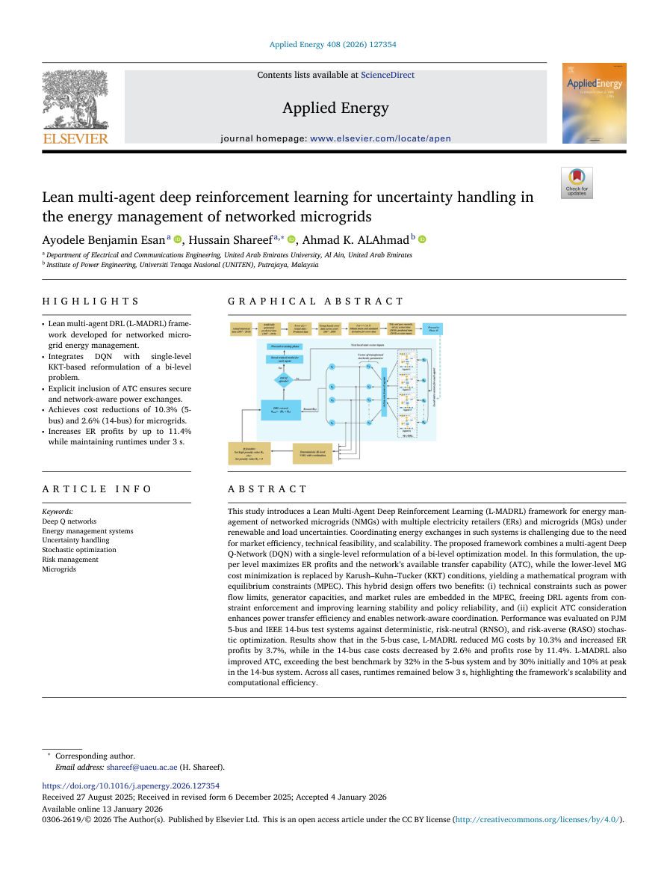

## 全文

Ayodele Benjamin Esana [iD](https://orcid.org/0000-0002-5409-4781), Hussain Shareef a,∗ [iD](https://orcid.org/0000-0001-7708-6904), Ahmad K. ALAhmadb [iD](https://orcid.org/0000-0002-5024-7795)

a Department of Electrical and Communications Engineering, United Arab Emirates University, Al Ain, United Arab Emirates bInstitute of Power Engineering, Universiti Tenaga Nasional (UNITEN), Putrajaya, Malaysia

## H I G H L I G H T S

• Lean multi-agent DRL (L-MADRL) framework developed for networked microgrid energy management.

• Integrates DQN with single-level KKT-based reformulation of a bi-level problem.

• Explicit inclusion of ATC ensures secure and network-aware power exchanges.

• Achieves cost reductions of 10.3% (5- bus) and 2.6% (14-bus) for microgrids.

• Increases ER profits by up to 11.4% while maintaining runtimes under 3 s.

## G R A P H I C A L A B S T R A C T

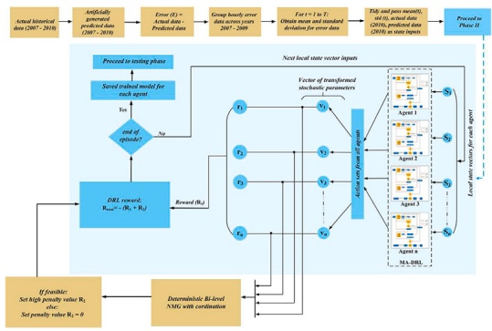

## A R T I C L E I N F O

Keywords: Deep Q networks Energy management systems Uncertainty handling Stochastic optimization Risk management Microgrids

## Abstract

This study introduces a Lean Multi-Agent Deep Reinforcement Learning (L-MADRL) framework for energy management of networked microgrids (NMGs) with multiple electricity retailers (ERs) and microgrids (MGs) under renewable and load uncertainties. Coordinating energy exchanges in such systems is challenging due to the need for market efficiency, technical feasibility, and scalability. The proposed framework combines a multi-agent Deep Q-Network (DQN) with a single-level reformulation of a bi-level optimization model. In this formulation, the upper level maximizes ER profits and the network’s available transfer capability (ATC), while the lower-level MG cost minimization is replaced by Karush–Kuhn–Tucker (KKT) conditions, yielding a mathematical program with equilibrium constraints (MPEC). This hybrid design offers two benefits: (i) technical constraints such as power flow limits, generator capacities, and market rules are embedded in the MPEC, freeing DRL agents from constraint enforcement and improving learning stability and policy reliability, and (ii) explicit ATC consideration enhances power transfer efficiency and enables network-aware coordination. Performance was evaluated on PJM 5-bus and IEEE 14-bus test systems against deterministic, risk-neutral (RNSO), and risk-averse (RASO) stochastic optimization. Results show that in the 5-bus case, L-MADRL reduced MG costs by 10.3% and increased ER profits by 3.7%, while in the 14-bus case costs decreased by 2.6% and profits rose by 11.4%. L-MADRL also improved ATC, exceeding the best benchmark by 32% in the 5-bus system and by 30% initially and 10% at peak in the 14-bus system. Across all cases, runtimes remained below 3 s, highlighting the framework’s scalability and computational efficiency.

<small>∗ Corresponding author. Email address: [shareef@uaeu.ac.ae](mailto:shareef@uaeu.ac.ae) (H. Shareef).</small>

<table><tr><td colspan="2">Nomenclature</td><td colspan="2"> $\overline { { P } } _ { \ell }$ </td><td>Thermal limit of line t [MW]</td></tr><tr><td colspan="2">Sets</td><td colspan="2">n</td><td>Number of buses(i,  $j , k = 1 , \ldots , n )$ </td></tr><tr><td>I Set of ERs</td><td> $( i = 1 , \dots , N _ { \mathrm { E R } } )$ </td><td colspan="2">m</td><td>Number of branches/lines  $( \ell = 1 , \ldots , m )$ </td></tr><tr><td> $\kappa$ </td><td> $( k = 1 , \dots , N _ { \mathrm { M G } } )$  Set of microgrids</td><td colspan="2"> $x _ { \ell }$ </td><td>Series reactance of line € [p.u.]</td></tr><tr><td> $\mathcal { M }$ </td><td>Set of microturbines  $( m = 1 , \ldots , \mathbf { M } )$ </td><td colspan="2"> $b _ { \ell } = 1 / x _ { \ell }$ </td><td>Series susceptance of line € [p.u.]</td></tr><tr><td> $\mathcal { L }$ </td><td>Set of transmission lines</td><td colspan="2"> $\begin{array} { r } { p _ { \omega } = \frac { 1 } { | \Omega | } } \end{array}$ </td><td>Scenario probabilities</td></tr><tr><td> $\Omega$ </td><td>Set of uncertainty scenarios</td><td colspan="2"></td><td></td></tr><tr><td> $\mathcal { T } = \{ 1 , \ldots , T \}$ </td><td>Time horizon (24 hourly steps)</td><td colspan="2">Variables</td><td></td></tr><tr><td> $\mathcal { B } \subseteq \mathcal { K }$ </td><td>Microgrids with battery storage</td><td colspan="2"> $P _ { \mathrm { M T } , k , t }$ </td><td>MT power [MW]</td></tr><tr><td> $\mathcal { W } \subseteq \mathcal { K }$ </td><td>Microgrids with wind generation</td><td colspan="2"> $P _ { \mathrm { r . . . } } ^ { \mathrm { e x } }$  K,I</td><td>Exchange (+ import,-export) [MW]</td></tr><tr><td> $S \subseteq { \mathcal { K } }$ </td><td>Microgrids with solar generation</td><td colspan="2"> $P ^ { \mathrm { { c h } } }$   $\tau _ { k , t }$ </td><td>Battery charging power [MW]</td></tr><tr><td>Parameters</td><td></td><td colspan="2"> $P _ { r } ^ { \mathrm { d i s } }$   $^ { - } _ { - } { } _ { k , t }$ </td><td>Battery discharging power [MW]</td></tr><tr><td> $D _ { k , t }$ </td><td>Load demand [MW]</td><td> $E _ { k , t }$ </td><td colspan="2">Battery state of charge [MWh] On/off status of MT i (binary)</td></tr><tr><td> $P _ { \mathrm { ~ \tiny ~ \hat { ~ } ~ \hat { ~ } ~ } } ^ { \mathrm { \tiny ~ \hat { ~ } ~ \hat { ~ } i n d } }$   $\tau _ { k , t ] }$ </td><td>Available wind generation [MW]</td><td> $u _ { i , t }$ </td><td colspan="2">Start-up / shut-down flags (binary)</td></tr><tr><td> $\overset { \cdot \cdot \cdot \cdot } { P ^ { \mathrm { s o l a r } } }$ </td><td>Available solar generation [MW]</td><td> $v _ { i , t } ,   w _ { i , t }$ </td><td colspan="2"></td></tr><tr><td> $\tilde { C _ { k } ^ { ' } }$ </td><td>MT fuel cost [€/litre]</td><td> $P _ { i , t } ^ { \mathrm { g r i d } }$ </td><td colspan="2">Power imported from grid [MW]</td></tr><tr><td> $L _ { k }$ </td><td>Lower heating value of MT fuel [MWh/litre]</td><td> $\Dot { P ^ { \mathrm { e x c } } }$   $\dot { r _ { i , k , t } }$ </td><td colspan="2">Power exported from MGC i to MG k [MW]</td></tr><tr><td></td><td>MT electrical efficiency [%]</td><td> $G _ { i , t } ^ { \mathrm { r e d } }$   $G _ { i , t } ^ { \mathrm { n e u } }$ </td><td colspan="2">Redispatched generation at MGC i [MW]</td></tr><tr><td> $\eta _ { k }$   $P ^ { \mathrm { m a x } }$ </td><td>MT maximum power [MW]</td><td> $D _ { \boldsymbol { k } , t } ^ { \mathrm { r e d } }$ </td><td colspan="2">Redispatched demand at MG k [MW]</td></tr><tr><td> $P _ { \mathrm { M T } , k } ^ { \mathrm { m a x } }$ </td><td>Ramp-up/down limits [MW/h]</td><td>n.t  $\tilde { \mathbf { A } \mathbf { T } \mathbf { C } } _ { t }$ </td><td colspan="2">Available Transfer Capability [MW]</td></tr><tr><td> $R _ { \mathrm { M T } , k } ^ { \uparrow } , R _ { \mathrm { M T } , k } ^ { \downarrow }$ </td><td></td><td> $F _ { \ell , t }$ </td><td colspan="2">Power flow on line € [MW]</td></tr><tr><td> $\overline { { P } } ^ { \mathrm { e x } }$ </td><td>Exchange limit with MGC [MW]</td><td colspan="2"></td><td></td></tr><tr><td> $c _ { t } ^ { \mathrm { g r i d } }$ </td><td>Exchange price [€/MWh]</td><td colspan="2">Abbreviations</td><td></td></tr><tr><td> $P_{k}^{\mathrm{ch,max}}, P_{k}^{\mathrm{dis,max}}$ </td><td>Max charge/discharge power [MW]</td><td>KKT</td><td colspan="2">Karush-Kuhn-Tucker</td></tr><tr><td> $\hat { E } _ { \nu } ^ { \mathrm { m a x } }$ </td><td>Battery capacity [MWh]</td><td>ERs</td><td colspan="2">Electricity Retailers</td></tr><tr><td> $E _ { r } ^ { \tilde { 0 } }$ </td><td>Initial battery SOC [MWh]</td><td>MGs</td><td colspan="2">Microgrids</td></tr><tr><td> $\eta _ { k } ^ { \mathrm { \hat { c h } } } , \eta _ { k } ^ { \mathrm { d i s } }$ </td><td>Battery efficiencies [%]</td><td>DRL</td><td colspan="2">Deep Reinforcement Learning</td></tr><tr><td></td><td>Battery degradation cost coefficients [€/MWh]</td><td>DQN</td><td colspan="2">Deep Q Networks</td></tr><tr><td> $\hat { K } _ { k } ^ { \mathrm { c h } } , \hat { K } _ { k } ^ { \mathrm { d i s } }$ </td><td></td><td></td><td colspan="2"></td></tr><tr><td> $C _ { t } ^ { \mathrm { g r i d } }$ </td><td>Wholesale grid purchase price [€/MWh]</td><td>MT</td><td colspan="2">Micro-turbines</td></tr><tr><td> $C _ { i , t } ^ { \mathrm { e x c } }$ </td><td> $i   ( = 1 . 1 0 C _ { t } ^ { \mathrm { g r i d } } )$  [€/MWh] Tariff charged by MGC i</td><td>SoC</td><td colspan="2">State of Charge</td></tr><tr><td></td><td>Variable fuel cost of MT i [€/MWh]</td><td>DA</td><td colspan="2">Day Ahead</td></tr><tr><td> $C _ { \mathrm { M T } , i } ^ { \mathrm { v a r } }$ </td><td>Start-up/shut-down cost of MT i [€]</td><td>O&amp;M</td><td>Operations and Maintenance</td><td></td></tr><tr><td> $C _ { i } ^ { \mathrm { s u } } ,   C _ { i } ^ { \mathrm { s d } }$ </td><td></td><td>GSF</td><td colspan="2">Generation Shift Factor</td></tr><tr><td> $C _ { i } ^ { \mathrm { w i n d } }$ </td><td>O&amp;M cost of wind owned by MGC i [€/MWh]</td><td>ATC</td><td colspan="2">Available Transfer Capability</td></tr><tr><td> $\Lambda ^ { \stackrel { i } { \mathrm { A T C } } }$ </td><td>Reward coefficient on ATC [€/MW]</td><td>ISF</td><td colspan="2">Injection Shift Factor</td></tr><tr><td> $P _ { \mathrm { M T } , i } ^ { \mathrm { m a x } } , P _ { \mathrm { M T } , i } ^ { \mathrm { m i n } }$ </td><td>Min/max output of MT i [MW]</td><td>MCS</td><td colspan="2">Monte-Carlo Simulation</td></tr><tr><td> $R _ { i } ^ { \uparrow } , R _ { i } ^ { \downarrow }$ </td><td>Ramp-up/down limits of MT i [MW/h]</td><td>PDF</td><td colspan="2">Probability Distribution Function</td></tr><tr><td> $T _ { i } ^ { \operatorname* { m i n } \uparrow } , T _ { i } ^ { \operatorname* { m i n } \downarrow }$ </td><td>Minimum up/down times of MT i [h]</td><td>RNSO</td><td colspan="2">Risk Neutral Stochastic Optimization</td></tr><tr><td> $\dot { P } _ { \mathrm { ~ : ~ : ~ } } ^ { \mathrm { m a x } }$ </td><td>Max import from grid to MGC i [MW]</td><td>RASO</td><td colspan="2">Risk Averse Stochastic Optimization</td></tr><tr><td> $\frac { \mathbf { g m a } , l } { P ^ { \mathrm { m a x } } }$ </td><td></td><td></td><td colspan="2"></td></tr><tr><td> $P _ { \mathrm { e x c } } ^ { \mathrm { a u x } }$ </td><td>Max export from all MGCs to any MG [MW]</td><td>L-MADRL</td><td colspan="2">Lean Multi-Agent Deep Reinforcement Learning</td></tr></table>

## 1 . Introduction

Energy remains a cornerstone of economic development, and as global priorities shift toward sustainability and decarbonization, ensuring efficient, resilient, and reliable energy distribution has become a central concern for utilities, policymakers, and grid operators. In this context, microgrids which are localized energy systems capable of operating independently or in coordination with the main grid have gained prominence as a strategic pathway for modernizing the power sector [1]. Their ability to integrate renewable energy technologies (RETs), improve energy access, and foster grid resilience makes them key enablers in the transition from centralized fossil fuel based infrastructures to decentralized clean energy networks. Deterministic models remain the first analytical approach through which researchers have tried to minimize cost, enhance reliability and more recently improve environmental impacts in the energy management of microgrids. Wu et al. minimized the levelized cost of energy for a Malaysian PV–diesel–battery system, constraining loss-of-load probability (LOLP) to 5% and arriving at a diesel mix that still covers 99.5% of demand [1]. Where a full MILP formulation proved computationally heavy for the energy management of a standalone MG, Sedighizadeh et al.

splited the horizon into 24-h windows applying approximate dynamic programming and a bee-colony heuristic algorithm which slashed solver time by 75% with only a 2% cost gap [2]. For grid-tied systems, Khan et al. developed a day-ahead EMS around a hybrid electric-thermal storage with vehicle-to-grid services; even without uncertainty modelling their approach trimmed operating cost and $CO_{2}$ emissions by 0.8% and 5.3% respectively [3]. Where MILP and MINLP formulations proved intractable, meta-heuristics have been adopted, albeit with no global optima guarantees. For instance, Roslan et al. employed a lightning-search algorithm (LSA) to schedule a diesel–PV–battery microgrid in real Malaysian load conditions, trimming grid import and operating cost by about 62% and cutting CO2 nearly 62%, all with far lower CPU burden than classical back-tracking or MILP methods [4].

A particularly transformative evolution of this type of energy system is the emergence of networked microgrids (NMGs), where multiple microgrids are interconnected through physical or virtual links and co-ordinated through shared control strategies or market mechanisms [5]. This interconnection facilitates enhanced operational flexibility, energy sharing, and the collective use of distributed energy resources (DERs). They also enable strategic islanding capabilities in the event of grid disturbances, supporting both grid resilience and energy autonomy, especially in vulnerable or remote regions. For example, Zhe et al. casted the distribution network (DN) as a Stackelberg leader that posts dynamic buy/sell tariffs, while prosumer MGs responded with unit commitment decisions. Solving the resulting bilevel MILP raised the DN revenue by 8% and clipped MG operating costs by 4% without breaching voltage limits [5]. Chen et al. treated five IEEE 33-bus microgrids as rational agents in a Shapley-value cooperative game where each MG posted a non-negative payoff and the total power purchase cost was reduced by 10% [6]. Merabet et al. explored a cluster of microgrids having diesel generators and solar PVs which shared a medium-voltage feeder offgrid; their results showed that coordinated power exchange trimmed fuel costs by 4.3% and paid back the feeder CAPEX in under four years [7].

While deterministic approaches remain quantitative baselines upon which advanced methods improve, they ignore forecast errors and the unpredictable behaviour of consumers with respect to their load demands. These uncertainties introduce volatility in power supply, complicate demand–supply balancing, and challenge both short-term scheduling and long-term investment planning. In networked configurations, such uncertainties can propagate across the system, affecting inter-microgrid coordination and leading to inefficient dispatch, suboptimal exchanges, or even reliability issues. These gaps pave the way for stochastic (SP), robust (RO) and Chance-Constrained (CCP) approaches, especially as they relate to NMGs. For instance, Nikmehr and Rasad’s Monte Carlo reliability analysis confirms that simply interconnecting MGs without any market layer cuts ENS by 70% and system average interruption frequency index (SAIFI) by 55% compared with islanded operation [8]. Seyednouri et al. compressed 200 wind/PV scenarios to 30 and embedded them in a price-setting bilevel MILP; their results showed that each MG operating cost fell by 7.5%, while the DISCO profit increased by 6.9%. Likewise, the loss-of-load risk dropped by 35%, and their sensitivity analysis revealed that supercapacitors below 0.2 p.u. of battery capacity risk jeopardizing all of the positive results obtained [9]. Jani et al. proposed a two stage stochastic optimization approach for the day-ahead and real-time energy management of microgrids; their work reduced the overall system costs by 5.5% and RES curtailment was also reduced by 15% [10]. Karimi et al. developed a multi-objective bilevel model that first maximizes the upper level distribution network operator’s (DNO) profit and then minimizes both the MG independence loss and its energy not served (ENS); their results revealed independence improved by 12% and the ENS dropped 63% without compromising on the profit realized by the DNO [11]. Similarly, Jani and Jadid proposed a two-stage bi-level framework in which a cooperative retail market clears day-ahead energy trades among networked MGs, while a real-time layer re-dispatches every few minutes to absorb renewable and load fluctuations; their results yielded operating cost reductions of \$61 and an additional \$44 when BESS is included in individual MGs [12]. Where scenario counts explode or tail events are prominent, some researchers have resulted to chance-constrained and robust optimization approaches. Aghdam et al. enforced a 5% violation probability on both emissions and power balance in their networked microgrid formulation. Their results showed that CO2 emissions dropped by 9.2% with a modest 1.3% increase in cost, and tightening epsilon 𝜖 from 10% to 1% increased cost by over 4% [13]. Gao et al. in their work allowed each MG to solve a local robust OPF with polyhedral uncertainty and exchange boundary flows with each other via ADMM; the algorithm converged in a dozen rounds, holding worst-case voltages within ± 3% and at only 1.2% extra cost [14]. To hedge both expected and worst-case costs in networked microgrids, Kim et al. fused a p-robust objective (p = 0.95) with a reduced scenario tree. Results revealed the expected operating cost reduced by 6.4%, while the worst-case cost fell by 12%, revealing a sweet spot between pure stochastic and pure robust formulations [15]. Wang et al. advanced the concept further for combined-cooling–heatingand-power (CCHP) MGs. They formulated a Wasserstein-based two-stage distributionally robust optimisation (WTSDRO) that treated wind power errors as ambiguity sets around the empirical distribution [16]. More recently, Bo et al. demonstrated that robust optimisation can operate at sub-hourly granularity: they embedded a budget-of-uncertainty layer inside a five-minute rolling MILP for an integrated-energy campus microgrid. Column-and-constraint generation solved each window in real time. Their approach reduced worst-case operating cost by about 10% while average cost rose only modestly; crucially, all hydrogen-pressure and thermal constraints remained feasible under every admissible PV/load realizations [17].

Accurate scheduling alone is insufficient if the upstream network lacks the capacity to accommodate the scheduled power transfers. Consequently, ATC emerges as a critical factor in effective energy management, particularly for utilities managing NMGs. ATC quantifies the remaining margin by which power can be transferred between different areas of a network without violating system constraints such as line limits, voltage boundaries, or reliability margins [18], and in the context of NMGs, ATC becomes a vital operational parameter for planning dayahead or intra-day transactions, and guiding real-time power exchange decisions. Liu et al. utilized a fully distributed Jacobi and Gauss–Seidel algorithms in computing the deterministic ATC across five areas [19]. Hou et al. showed that demand response itself is a latent ATC resource. By co-optimizing flexible loads, they were able to increase real-time network capacity, curtail RES losses, and still lower total cost [18]. Probabilistic studies by Wei et al. and Ávila-Ávila et al. reveal that 95% or 90% quantile ATC values are 12–15% below deterministic means, yet targeted network upgrades could help to increase these probabilistic ATC values further [20,21]. Complementing these, Wang et al. embedded ATC evaluation directly within market operations via a bi-level model; the upper level computed the ATC while the lower level handled the economic dispatch [22]. In addressing the multifaceted issues pertaining to uncertainties and ATC maximization, the use of SP, RO, and CCP comes with non-trivial limitations; SP relies on credible joint prob ability distributions of the stochastic parameters considered, in practice this necessitates large scenario trees accompanied by aggressive reductions, which could oftentimes attenuate tail events. This consequently inflates the complexity of bilevel MILP in NMG settings. CCP hinges on a user specified violation rate 𝜖 and tractable surrogates for joint chance constraints. RO avoids probability distributions but is highly sensitive to the choice of uncertainty set; polyhedral and budget sets frequently ignore temporal/spatial correlation, trading renewable utilization and ATC for conservatism, and may still under-hedge if misspecified. In addition, the high compute time needed by these conventional methods, particularly in regard to NMGs is enormous, and often-times not reliable for use in real-time environments.

In response to these challenges, reinforcement learning (RL), particularly deep reinforcement learning (DRL) has emerged as a promising solution. DRL combines the adaptive, sequential decision-making capabilities of RL with the function approximation strength of deep neural networks, enabling intelligent decision-making in dynamic, uncertain, and high dimensional environments. Unlike traditional optimization methods, DRL learns optimal control strategies through continuous interaction with the environment, adapting in real time as system conditions evolve. This makes DRL especially well-suited for solving energy management problems in complex NMG configurations. For instance, Yin et al. added “arousal” and “valence” variables to an actor–critic HVAC controller for a building in a standalone microgrid, so exploration escapes local optima; their results cut daily energy bills by 9% while keeping indoor temperature within ±0.5𝑜𝐶 [23]. Claessens et al. compressed 400 heterogeneous heat pump homes into one cluster-level DQN; after a month of simulation the agent reduced the electricity costs by 18% and shaves 0.9 MW (17%) off the evening peak [24]. Liu & Mao enrich the state of an actor–critic with one-hour PV and load forecast in a grid-tied single MG; the “information-enhanced” agent beats vanilla DDPG by 5.6 – 12.9% on cost while maintaining voltage inside ±5% [25]. Zhou et al. extended the idea to an electric-heat-gas microgrid where a continuous action DDPG co-optimizes battery and CHP, lowering daily costs by 6.8% with convergence in 300 episodes [26]. For networked microgrids, Tan et al. allowed each residential MG to train a Proximal Policy Optimization (PPO) agent locally; the results of their approach reduced the average daily cost by 4.1% and training time by 38% [27]. Guo et al. approximated a Stackelberg equilibrium with a dual layer actor–critic; where the DSO was the price-setter, and the optimal dispatch was done by the MG agents. Equilibrium emerged within 250 episodes, boosting the DSO profit by 5% and reducing the MG costs by 4% [28]. Monfaredi et al. targeted an electric-thermal cluster in a grid-tied multi-energy MG by combining MADDPG with stacked denoising auto-encoders. When tested on an IEEE 33 bus and 8 node gas grid, costs fell by 9% and CO2 emissions fell by 8% [29]. Hedayatnia et al. decoupled training and execution, splitting an offline optimal EMS phase into an online DRL policy. Their results showed the MG cost dropped by 12.9% and run-time by 17% relative to a dueling-DQN baseline, while transmission losses reduced by 6% [30]. Gao et al. injected graph-attention and entropy annealing into Soft-Actor–Critic for a six MG cluster. The algorithm reduced operating costs by 10.2% and RES curtailment by 14.7% [31]. Wang et al. proposed a data-driven multi-agent stochastic-game RL for a networked microgrid with the goal of minimizing costs and improving grid stability [32]. Samadi et al. complemented these advances with a fully decentralized, multi-agent RL where self-interested DER and customer agents learn cost optimal bids via actor–critic algorithms, while an upper-level manager clears local electricity-and-heat trades without exposing raw data. Their results during testing finalized transactions in <2 s, increased the aggregator’s revenue by 5%, and reduced total MG costs by 7% [33]. Yang et al. deployed a Rainbow deep-RL controller that jointly scheduled a wind-farm battery and reserve purchases. By directly mapping forecasted wind and price trajectories to continuous charge/discharge actions, the agent absorbed forecast error automatically and increased the utility’s revenue in every simulated market scenario [34]. Foruzan et al. demonstrated that even a tabular multi-agent RL scheme where each generator, storage unit and customer learns autonomously can drive an islanded MG toward a Nash equilibrium dispatch that lowers fuel use and unmet load probability [35]. Vergara et al. extended RL to inverter-level services where a decentralized actor–critic scheme dispatches on each PV inverter every few seconds and converges to near optimal voltage regulation, limiting additional PV curtailment to <2.5% [36]. Zhou et al. combined deeplearning forecasts with a lightweight DDPG agent for battery scheduling in an integrated energy MG; the RL policy cuts solution time by 61% while sacrificing only 3.1% reductions in cost accuracy relative to an MILP, a trade-off that is crucial for real-time operation [26]. Going beyond electricity-only systems, Zhang et al. framed carbon-capture and power-to-gas dispatch as a Markov game and trained a prioritized experience replay Soft-Actor–Critic (SAC). They observed that when prediction errors exceeded 10%, their PER-SAC reduced total cost by approximately 11.6% [37].

The above discussions show that existing EMS frameworks for MGs and NMGs broadly fall into three methodological families. The first family comprises deterministic formulations and their extensions to stochastic, robust, or chance-constrained optimization. Deterministic EMS schemes for single MGs or simple MG clusters already achieve notable cost and emission reductions using MILP, MINLP, or metaheuristics [1–7]. Their main limitation is that they either neglect uncertainty entirely or only handle it through point forecasts, which can be particularly restrictive in networked settings where forecast errors propagate along the network and affect inter-microgrid exchanges. This has motivated scenario-based stochastic, chance-constrained, and robust formulations for NMGs that co-optimise local DERs, storage, and interconnection flows [8–17]. These approaches capture uncertainty more faithfully, but they typically lead to large-scale mixed-integer programs with many scenarios, long solve times, and they rarely treat ATC as a central objective. ATC-oriented works such as [18–22] focus on computing deterministic or probabilistic transfer margins, sometimes embedded in a market model, but are not usually integrated with detailed NMG EMS and multi-microgrid DRL policies. The second family emphasizes economic interaction and hierarchical decision-making. Here, the distribution network operator, a retailer, or an aggregator is modelled explicitly as a leader that sets prices or dispatch signals, while microgrids or prosumers act as followers that minimize their own operating costs [5,9,11,12,22]. These bi-level or game-theoretic structures capture market behaviour and decentralized decision-making, and some of them already incorporate ATC or line-flow constraints. However, they remain optimization-centric: each scheduling horizon still requires solving a large (often stochastic) bi-level MILP or MINLP, and technical limits are enforced purely through the solver. As a result, online scalability and real-time deployment remain challenging, especially when highdimensional uncertainties or many microgrids are involved. The third family uses deep reinforcement learning to mitigate repeated large-scale optimization and to handle high-dimensional, dynamic environments. DRL has been successfully demonstrated for single MGs, building-level demand response, and multi-energy clusters [23–26,34–37], and more recently for networked or multi-microgrid systems [27–33]. These works show that DRL can reduce cost, peak load, or emissions while greatly accelerating decision times compared with solving a full optimization problem at each step. Nevertheless, most of them either (i) do not embed a full ER–MG bi-level market structure with explicit KKT conditions for the follower MGs, or (ii) enforce network and generator constraints using penalty terms in the reward, which might leave some residual infeasibilities and complicate training.

In light of this, the present work combines elements of all three families. Structurally, it retains the economic clarity of bi-level models by formulating an upper layer that maximizes ER profits and network ATC and a lower layer that minimizes MG operating cost, then recasts the lower layer via its KKT conditions into a single-level MPEC with explicit network, generator, and storage constraints. Methodologically, it uses a lean multi-agent DRL (L-MADRL) framework to learn policies over this constrained environment, so that feasibility with respect to ATC and DER limits is enforced by the MPEC rather than by the DRL agents themselves. In contrast to pure optimization-based NMG frameworks $[ 9 { - } 1 2 , 1 4 , 1 5 , 1 7 ]$ and pure DRL approaches [27,29–33], the proposed L-MADRL framework explicitly includes ATC in the upperlevel objective, models ER–MG coordination over a weakly meshed network, and learns policies that, once trained, achieve near real-time decision speeds while maintaining technical feasibility under renewable and load uncertainties. As later shown in Section 6, this yields consistent cost reductions for MGs and profit increases for ERs relative to deterministic, risk-neutral, and risk-averse stochastic benchmarks on the same PJM 5-bus and IEEE 14-bus systems, while improving ATC and keeping testing runtimes close to those of a deterministic baseline. Table 1 summarizes how the proposed approach compares with representative single and networked microgrid (SMGs/NMGs) studies in the literature. Consequently, the main contributions of this work are as follows:

1. We formulate a bi-level optimization problem in which an upper layer coordinates multiple grid-connected energy resources (ERs) and a lower layer manages interconnected MGs; ERs and MGs exchange power over a weakly meshed distribution network with explicit network constraints. The bi-level problem is then recast as a mathematical program with equilibrium constraints (MPEC) by replacing the lower-level problem with its Karush–Kuhn–Tucker (KKT) conditions, yielding a tractable single-level model.

2. Thereafter, we implement a microgrid coordinator/controller that jointly oversees ER–MG interactions; upper-level objectives are to maximize all ERs profit and maximize the ATC between sources (ERs) and sinks (MGs), while the lower level minimizes MGs operating cost.

3. We then develop a L-MADRL framework to solve the resulting MPEC under solar, wind, and load-demand uncertainties on both the ER and MG sides.

Table 1

Selected literature summary and proposed work.

<table><tr><td rowspan="2">Reference</td><td rowspan="2">System</td><td colspan="3">Uncertainties</td><td rowspan="2">Uncertainty Model</td><td rowspan="2">Network Constr.</td><td rowspan="2">Bi-level EMS structure</td><td colspan="3">Objectives</td><td rowspan="2">DRL Agent</td></tr><tr><td>PV</td><td>Load Wind</td><td></td><td>Profit Max.</td><td>Cost Min.</td><td>ATC Max.</td></tr><tr><td>Ref [1]</td><td>SMG</td><td>x</td><td>x</td><td>x</td><td>Deterministic</td><td>x</td><td>x</td><td>x</td><td>√</td><td>x</td><td>Not Applicable</td></tr><tr><td>Ref [2]</td><td>SMG</td><td>x</td><td>x</td><td>x</td><td>Deterministic</td><td>x</td><td>x</td><td>x</td><td>√</td><td>x</td><td>Not Applicable</td></tr><tr><td>Ref [17]</td><td>SMG</td><td>√</td><td>x</td><td>√</td><td>Robust</td><td>√</td><td>x</td><td>x</td><td>√</td><td>x</td><td>Not Applicable</td></tr><tr><td>Ref [16]</td><td>SMG</td><td>x</td><td>√</td><td></td><td>Robust</td><td>√</td><td>x</td><td>x</td><td>√</td><td>x</td><td>Not Applicable</td></tr><tr><td>Ref [3]</td><td>SMG</td><td>x</td><td>x</td><td>x</td><td>Deterministic</td><td>x</td><td>x</td><td>x</td><td>√</td><td>x</td><td>Not Applicable</td></tr><tr><td>Ref [5]</td><td>NMG</td><td>x</td><td>x</td><td>x</td><td>Deterministic</td><td>√</td><td>√</td><td>√</td><td>√</td><td>x</td><td>Not Applicable</td></tr><tr><td>Ref [13]</td><td>NMG</td><td>√</td><td>√</td><td>L</td><td>Chance-Constrained</td><td>√</td><td>x</td><td>x</td><td></td><td>x</td><td>Not Applicable</td></tr><tr><td>Ref [20]</td><td>NMG</td><td>√</td><td>√</td><td>√</td><td>Chance-Constrained</td><td>√</td><td>x</td><td>x</td><td>x</td><td>√</td><td>Not Applicable</td></tr><tr><td>Ref [6]</td><td>NMG</td><td>x</td><td>x</td><td>X</td><td>Deterministic</td><td>√</td><td>√</td><td>x</td><td>√</td><td>x</td><td>Not Applicable</td></tr><tr><td>Ref [7]</td><td>NMG</td><td>x</td><td>x</td><td>x</td><td>Deterministic</td><td>√</td><td>x</td><td>x</td><td>√</td><td>x</td><td>Not Applicable</td></tr><tr><td>Ref [9]</td><td>NMG</td><td>√</td><td>√</td><td>√</td><td>Stochastic</td><td>√</td><td>√</td><td>√</td><td>√</td><td>x</td><td>Not Applicable</td></tr><tr><td>Ref [10]</td><td>NMG</td><td></td><td>V</td><td>1</td><td>Stochastic</td><td>√</td><td>x</td><td>x</td><td>√</td><td>x</td><td>Not Applicable</td></tr><tr><td>Ref [14]</td><td>NMG</td><td>V</td><td>L</td><td></td><td>Robust</td><td>√</td><td>x</td><td>x</td><td>√</td><td>x</td><td>Not Applicable</td></tr><tr><td>Ref [15]</td><td>NMG</td><td>√</td><td>√</td><td></td><td>Robust</td><td>1</td><td>x</td><td>x</td><td></td><td>x</td><td>Not Applicable</td></tr><tr><td>Ref [25]</td><td>SMG</td><td>√</td><td>x</td><td></td><td>DRL</td><td>V</td><td>x</td><td>x</td><td>√</td><td>x</td><td>Single</td></tr><tr><td>Ref [24]</td><td>SMG</td><td>x</td><td>x</td><td></td><td>DRL</td><td>X</td><td>x</td><td>x</td><td>√</td><td>x</td><td>Single</td></tr><tr><td>Ref [35]</td><td>SMG</td><td>√</td><td>V</td><td></td><td>DRL</td><td>X</td><td>x</td><td>x</td><td>√</td><td>x</td><td>Multi</td></tr><tr><td>Ref [27]</td><td>NMG</td><td>√</td><td>x</td><td></td><td>DRL</td><td>X</td><td>x</td><td>x</td><td>√</td><td>x</td><td>Multi</td></tr><tr><td>Ref [33]</td><td>NMG</td><td>√</td><td>V</td><td></td><td>DRL</td><td>X</td><td>√</td><td>√</td><td>√</td><td>x</td><td>Multi</td></tr><tr><td>Ref [21]</td><td>NMG</td><td>V</td><td>√</td><td>1</td><td>Stochastic</td><td>V</td><td>x</td><td>x</td><td>x</td><td></td><td>Not Applicable</td></tr><tr><td>Ref [12]</td><td>NMG</td><td>√</td><td>√</td><td>√</td><td>Stochastic</td><td>V</td><td>√</td><td>x</td><td>√</td><td>x</td><td>Not Applicable</td></tr><tr><td>Ref [8]</td><td>NMG</td><td>√</td><td>√</td><td>L</td><td>Stochastic</td><td></td><td>x</td><td>x</td><td>√</td><td>x</td><td>Not Applicable</td></tr><tr><td>Ref [29]</td><td>NMG</td><td>√</td><td>√</td><td>V</td><td>DRL</td><td></td><td>x</td><td>x</td><td>√</td><td>x</td><td>Multi</td></tr><tr><td>Ref [31]</td><td>NMG</td><td>V</td><td>√</td><td>1</td><td>DRL</td><td></td><td>x</td><td>x</td><td>√</td><td>x</td><td>Multi</td></tr><tr><td>Ref [11]</td><td>NMG</td><td>√</td><td>√</td><td>1</td><td>Stochastic</td><td></td><td>1</td><td>√</td><td>L</td><td>x</td><td>Not Applicable</td></tr><tr><td>Ref [32]</td><td>NMG</td><td>√</td><td>√</td><td></td><td>DRL</td><td>V</td><td>x</td><td>x</td><td>√</td><td>x</td><td>Multi</td></tr><tr><td>Ref [30]</td><td>NMG</td><td>V</td><td>V</td><td></td><td>DRL</td><td>1</td><td>x</td><td>x</td><td>√</td><td>x</td><td>Multi</td></tr><tr><td>This work</td><td>NMG</td><td>√</td><td>V</td><td>V</td><td>DRL</td><td>√</td><td>√</td><td>√</td><td>L</td><td>√</td><td>Multi</td></tr></table>

4. The proposed L-MADRL is evaluated on a PJM 5-bus, and an IEEE 14-bus network, and further bench-marked against deterministic, risk-neutral, and risk-aware two-stage stochastic optimization baselines on the same test systems and scenarios.

The organization of the rest of this paper is as follows: Section 2 introduces the concepts of DRL and discusses succinctly the workings of DQNs; Section 3 describes the problem formulation in detail, including the upper level, lower level, KKT reformulations, and the single level equivalent MILP formulation. Section 4 presents the proposed L-MADRL framework in detail, while Section 5 briefly describes the risk-neutral and risk-aware two-stage stochastic optimization methods being used as benchmarks. Section 6 shows the case study networks, presents and discusses the results of the L-MADRL framework in comparison with the benchmarks. Lastly, Section 7 concludes this work. Appendix A is shown before the reference section to denote the technical and economic parameters used in each case study network.

## 2 . Deep reinforcement learning (DRL)

Developing an effective RL model is rarely a straightforward task; the performance of the final solution depends heavily on the design choices, algorithmic sophistication, and careful tuning throughout the training process. Traditional Q-learning is constrained to discrete state and action spaces, limiting its applicability to many real-world scenarios. In contrast, energy management problems in microgrids often involve continuous state and action spaces, necessitating more advanced approaches such as DRL.

Among the suite of DRL techniques, DQN stands out as one of the most widely adopted and adaptable algorithms. By combining deep neural networks with RL’s sequential decision-making framework, DQNs are capable of learning powerful policies and approximating Q-values for all actions across a given state space. This makes them a strong candidate for tackling high-dimensional and complex control tasks.

### 2.1 . Deep Q-networks (DQN)

Deep Q-Networks (DQNs) are a form of reinforcement learning that use neural networks to approximate the Q-value function. They represent a significant advancement over conventional Q-learning by enabling scalability to high-dimensional input spaces and supporting continuous state representations. In situations where the true Q-value function cannot be computed explicitly due to the size of the state-action space, DQNs approximate it using a neural network parameterized by weights 𝜃 denoted as $Q ( s , a ; \theta )$ . The network is trained to minimize the temporal difference (TD) error [38], guiding the model toward optimal value estimation over time. Fig. 1 shows the inner workflows of the DQN algorithm.

$$
\delta = \left[ r + \gamma \operatorname* { m a x } _ { a ^ { \prime } } Q \big ( s ^ { \prime } , a ^ { \prime } ; \theta \big ) - Q \big ( s , a ; \theta \big ) \right]\tag{1}
$$

Using the mean squared error (MSE), the loss function L(𝜃) is given by [38]:

$$
\mathcal { L } ( \theta ) = \mathbb { E } \Big [ \big (   r + \gamma   \operatorname* { m a x } _ { a ^ { \prime } } Q ( s ^ { \prime } , a ^ { \prime } ; \theta ) \; - \; Q ( s , a ; \theta ) \big ) ^ { 2 } \Big ]\tag{2}
$$

For exploration during training, the DQN has the option to choose from a variety of exploration strategies, but one of the most common is the epsilon-greedy exploration strategy. This strategy balances exploiting previously learned effective actions and exploring new potential strategies by occasionally selecting random actions. The epsilon parameter, initially set high to encourage exploration, is gradually decreased as training progresses, allowing the algorithm to increasingly rely on its learned policies to find optimal solutions.

## 3 . Problem formulation

The bi-level problem formulation for the NMGs is presented in subsequent sections; the upper level objectives and constraints are first pre-sented for the ERs, and the lower level formulates the objectives and constraints for the MGs. The networked microgrid controller/coordinator (MGC) coordinates the operations of the entire system in a centralized EMS scheme.

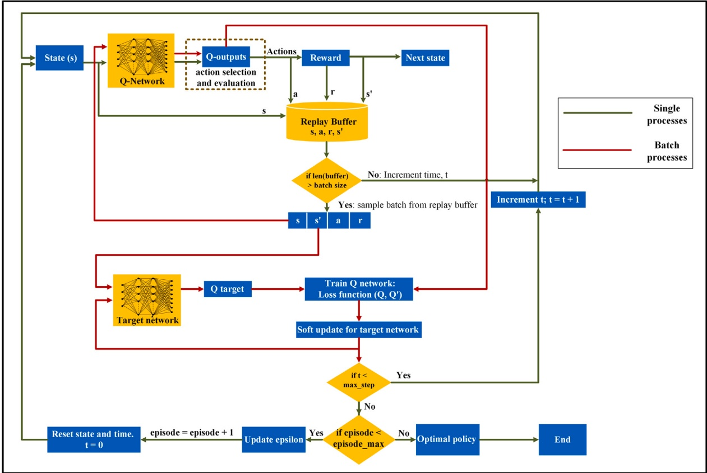

Fig. 1. DQN complete learning process for each agent in the L-MADRL framework [39].

### 3.1 . Upper-level problem

In each case network considered, the upper level maximizes the profits of the ERs and also the ATC of the network. Each ER has a connection to the external grid, a local wind turbine, and a local MT as well. Each ER also has a connection directly or indirectly to all MGs to facilitate power exchanges.

$$
\begin{aligned}Z = & \max \sum_{t \in \mathcal{T}} \Bigg[ \sum_{i \in \mathcal{I}} \sum_{k \in \mathcal{K}} C_{i,t}^{\mathrm{exc}} P_{i,k,t}^{\mathrm{exc}} - \sum_{i \in \mathcal{I}} \left( C_{\mathrm{MT},i}^{\mathrm{var}} P_{\mathrm{MT},i,t} + C_{i}^{\mathrm{su}} v_{i,t} + C_{i}^{\mathrm{sd}} w_{i,t} \right. \\& \left. + C_{i}^{\mathrm{wind}} P_{i,t}^{\mathrm{wind}} + C_{t}^{\mathrm{grid}} P_{i,t}^{\mathrm{grid}} \right) + \Lambda^{\mathrm{ATC}} \sum_{i \in \mathcal{I}} \left( G_{i,t}^{\mathrm{red}} - G_{i,t} \right) \Bigg]\end{aligned}\tag{3}
$$

Where $P _ { i , t } ^ { \mathrm { w i n d } }$ is defined as in Eq. (4) and $C _ { \mathrm { M T } , i } ^ { \mathrm { v a r } }$ is given by Eq. (5).

$$
P_{i,t}^{ wind } = \left\{ \begin{aligned} & 0, & &  if   v_t < V_{ ci }  or   v_t > V_{ co } \\ & P_{ w,rated } \cdot \frac{v_t^3 - V_{ ci }^3}{V_{ r }^3 - V_{ ci }^3}, & &  if   V_{ ci } \leq v_t < V_{ r } \\ & P_{ w,rated }, & &  if   V_{ r } \leq v_t \leq V_{ co } \end{aligned} \right.
$$

$$
C _ { \mathrm { M T } , i } ^ { \mathrm { v a r } } = \frac { C _ { i } ^ { \mathrm { M T } } } { L _ { i } ^ { \mathrm { M T } } \cdot \eta _ { i } }
$$

$$
P _ { \mathrm { M T } , i , t } + P _ { i , t } ^ { \mathrm { w i n d , a v a i l } } + P _ { i , t } ^ { \mathrm { g r i d } } = \sum _ { k \in \mathcal { K } } P _ { i , k , t } ^ { \mathrm { e x c } } , \quad \forall i \in \mathcal { I } , \; t \in \mathcal { T }
$$

$$
P _ { \mathrm { M T } , i } ^ { \min } u _ { i , t } \leq P _ { \mathrm { M T } , i , t } \leq P _ { \mathrm { M T } , i } ^ { \max } u _ { i , t } , \quad \forall i \in \mathcal { I } , t \in \mathcal { T }\tag{4}
$$

$$
v _ { i , t } - w _ { i , t } = u _ { i , t } - u _ { i , t - 1 } , \quad \forall i \in \mathcal { I } , \; t \in \mathcal { T }\tag{8}
$$

(5)

$$
P _ { \mathrm { M T } , i , t } - P _ { \mathrm { M T } , i , t - 1 } \leq R _ { \mathrm { M T } , i } ^ { \uparrow } , \quad \forall i \in \mathcal { I } , \; t \in \mathcal { T }\tag{9}
$$

$$
P _ { \mathrm { M T } , i , t - 1 } - P _ { \mathrm { M T } , i , t } \leq R _ { \mathrm { M T } , i } ^ { \downarrow } , \quad \forall i \in \mathcal { I } , \; t \in \mathcal { T }\tag{6}
$$

(10)

(11)

$$
\sum _ { \tau = t } ^ { t + T _ { i } ^ { \operatorname* { m i n } \uparrow } - 1 } u _ { i , \tau } \geq T _ { i } ^ { \operatorname* { m i n } \uparrow } v _ { i , t } , \quad \forall i \in \mathcal { I } , \; t \leq T - T _ { i } ^ { \operatorname* { m i n } \uparrow } .\tag{12}
$$

$$
\sum _ { \tau = t } ^ { t + T _ { i } ^ { \operatorname* { m i n } \downarrow } - 1 } ( 1 - u _ { i , \tau } ) \geq T _ { i } ^ { \operatorname* { m i n } \downarrow } w _ { i , t } , \quad \forall i \in \mathcal { I } , \; t \leq T - T _ { i } ^ { \operatorname* { m i n } \downarrow } .\tag{13}
$$

$$
0 \leq P _ { i , t } ^ { \mathrm { g r i d } } \leq P _ { \mathrm { g r i d } , i } ^ { \mathrm { m a x } } , \quad \forall i \in \mathcal { I } , \; t \in \mathcal { T }\tag{14}
$$

$$
\sum _ { i \in \mathcal { I } } P _ { i , k , t } ^ { \mathrm { e x c } } \leq P _ { \mathrm { e x c } } ^ { \mathrm { m a x } } , \quad \forall k \in \mathcal { K } , \; t \in \mathcal { T } .
$$

$$
G _ { i , t } = P _ { \mathrm { M T } , i , t } + P _ { i , t } ^ { \mathrm { w i n d , a v a i l } } + P _ { i , t } ^ { \mathrm { g r i d } } , \quad \forall i \in \mathcal { I } , \; t \in \mathcal { T }\tag{15}
$$

$$
D _ { k , t } = \sum _ { i \in \mathcal { I } } P _ { i , k , t } ^ { \mathrm { e x c } } , \quad \forall k \in \mathcal { K } , \; t \in \mathcal { T } .\tag{16}
$$

(7)

$$
G _ { i , t } \leq G _ { i , t } ^ { \mathrm { r e d } } \leq P _ { i } ^ { \mathrm { m a x } } , \quad \forall i \in \mathcal { I } , \; t \in \mathcal { T }\tag{17}
$$

$$
D _ { k , t } \leq D _ { k , t } ^ { \mathrm { r e d } } , \quad \forall k \in \mathcal { K } , \; t \in \mathcal { T }\tag{18}
$$

$$
\sum _ { i \in \mathcal { I } } \left( G _ { i , t } ^ { \mathrm { r e d } } - G _ { i , t } \right) = \sum _ { k \in \mathcal { K } } \left( D _ { k , t } ^ { \mathrm { r e d } } - D _ { k , t } \right) , \quad \forall t \in \mathcal { T } .\tag{19}
$$

$$
- \overline { { P } } _ { \ell } \leq \sum _ { n = 1 } ^ { N } \mathrm { G S F } _ { \ell , n } \left( G _ { n , t } ^ { \mathrm { r e d } } - D _ { n , t } ^ { \mathrm { r e d } } \right) \leq \overline { { P } } _ { \ell } , \quad \forall \ell \in \mathcal { L } , \; t \in \mathcal { T } .\tag{20}
$$

In the objective function defined by 𝑍 in Eq. (3), $C _ { i , t } ^ { \mathrm { e x c } }$ represents the cost of selling power to the microgrids; this is taken as 10% over the cost of power purchase by the ERs in the DA market i.e. $1 . 1 0 C _ { t } ^ { \mathrm { g r i d } }$ $C _ { \mathrm { M T } , i } ^ { \mathrm { v a r } }$ represents the operating cost of the MT given by Eq. $(5). $C _ { i } ^ { \mathrm { s u } } v _ { i , t }$$ and $C _ { i } ^ { \mathrm { s d } } w _ { i , t }$ stands for the cost of starting up and shutting down the MT respectively. The O&M cost of the wind turbines of the ERs is given by $C _ { i } ^ { \mathrm { w i n d } }$ , and lastly $C _ { t } ^ { \mathrm { g r i d } }$ denotes the price of purchasing power by the ERs in the DA market. $\left[ \Lambda ^ { \mathrm { A T C } } \right.$ represents the cost-coefficient on the available transfer capability. The power balance from each ER’s node is given by Eq. (6), where the sum of sources matches with the total extra demand from the microgrids. The MT capacity constraints is given by Eq. (7), with the commitment constraints given by Eq. (8). The ramp up/down constraints of the MTs are given by Eqs. (9) and (10) respectively, while the minimum up/down constraints are shown in Eqs. (11) and (12). The minimum and maximum purchase limits from the DA market is shown in Eq. (13), while Eq. (14) constrains the total extra demand by the MGs from the ERs. The predispatch conditions from the source and sink sides are shown in Eqs. (15) and (16) respectively. The redispatch bounds for the source side are given by Eq. (17) while those for the sink are shown in Eq. (18). The ATC power balance is given by Eq. (19) and lastly the line flows between the source and sink sides are constrained by Eq. (20).

In Eq. (20), the GSF is computed from DC power flow approximations. These approximations are given by Eq. (21).

$$
B _ { \mathrm { b u s } } \; \theta \; = \; P \; \implies \; f \; = \; B _ { f } \; \theta\tag{21}
$$

Where $B _ { \mathrm { b u s } }   \in   \mathbb { R } ^ { n \times n }$ is the DC bus susceptance matrix, $\theta   \in   \mathbb { R } ^ { n }$ represents the bus voltage angles in radians, $P \in \mathbb { R } ^ { n }$ is the net real-power injection vector in $\mathtt { p . u , } f \in \mathbb { R } ^ { m }$ is the real power flow on each line (positive $i   \rightarrow   j ) ,$ , and $B _ { f } \in \mathbb { R } ^ { m \times n }$ is the branch–bus incidence matrix weighted by susceptance. Eq. (21) can therefore be rewritten as Eq. (22).

$$
\theta \quad = \quad B _ { \mathrm { b u s } } ^ { - 1 } P \quad \Longrightarrow \quad f \quad = \quad B _ { f } \quad B _ { \mathrm { b u s } } ^ { - 1 } P\tag{22}
$$

From Eq. (22), the injection shift factor (ISF) is defined as Eq. (23), where $\frac { \partial f _ { \ell } } { \partial P _ { k } }$ gives the sensitivity of line $\ell$ to a 1 p.u. injection at bus 𝑘 and an equal withdrawal at the implicit slack reference.

$$
\mathrm { I S F } : = B _ { f } B _ { \mathrm { b u s } } ^ { - 1 } \in \mathbb { R } ^ { m \times n } , \qquad ( \mathrm { I S F } ) _ { \ell k } = \frac { \partial f _ { \ell } } { \partial P _ { k } }\tag{23}
$$

For a distributed slack model, if the imbalance is shared by a weight vector 𝛼 ∈ R𝑛 with $\sum _ { k = 1 } ^ { n } \alpha _ { k } = 1 ,$ , it would mean that $\mathbf { a } + 1$ p.u. injection at a source/generator bus 𝑖 would be withdrawn at a factor of $\alpha _ { k }$ at every bus 𝑘. Hence the resulting change in flow on line 𝓁 is given by:

$$
\Delta f _ { \ell } \; = \; \mathrm { I S F } _ { \ell i } \; - \; \sum _ { k = 1 } ^ { n } \alpha _ { k }   \mathrm { I S F } _ { \ell k }\tag{24}
$$

Hence the distributed slack GSF is as shown in Eq. (25)

$$
\mathrm { G S F } _ { \ell i } ( \alpha ) \; = \; \mathrm { I S F } _ { \ell i } \; - \; ( \alpha ^ { \top } \mathrm { I S F } ) _ { \ell }\tag{25}
$$

where $( \alpha ^ { \mathsf { T } } \mathrm { I S F } ) _ { \ell }$ is the 𝓁-th entry of the row vector 𝛼⊤ISF and an equal share slack sets $\alpha _ { k } \; = \; 1 / n$ for every bus. Defining the rank 1 matrix $A = \mathbf { 1 }   \boldsymbol { \alpha } ^ { \top }$ , the GSF formulation previously defined in Eq. (25) compactly becomes:

$$
\mathrm { G S F } ( \alpha ) \; = \; ( \mathbf { I } - \mathbf { A } )   \mathrm { I S F }\tag{26}
$$

### 3.2 . Lower-level problem

The lower level problem consists of the MGs. The MGs comprise DERs with some having only renewable energy sources (RES), while others also consist of MTs. In some of these MGs having RES, a BESS is also provided but it comes at a degradation cost and thus is considered in the overall problem formulation of each MG. Aside from the DERs available in each MG, each MG also exchanges power directly or indirectly with the ERs in the case of a power deficit.

$$
\min_{P_{\mathrm{MT}}, P^{\mathrm{cs}}, P^{\mathrm{ch}}, P^{\mathrm{dis}}} J_{k} = \sum_{t \in \mathcal{T}} \left[ \sum_{m \in \mathcal{M}} c_{\mathrm{MT}, k}^{\mathrm{m}} P_{\mathrm{MT}, k, t}^{\mathrm{m}} + c_{t}^{\mathrm{exc}} P_{k, t}^{\mathrm{exc}} + \underbrace{K_{k}^{\mathrm{ch}} P_{k, t}^{\mathrm{ch}} + K_{k}^{\mathrm{dis}} P_{k, t}^{\mathrm{dis}}}_{ for   k \in \mathcal{B}} \right]\tag{27}
$$

$$
P _ { \mathrm { M T } , k , t } + P _ { k , t } ^ { \mathrm { w i n d } } + P _ { k , t } ^ { \mathrm { s o l a r } } + P _ { k , t } ^ { \mathrm { d i s } } - P _ { k , t } ^ { \mathrm { c h } } + P _ { k , t } ^ { \mathrm { e x } } = D _ { k , t } , \quad \forall k \in \mathcal { K } , t \in \mathcal { T }\tag{28}
$$

Where $P _ { k , t } ^ { \mathrm { w i n d } }$ is defined as in $\mathrm { E q . ~ } ( 4 )$ in the upper layer and the solar power $P _ { k , t } ^ { \mathrm { s o l a r } }$ is defined in $\operatorname { E q . }$ (29) [40]:

$$
\begin{aligned} &P_{k,t}^{ solar } = \left\{ \begin{aligned}\\ &0, & & if   G_{t} \leq G_{ thr } \\&P_{ solar,rated } \cdot \frac{G_{t}}{G_{ std }}, & & if   G_{ thr } < G_{t} \leq G_{ std } \\&P_{ solar,rated }, & & if   G_{t} > G_{ std }\\ &\end{aligned} \right.\\ \end{aligned}\tag{29}
$$

$$
0 \leq P _ { \mathrm { M T } , k , t } ^ { \mathrm { m } } \leq P _ { \mathrm { M T } , k } ^ { \mathrm { m } , \mathrm { m a x } } , \quad \forall m \in \mathcal { M } , \forall k \in \mathcal { K } , t \in \mathcal { T }\tag{30}
$$

$$
P _ { \mathrm { M T } , k , t } ^ { \mathrm { m } } - P _ { \mathrm { M T } , k , t - 1 } ^ { \mathrm { m } } \leq R _ { \mathrm { M T } , k } ^ { m \uparrow } , \quad \forall m \in \mathcal { M } , \forall k \in \mathcal { K } , t \in \mathcal { T }\tag{31}
$$

$$
P _ { \mathrm { M T } , k , t - 1 } ^ { \mathrm { m } } - P _ { \mathrm { M T } , k , t } ^ { \mathrm { m } } \leq R _ { \mathrm { M T } , k } ^ { m \downarrow } , \quad \forall m \in \mathcal { M } , \forall k \in \mathcal { K } , t \in \mathcal { T }\tag{32}
$$

$$
- \overline { { P } } ^ { \mathrm { e x c } } \leq P _ { k , t } ^ { \mathrm { e x c } } \leq \overline { { P } } ^ { \mathrm { e x c } } , \quad \forall k \in \mathcal { K } , t \in \mathcal { T } .\tag{33}
$$

$$
0 \leq P _ { k , t } ^ { \mathrm { c h } } \leq P _ { k } ^ { \mathrm { c h , m a x } } , \quad \forall k \in \mathcal { B } , t \in \mathcal { T }\tag{34}
$$

$$
0 \leq P _ { k , t } ^ { \mathrm { d i s } } \leq P _ { k } ^ { \mathrm { d i s , m a x } } , \quad \forall k \in \mathcal { B } , t \in \mathcal { T }
$$

$$
P _ { k , t } ^ { \mathrm { c h } } + P _ { k , t } ^ { \mathrm { d i s } } \leq 1 , \quad \forall k \in \mathcal { B } , t \in \mathcal { T }\tag{35}
$$

(36)

$$
E _ { k , t } = E _ { k , t - 1 } + \eta _ { k } ^ { \mathrm { c h } } P _ { k , t } ^ { \mathrm { c h } } - \frac { 1 } { \eta _ { k } ^ { \mathrm { d i s } } } P _ { k , t } ^ { \mathrm { d i s } } , \quad \forall k \in \mathcal { B } , t \in \mathcal { T }\tag{37}
$$

$$
0 \leq E _ { k , t } \leq E _ { k } ^ { \operatorname* { m a x } } , \quad \forall k \in \mathcal { B } , t \in \mathcal { T }\tag{38}
$$

Eq. (27) defines the objectives of the MGs in the lower level, where the first term represents the operating costs of the MTs and $c _ { \mathrm { M T } , k } ^ { \mathrm { m } }$ is as defined in Eq. (5) in the upper level problem. $P _ { \mathrm { M T } , k , t } ^ { \mathrm { m } }$ is the power produced by the mth MT in MG 𝑘. The second term represents the cost of power purchased from the ER. $c ^ { \mathrm { e x c } }$ is synonymous with the exchanged power cost $C _ { i , t } ^ { \mathrm { e x c } }$ defined in the upper level problem, and $P _ { k , t } ^ { \mathrm { e x c } }$ is the exchanged power with the ERs. The third and fourth portion of the objective are specifically for MGs with energy storage systems. The two cost components collectively represent the battery degradation costs due to charging and discharging the batteries. The power balance constraints of each MG is defined in Eq. (28), while the power output from the solar PVs are defined in Eq. (29). Eqs. (30)–(32) are the technical limits of the MTs as well as its ramp up/down limits. The maximum and minimum exchange capacity by each MG with the ERs is defined in Eq. (33). For the MGs with BESS, the charging and discharging power limits are defined in Eqs. (34) and (35). Eq. (36) prevents the simultaneous charging/discharging of the BESS, and its energy dynamics and limits are lastly defined in Eqs. (37) and (38) respectively.

#### 3.2.1 . KKT formulations of lower-level problem

For clarity, the dual variables and multipliers are defined explicitly for each and every constraint in the primal formulation of the lower-level problem. For the equality constraints, the dual variable $\lambda _ { k , t } ^ { \mathrm { P B } }$ denotes that of the power balance equality, and $\lambda _ { k , t } ^ { \mathrm { S O C } }$ represents the equality equation of the battery SoC dynamics.

For the inequality constraint, the dual variables $\mu _ { k , t } ^ { \mathrm { M T , l o } } , \quad \mu _ { k , t } ^ { \mathrm { M T , u p } } , \quad \mu _ { k , t } ^ { \mathrm { R a m p , u p } } , \quad \mu _ { k , t } ^ { \mathrm { R a m p , d o w n } } .$ are the multipliers for the MT constraints. Secondly, $\mu _ { k , t } ^ { \mathrm { e x , l o } } , \quad \mu _ { k , t } ^ { \mathrm { e x , u p } }$ are the dual variables for the exchange constraint between the ERs and lower level MGs. Lastly, $\mu _ { k , t } ^ { \mathrm { c h , l o } } , \quad \overset { \circ } { \mu _ { k , t } ^ { \mathrm { c h , u p } } } , \quad \mu _ { k , t } ^ { \mathrm { d i s , l o } } , \quad \mu _ { k , t } ^ { \mathrm { d i s , u p } } , \quad \mu _ { k , t } ^ { \mathrm { m u t } } , \quad \mu _ { k , t } ^ { \mathrm { S O C , l o } } , \quad \mu _ { k , t } ^ { \mathrm { S O C , u p } }$ are the dual multi-pliers for the primal battery constraints. Consequently, the Lagrangian equation is written as:

$$
L _ { k } = J _ { k } + \sum _ { t \in \mathcal { T } } \lambda _ { k , t } ^ { \mathrm { P B } } \Big ( D _ { k , t } - P _ { \mathrm { M T } , k , t } - P _ { k , t } ^ { \mathrm { w i n d } } - P _ { k , t } ^ { \mathrm { s o l a r } } - P _ { k , t } ^ { \mathrm { d i s } } + P _ { k , t } ^ { \mathrm { c h } } - P _ { k , t } ^ { \mathrm { e x } } \Big )
$$

$$
+ \sum_{t \in \mathcal{T}, k \in \mathcal{B}} \lambda_{k,t}^{\mathrm{SOC}} \Big( E_{k,t-1} + \eta_k^{\mathrm{ch}} P_{k,t}^{\mathrm{ch}} - \frac{1}{\eta_k^{\mathrm{dis}}} P_{k,t}^{\mathrm{dis}} - E_{k,t} \Big)
$$

$$
+ \sum_{t \in \mathcal{T}} \left[ \mu_{k,t}^{\mathrm{MT,lo}}(0 - P_{\mathrm{MT},k,t}) + \mu_{k,t}^{\mathrm{MT,up}}(P_{\mathrm{MT},k,t} - P_{\mathrm{MT},k}^{\max}) \right]
$$

$$
+ \sum_{t \in \mathcal{T}} \left[ \mu_{k,t}^{\mathrm{ex,lo}} (- \overline{P}^{\mathrm{ex}} - P_{k,t}^{\mathrm{ex}}) + \mu_{k,t}^{\mathrm{ex,up}} (P_{k,t}^{\mathrm{ex}} - \overline{P}^{\mathrm{ex}}) \right]
$$

$$
+ \sum_{t \in \mathcal{T}} \left[ \mu_{k,t}^{\mathrm{Ramp,down}} (-R_{\mathrm{MT},k}^{\downarrow} - P_{\mathrm{MT},k,t} + P_{\mathrm{MT},k,t-1}) \right]
$$

$$
+ \mu _ { k , t } ^ { \mathrm { R a m p , u p } } ( P _ { \mathrm { M T } , k , t } - P _ { \mathrm { M T } , k , t - 1 } - R _ { \mathrm { M T } , k } ^ { \uparrow } ) \Big ]
$$

$$
+ \sum_{t \in \mathcal{T}, k \in \mathcal{B}} \left[ \mu_{k,t}^{\mathrm{ch},\mathrm{lo}}(-P_{k,t}^{\mathrm{ch}}) + \mu_{k,t}^{\mathrm{ch},\mathrm{up}}(P_{k,t}^{\mathrm{ch}} - P_{k}^{\mathrm{ch},\mathrm{max}}) \right]
$$

$$
+ \mu _ { k , t } ^ { \mathrm { d i s , l o } } ( - P _ { k , t } ^ { \mathrm { d i s } } ) + \mu _ { k , t } ^ { \mathrm { d i s , u p } } ( P _ { k , t } ^ { \mathrm { d i s } } - P _ { k } ^ { \mathrm { d i s , m a x } } ) \Big ]
$$

$$
+ \sum_{t \in \mathcal{T}, k \in \mathcal{B}} \left[ \mu_{k,t}^{\mathrm{mut}} (P_{k,t}^{\mathrm{ch}} + P_{k,t}^{\mathrm{dis}} - 1) + \mu_{k,t}^{\mathrm{SOC,lo}} (-E_{k,t}) \right]
$$

$$
+ \mu _ { k , t } ^ { \mathrm { S O C , u p } } ( E _ { k , t } - E _ { k } ^ { \mathrm { m a x } } ) \Big ]\tag{39}
$$

The KKT conditions are derived systematically from the Lagrangian equation defined in Eq. (39), and comprise four main portions:

• Stationarity conditions: This denotes the derivatives of the Lagrangian equation with respect to all decision variables equated to zero.

• Primal feasibility: The constraints originally defined under the lowerlevel problem formulation.

• Dual feasibility: This represents the non-negativity of the dual multipliers.

• Complementary slackness: This links the primal and dual variables.

For the stationarity conditions, the derivatives of the Lagrangian with respect to all decision variables are given by the following equations:

$$
\begin{aligned}\frac{\partial L_{k}}{\partial P_{\mathrm{MT},k,t}} = & c_{\mathrm{MT},k}^{\mathrm{var}} - \lambda_{k,t}^{\mathrm{PB}} - \mu_{k,t}^{\mathrm{MT},\mathrm{lo}} + \mu_{k,t}^{\mathrm{MT},\mathrm{up}} - \mu_{k,t}^{\mathrm{Ramp},\mathrm{down}} + \mu_{k,t}^{\mathrm{Ramp},\mathrm{up}} \\& + \mu_{k,t+1}^{\mathrm{Ramp},\mathrm{down}} - \mu_{k,t+1}^{\mathrm{Ramp},\mathrm{up}} = 0, \quad \forall k \in \mathcal{K}, \; t \in \mathcal{T}\end{aligned}\tag{40}
$$

$$
\frac { \partial L _ { k } } { \partial P _ { k , t } ^ { \mathrm { e x } } } = c _ { t } ^ { \mathrm { g r i d } } - \lambda _ { k , t } ^ { \mathrm { P B } } - \mu _ { k , t } ^ { \mathrm { e x } , \mathrm { l o } } + \mu _ { k , t } ^ { \mathrm { e x } , \mathrm { u p } } = 0 , \quad \forall k \in \mathcal { K } , \; t \in \mathcal { T }\tag{41}
$$

$$
\frac { \partial L _ { k } } { \partial P _ { k , t } ^ { \mathrm { c h } } } = K _ { k } ^ { \mathrm { c h } }   +   \lambda _ { k , t } ^ { \mathrm { P B } }   +   \eta _ { k } ^ { \mathrm { c h } } \lambda _ { k , t } ^ { \mathrm { S O C } }   -   \mu _ { k , t } ^ { \mathrm { c h , l o } }   +   \mu _ { k , t } ^ { \mathrm { c h , u p } }   +   \mu _ { k , t } ^ { \mathrm { m u t } } = 0 , \quad \forall k \in \mathcal { B } , \; t \in \mathcal { T }\tag{42}
$$

$$
\frac { \partial L _ { k } } { \partial P _ { k , t } ^ { \mathrm { d i s } } } = K _ { k } ^ { \mathrm { d i s } } - \lambda _ { k , t } ^ { \mathrm { P B } } - \frac { 1 } { \eta _ { k } ^ { \mathrm { d i s } } } \lambda _ { k , t } ^ { \mathrm { S O C } } - \mu _ { k , t } ^ { \mathrm { d i s , l o } } + \mu _ { k , t } ^ { \mathrm { d i s , u p } } + \mu _ { k , t } ^ { \mathrm { m u t } } = 0 ,
$$

$$
\forall k \in \mathcal { B } , \; t \in \mathcal { T }\tag{43}
$$

$$
\frac { \partial L _ { k } } { \partial E _ { k , t } } = - \lambda _ { k , t } ^ { \mathrm { S O C } } + \lambda _ { k , t + 1 } ^ { \mathrm { S O C } } - \mu _ { k , t } ^ { \mathrm { S O C , l o } } + \mu _ { k , t } ^ { \mathrm { S O C , u p } } = 0 , \quad \forall k \in \mathcal { B } , \; t \leq T - 1\tag{44}
$$

Where Eq. (40) is the derivative with respect to the variable $P _ { \mathrm { M T } , k , t } ,$ while $\operatorname { E q . }$ (41), Eq. (42), Eq. (43), and Eq. (44) are the derivatives of the Lagrangian with respect to the variables $P _ { k , t } ^ { \mathrm { e x } } , \; P _ { k , t } ^ { \mathrm { c h } } , \; P _ { k , t } ^ { \mathrm { d i s } }$ and $E _ { k , t }$ respectively. The complementarity slackness constraints are defined by the subsequent equations:

$$
0 \leq \mu _ { k , t } ^ { \mathrm { M T , l o } } \perp P _ { \mathrm { M T } , k , t } \geq 0 , \quad \forall k \in \mathcal { K } , \; t \in \mathcal { T } .\tag{45}
$$

$$
0 \leq \mu _ { k , t } ^ { \mathrm { M T , u p } } \perp P _ { \mathrm { M T } , k } ^ { \mathrm { m a x } } - P _ { \mathrm { M T } , k , t } \geq 0 , \quad \forall k \in \mathcal { K } , \; t \in \mathcal { T } .\tag{46}
$$

$$
0 \leq \mu _ { k , t } ^ { \mathrm { R a m p , d o w n } } \perp R _ { \mathrm { M T } , k } ^ { \downarrow } + P _ { \mathrm { M T } , k , t } - P _ { \mathrm { M T } , k , t - 1 } \geq 0 , \quad \forall k \in \mathcal { K } , \; t \in \mathcal { T } .\tag{47}
$$

$$
0 \leq \mu _ { k , t } ^ { \mathtt { R a m p } , \mathtt { u p } } \perp R _ { \mathtt { M T } , k } ^ { \uparrow } - P _ { \mathtt { M T } , k , t } + P _ { \mathtt { M T } , k , t - 1 } \geq 0 , \quad \forall k \in \mathcal { K } , \; t \in \mathcal { T } .\tag{48}
$$

$$
0 \leq \mu _ { k , t } ^ { \mathrm { e x } , \mathrm { l o } } \perp \overline { { P } } ^ { \mathrm { e x } } + P _ { k , t } ^ { \mathrm { e x } } \geq 0 , \quad \forall k \in \mathcal { K } , \; t \in \mathcal { T } .\tag{49}
$$

$$
0 \leq \mu _ { k , t } ^ { \mathrm { e x } , \mathrm { u p } } \perp \overline { { P } } ^ { \mathrm { e x } } - P _ { k , t } ^ { \mathrm { e x } } \geq 0 , \quad \forall k \in \mathcal { K } , \; t \in \mathcal { T } .\tag{50}
$$

$$
0 \leq \mu _ { k , t } ^ { \mathrm { c h , l o } } \perp P _ { k , t } ^ { \mathrm { c h } } \geq 0 , \quad \forall k \in \mathcal { B } , \; t \in \mathcal { T } .\tag{51}
$$

$$
0 \leq \mu _ { k , t } ^ { \mathrm { c h , u p } } \perp P _ { k } ^ { \mathrm { c h , m a x } } - P _ { k , t } ^ { \mathrm { c h } } \geq 0 , \quad \forall k \in \mathcal { B } , \; t \in \mathcal { T } .\tag{52}
$$

$$
0 \leq \mu _ { k , t } ^ { \mathrm { d i s , l o } } \perp P _ { k , t } ^ { \mathrm { d i s } } \geq 0 , \quad \forall k \in \mathcal { B } , \; t \in \mathcal { T } .\tag{53}
$$

$$
0 \leq \mu _ { k , t } ^ { \mathrm { d i s , u p } } \perp P _ { k } ^ { \mathrm { d i s , m a x } } - P _ { k , t } ^ { \mathrm { d i s } } \geq 0 , \quad \forall k \in \mathcal { B } , \; t \in \mathcal { T } .\tag{54}
$$

$$
0 \leq \mu _ { k , t } ^ { \mathrm { m u t } } \perp 1 - P _ { k , t } ^ { \mathrm { c h } } - P _ { k , t } ^ { \mathrm { d i s } } \geq 0 , \quad \forall k \in \mathcal { B } , \; t \in \mathcal { T } .\tag{55}
$$

$$
0 \leq \mu _ { k , t } ^ { \mathrm { S O C , l o } } \perp E _ { k , t } \geq 0 , \quad \forall k \in \mathcal { B } , \; t \in \mathcal { T } .\tag{56}
$$

$$
0 \leq \mu _ { k , t } ^ { \mathrm { S O C , u p } } \perp E _ { k } ^ { \mathrm { m a x } } - E _ { k , t } \geq 0 , \quad \forall k \in \mathcal { B } , \; t \in \mathcal { T } .\tag{57}
$$

Where Eqs. (45) and (46) are the complementarity conditions linking the dual variables for the minimum and maximum power output from the MT to its primal variables. Eqs. (47) and (48) are the slackness conditions for the up and down ramp limits for the MT. Eqs. (49) and (50) link the dual variables for the lower and upper limits of the exchange with ERs to its primal constraints. Eqs. (51) and (52) show the primal and dual variables linking for the charging limits of the BESS. Similarly, Eqs. (53) and (54) show that for the discharging limits. $\operatorname { E q . }$ (55) shows the slackness conditions for the mutual exclusivity of the BESS, and lastly Eqs. (56) and (57) show the complementarity conditions for the minimum and maximum SoC limits for the BESS.

The complementarity conditions defined in Eqs. (45)–(57) are non-linear and hence non-convex. In order to linearize these equations, the Big-M approach is utilized, consequently leading to the creation of more auxiliary variables. The transformations/linearizations of Eqs. (45)–(57) are fully presented in Eqs. (58)–(83).

**MT capacity constraints**:

$$
\mu _ { k , t } ^ { \mathrm { M T , l o } } \leq M \delta _ { k , t } ^ { \mathrm { M T , m i n } } , \quad \delta _ { k , t } ^ { \mathrm { M T , m i n } } \in \{ 0 , 1 \} , \quad \forall k \in \mathcal { K } , \; t \in \mathcal { T } .\tag{58}
$$

$$
P _ { \mathrm { M T } , k , t } \leq M ( 1 - \delta _ { k , t } ^ { \mathrm { M T , m i n } } ) , \quad \delta _ { k , t } ^ { \mathrm { M T , m i n } } \in \{ 0 , 1 \} , \quad \forall k \in \mathcal { K } , \; t \in \mathcal { T } .\tag{59}
$$

$$
\mu _ { k , t } ^ { \mathrm { M T , u p } } \leq M \delta _ { k , t } ^ { \mathrm { M T , m a x } } , \quad \delta _ { k , t } ^ { \mathrm { M T , m a x } } \in \{ 0 , 1 \} , \quad \forall k \in \mathcal { K } , \; t \in \mathcal { T }\tag{60}
$$

$$
P _ { \mathrm { M T } , k } ^ { \mathrm { m a x } }   -   P _ { \mathrm { M T } , k , t } \leq M ( 1   -   \delta _ { k , t } ^ { \mathrm { M T , m a x } } ) , \quad \delta _ { k , t } ^ { \mathrm { M T , m a x } } \in \{ 0 , 1 \} , \quad \forall k \in \mathcal { K } , \; t \in \mathcal { T }\tag{61}
$$

**MT ramping constraints**:

$$
\mu _ { k , t } ^ { \mathrm { R a m p , d o w n } } \leq M \delta _ { k , t } ^ { \mathrm { R a m p , d o w n } } , \quad \delta _ { k , t } ^ { \mathrm { R a m p , d o w n } } \in \{ 0 , 1 \} , \quad \forall k \in \mathcal { K } , \; t \in \mathcal { T }\tag{62}
$$

$$
R _ { \mathrm { M T } , k } ^ { \downarrow } + P _ { \mathrm { M T } , k , t } - P _ { \mathrm { M T } , k , t - 1 } \leq M ( 1 - \delta _ { k , t } ^ { \mathrm { R a m p , d o w n } } ) , \quad \delta _ { k , t } ^ { \mathrm { R a m p , d o w n } } \in \{ 0 , 1 \} ,
$$

$$
\forall k \in \mathcal { K } , \; t \in \mathcal { T }\tag{63}
$$

$$
\mu _ { k , t } ^ { \mathtt { R a m p } , \mathtt { u p } } \leq M \delta _ { k , t } ^ { \mathtt { R a m p } , \mathtt { u p } } , \quad \delta _ { k , t } ^ { \mathtt { R a m p } , \mathtt { u p } } \in \{ 0 , 1 \} , \quad \forall k \in \mathcal { K } , \; t \in \mathcal { T } .\tag{64}
$$

$$
R _ { \mathrm { M T } , k } ^ { \uparrow } - P _ { \mathrm { M T } , k , t } + P _ { \mathrm { M T } , k , t - 1 } \leq M ( 1 - \delta _ { k , t } ^ { \mathrm { R a m p , u p } } ) , \quad \delta _ { k , t } ^ { \mathrm { R a m p , u p } } \in \{ 0 , 1 \} ,
$$

$$
\forall k \in \mathcal { K } , \; t \in \mathcal { T }\tag{65}
$$

**Exchange power constraints**:

$$
\mu _ { k , t } ^ { \mathrm { e x , l o } } \leq M \delta _ { k , t } ^ { \mathrm { e x , m i n } } , \quad \delta _ { k , t } ^ { \mathrm { e x , m i n } } \in \{ 0 , 1 \} , \quad \forall k \in \mathcal { K } , \; t \in \mathcal { T } .\tag{66}
$$

$$
\overline { { P } } ^ { \mathrm { e x } } + P _ { k , t } ^ { \mathrm { e x } } \leq M ( 1 - \delta _ { k , t } ^ { \mathrm { e x } , \mathrm { m i n } } ) , \quad \delta _ { k , t } ^ { \mathrm { e x } , \mathrm { m i n } } \in \{ 0 , 1 \} , \quad \forall k \in \mathcal { K } , \; t \in \mathcal { T } .\tag{67}
$$

$$
\mu _ { k , t } ^ { \tt e x , u p } \leq M \delta _ { k , t } ^ { \tt e x , m a x } , \quad \delta _ { k , t } ^ { \tt e x , m a x } \in \{ 0 , 1 \} , \quad \forall k \in \mathcal { K } , \; t \in \mathcal { T }\tag{68}
$$

$$
\overline { { P } } ^ { \mathrm { e x } } - P _ { k , t } ^ { \mathrm { e x } } \leq M ( 1 - \delta _ { k , t } ^ { \mathrm { e x } , \mathrm { m a x } } ) , \quad \delta _ { k , t } ^ { \mathrm { e x } , \mathrm { m a x } } \in \{ 0 , 1 \} , \quad \forall k \in \mathcal { K } , \; t \in \mathcal { T }\tag{69}
$$

**BESS charging limits**:

$$
\mu _ { k , t } ^ { \mathrm { c h , l o } } \leq M \delta _ { k , t } ^ { \mathrm { c h , m i n } } , \quad \delta _ { k , t } ^ { \mathrm { c h , m i n } } \in \{ 0 , 1 \} , \quad \forall k \in \mathcal { B } , \; t \in \mathcal { T }\tag{70}
$$

$$
P _ { k , t } ^ { \mathrm { c h } } \leq M ( 1 - \delta _ { k , t } ^ { \mathrm { c h , m i n } } ) , \quad \delta _ { k , t } ^ { \mathrm { c h , m i n } } \in \{ 0 , 1 \} , \quad \forall k \in \mathcal { B } , \; t \in \mathcal { T } .\tag{71}
$$

$$
\mu _ { k , t } ^ { \mathrm { c h , u p } } \leq M \delta _ { k , t } ^ { \mathrm { c h , m a x } } , \quad \delta _ { k , t } ^ { \mathrm { c h , m a x } } \in \{ 0 , 1 \} , \quad \forall k \in \mathcal { B } , \; t \in \mathcal { T }\tag{72}
$$

$$
P _ { k } ^ { \mathrm { c h , m a x } } - P _ { k , t } ^ { \mathrm { c h } } \leq M ( 1 - \delta _ { k , t } ^ { \mathrm { c h , m a x } } ) , \quad \delta _ { k , t } ^ { \mathrm { c h , m a x } } \in \{ 0 , 1 \} , \quad \forall k \in \mathcal { B } , \; t \in \mathcal { T }
$$

**BESS discharging limits**:

(73)

$$
\mu _ { k , t } ^ { \mathrm { d i s , l o } } \leq M \delta _ { k , t } ^ { \mathrm { d i s , m i n } } , \quad \delta _ { k , t } ^ { \mathrm { d i s , m i n } } \in \{ 0 , 1 \} , \quad \forall k \in \mathcal { B } , \; t \in \mathcal { T }\tag{74}
$$

$$
P _ { k , t } ^ { \mathrm { d i s } } \leq M ( 1 - \delta _ { k , t } ^ { \mathrm { d i s , m i n } } ) , \quad \delta _ { k , t } ^ { \mathrm { d i s , m i n } } \in \{ 0 , 1 \} , \quad \forall k \in \mathcal { B } , \; t \in \mathcal { T } .\tag{75}
$$

$$
\mu _ { k , t } ^ { \mathrm { d i s , u p } } \leq M \delta _ { k , t } ^ { \mathrm { d i s , m a x } } , \quad \delta _ { k , t } ^ { \mathrm { d i s , m a x } } \in \{ 0 , 1 \} , \quad \forall k \in \mathcal { B } , \; t \in \mathcal { T }\tag{76}
$$

$$
P _ { k } ^ { \mathrm { d i s , m a x } } - P _ { k , t } ^ { \mathrm { d i s } } \leq M ( 1 - \delta _ { k , t } ^ { \mathrm { d i s , m a x } } ) , \quad \delta _ { k , t } ^ { \mathrm { d i s , m a x } } \in \{ 0 , 1 \} , \quad \forall k \in B , \; t \in \mathcal { T }
$$

**BESS mutual exclusivity**:

(77)

$$
\mu _ { k , t } ^ { \mathrm { m u t } } \leq M \delta _ { k , t } ^ { \mathrm { m u t } } , \quad \delta _ { k , t } ^ { \mathrm { m u t } } \in \{ 0 , 1 \} , \quad \forall k \in \mathcal { B } , \; t \in \mathcal { T }\tag{78}
$$

$$
1 - P _ { k , t } ^ { \mathrm { c h } } - P _ { k , t } ^ { \mathrm { d i s } } \leq M ( 1 - \delta _ { k , t } ^ { \mathrm { m u t } } ) , \quad \delta _ { k , t } ^ { \mathrm { m u t } } \in \{ 0 , 1 \} , \quad \forall k \in \mathcal { B } , \; t \in \mathcal { T } .\tag{79}
$$

**BESS SoC limits**:

$$
\mu _ { k , t } ^ { \mathrm { S O C , l o } } \leq M \delta _ { k , t } ^ { \mathrm { S O C , m i n } } , \quad \delta _ { k , t } ^ { \mathrm { S O C , m i n } } \in \{ 0 , 1 \} , \quad \forall k \in \mathcal { B } , \; t \in \mathcal { T } .\tag{80}
$$

$$
E _ { k , t } \leq M ( 1 - \delta _ { k , t } ^ { \mathrm { S O C , m i n } } ) , \quad \delta _ { k , t } ^ { \mathrm { S O C , m i n } } \in \{ 0 , 1 \} , \quad \forall k \in \mathcal { B } , \; t \in \mathcal { T } .\tag{81}
$$

$$
\mu _ { k , t } ^ { \mathrm { S O C , u p } } \leq M \delta _ { k , t } ^ { \mathrm { S O C , m a x } } , \quad \delta _ { k , t } ^ { \mathrm { S O C , m a x } } \in \{ 0 , 1 \} , \quad \forall k \in \mathcal { B } , \; t \in \mathcal { T }\tag{82}
$$

$$
E _ { k } ^ { \operatorname* { m a x } } - E _ { k , t } \leq M ( 1 - \delta _ { k , t } ^ { \mathrm { S O C , m a x } } ) , \quad \delta _ { k , t } ^ { \mathrm { S O C , m a x } } \in \{ 0 , 1 \} , \quad \forall k \in \mathcal { B } , \; t \in \mathcal { T } .\tag{83}
$$

Where M is a positive large constant number, $\delta _ { k , t } ^ { \mathrm { M T , m i n } } \mathrm { a n d } \delta _ { k , t } ^ { \mathrm { M T , m a x } }$ are the auxiliary variables for the MT capacity constraints in Eqs. $\stackrel { \kappa , \ast } { ( 5 8 ) } - ( 6 1 )$ $\delta _ { k , t } ^ { \mathrm { R a m p , d o w n } } \; \mathrm { a n d } \; \delta _ { k , t } ^ { \mathrm { R a m p , u p } }$ are the auxiliary variables for the MT ramp capacity in Eqs. (62)–(65). $\delta _ { k , t } ^ { \mathrm { e x , m i n } }$ and $\delta _ { k , t } ^ { \mathrm { e x , m a x } }$ in Eqs. (66)–(69) are the auxiliary variables defined for the power exchange limits. $\delta _ { k , t } ^ { \mathrm { c h , m i n } } , \; \delta _ { k , t } ^ { \mathrm { c h , m a x } }$ in Eqs. $( 7 0 ) – ( 7 3 )$ , and $\delta _ { k , t } ^ { \mathrm { d i s , m i n } } , \; \delta _ { k , t } ^ { \mathrm { d i s , m a x } }$ in Eqs. $( 7 4 ) – ( 7 7 )$ are the auxiliary variables for the BESS charging and discharging limits respectively. $\delta _ { k , t } ^ { \mathrm { m u t } }$ represents the auxiliary variable for the BESS mutual exclusivity in Eqs. $( 8 )  – ( 7 9 )$ . Lastly, in Eqs. $( 8 0 ) – ( 8 3 ) , \; \delta _ { k , t } ^ { \mathrm { S O C , m i n } } , \; \delta _ { k , t } ^ { \mathrm { S O C , m a x } }$ are the auxiliary variables for the BESS SoC limits respectively.

The primal feasibility in the KKT conditions are as defined in Eqs. (28)–(38) in the original lower level formulation. Meanwhile, the dual feasibility constraints are as shown in Eqs. (84) and $( \mathrm { E q . ~ } 8 5 )$ Consequently, the KKT transformation of the lower-level problem originally defined in Eqs. (27)–(38) is as shown in Eqs. (40)–(44) and Eqs. (58)–(85).

$$
\mu _ { k , t } ^ { \mathrm { M T , l o } } \geq 0 , \quad \mu _ { k , t } ^ { \mathrm { M T , u p } } \geq 0 , \quad \mu _ { k , t } ^ { \mathrm { R a m p , d o w n } } \geq 0 , \quad \mu _ { k , t } ^ { \mathrm { R a m p , u p } } \geq 0 , \quad \mu _ { k , t } ^ { \mathrm { e x , l o } } \geq 0 ,
$$

$$
\mu _ { k , t } ^ { \mathrm { e x } , \mathrm { u p } } \geq 0 , \quad \forall k \in \mathcal { K } , \; t \in \mathcal { T } .\tag{84}
$$

$$
\mu _ { k , t } ^ { \mathrm { c h , l o } } \geq 0 , \quad \mu _ { k , t } ^ { \mathrm { c h , u p } } \geq 0 , \quad \mu _ { k , t } ^ { \mathrm { d i s , l o } } \geq 0 , \quad \mu _ { k , t } ^ { \mathrm { d i s , u p } } \geq 0 , \quad \mu _ { k , t } ^ { \mathrm { m u t } } \geq 0 , \quad \mu _ { k , t } ^ { \mathrm { S O C , l o } } \geq 0 ,
$$

$$
\mu _ { k , t } ^ { \mathrm { S O C , u p } } \geq 0 , \qquad \forall k \in \mathcal { B } , \; t \in \mathcal { T }\tag{85}
$$

Following the KKT reformulations of the lower level problem, the process for the combined single level problem is shown in Fig. 2 and is given by Eq. (86):

max Z Eq. (3)

$$
{ \bf s . t . } ~ E q . ~ ( 4 )  –  ( 2 6 ) \quad { \bf U p p e r - l e v e l ~ c o n s t r a i n t s }
$$

$$
\left( \begin{aligned} & Eq. (28)\text{— }(38) \\ & Eq. (40)\text{— }(44) \\ & Eq. (58)\text{— }(83) \\ & Eq. (84)\text{— }(85) \end{aligned} \right).\tag{86}
$$

Equivalent lower-level KKT conditions

The linking variable between the upper and lower levels is the exchange power given by the variable $P _ { i , k , t } ^ { e x c }$ . From the upper level (ERs) perspective, this refers to power being sold to the MGs in the lower level that have a deficit and depicts a revenue. In the lower level, this represents a cost to the MGs, and each MG strives to minimize the deficit power purchased from the ERs.

## 4 . Lean multi-agent DRL (L-MADRL framework)

The proposed L-MADRL framework aligns with the principles of safe DRL where the conventional burden of satisfying a wide array of technical, operational, and network-level constraints is decoupled from the learning process itself. In classical DRL setups for energy systems, the agent is expected to simultaneously learn optimal actions while navigating complex feasibility regions defined by system dynamics, power flow constraints, generator limits, and interconnection rules. This dual responsibility often leads to unstable learning, infeasible actions, and slow convergence, particularly in high-dimensional stochastic environments.

To address this, L-MADRL adopts a modular architecture in which constraint handling is delegated to a dedicated and analytically tractable optimization layer. This layer is derived from a reformulated single-level optimization problem based on the KKT conditions of the original bilevel structure, ensuring that every action proposed by the DRL agents is inherently feasible with respect to network and market constraints. This design relieves the agents from the computational overhead of constraint checking and can instead focus exclusively on learning optimal policies for managing stochastic variables such as solar irradiance, wind speed, and load demand in order to maximize long-term rewards under these uncertainties. Consequently, the learning process becomes more stable and computationally efficient, since the agents are relieved of the burden of navigating complex feasibility regions during training. Additionally, the proposed structure guarantees that technical and economic constraints are rigorously satisfied throughout system operation, thereby enhancing the reliability and safety of the decision-making process.

The proposed algorithm implementation relies primarily on two tenets: the DQN algorithm used by each agent, and the MPEC reformulation of the original bilevel problem shown in Eq. (86) with the detailed process depicted in Fig. 2. It is pertinent to note that each agent depending on the stochastic parameter being assigned to it and the corresponding node on the network receives its own set of observations (states) as shown in Fig. 3. Using these inputs, each agent receives its own local state(s) in parallel and takes an action from its corresponding action set (discussed in subsequent sections). These action sets represent real constant values by which the agent adjusts its predicted wind, solar, or load parameter to closely match its actual value.

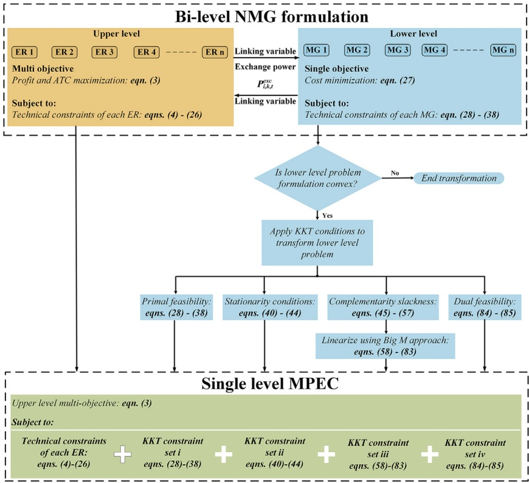

Fig. 2. Networked microgrid bi-level to single level MPEC transformation process.

After each agent selects its corresponding action with respect to the stochastic parameter in question, it compares the outcome of the action taken with its actual value. The stacking of the reward outcomes from each agent forms $\mathtt { R _ { 1 } }$ as seen in Fig. 3. At each time $t ,$ this selected action set from each agent is passed to the single-level MPEC. Since the DQN algorithm only focuses on learning the stochastic parameters, to check that the selected actions are feasible and respect the technical constraints of the case study networks, the actions from the agents (which are the transformed stochastic parameters) are passed into the MPEC reformulation which then outputs the optimal values for each day-ahead variable. If the actions lead to infeasible solutions, a huge penalty value $\mathtt { R _ { 2 } }$ is added to the previous reward value $\mathtt { R _ { 1 } }$ as seen in Fig. 3. In this way, the agent learns to only produce feasible action sets that better represent the stochastic parameters and meet all technical and network constraints.

### 4.1 . Training process

As a precursor to the training phase, historical data for the load demand, wind speed, and solar irradiation were obtained from the data repositories by $^ { [ 4 1 , 4 2 ] }$ , and [43] respectively for the years 2007 – 2010. These data after being extracted and tidied were split into two sets: set 1 contained the data records for 2007 – 2009, while set 2 contained the records for 2010.

Using set 1, we first constructed synthetic forecasts by perturbing the measured series with random errors whose distributions were chosen to reflect the characteristics of each stochastic variable: for the load; additive errors were sampled from a Gaussian distribution, for the solar irradiation, errors were sampled from a Beta distribution, for the wind speed, errors were sampled from a Weibull distribution. For each stochastic parameter and each hour of the day, the deviations between these synthetic predictions and the actual values over 2007–2009 were collected. The empirical mean and standard deviation of these forecast errors at each hour were then computed and included as state inputs to the DRL agent, as described in Fig. 3.

In training the DRL model in Fig. 3, the data in set 2 (year 2010) was utilized, however, we randomly extracted exclusively the 24-h data for the 15th of July 2010 for testing, hence our data points comprised 8736 data points. As before, we again generated the predicted profiles by perturbing the actual 2010 series with random samples drawn from the fitted distributions. In this way, the agent learns under statistically realistic forecast errors, while keeping the NMG EMS formulation agnostic to the particular forecasting technique. In practice, any forecasting algorithm could be used to produce the predicted values and associated error statistics required by the proposed L-MADRL framework. Integrating a more advanced forecasting module is therefore straightforward and would not require changes to the L-MADRL framework design. Considering the different agents used in this framework, each agent had its own unique (local) state observations, that generally comprised: time period 𝑡 for $t   \in   1 , 2 4$ , its real and predicted stochastic parameter, the mean and standard deviation of the error of each stochastic parameter at time 𝑡 passed to the process in phase II in Fig. 3.

#### 4.1.1 . States

Depending on the case (5 bus, 14 bus) being studied, the number of agents in the L-MADRL varies. The 5 bus case has just three agents; agent 1 handles the wind speed uncertainty in its two ER nodes, hence the state of agent 1 is represented below:

$$
\begin{aligned}S_{\mathrm{A}1,\mathrm{o}}^{5\mathrm{bus}} = \Bigg\{ & t, \; V_{\mathrm{ws}}^{\mathrm{ER}1}, \; \hat{V}_{\mathrm{ws}}^{\mathrm{ER}1}, \; V_{\mathrm{ws}}^{\mathrm{ER}2}, \; \hat{V}_{\mathrm{ws}}^{\mathrm{ER}2}, \\& \mu_{\mathrm{error,ws(t)}}^{\mathrm{ER}1}, \; \mu_{\mathrm{error,ws(t)}}^{\mathrm{ER}2}, \; \sigma_{\mathrm{error,ws(t)}}^{\mathrm{ER}1}, \; \sigma_{\mathrm{error,ws(t)}}^{\mathrm{ER}2} \Bigg\} \quad \forall o \in \mathrm{Set}   2\end{aligned}\tag{87}
$$

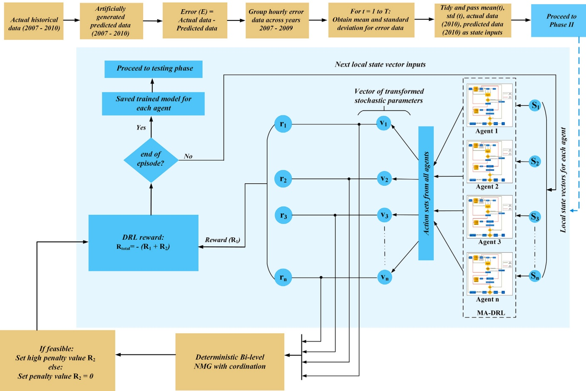

Fig. 3. L-MADRL training framework.

Where 𝑡 stands for the time period, $V _ { \mathrm { w s } } ^ { \mathrm { E R 1 } }$ and $V _ { \mathrm { w s } } ^ { \mathrm { E R 2 } }$ are the actual wind speeds in ER1 and ER2 respectively. $\hat { \hat { V } } _ { \mathrm { w s } } ^ { \mathrm { E R 1 } }$ and $\widehat { \mathcal { V } } _ { \mathrm { w s } } ^ { \mathrm { E R 2 } }$ are the pre-dicted wind speeds in ER1 and ER2 respectively. ${ \mu _ { \mathrm { e r r o r , w s ( t ) } } ^ { \mathrm { E R 1 } } } ^ { ^ { \mathrm { w s } } }$ and $\mu _ { \mathrm { a u s e } } ^ { \mathrm { E R 2 } }$ error,ws(t) are the mean error values for ER1 and ER2 obtained from set 1 data. $\sigma _ { \mathrm { e r r o r , w s ( t ) } } ^ { \mathrm { E R 1 } }$ and $\sigma _ { \mathrm { e r r o r , w s ( t ) } } ^ { \mathrm { E R 2 } }$ are the standard deviation of the error distribution obtained from data in set 1. Similarly, agent 2 in the $5$ bus case handles the wind speed and solar irradiance uncertainties from the three MG nodes, and its local observation is given as:

$$
\begin{aligned}S_{\mathrm{A}2,\mathrm{o}}^{\mathrm{Sbus}} = \Bigg\{ & t,\ V_{\mathrm{ws}}^{\mathrm{MG1}},\ \hat{V}_{\mathrm{ws}}^{\mathrm{MG1}},\ G_{\mathrm{s}}^{\mathrm{MG2}},\ \hat{G}_{\mathrm{s}}^{\mathrm{MG2}},\ V_{\mathrm{ws}}^{\mathrm{MG3}},\ \hat{V}_{\mathrm{ws}}^{\mathrm{MG3}}, \\& \mu_{\mathrm{error,ws(t)}}^{\mathrm{MG1}},\ \mu_{\mathrm{error,s(t)}}^{\mathrm{MG2}},\ \mu_{\mathrm{error,ws(t)}}^{\mathrm{MG3}}, \\& \sigma_{\mathrm{error,ws(t)}}^{\mathrm{MG1}},\ \sigma_{\mathrm{error,s(t)}}^{\mathrm{MG2}},\ \sigma_{\mathrm{error,ws(t)}}^{\mathrm{MG3}} \Bigg\} \quad \forall o \in \operatorname{Set} 2\end{aligned}\tag{88}
$$

Where $V _ { \mathrm { w s } } ^ { \mathrm { M G 1 } } ,   G _ { \mathrm { s } } ^ { \mathrm { M G 2 } }$ , and $V _ { \mathrm { w s } } ^ { \mathrm { M G 3 } }$ are the actual wind speeds and solar irradiance for MG 1, MG 2, and MG 3 respectively. $\bar { \hat { V } _ { \mathrm { w s } } ^ { \mathrm { M G 1 } } } , \; \bar { \hat { G } } _ { \mathrm { s } } ^ { \mathrm { M G 2 } }$ , and $\hat { V } _ { \mathrm { w s } } ^ { \mathrm { M G 3 } }$ represent the predicted values of the wind speeds and solar irradiance respectively. The error values for the mean of these stochastic parameters in MG $^ { 1 , }$ MG2, and MG3 are given by $\mu _ { \mathrm { e r r o r , w s ( t ) } } ^ { \mathrm { M G 1 } } , \mu _ { \mathrm { e r r o r , s ( t ) } } ^ { \mathrm { M G 2 } } ,$ and $\mu _ { \mathrm { e r r o r , w s ( t ) } } ^ { \mathrm { M G 3 } }$ respectively, while the standard deviation of the errors for the wind speed and solar irradiance are given by $\sigma _ { \mathrm { e r r o r , w s ( t ) } } ^ { \mathrm { M G 1 } } ,   \sigma _ { \mathrm { e r r o r , s ( t ) } } ^ { \mathrm { M G 2 } } ,$ and $\sigma _ { \mathrm { e r r o r , w s ( t ) } } ^ { \mathrm { M G 3 } }$ respectively. Lastly, agent 3 in the 5 bus case deals with the uncertainties relating to the load demand in the three microgrids, and its local observation is given as:

$$
S _ { \mathrm { A 3 , o } } ^ { \mathrm { 5 b u s } } = \left\{ t , D ^ { \mathrm { M G 1 } } , \hat { D } ^ { \mathrm { M G 1 } } , D ^ { \mathrm { M G 2 } } , \hat { D } ^ { \mathrm { M G 2 } } , D ^ { \mathrm { M G 3 } } , \hat { D } ^ { \mathrm { M G 3 } } , \right.
$$

$$
\begin{aligned} &\mu_{ error ,  D ( t )}^{ MG 1}, \mu_{ error ,  D ( t )}^{ MG 2}, \mu_{ error ,  D ( t )}^{ MG 3},\\ &\sigma_{ error ,  D ( t )}^{ MG 1}, \sigma_{ error ,  D ( t )}^{ MG 2}, \sigma_{ error ,  D ( t )}^{ MG 3} \Bigg\} \quad \forall o \in  Set   2.\\ \end{aligned}\tag{89}
$$

Where $D ^ { \mathrm { M G 1 } } ,   D ^ { \mathrm { M G 2 } }$ , and $D ^ { \mathrm { M G 3 } }$ stand for the actual load demand in MG1, $\mathbf { M } \mathbf { G } 2 ,$ and MG3 respectively, $\hat { D } ^ { \mathrm { M G 1 } } ,   \hat { D } ^ { \mathrm { M G 2 } } ,$ and $\hat { D } ^ { \mathrm { M G 3 } }$ represent the predicted values of load demand in the microgrids respectively. $\mu _ { \mathrm { e r r o r , D ( t ) } } ^ { \mathrm { M G 1 } } ,$ $\mu _ { \mathrm { e r r o r , D ( t ) } } ^ { \mathrm { M G 2 } } ,$ and $\mu _ { \mathrm { e r r o r , D ( t ) } } ^ { \mathrm { M G 3 } }$ are the mean error values for the load demand in MG1, MG2, and MG3 respectively, while $\sigma _ { \mathrm { e r r o r } , \mathrm { D } ( \mathrm { t } ) } ^ { \mathrm { M G 1 } } , \sigma _ { \mathrm { e r r o r } , \mathrm { D } ( \mathrm { t } ) } ^ { \mathrm { M G 2 } } ,$ and $\sigma _ { \mathrm { e r r o r , D ( t ) } } ^ { \mathrm { M G 3 } }$ signify the standard deviation of the error values for the demand in the three microgrids.

Across all local state inputs, we can deduce a common/generic state input format for an agent ’n’ in the other case i.e. the 14 bus case. Hence the local state inputs can be generalized as:

$$
\begin{aligned} S_{\mathrm{An,o}}^{\mathrm{kbus}} = \Bigg\{ & t, \Big[ Y_{\mathrm{sp}}^{\mathrm{ER1}}, Y_{\mathrm{sp}}^{\mathrm{ER2}}, Y_{\mathrm{sp}}^{\mathrm{ERn}} \Big], \Big[ \hat{Y}_{\mathrm{sp}}^{\mathrm{ER1}}, \hat{Y}_{\mathrm{sp}}^{\mathrm{ER2}}, \hat{Y}_{\mathrm{sp}}^{\mathrm{ERn}} \Big], \\ & \Big[ X_{\mathrm{sp}}^{\mathrm{MG1}}, X_{\mathrm{sp}}^{\mathrm{MG2}}, X_{\mathrm{sp}}^{\mathrm{MGn}} \Big], \Big[ \hat{X}_{\mathrm{sp}}^{\mathrm{MG1}}, \hat{X}_{\mathrm{sp}}^{\mathrm{MG2}}, \hat{X}_{\mathrm{sp}}^{\mathrm{MGn}} \Big], \\ & \Big[ \mu_{\mathrm{error,sp(t)}}^{\mathrm{ER1}}, \mu_{\mathrm{error,sp(t)}}^{\mathrm{ER2}}, \mu_{\mathrm{error,sp(t)}}^{\mathrm{ERn}} \Big], \\ & \Big[ \mu_{\mathrm{error,sp(t)}}^{\mathrm{MG1}}, \mu_{\mathrm{error,sp(t)}}^{\mathrm{MG2}}, \mu_{\mathrm{error,sp(t)}}^{\mathrm{MGn}} \Big], \\ & \Big[ \sigma_{\mathrm{error,sp(t)}}^{\mathrm{ER1}}, \sigma_{\mathrm{error,sp(t)}}^{\mathrm{ER2}}, \sigma_{\mathrm{error,sp(t)}}^{\mathrm{ERn}} \Big], \\ & \Big[ \sigma_{\mathrm{error,sp(t)}}^{\mathrm{MG1}}, \sigma_{\mathrm{error,sp(t)}}^{\mathrm{MG2}}, \sigma_{\mathrm{error,sp(t)}}^{\mathrm{MGn}} \Big] \Bigg\} \quad \forall o \in \mathrm{Set}   2 \end{aligned}\tag{90}
$$

Where [.] denotes the optional local observations depending on the uncertainty being handled by the agent ’n’. 𝑘𝑏𝑢𝑠 represents either the

5 or 14 bus. $Y _ { \mathrm { s p } } ^ { \mathrm { E R } }$ and $\hat { Y } _ { \mathrm { s p } } ^ { \mathrm { E R } }$ denote the actual and predicted stochastic parameters handled by agent ${ \bf \Phi ^ { \prime } n ^ { \prime } }$ in the ER nodes. $X _ { \mathrm { s p } } ^ { \mathrm { M G } }$ and $\hat { X } _ { \mathrm { s p } } ^ { \mathrm { M G } }$ represent the actual and predicted stochastic parameters handled by agent $\mathbf { ^ { \circ } n ^ { \prime } }$ at the MG nodes. $\mu _ { \mathrm { e r r o r , s p ( t ) } } ^ { \mathrm { E R } }$ and $\mu _ { \mathrm { e r r o r , s p ( t ) } } ^ { \mathrm { M G } }$ represent the mean error values of the stochastic parameters in the ER and MG nodes respectively, while $\sigma _ { \mathrm { e r r o r , s p ( t ) } } ^ { \mathrm { E R } }$ and $\sigma _ { \mathrm { e r r o r , s p ( t ) } } ^ { \mathrm { \bar { M G } } }$ signify the standard deviation of the error values for the stochastic parameters considered in the ER and MG nodes respectively.

#### 4.1.2 . Actions

The agent in any state has to take an action and make the best decision that will edge it closer to maximizing its own reward. In the L-MADRL framework, each agent outputs or decides on its own unique policy which might be different from the other agents. As the DQN algorithm is limited to only discrete action spaces, we have discretized the action space of the agent. The output/action from each agent is selected as a real number R which is used as a factor multiplier on the standard deviation of the stochastic parameters considered. For instance, in the 5 bus system, agent 1 which handles the wind uncertainty for the ERs has the action set given by:

$$
A _ { 1 , \mathrm { e r } } ^ { 5 \mathrm { b u s } } = \Bigg \{ - 2 , - 1 . 5 , - 1 , 1 , 1 . 5 , 2 \Bigg \} \quad \forall e r \in \mathrm { E R s } .\tag{91}
$$

The $\operatorname { E q . }$ (91) above comprises six distinct action error multipliers which are used to create the transformed stochastic parameter used to get the predicted parameter closer to its actual value. For the agent 1 case, the overall action space comprises 36 independent sets to be decided by the agent i.e. at any time 𝑡, agent 1 decides on the appropriate error multiplier for ER1 and ER2 such that the predicted day-ahead stochastic parameter for both electricity retailers is approximated to closely match the actual value. Likewise the action set for agent 2 and agent 3 for the 5 bus case is shown below:

$$
A _ { 2 , \mathrm { m g } } ^ { \mathrm { 5 b u s } } = \left\{ \begin{array} { l l } { { \{ - 0 . 3 ,   - 0 . 1 ,   0 . 1 ,   0 . 3 ,   0 . 5 \} , } } & { { \forall   m g \in \{ \mathrm { M G 1 , M G 3 } \} } } \\ { { } } & { { } } \\ { { \qquad \{ - 0 . 4 ,   - 0 . 2 ,   - 0 . 1 ,   - 0 . 0 8 ,   - 0 . 0 5 , } } } & { { \forall   m g = \mathrm { M G 2 } } } \\ { { } } & { { } } \\ { { - 0 . 0 1 ,   0 . 0 1 ,   0 . 0 5 ,   0 . 0 8 ,   0 . 1 0 ,   0 . 2 ,   0 . 4 \} , } } & { { } } \end{array} \right.\tag{92}
$$

$$
A _ { 3 , \mathrm { m g } } ^ { 5 \mathrm { b u s } } = \Bigg \{ - 1 0 , \; - 8 , \; - 5 , \; 5 , \; 8 , \; 1 0 \Bigg \} \quad \forall m g \in \mathrm { M G s }\tag{93}
$$

Where Eq. (92) comprises the error multipliers for the stochastic parameters (wind and solar) in MG1, MG2, and MG3, and Eq. (93) is the error multiplier for the load demand stochastic parameters across the microgrids. The agents action multipliers for the 14 bus case follow a similar pattern as that for the 5 bus case, albeit with more action spaces per agent.

In the 14 bus case, there were a total of 5 agents; with agent 1 handling the wind speed uncertainty in ER1 - ER5, hence $A _ { 1 , \mathrm { e r } } ^ { 1 4 \mathrm { b u s } } \; = \; A _ { 1 , \mathrm { e r } } ^ { 5 \mathrm { b u s } }$ However, given that there are a total of 5 ERs, the action space becomes $( N _ { \mathrm { m u l t } } ^ { \mathrm { N E R } } = \widetilde { 6 ^ { 5 } } )$ i.e. $7 7 7 6 ,$ where $N _ { \mathrm { m u l t } }$ denotes the number of action multi-pliers and NER is the number of electricity retailers. Hence at any time $t ,$ agent 1 in the 14-bus case must select an optimal combination from 7776 combinations comprising 5 tuples for the 4 ERs. The second agent, agent 2 handled the wind speed uncertainty in the MG nodes with wind turbines i.e., MG 1, 3, 6, 7, 8, 9 (six in total). The action multipliers are similar to that in the 5 bus case of agent 2 for MG1 and MG3, hence for agent 2, the action space is $( 5 ^ { 6 } )$ i.e. 15,625. Agent 3, the third agent dealt with the solar irradiance uncertainty in MG nodes having solar PV’s i.e. MG 2, 4, and 5 (three in total). The action multipliers are the same as those used in agent 2 of the 5 bus case for MG 2, hence the action space for agent 3 here becomes (123) i.e., 1728. Agent 4 and 5 both handled the load demand uncertainties in MG 1 - MG 5 for agent $^ { 4 , }$ and MG 6 - MG 9 for agent 5 respectively. The error multipliers were similar to that in agent 3 in the 5 bus case. However, here the action space for agent 4 is $( 6 ^ { 5 } )$ i.e. $7 7 7 6 ,$ while that for agent 5 is (64) i.e. 1296. The details of these stochastic parameters is as shown in Table 2.

Table 2

Case studies, number of agents, parameters, and action spaces.

| Case study | No. of agents | Parameter by agent | Action space |
| --- | --- | --- | --- |
| Case 1 |  |  |  |
| PJM 5 Bus | 3 | A1 – wind at ERs | 36 |
|  |  | A2 – wind and solar at MGs | 300 |
| Case 2 |  | A3 – load at MG | 216 |
|  |  |  |  |
| IEEE 14 Bus | 5 | A1 – wind at ERs | 7776 |
|  |  | A2 – wind at MGs | 15,625 |
|  |  | A3 – solar at MGs | 1728 |
|  |  | A4 – load at MGs | 7776 |
|  |  | A5 – load at MGs | 1296 |

It’s also important to note that during the learning phase of the DQN, particularly in the early stages, the 𝜖-greedy strategy is commonly employed for action selection to prevent the agent from converging pre-maturely to a local optimum. Under this approach, the agent selects the optimal (greedy) action with probability $1   -   \epsilon ,$ and a random action with probability 𝜖. A uniformly distributed random number $H \in [ 0 ,$ 1] is generated to determine which type of action to take. The 𝜖-greedy policy can be mathematically described as follows:

$$
\mathsf { a c t i o n } ^ { \mathrm { D Q N } } = \left\{ \begin{aligned} & \arg ,   \max _ { \mathsf { a c t i o n } \in A } Q ^ { * } ( s , \mathsf { a c t i o n } ) , & & H \leq \epsilon \\ & \mathsf { a c t i o n } _ { \mathsf { r a n d o m } } , & & \epsilon < H \leq 1 \end{aligned} \right.\tag{94}
$$

#### 4.1.3 . Rewards

The rewards obtained by each agent are state dependent. What this means is that each agent minimizes the deviation of its predicted stochastic parameter from the actual value at each state–action pair. Since fundamentally the L-MADRL abstracts the feasibility and technicality checks to the bi-level framework, the reward formulation is divided into two categories; $R _ { 1 }$ and $R _ { 2 } ,$ where $R _ { 1 }$ represents the reward vector comprising the individual rewards obtained by agent 1 to agent n, depending on the problem case being studied. In general, $R _ { 1 }$ is given by:

$$
R _ { 1 } = [ r _ { 1 } , \; r _ { 2 } , \; r _ { 3 } , \; \ldots \; , \; r _ { n } ] ^ { T }\tag{95}
$$

Where $r _ { 1 }   =   r _ { 2 }   =   r _ { n }$ and is defined by:

$$
r _ { 1 } = \beta _ { \mathrm { c o e f } } ( S P - \hat { S P } _ { \mathrm { t r a n s } } )\tag{96}
$$

Where $\beta _ { \mathrm { c o e f } }$ is a cost coefficient associated with the severity of the deviation, $S P$ is the actual value of the stochastic parameter, and $\hat { S P } _ { \mathrm { t r a n s } }$ is the transformed predicted stochastic parameter given by:

$$
\hat { S P } _ { \mathrm { t r a n s } } = \hat { S P } _ { \mathrm { p r e d } } + \left[ \mu _ { \mathrm { e r r o r , s p } } ^ { ( \mathrm { t } ) } + ( A _ { \mathrm { n , s p } } ^ { \mathrm { k b u s } } \times \sigma _ { \mathrm { e r r o r , s p } } ^ { ( \mathrm { t } ) } ) \right]\tag{97}
$$

Where $\hat { S P } _ { \mathrm { p r e d } }$ is the predicted stochastic parameter at either the ER or MG nodes, $\mu _ { \mathrm { e r r o r , s p } } ^ { \mathrm { ( t ) } }$ is the mean error value of the stochastic parameter at time $t ,   \sigma _ { \mathrm { e r r o r , s p } } ^ { \mathrm { ( t ) } }$ is the error value of the standard deviation of the stochastic parameter at time $t ,$ and $A _ { \mathrm { n , s p } } ^ { \mathrm { k b u s } }$ is the action multiplier of agent’n’ for the stochastic parameter considered at the 𝑘𝑡ℎ 𝑏𝑢𝑠 case, where $k \in \{ 5 , 1 4 \}$

The second part of the reward formulation, $R _ { 2 } ,$ is the penalty value derived from the feasibility checks when the transformed stochastic parameters $\hat { S P } _ { \mathrm { t r a n s } }$ are passed as inputs into the deterministic bi-level NMG framework. Consequently, the total reward obtained is the summation of these two reward categories, however, since by default DRL seeks to maximize rewards, but in this case, the problem formulation seeks to minimize deviations, the total reward is prefixed with a negative sign so it conforms to the DRL framework. Hence the total reward $R _ { \mathrm { t o t a l } }$ is given by:

Table 3

DRL agent’s implementation hyperparameters.

| S/N | Hyperparameter | Value |
| --- | --- | --- |
| 1 | Batch size | 128 |
| 2 | No of hidden layers | 2 |
| 3 | Fully connected layer 1 | 256 |
| 4 | Fully connected layer 2 | 256 |
| 5 | Replay buffer size | 1e6 |
| 6 | Learning rate | 1e-4 |
| 7 | Polyak averaging coefficient | 1e-3 |
| 8 | Optimizer | Adaptive moment estimation |
| 9 | Loss function | Mean squared error |
| 10 | Maximum Episode | 4000 |
| 11 | Discount factor (gamma) | 0.8 |
| 12 | Target network update frequency | 4 |
| 13 | Exploration strategy | 𝜖-greedy |
| 14 | Initial exploration probability | 1.0 |
| 15 | Exploration decay | 0.995 |
| 16 | Minimum exploration probability | 1e-14 |

$$
R _ { \mathrm { t o t a l } } = - ( R _ { 1 } + R _ { 2 } )\tag{98}
$$

In selecting $\beta _ { \mathrm { c o e f } } ,$ we first examined the typical range of $( S P { - } \hat { S P } _ { \mathrm { t r a n s } } )$ on historical data and preliminary runs, and the order of magnitude of the feasibility penalties $R _ { 2 }$ which was fixed to a large value of €2000. $\beta _ { \mathrm { c o e f } }$ was then chosen such that, for deviations in the practically relevant range, the resulting term $\beta _ { \mathrm { c o e f } } ( S P - \hat { S P } _ { \mathrm { t r a n s } } )$ is of the same order as the associated feasibility penalties. This ensures that the agents during learning are simultaneously encouraged to keep the transformed stochastic parameters close to their actual values and avoid infeasible operating points where one effect (either $R _ { 1 }$ or $R _ { 2 } )$ numerically dominates the other excessively. In our simulations we verified that using $\beta _ { \mathrm { c o e f } }$ within a reasonable range around €1000 did not materially change the learned scheduling performance; it only primarily affected the absolute scale of the learned Q-values.

At the end of the entire training episode, the trained models for each agent is saved, and can be deployed for use in the testing phase. Table 3 reveals the hyper-parameters used during the training of each DRL agent.

Although actor–critic algorithms such as SAC, A3C and PPO are popular for continuous control, we deliberately adopt a value based Deep Q Network (DQN) for the proposed EMS because it matches the structure and computational constraints of our problem. The agents do not output generic continuous controls, but select one multiplier from a finite catalogue of discrete error factors that scale the forecast error standard deviation of each stochastic parameter, which yields a large yet finite combinatorial action space that is naturally handled by DQN, whereas a continuous policy would still need to be projected back to the nearest admissible multiplier, breaking the assumptions of policy gradient updates and introducing additional approximation errors. Moreover, every environment step requires solving the single level MPEC with the transformed stochastic parameters to compute the feasibility penalties $R _ { 2 } ,$ so off-policy data reuse is crucial; on-policy methods such as SAC, A3C and PPO would demand many more fresh trajectories and therefore many more expensive MPEC solves, while DQN uses a replay buffer that allows extensive reuse of past transitions. In addition, the reward landscape induced by deviation and penalty terms can be highly non smooth, so policy gradient methods may suffer from noisy and unstable gradients unless heavily regularized, whereas value based DQN learns Q values from temporal difference targets without differentiating through the environment, which typically yields lower variance targets and makes training less sensitive to hyperparameters such as learning rate and entropy regularization. Finally, DQN provides simple and transparent exploration control through an epsilon greedy policy, which is easy to tune in the presence of large negative rewards for infeasible or highly suboptimal schedules, while entropy regularization in SAC or PPO can encourage overly aggressive exploration in regions that consistently produce infeasible operating points, which is undesirable given the high cost of each environment evaluation.

### 4.2 . Testing process

The testing phase is as described in Fig. 4. Here, given the day-ahead predictions of the stochastic parameters (load, solar, and wind) from the ERs and MGs, the hourly mean and standard deviation from the historical data (2007–2009), these inputs are fed into the commensurately trained agent(s).

The agent(s) then perform the transformations internally, and sends these transformed values as inputs to the deterministic bi-level NMG framework from where the optimal schedules and objectives are derived. The testing process all happens on a timescale of milli-seconds when compared with the time required for uncertainty handling with the stochastic optimization methods showcased as benchmarks in this work. It is critical to note here that a larger network does not necessarily translate to a proportionate increase in the number of DRL agents in the L-MADRL framework. While it is true that ERs and MG operators are modelled by different agents, each agent is designed to handle multiple nodes that share the same type of stochastic parameter (for example, wind at ERs, wind at MGs, solar at $\mathbf { M G s } ,$ or load at MGs). In other words, the number of agents scales with the number of distinct uncertainty types, not with the number of buses. Hence, when the system size increases, what grows is primarily the action space of some agents, not the agent count itself. Alternatively, for scalability and faster learning, the action space because of the larger network could be partitioned across two or more agents that each cover a subset of nodes. This was precisely what was done for agents 4 and 5 in the 14-bus case which handled the load demand uncertainty, since nine (9) buses had load attached, they were split between two agents; agent 4 handled five of the nine load buses and agent 5 handled the remaining four. Either way, both design choices remain compatible with our L-MADRL framework.

## 5 . Two-stage stochastic optimization

This section describes the procedures involved in implementing the two-stage risk-neutral and the risk-averse stochastic optimization with CVaR. The uncertainty modeling technique used is described first alongside the scenario generation/reduction process.

### 5.1 . Uncertainty modelling

Accurately modeling the uncertainties of stochastic parameters by considering only deterministic forecasts is too risky, and could lead to sub-optimal schedules especially when planning to participate in a dayahead or real-time electricity market. To circumvent this, MCS could be utilized in generating multiple plausible scenarios of these variable parameters in the next hour, or next day as the case may be. This process is the ’scenario generation’ phase and it relies on using accurate PDFs that closely fits the stochastic parameters. In this work, the normal distribution was used to model the stochasticity of the load demand, while the beta and weibull distributions were used to model that of the solar irradiance and wind speed respectively.

For the load demand the Gaussian PDF is as given in [10]:

$$
f _ { \mathrm { l o a d } } ( d ) = \frac { 1 } { \sigma _ { \mathrm { l o a d } } \sqrt { 2 \pi } } \exp \left( - \frac { ( d - \mu _ { \mathrm { l o a d } } ) ^ { 2 } } { 2 \sigma _ { \mathrm { l o a d } } ^ { 2 } } \right) , \quad d \in \mathbb { R }\tag{99}
$$

Where $\mu _ { \mathrm { l o a d } }$ and $\sigma _ { \mathrm { l o a d } }$ represent the mean(expected value) and the standard deviation respectively.

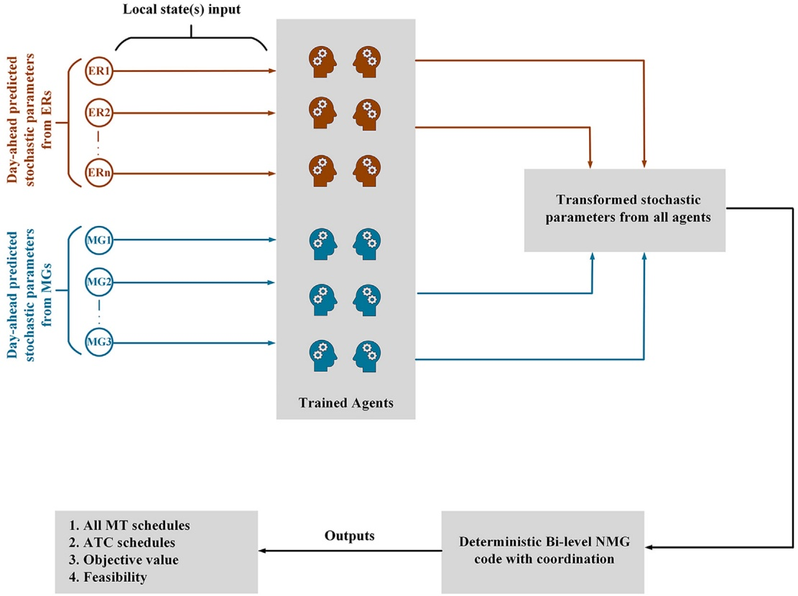

Fig. 4. L-MADRL testing process.

For the solar irradiance, the beta PDF is given as in [12]:

$$
f _ { \mathrm { s o l a r } } ( x ) = \frac { x ^ { \alpha - 1 } ( 1 - x ) ^ { \beta - 1 } } { B ( \alpha , \beta ) } , \quad 0 \leq x \leq 1\tag{100}
$$

Where 𝛼 and $\beta$ are the shape parameters representing the skewness and kurtosis respectively, and $B ( \alpha , \beta )$ is defined as:

$$
B ( \alpha , \beta ) = \frac { \Gamma ( \alpha )   \Gamma ( \beta ) } { \Gamma ( \alpha + \beta ) }\tag{101}
$$

Where Γ(.) is the gamma function of the shape parameters. The shape parameters 𝛼 and $\beta$ are defined as:

$$
\alpha = { \frac { \mu \times \beta } { 1 - \mu } }\tag{102}
$$

$$
\beta = (1 - \mu) \times \left( \frac{\mu \times (1 - \mu)}{\delta^2} - 1 \right)\tag{103}
$$

Where $\mu$ and $\delta$ are the mean and standard deviation derived from historical data respectively.

For the wind speed, let 𝑉 denote the wind speed in (m/s), the weibull PDF is defined as in [10]:

$$
f_{V}(v)=\begin{cases}\frac{k}{\lambda}\Big(\frac{v}{\lambda}\Big)^{k-1}\exp\left[-\Big(\frac{v}{\lambda}\Big)^{k}\right],&v\geq0,\\0,&v<0.\end{cases}\tag{104}
$$

Where $k > 0$ is the shape parameter, and $\lambda > 0$ is the scale parameter. A detailed flowchart describing the process for implementing the risk-neutral and risk-averse two stage stochastic optimization is pre-sented in Fig. 5. The process starts with reading as inputs the day-ahead stochastic parameters for each node in the case network under consideration. Thereafter, depending on the stochastic parameter at that node, Eq. (99) for the load uncertainty, Eq. (100) for the solar irradiance uncertainty, and Eq. (104) for the wind speed uncertainty are used to generate the scenarios using MCS for each time 𝑡. Initially, 1000 scenarios are generated, but due to the large number of these scenarios which could add a lot of computational burden and may become intractable to solve, we adopted an efficient scenario reduction technique known as the backward reduction method (BRM) [44] to reduce the original set of scenarios to a more manageable set (15). Details of the algorithm are available in [45].

The reduced scenario set as well as their corresponding probabilities are then passed on to the two-stage RNSO (Eq. 105) or RASO $( \operatorname { E q . }$ (108)) depending on whether consideration is given to problem formulation to hedge against cases when the outputs of the stochastic parameters are extremely low. The formulation of the two-stage RNSO and RASO are discussed in subsequent sections.

### 5.2 . Risk-neutral stochastic optimization (RNSO)

$$
\begin{aligned}Z_{\Omega} = & \max \sum_{\omega \in \Omega} p_{\omega} \sum_{t \in \mathcal{T}} \left[ \sum_{i \in \mathcal{I}} \sum_{k \in \mathcal{K}} C_{i,t}^{\mathrm{exc}} P_{i,k,t}^{\mathrm{exc}} - \sum_{i \in \mathcal{I}} \left( C_{\mathrm{MT},i}^{\mathrm{var}} P_{\mathrm{MT},i,t} + C_{i}^{\mathrm{su}} v_{i,t} \right. \right. \\& \left. \left. + C_{i}^{\mathrm{sd}} w_{i,t} + C_{i}^{\mathrm{wind}} P_{i,t,\omega}^{\mathrm{wind}} + C_{t}^{\mathrm{grid}} P_{i,t}^{\mathrm{grid}} \right) + \Lambda^{\mathrm{ATC}} \sum_{i \in \mathcal{I}} \left( G_{i,t,\omega}^{\mathrm{red}} - G_{i,t,\omega} \right) \right]\end{aligned}
$$

s.t. All first & second stage constraints + KKT constraints, ∀𝜔 ∈ Ω (105)

Where $P _ { i , k , t } ^ { \mathrm { e x c } } , \; P _ { \mathrm { M T } , i , t } , \; v _ { i , t } , \; w _ { i , t } ,$ and $P _ { i , t } ^ { \mathrm { g r i d } }$ all represents the first-stage (or here-and-now) decision variables, the second-stage (or wait-and-see) decision variables involves the ATC variables given by $G _ { i , t , \omega } ^ { \mathrm { r e d } }$ and $G _ { i , t , \omega } ,$ the line flows, and all of the prior decision variables in the lower level problem which includes; the local MT generation from each microgrid, the battery charge/discharge power, and battery energy/SoC for all microgrids $k   \in   { \mathcal { B } } ,$ and lastly the dual and auxiliary KKT variables associated with the complementarity conditions for the

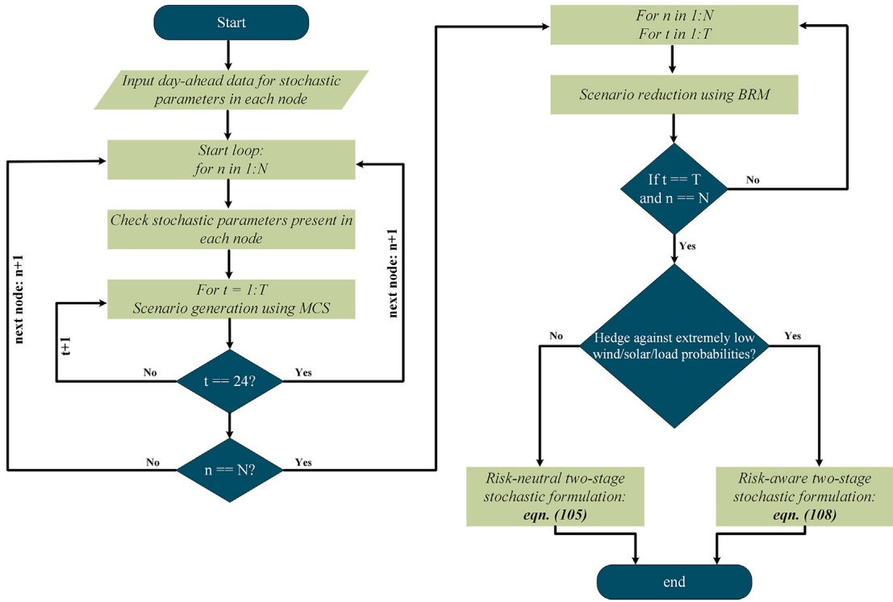

Fig. 5. Implementation process for two-stage RNSO and RASO.

MTs and BESS defined on their respective MG nodes. The first-stage (scenario-independent) constraints are the technical constraints associated with the first stage decision variables, while the second-stage (scenario-dependent) constraints are that of the second-stage decision variables.

### 5.3 . Risk-aware stochastic optimization (RASO)

By default, the stochastic optimization process is risk-neutral, to transform this into a risk-averse model, the conditional value at risk (CVaR) procedure is utilized. The CVaR at the confidence level (𝛼) is defined as the expected profit for the worst 100𝛼% scenarios, and is expressed as [46]:

$$
\operatorname { C V a R } _ { \alpha } ( Z ) = \underbrace { \zeta } _ { \mathrm { t a r g e t \: p r o f i t } } - \underbrace { \frac { 1 } { 1 - \alpha } \sum _ { \omega \in \Omega } p ( \omega )   \eta _ { \omega } } _ { \mathrm { e x p e c t e d \: s h o r t f a l l } } ,\tag{106}
$$

Where

$$
\eta _ { \omega } = \operatorname* { m a x } \{ \zeta - Z _ { \omega } ,   0 \} \geq 0 , \quad \forall \omega \in \Omega\tag{107}
$$

Because $\eta _ { \omega }$ is non-negative; subtracting it lowers the expression, hence the difference is maximized to push the tail average up. Therefore, given a risk-aversion tunable parameter $0 ~ \leq ~ \lambda ~ \leq ~ 1$ , the complete risk-averse formulation becomes:

$$
\begin{array} { r l } { \underset { ( \mathrm { a l l \; o r i g i n a l \; v a r s } ) ,   \zeta ,   \eta _ { \omega } , \; Z _ { \omega } } { \operatorname* { m a x } } } & { { } ( 1 - \lambda ) \displaystyle \sum _ { \omega \in \Omega } p ( \omega )   Z _ { \omega } + \lambda \left( \zeta - \frac { 1 } { 1 - \alpha } \displaystyle \sum _ { \omega \in \Omega } p ( \omega )   \eta _ { \omega } \right) } \end{array}
$$

s.t. All first & second stage original feasibility and KKT constraints,

$$
\forall \omega \in \Omega
$$

$$
\eta _ { \omega } \geq Z _ { \omega } - \zeta , \quad \forall \omega \in \Omega
$$

$$
\eta _ { \omega } \geq 0 , \quad \forall \omega \in \Omega\tag{108}
$$

Where $\lambda = 0$ reproduces the risk-neutral formulation defined in Eq. (105) and a larger 𝜆 gives a stronger aversion to tail losses. $\eta _ { \omega }$ and $\zeta$ are both auxiliary variables associated with the CVaR reformulation.

## 6 . Case study

Two different sub-transmission grid networks were utilized as case studies to test the L-MADRL framework alongside the deterministic, risk-neutral, and risk-averse two-stage stochastic optimization methods being used as benchmarks. The framework was written in Python (version 3.10.16) using important modules such as PyTorch for the multi-agent DRL part and MIP for the single-level MPEC solution. The developed L-MADRL framework was trained and tested on an AMD Ryzen 9 5950x 16-core processor equipped with an NVIDIA GeForce RTX 4070 Ti Super GPU. Subsequent sections reveal these case studies in more detail and discuss the results obtained.

### 6.1 . Case 1: PJM 5 bus network

As the first case study, a modified PJM 5 bus network is utilized, this simplified test grid is used to test the energy management prowess of the L-MADRL in a networked MG setting with uncertainties present. Table A1 in Appendix A shows the technical and economic parameters of the ERs and MGs connected to different nodes in the network and Fig. 7 shows the schematic of the network alongside the different DERs attached to the respective nodes.

The learning trajectory for the three agents in the 5-bus case network is shown in Fig. 6. The solid lines represent the rolling mean of the agent’s learning progress after 100 episodes until the end of training. At the onset, At the onset, each agent explores the environment more due to the epsilon-greedy action selection policy defined in Eq. (94) for each period. The overall trend observed is an increase in the normalized rewards across all agents evidenced by the sharp improvement in the first 200–300 episodes. In particular, the agent (agent 3) responsible for the MG load demand stochasticity’s reached a reward of 0.9 at about the 1500th episode and remained close to 1.0 for the rest of the training horizon. The MG solar and wind agent (agent 2) experienced a bit of delay but largely followed a similar pattern to agent 3 achieving rewards asymptotically close to 1.0 after about the 3000th episode. The wind ER agent (agent 1) displayed the most visible non-monotonic behaviour. After an initial increase, it experienced a temporary degradation in the reward around the 1000th episode before recovering and converging to a high reward of around 0.95. The dip suggests the difficulty in learning the stochasticity’s of the wind speed in the ER nodes possibly due to the variance observed in the training data, however, since at each episode, the agent still has the ability to explore its environment, it eventually learns to choose more optimal policies.

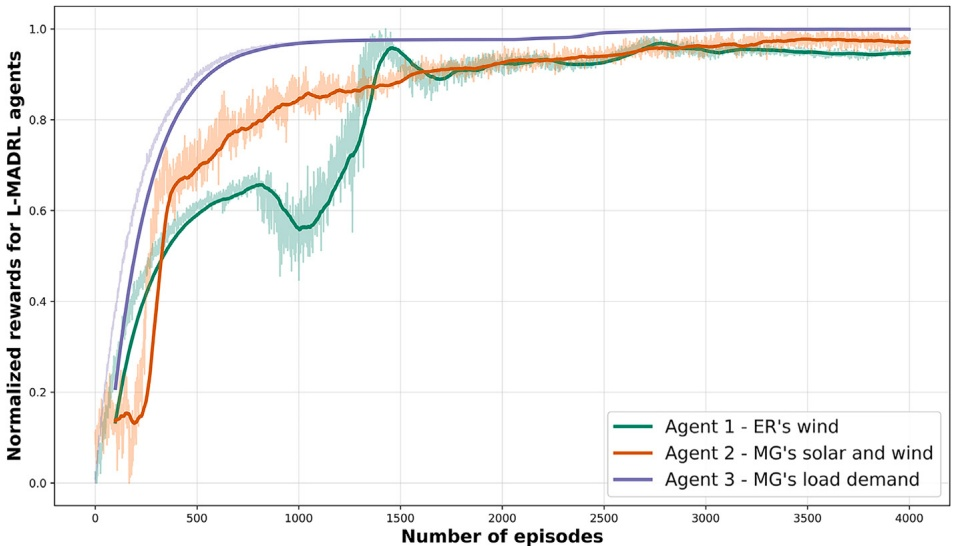

Fig. 6. L-MADRL learning trajectory for 5-bus multi-agents.

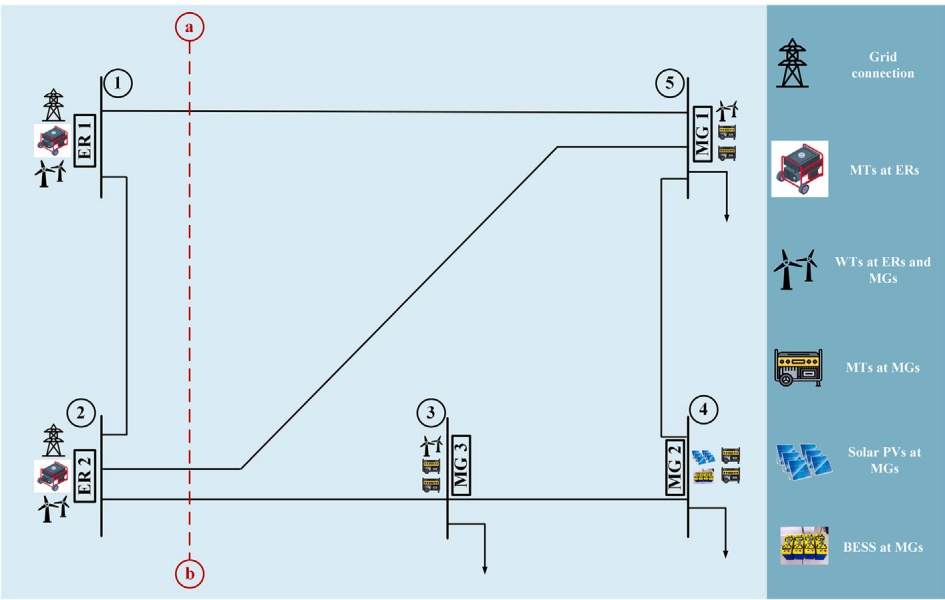

Fig. 7. Modified PJM 5-Bus schematic comprising 2 ERs and 3 MGs.

The day-ahead predictions for the loads in the MGs, the solar irradiance at MG2, and the wind speeds at ER1, ER2, MG1, and MG3 were extracted for the 15th of July 2010 obtained from the data sources in [41–43]. The electricity price data utilized were retrieved from the dayahead energy market in [47]. Since the ERs are in business to make profits, a fixed overhead price of 10% was added to represent the selling price of electricity to the MGs.

Fig. 8(a)–(d) shows the dispatch schedules of MG1 in the 5 bus network. In the deterministic case in Fig. 6(a), across all hours, the MG mostly buys energy from the ERs to meet its deficit demand. Accounting for uncertainties, in the risk-neutral (RN) and risk-aware (RA) cases in Fig. 8(b) and (c) respectively, the schedules were almost similar with some hours especially during mid-day (hour 12 - 17) in the RN case requiring more purchases from the grid than in the RA case. This is typical for the RA case as the optimizer aims to hedge against tail risks when wind scenarios are low and rarely occurs. As a result, the optimizer allows the MTs in this case to produce more power as against buying those extras from the ERs. In Fig. 8(d), with the L-MADRL framework, one thing quickly visible is the higher outputs from the wind turbines, these consequently reduces the outputs needed from the MTs.

For MG2, which also has the solar PVs, in Fig. 9(a), the deterministic case shows the output from the MTs remaining almost constant throughout the day, but ramps up during mid-day and settles back down at dusk i.e. 6pm until the end of the day. Consequently much of the energy

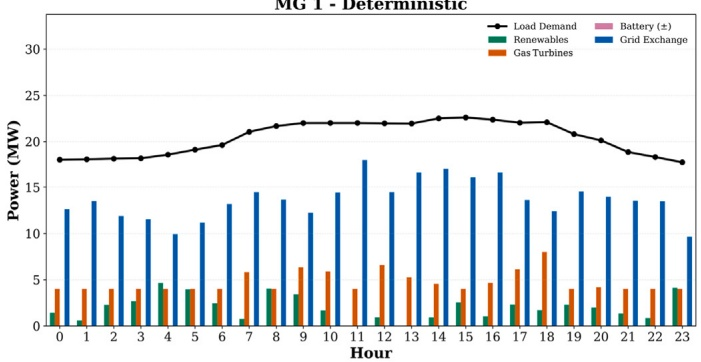

(a)

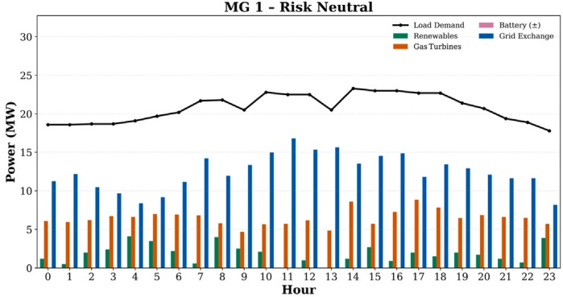

(b)

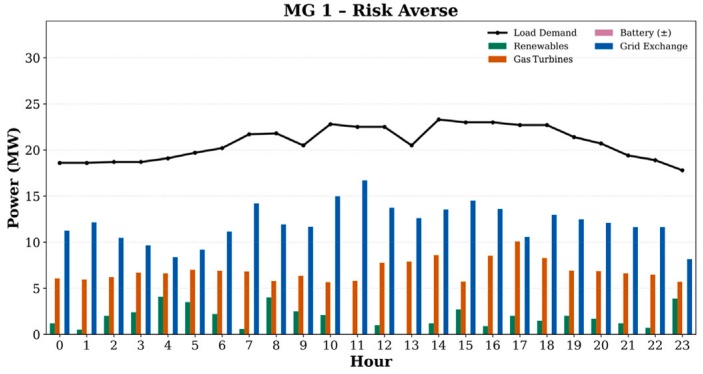

(c)

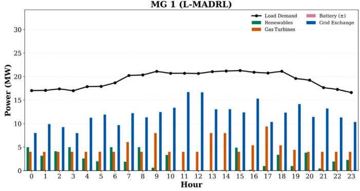

(d)

Fig. 8. Comparison of MG 1 schedules under deterministic, risk-neutral, risk-averse, and DRL methods.

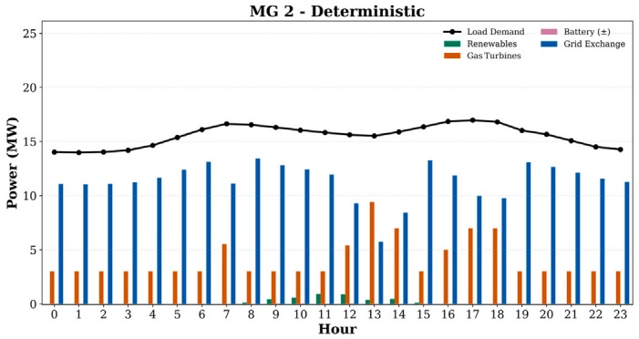

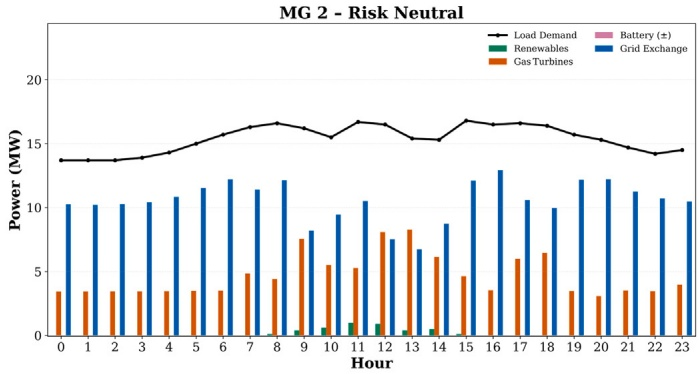

(a)

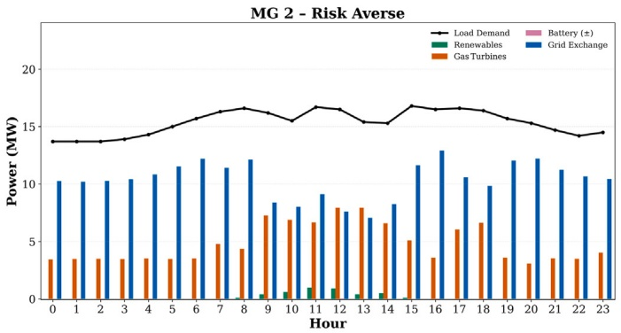

(c)

(b)

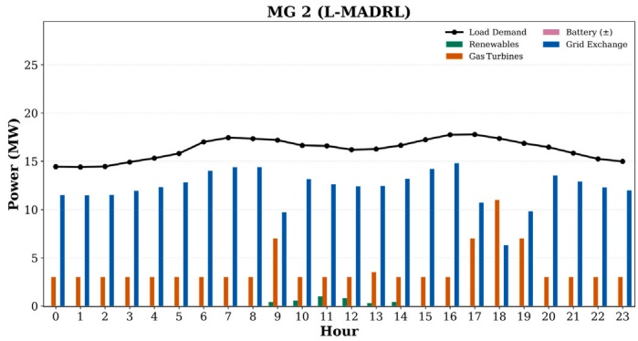

(d)

Fig. 9. Comparison of MG 2 schedules under deterministic, risk-neutral, risk-averse, and DRL methods.

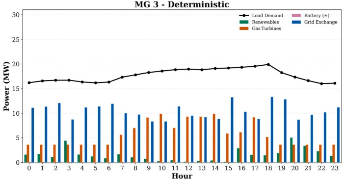

(a)

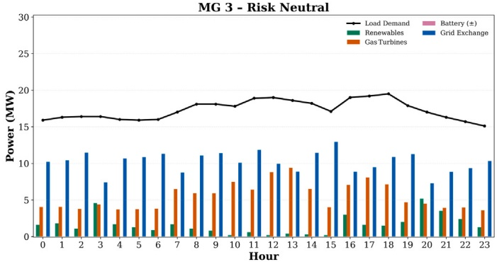

(b)

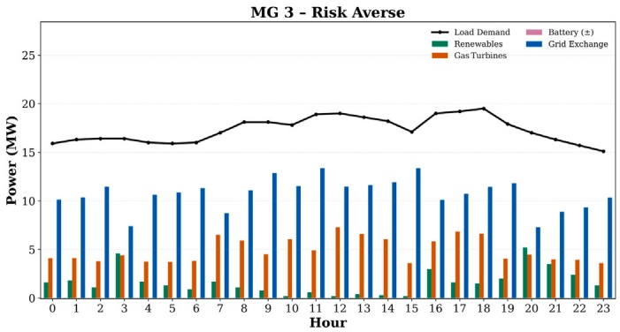

(c)

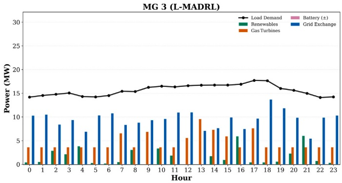

(d)

Fig. 10. Comparison of MG 3 schedules under deterministic, risk-neutral, risk-averse, and DRL methods.

demand deficits at the MGs were bought from the ERs. In Fig. 9(b) and (c), the schedules for the RN and RA case are similar, with lesser power being purchased from the ERs at hours 8 - 14, consequently meeting its demand with more outputs from the MTs and support from the solar PVs. In Fig. 9(d), the MT output is also fairly constant except during certain hours (hours 9 & 17–19) and demand deficits are predominantly met by power purchases from the ERs.

The dispatch schedules for MG3 are shown in Fig. 10(a)–(d). The deterministic case in Fig. 10(a) shows the outputs from the MT greater than or equal to that purchased from the ERs with some hours (hour 9–10, 14, and 17) recording higher power outputs from the MT. Fig. 10(b) and (c) show nearly identical schedules for the RN and RA cases respectively. However, in the RA case, more power is observed to be purchased from the ERs. In the L-MADRL case in Fig. 10(d), the outputs from the wind turbines were higher in most hours when compared with the benchmarks, consequently not as much power was purchased from the ERs to meet demand deficits. Across all four cases, the outputs from the MTs ramps up during mid-day to possibly meet peak demands, and tapers off towards the end of the day.

In Fig. 11(a)–(d), the SoC trajectories of the BESS installed in MG2 and MG3 are presented. In Fig. 11(a), the deterministic case shows the BESS charging gradually during the early hours of the day for the two MGs up until almost mid-day when load demand increases. The BESS in the two MGs is then seen to discharge consistently until the minimum SoC is reached, but as the day draws to an end, the BESS charges up again to meet the condition set by the optimizer for the energy at the end of the day (i.e. at 𝑡 = 24) being equal or greater than the BESS initial energy (i.e. at 𝑡 = 1). The trajectory for the RN and RA case in Fig. 11(b) and (c) are quite similar. In both cases, the BESS in MG3 stays idle throughout as the optimizer considers the degradation cost of the BESS and the variabilities of the wind speed. Since MG2 comprises solar

PVs and the stochasticities of solar irradiance is lesser compared to wind, the optimizer still tries to utilize the BESS in these cases, where in the RN case, the BESS charges up from approximately 40% SoC to around 62% SoC in one hour, and stays idle until the end of the day. In the RA case, the BES charges up earlier to around 62% SoC, but discharges close to mid-day to meet peak demand, it stays idle again until around 5pm and charges up until 62% SoC in one hour, staying this way till the end of the day. For the L-MADRL case in Fig. 11(d), the BESS for the two MGs follow similar trajectories, at the start of the day, the BESS charges up to 80% SoC and remains relatively stable with slight charge and discharge flickers just before mid-day. From mid-day till around 4pm, the BESS for both MGs discharges gradually, however, due to the peculiar load demands in MG3, the BESS discharges more deeply in this case, however, they both charge back up during the later part of the day to meet the battery energy conditions.

The line flows in the 5 bus network are shown in Fig. 12(a)–(d) for the deterministic, risk-neutral, risk-averse, and L-MADRL methods respectively. The pattern of flow is somewhat similar across the four plots. Looking closely at the figures, the pattern of flow in the non-deterministic plots (Fig. 12(b)–(d)) reveal more loadings on some lines as against the deterministic plot in Fig. 12(a). This is due to the stochasticities being considered in these methods. It’s observed that the line flows in Fig. 12(d) (L-MADRL case) are more than those of the other three, this is due to the better uncertainty handling of this method, capturing more accurately the state of the lines across the study period. Across all four plots, the branch connecting nodes 1 and 5 (L15) seems more loaded, indicating the criticality of this line and the need for redundancy in terms of load or generation managements if the ATC between both sides are desired to remain adequate.

The power exchanged between the three MGs and ER1 are displayed in Fig. 13(a)–(d). In Fig. 13(a), the deterministic case shows ER1 selling power mostly to MG1 from the early hours of the day until around midday, and the next big sales were made to MG2 especially towards the end of the day. MG3 generally did not purchase much from ER1 but purchased power sparingly during the early hours of the day up until 5pm. The ATC trajectory post-dispatch starts off at 15 MW and fluctuates throughout the day with its minimum value being around 7 MW at hour

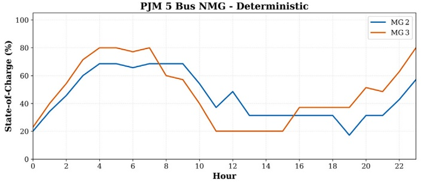

(a)

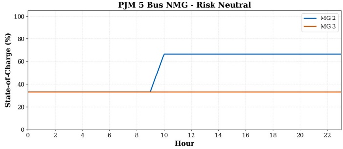

(b)

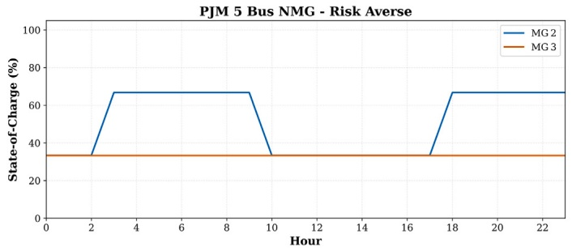

(c)

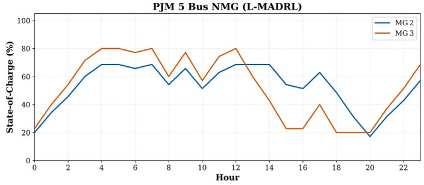

(d)

Fig. 11. Comparison of BESS SoC schedules for MG 2 and MG 3 under deterministic, risk-neutral, risk-averse, and DRL methods.

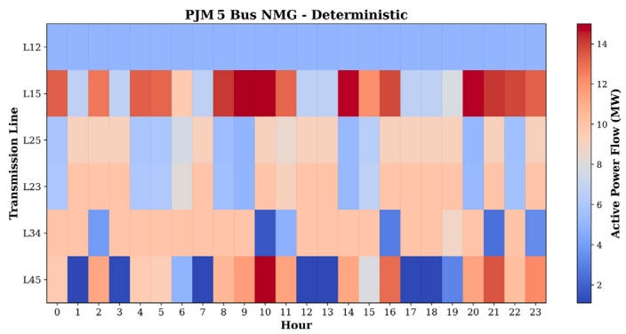

(a)

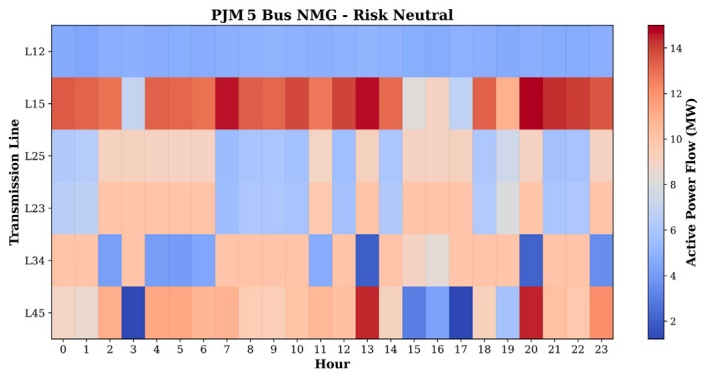

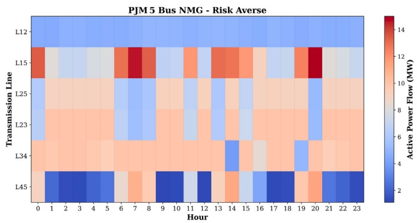

(c)

(b)

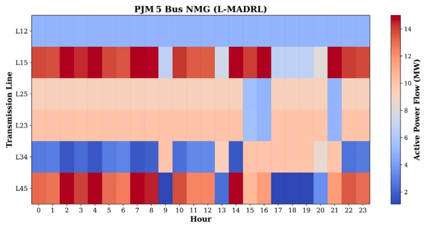

(d)

Fig. 12. Comparison of 5-Bus line flows under deterministic, risk-neutral, risk-averse, and DRL methods.

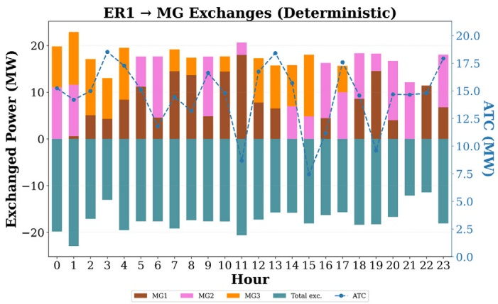

(a)

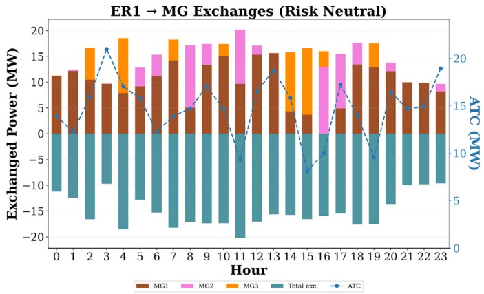

(b)

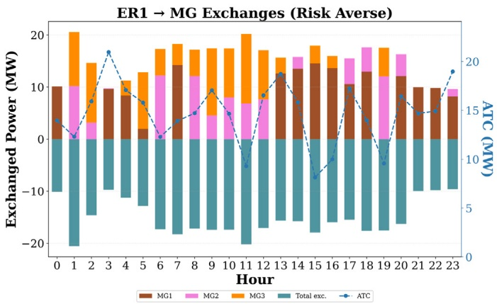

(c)

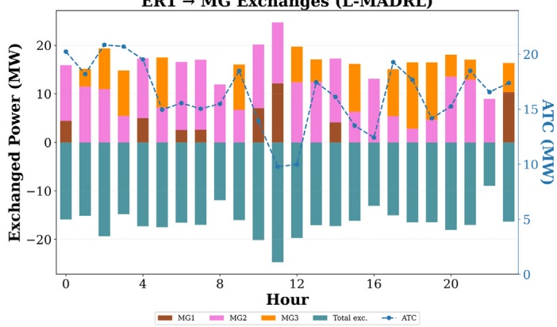

(d)

Fig. 13. Comparison of ER1 power exchange in the 5-bus system under deterministic, risk-neutral, risk-averse, and DRL methods.

15, and its maximum value being around 17.5 MW at hour 13. Generally, the ATC post dispatch is greater than 7 MW in all cases. In the RN case of Fig. 13(b), ER1 sold most of its available power to MG1 throughout the day, with small quantities purchased by MG2 and MG3 respectively. In Fig. 13(c), similar observations were made with the bulk of power being sold by ER1 to MG1 during the later part of the day, and to MG3 during the earlier part of the day, and then to MG2 sparingly throughout the day. The ATC values for the RN and RA cases are similar with the starting value being around 13 MW, the minimum being around 8 MW at hour 15, and the maximum being around 20.5 MW at hour 3.For the L-MADRL case in Fig. 13(d), unlike the other three cases, ER1 sold the bulk of its available power to MG2 throughout the day, and the next big buyer was MG3, although its purchases were mostly post-midday, while MG1 purchased very sparingly throughout the day. The ATC value post-day varied throughout the day but was more stable in some hours compared to the other benchmarks. The starting ATC value was around 20.5 MW, with the lowest value being around 10 MW at hour 11, and its highest value being around 21 MW at hour 2.

The exchanged power between the MGs and ER2 is shown in Fig. 14(a)-(d) respectively. Just like the deterministic case for ER1, Fig. 14(a) shows MG1 as the bulk purchaser of power especially post mid-day as opposed to before mid-day in Fig. 13(a). MG3 was the next big buyer of power from ER2 especially towards the end of the day. For the RN case in Fig. 14(b), unlike the case in Fig. 13(b), MG1 was the least purchaser of power from ER2 while MG3 purchased the most throughout the day, with MG2 closely following behind. For the RA case in Fig. 14(c), ER2 sold the bulk of its available power to MG3, and the least to MG1. Interestingly, in the L-MADRL case of Fig. 14(d), MG1 was the highest purchaser of power from ER2, purchasing power at almost all hours of the day, whereas it was the least in Fig. 13(d). The next big buyer was MG3, especially during pre-midday periods, with the least buyer being MG2. It’s important to point out that the ATC values are the same in Fig. 13(a)–(d) and Fig. 14(a)–(d) respectively.

### 6.2 . Case 2: IEEE 14 bus network

To evaluate the proposed L-MADRL framework, a larger test grid i.e. a modified IEEE 14 bus network is proposed for the networked MG setting. The technical and economic details of all parameters for the ERs and MGs are shown in Table A2 in Appendix A. Fig. 16 shows the schematic of the modified network alongside the nodes on which the ERs and MGs are situated. In this modified network, there are a total of 5 ERs and 9 MGs. Out of the 9 MGs, MGs 7, 8, and 9 are without MTs and only comprise wind turbines and load demands accordingly.

For the 14-bus system in Fig. 15, all five agents start with very low normalized rewards close to zero and experience a steep improvement during the first 300–400 episodes. In this early phase, the curves are relatively spread and the instantaneous rewards exhibit noticeable variability, which is typical of intensive exploration. As training proceeds, the rewards of all agents increase monotonically and rapidly cross 0.8, indicating that the agents are already learning beneficial coordinated behaviors. Between roughly 500 and 1000 episodes, the slopes of the curves gradually flatten and the agents approach their steady-state rewards. The agents associated with MG load demands (agents 4 and 5) converge slightly faster than the renewable agents (agents 2 and 3) and attain normalized rewards very close to 1.0. The wind-based ER agent (agent 1) is marginally slower but also reaches a high reward level close to 1.0. After about 2500 episodes, all five trajectories become almost flat and tightly grouped near 1.0, and the variance of the instantaneous reward signals is significantly reduced.

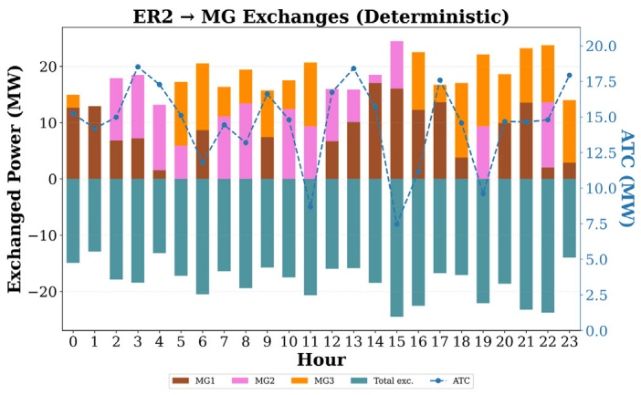

(a)

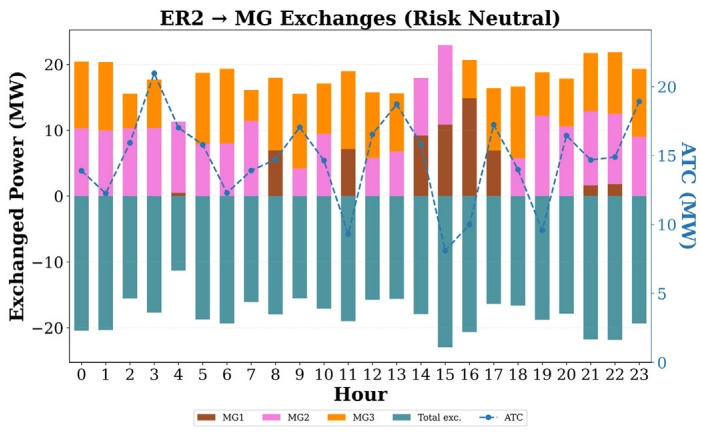

(b)

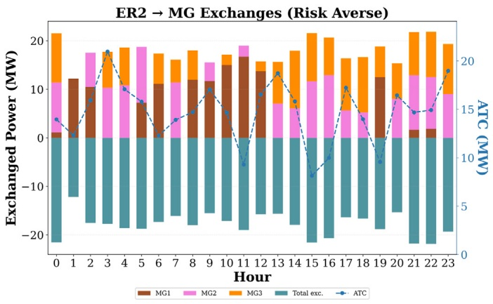

(c)

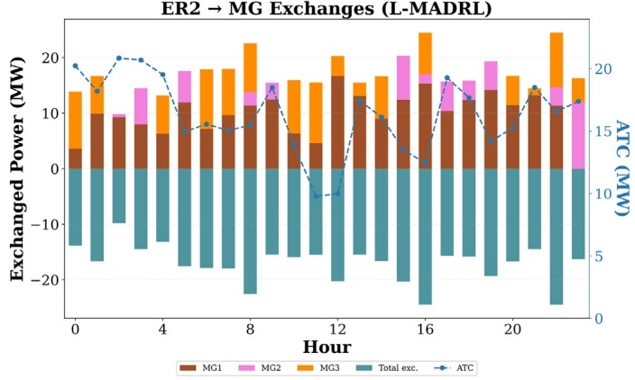

(d)

Fig. 14. Comparison of ER2 power exchange in the 5-bus system under deterministic, risk-neutral, risk-averse, and DRL methods.

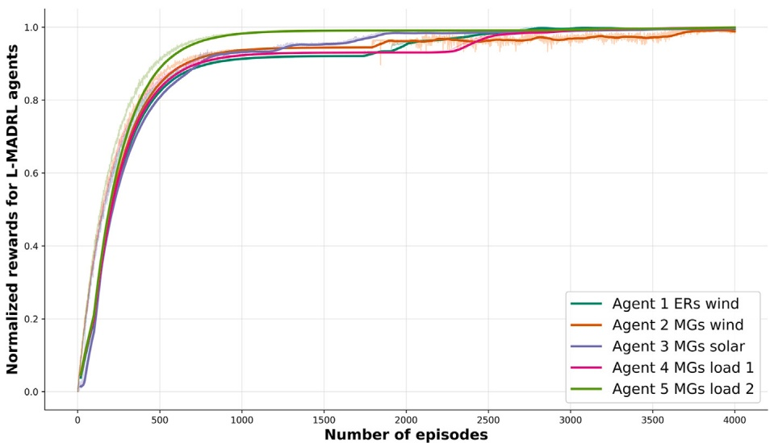

Fig. 15. L-MADRL learning trajectory for 14-bus multi-agents.

The MGs dispatch schedules for the deterministic, RNSO, RASO, and L-MADRL methods are shown in Fig. 17(a)–(d) respectively. In Fig. 17(a), the deterministic case for the 9 MGs is shown. It’s observed that the power outputs from MG1, MG5, and MG6 are larger than the power purchased from the ERs in most of the hours in the 24-h time period, while for MGs 2, 3, and 4, the deficit demands were mostly met with power being purchased from the ERs. This is largely due to the bigger capacities of the MTs in those respective MGs and the higher load demands as well when compared to MGs 2, 3, and 4 whose demands were largely below 20 MW. In MG7, MG8, and MG9, all the loads were met by the available power from the wind turbines, with deficits being met by power purchased from the ERs. For the RN case in Fig. 17(b),

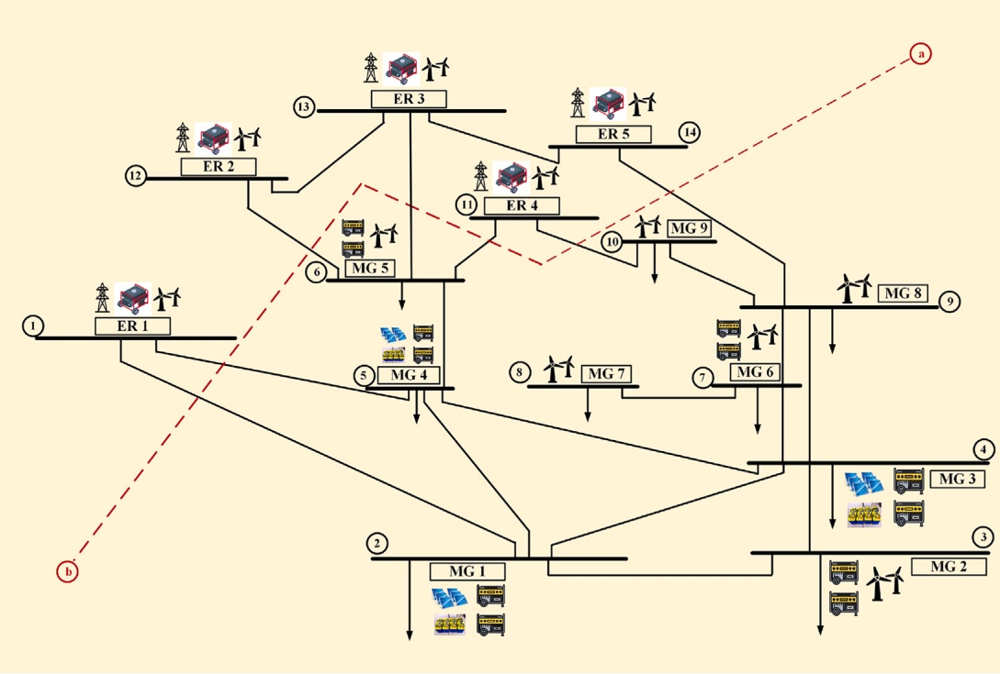

Fig. 16. Modified IEEE 14-Bus schematic with 5 ERs and 9 MGs.

MGs 1, 4, 5, and 6 had their respective MTs producing more power than their purchases from the ERs, particularly in MG5 and MG6, only twice did the power purchased from the ERs exceed that produced locally by the MTs. In MG2 and MG3, the deficit power were largely met by power purchased from the ERs, however, the MT’s output from MG3 were more than that from MG2. As before MGs 7–9 relied only on power exchanges with the ERs to meet deficit demands. In Fig. 17(c), the RA case showed MGs 1–6 meeting their commensurate demands through outputs from their renewable resources and MTs, with a few hours requiring purchases of deficit power from the ERs. Interestingly, in Fig. 17(d), the L-MADRL case shows for MG2, MG4, and MG5 some hours requiring more purchases from the ERs while other hours showed less purchase. However in MG1, MG3, and MG6, much of the load demands were met via purchases from the ERs. As before, in MGs 7–9, the renewable outputs were more and power deficits were met by power purchases from the ERs.

The BESS SoC trajectory for the four solution methods are shown in Fig. 17(a)–(d). MG2, MG4, and MG5 were the only MGs having battery storage systems. In Fig. 17(a), the deterministic case shows a rather conservative trajectory for MG5, with the BESS largely remaining within 20%–40% SoC throughout the day, MG2 had a more aggressive trajectory, reaching peak of 80% SoC during post-midday (1pm). MG4 results were in between, idling for the most part of the early hours of the day. Fig. 17(b) shows the RN case, and here the BESS largely remained idle for the most part of the day and only charged up a little in the later parts of the day. Conversely, the RA case in Fig. 17(c) shows more dynamics in the BESS SoC with some hours e.g. (hours 11–14 and hours 17–18) having all the BESS idling. Here MG2 and MG5 were conservative, having their SoC’s varying between 30%–50%, while MG4 was a bit more aggressive reaching SoC values of around 75%. The L-MADRL case in Fig. 17(d) shows a much smoother SoC trajectory for all of the BESS in MGs 2, 4 and 5, revealing its capability in the smooth coordination and control of the battery system in NMGs energy management. During the early hours of the day, the BESS in all three MGs charges up gradually, and during mid-day due to peak demand in those periods, discharges gradually up until around 8pm, where it then charges up steadily to fulfill the BESS energy requirements at the end of the day.

The line flows across all four methods for the 14 bus system are shown in Fig. 18(a)–(d). The seven branches considered refers to the tie-lines separating power exchanges between the source sides (majorly ERs) and the sink side (mostly MGs), and this is represented by the dotted line ’ab’ on Fig. 16. The results for the deterministic case is shown in Fig. 18(a), here the majority of the tie-lines had power flow in the reverse direction, e.g. in branch ’10\_11’, the power flow was from node 11 to 10, which from Fig. 16 denotes the power being exchanged between source and sink. The RN and RA cases in Fig. 18(b) and Fig. 18(c) had the power flow reversed on some tie-lines, possibly due to the stochasticities of the renewables present. The L-MADRL method in Fig. 18(d) shows the line-flow less random and more sensitive to the uncertainties present in the system, effectively showing the exchanged power between source and sink. Although on some lines, in order for the physics of the system to be respected, power is allowed to flow from sink to source nodes. However, across all four plots, the lines L12, L15, and L10\_11 show increased line flows, indicating these lines as being critical and having higher impacts on the ATC within the system.

The exchanged power between the ERs and MGs for all four methods are shown in Fig. 19(a)–(h), Fig. 20(a)–(h) and Fig. 21(a)–(d) for ER1, ER2, ER3, ER4, and ER5 respectively. The ATC values post-dispatch for the deterministic, RNSO, and RASO cases were very similar, with starting values of 55 MW, a minimum value of 50 MW at hour 1, and a maximum value of 72 MW at hour 13. For the L-MADRL case, however, the ATC values were generally higher than the other 3 benchmarks, highlighting the superiority of the method in the efficient energy management of NMGs. The starting value in this case was 70 MW, and the least value was 57 MW at hour 19 (7 pm). The highest ATC recorded for the L-MADRL framework was 79 MW at hour 23 which is around 10% higher than that of the other benchmarks. Fig. 22(a)–(b) shows the ATC trajectory over 24 h for the 5-bus and 14-bus case respectively. It’s observed that the ATC for the L-MADRL method yielded higher values in some hours during the study period, while for some other hours its was actually lower than the other three benchmarks. This is due to the true reflection of the line loading of the tie-lines at those hours, especially

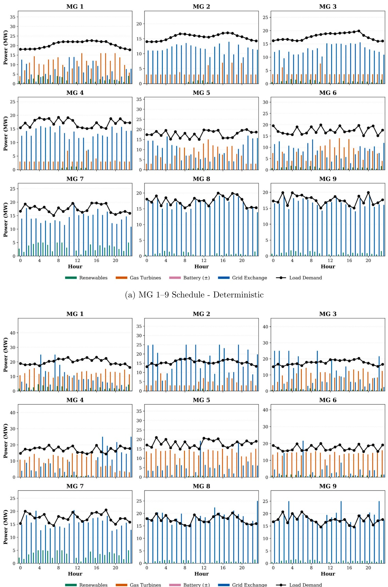

(b) MG 1–9 Schedule - Risk Neutral

Fig. 17. Comparison of MG 1–9 schedules in the 14-bus system (part 1).

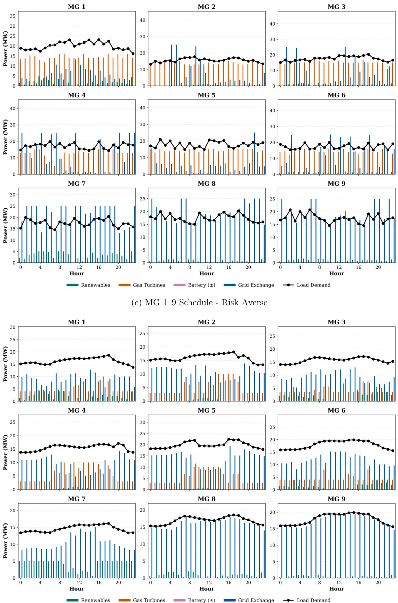

(d) MG 1–9 Schedule - DRL

Fig. 17. Comparison of MG 1–9 schedules in the 14-bus system (part 2).

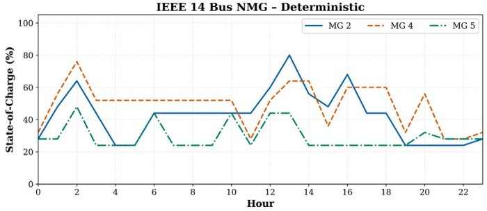

(a)

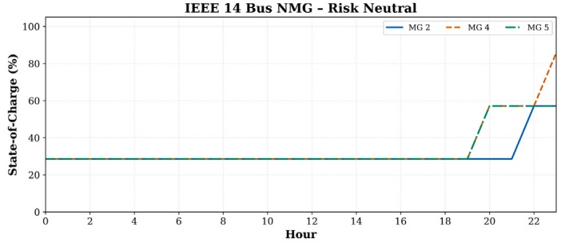

(b)

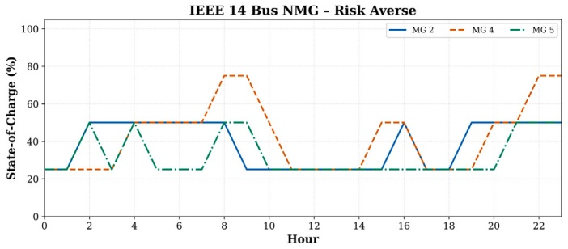

(c)

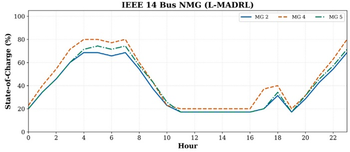

(d)

Fig. 18. Comparison of BESS SoC for MGs in the 14-bus system under deterministic, risk-neutral, risk-averse, and DRL methods.

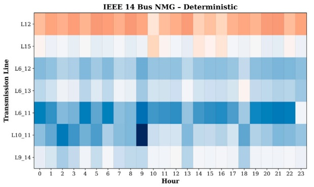

(a)

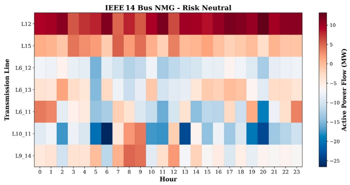

(b)

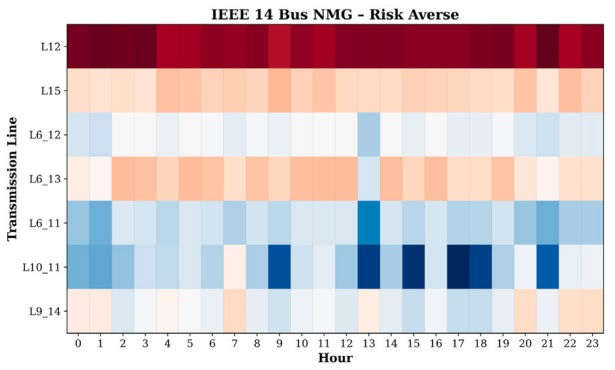

(c)

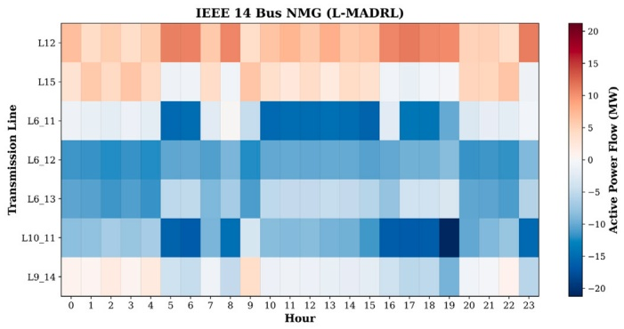

(d)

Fig. 19. Comparison of line flows in the 14-bus system under deterministic, risk-neutral, risk-averse, and DRL methods.

hours when the peak demand from sink nodes were highest which more often than not occurred around mid-day.

Table 4 shows in detail the overall breakdown of the total profits received by each ER in the 5 and 14 bus respectively, and also shows the breakdown of the total costs incurred by each MG as well as the aggregate sum of these costs for the 5 and 14 bus respectively. Starting off from the 5 bus system, it is observed that the total MG costs for all MGs were €45,825, €43,036, €43,010, and €41,116 for the deterministic,

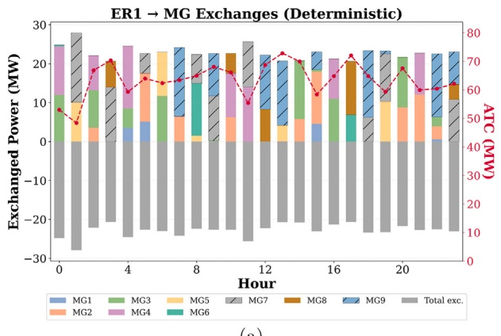

(a)

(b)

(c)

(d)

(e)

(f)

(g)

(h)

Fig. 20. Power exchange of ER1 (a–d) and ER2 (e–h) in the 14-bus system under deterministic, risk-neutral, risk-averse, and L-MADRL methods.

(a)

(b)

(c)

(d)

(e)

(f)

(g)

(h)

Fig. 21. Power exchange of ER3 (a–d) and ER4 (e–h) in the 14-bus system under deterministic, risk-neutral, risk-averse, and L-MADRL methods.

(a)

(b)

(c)

(d)

Fig. 22. Comparison of ER5 power exchange in the 14-bus system under deterministic, risk-neutral, risk-averse, and DRL methods.

(a) ATC 5 Bus

(b) ATC 14 Bus

Fig. 23. ATC comparisons across test systems: (a) 5-bus, (b) 14-bus.

RNSO, RASO, and L-MADRL methods respectively. As seen from the Table 4, the L-MADRL method achieved a reduction in the total costs, realizing cost savings of 10.3%, 4.5%, and 4.4% when compared to the deterministic, RNSO, and RASO cases respectively. Simultaneously, the profits generated by each ER and the associated table is also shown in Table 4. The total profit obtained by the deterministic case were €21,474, €21,351 for the RNSO case, €21,334 for the RASO case, and €22,115 for the L-MADRL case respectively. The proposed framework (L-MADRL) on aggregate generated more profits for the ERs, yielding 3%, 3.6%, and 3.7% more than the deterministic, RNSO, and RASO methods respectively.

Moving on to the 14 bus case, having a total of 5 ERs and 9 MGs, the total profit generated by the L-MADRL framework exceeded that from the RNSO and RASO method by 11.4%, and the deterministic approach by 4.5%. This goes on to show the superiority of the proposed approach over the other 3 benchmarks. As expected, the total profits by the ERs using the RNSO and RASO approach are lower than those from the deterministic case due to the probabilistic approach used leading to the computation of expected profits instead. Similarly, for the MGs in the 14-bus case, the total costs using the L-MADRL framework yielded a reduced cost of €139,884, representing a decrease of 2.6%, 2%, and 2.5% for the deterministic, RNSO, and RASO cases respectively.

Table 5 show the differences in the time taken by each method to solve the NMG problem. For the L-MADRL framework, due to the number of agents being trained and the system network topology, the training time for the 5 and 14 bus systems are seen to be high, however, during testing, the time taken were almost similar to the deterministic case, but as well captured the uncertainties present in the system. It is also observed that for the RNSO and RASO cases, due to the number of initial scenarios generated (1000) and the subsequent reduced scenarios (15), the time taken for the solutions were much higher, and compared to the L-MADRL method required far greater compute times for the same problem case.

Table 4

MG costs and ER profits across methods (Deterministic, RNSO, RASO, L-MADRL).

| S/N &amp; unit | Deterministic (€) | RNSO (€) | RASO (€) | L-MADRL (€) |
| --- | --- | --- | --- | --- |
| PJM 5 Bus |  |  |  |  |
| MG costs |  |  |  |  |
| 1. MG1 | 17,515 | 16,104 | 15,626 | 15,410 |
| 2. MG2 | 14,708 | 13,716 | 13,551 | 13,414 |
| 3. MG3 | 13,602 | 13,216 | 13,833 | 12,292 |
| Total MGs | 45,825 | 43,036 | 43,010 | 41,116 |
| ER profits |  |  |  |  |
| 4. ER1 | 10,400 | 9675 | 9658 | 10,582 |
| 5. ER2 | 11,074 | 11,676 | 11,676 | 11,533 |
| Total ERs | 21,474 | 21,351 | 21,334 | 22,115 |
| IEEE 14 Bus |  |  |  |  |
| MG costs |  |  |  |  |
| 1. MG1 | 9653 | 11,288 | 7715 | 11,975 |
| 2. MG2 | 15,020 | 22,196 | 8496 | 14,046 |
| 3. MG3 | 16,636 | 15,165 | 9999 | 12,005 |
| 4. MG4 | 17,433 | 12,428 | 17,927 | 12,623 |
| 5. MG5 | 13,052 | 8202 | 7796 | 18,431 |
| 6. MG6 | 11,568 | 5737 | 13,934 | 15,287 |
| 7. MG7 | 17,983 | 19,627 | 27,420 | 13,098 |
| 8. MG8 | 21,201 | 23,669 | 25,539 | 20,363 |
| 9. MG9 | 21,041 | 23,968 | 24,686 | 22,052 |
| Total MGs | 143,591 | 142,284 | 143,517 | 139,884 |
| ER profits |  |  |  |  |
| 10. ER1 | 10,285 | 9602 | 9602 | 11,538 |
| 11. ER2 | 10,535 | 9928 | 9928 | 9282 |
| 12. ER3 | 8332 | 7930 | 7930 | 9715 |
| 13. ER4 | 9794 | 8983 | 8983 | 8477 |
| 14. ER5 | 8848 | 8352 | 8352 | 10,891 |
| Total ERs | 47,794 | 44,795 | 44,795 | 49,903 |

Table 5

Computation time for all four methods across case networks.

| Bus | Deterministic (s) | RNSO (s) | RASO (s) | L-MADRL training (s) | L-MADRL testing (s) |
| --- | --- | --- | --- | --- | --- |
| 5 | 0.8 | 2400 | 2520 | 10,800 | 0.9 |
| 14 | 2.5 | 4200 | 4440 | 25,200 | 2.8 |

## 7 . Conclusion and future work

This study proposed a lean multi-agent deep reinforcement learning framework for the energy management of NMGs under uncertainties. Initially, the NMG problem was represented as a two-layer energy management problem where the upper layer handled the objectives and technical constraints of all the ERs, and the lower layer represented the objectives and technical constraints of the MGs. In order to solve this dual-layer problem under uncertainty and obtain globally optimal solutions, the lower level problem formulations were represented by its equivalent KKT conditions. The resulting KKT equations were then added as additional constraints to the upper level problem hence transforming it into a MPEC (single-level) problem for the NMGs. Since conventional methods that handle uncertainties in complex systems of this nature face challenges such as dependencies on scenarios, and overly conservative solutions, a L-MADRL was proposed to draw on the strength of DQNs through multi-agents and the resulting MPEC problem formulation. The beauty of this framework lies in its relinquishing the burden of technical feasibility to the single-level formulation whilst focusing solely on learning optimal policies for all stochastic parameters (solar irradiance, wind speed, and load demand) considered. These proposed methodology bench-marked against the deterministic, two-stage RNSO, and two-stage RASO cases were tested on two distinct case networks; PJM 5 Bus and IEEE 14 Bus. The results of the L-MADRL performed better when compared to the other benchmarks, simultaneously minimizing the overall costs of the MGs and maximizing the total profits of the ERs and the ATC of the test grid. Also, the time taken by the L-MADRL to handle the complexity of these networks with uncertainties for the 5 and 14 bus system were less than 3 secs, while it took far more time when any of the other three benchmarks were utilized. In a future work, a more decentralized EMS using L-MADRL framework would be explored where the privacy concerns of each and every market player/entity is considered accordingly.

## CRediT authorship contribution statement

**Ayodele Benjamin Esan:** Writing – original draft, Visualization, Validation, Software, Methodology, Investigation, Formal analysis, Data curation, Conceptualization. **Hussain Shareef:** Writing – review & editing, Supervision, Resources, Project administration, Investigation. **Ahmad K. ALAhmad:** Writing – review & editing, Validation, Methodology.

## Funding

This research was supported by the Strategic Research Program–ECMR, UAEU (project title: “Solar Photovoltaic Integrated Wireless Charging System for Electric Vehicles with Advanced Control Techniques and Smart Energy Management Features”) under grant number G00005488 and fund code 12R357.

## Declaration of competing interest

The authors declare that they have no known competing financial interests or personal relationships that could have appeared to influence the work reported in this paper.

## Appendix A

Technical and economic parameters of ERs and MGs for modified PJM 5 bus.

<table><tr><td>Parameters</td><td>ER1</td><td>ER2</td><td>MG1</td><td>MG2</td><td>MG3</td></tr><tr><td colspan="6">Wind turbine parameters</td></tr><tr><td> $V _ { \mathrm { c i } } \left( \mathrm { m } / \mathrm { s } \right)$ </td><td>3.0</td><td>3.0</td><td>2</td><td></td><td>2.2</td></tr><tr><td> $V _ { \mathrm { c o } } ~ ( \mathrm { m } / \mathrm { s } )$ </td><td>20</td><td>20</td><td>10</td><td></td><td>10</td></tr><tr><td> $V _ { \mathrm { r } } \left( \mathrm { m } / \mathrm { s } \right)$ </td><td>11</td><td>9</td><td>5</td><td></td><td>8</td></tr><tr><td> $P_{\mathrm{rad}} (\mathrm{MW})$ </td><td>3</td><td>2.5</td><td>2</td><td></td><td>2.5</td></tr><tr><td colspan="6">Solar PV parameters</td></tr><tr><td> $G _ { \mathrm { t h r } } \left( \mathrm { W } / \mathrm { m } ^ { 2 } \right)$ </td><td></td><td></td><td></td><td>40</td><td></td></tr><tr><td> $G _ { \mathrm { s t d } } \left( \mathrm { W } / \mathrm { m } ^ { 2 } \right)$ </td><td></td><td></td><td></td><td>1000</td><td></td></tr><tr><td> $P_{\mathrm{rad}} (\mathrm{MW})$ </td><td></td><td></td><td></td><td>1</td><td></td></tr><tr><td colspan="6">Microturbine parameters</td></tr><tr><td> $P_{\mathrm{MT,min}} (\mathrm{MW})$ </td><td>0</td><td>0</td><td>(2,2)</td><td>(1.5, 1.5)</td><td>(1.8, 1.8)</td></tr><tr><td> $P_{ MT,max } \left(  MW  \right)$ </td><td>5</td><td>5.5</td><td>(8,8)</td><td>(7,7)</td><td>(7.5, 7.5)</td></tr><tr><td> $R_{\mathrm{MT,up}} (\mathrm{MW})$ </td><td>3</td><td>3.5</td><td>(2,2)</td><td>(2, 2)</td><td>(2,2)</td></tr><tr><td> $R_{ MT,down } ( MW )$ </td><td>3</td><td>3.5</td><td>(2,2)</td><td>(2, 2)</td><td>(2, 2)</td></tr><tr><td> $T_{ up }^{\min}( hrs. )$ </td><td>2</td><td>2</td><td></td><td></td><td></td></tr><tr><td> $T_{ down }^{\min}( hrs. )$ </td><td>2</td><td>2</td><td></td><td></td><td></td></tr><tr><td> $C _ { \mathrm { s u } } \; ( \mathfrak { C } )$ </td><td>2</td><td>2.5</td><td></td><td></td><td></td></tr><tr><td> $C _ { \mathrm { s d } } \left( \mathfrak { C } \right)$ </td><td>0.8</td><td>0.5</td><td></td><td></td><td></td></tr><tr><td> $\eta _ { \mathrm { M T } } \left( \% \right)$ </td><td>40</td><td>45</td><td>(30,32)</td><td>(25,30)</td><td>(30, 35)</td></tr><tr><td> $C_{ MT } \left( \mathbb{C} /  MWh  \right)$ </td><td>6</td><td>5</td><td>(4, 4)</td><td> $( 4 , 4 )$ </td><td>(4, 4)</td></tr><tr><td> $L_{\mathrm{MT}} (\mathrm{kg/MWh})$ </td><td>3</td><td>3</td><td>(4.78, 4.78)</td><td>(4.78, 4.78)</td><td>(4.78, 4.78)</td></tr><tr><td colspan="6">Grid and exchange parameters</td></tr><tr><td> $P_{ grid,max } (MW)$ </td><td>10</td><td>10</td><td></td><td>1</td><td>1</td></tr><tr><td> $P_{\mathrm{exc,max}} (\mathrm{MW})$ </td><td></td><td></td><td>20</td><td>20</td><td>20</td></tr><tr><td> $E _ { \mathbb { R } } \left( \mathrm { k W h } \right)$ </td><td></td><td></td><td></td><td>300</td><td>350</td></tr><tr><td> $E_{\mathrm{init}} (\mathrm{kWh})$ </td><td></td><td></td><td></td><td>70</td><td>80</td></tr><tr><td> $E_{ end }( kW )$ </td><td></td><td></td><td></td><td>70</td><td>80</td></tr><tr><td colspan="6">Battery parameters</td></tr><tr><td> $P_{\mathrm{thr,max}} (\mathrm{kW})$ </td><td></td><td></td><td></td><td>50</td><td>60</td></tr><tr><td> $P _ { \mathrm { d i s , m a x } } \mathrm { ~ ( k W ) }$ </td><td></td><td></td><td></td><td>50</td><td>60</td></tr><tr><td> $SOC_{\min}(\%)$ </td><td></td><td></td><td></td><td>20</td><td>20</td></tr><tr><td> $SOC_{ max }(\%)$ </td><td></td><td></td><td></td><td>80</td><td>80</td></tr><tr><td> $\eta _ { \mathrm { c h r } } ~ ( \% )$ </td><td></td><td></td><td></td><td>92</td><td>92</td></tr><tr><td> $\eta _ { \mathrm { d i s } } ~ ( \% )$ </td><td></td><td></td><td></td><td>92</td><td>92</td></tr><tr><td> $K_{\mathrm{chr}} \left( \mathrm{e/kWh} \right)$ </td><td></td><td></td><td></td><td>0.002</td><td>0.002</td></tr><tr><td> $K_{ dis } (\mathrm{e/kWh})$ </td><td></td><td></td><td></td><td>0.001</td><td>0.001</td></tr></table>

Table A2

Technical and economic parameters of ERs and MGs for modified IEEE 14 bus.

<table><tr><td>Parameter</td><td>ER1</td><td>ER2</td><td>ER3</td><td>ER4</td><td>ER5</td><td>MG1</td><td>MG2</td><td>MG3</td><td>MG4</td><td>MG5</td><td>MG6</td><td>MG7</td><td>MG8</td><td>MG9</td></tr><tr><td colspan="10">Wind Turbine Parameters</td><td></td><td></td><td></td><td></td><td></td></tr><tr><td> $V _ { \mathrm { c i } } \mathrm { ~ ( m / s ) }$ </td><td>3.0</td><td>3.5</td><td>3.2</td><td>3.3</td><td>3.1</td><td>2.0</td><td></td><td>2.2</td><td></td><td></td><td>2.5</td><td>2.0</td><td>2.3</td><td>2.5</td></tr><tr><td> $V _ { \mathrm { c o } } ~ ( \mathrm { m } / \mathrm { s } )$ </td><td>25</td><td>24</td><td>25</td><td>24</td><td>25</td><td>10</td><td></td><td>10</td><td></td><td></td><td>11</td><td>10</td><td>10</td><td>11</td></tr><tr><td> $V _ { \mathrm { r } } \left( \mathrm { m } / \mathrm { s } \right)$ </td><td>11</td><td>12.5</td><td>13</td><td>12</td><td>11.5</td><td></td><td></td><td>8</td><td></td><td></td><td>9</td><td>5</td><td>7</td><td>9.5</td></tr><tr><td> $P_{\mathrm{rad}} (\mathrm{MW})$ </td><td>10</td><td>11</td><td>9</td><td>12</td><td>10</td><td></td><td></td><td>6</td><td></td><td></td><td>7</td><td>5</td><td>6</td><td>7</td></tr><tr><td colspan="10">Solar PV Parameters</td><td></td><td></td><td></td><td></td><td></td></tr><tr><td> $G _ { \mathrm { t h r } } \left( \mathrm { W } / \mathrm { m } ^ { 2 } \right)$ </td><td></td><td></td><td></td><td></td><td></td><td></td><td>50</td><td></td><td>45</td><td>40</td><td></td><td></td><td></td><td></td></tr><tr><td> $G_{\mathrm{std}} \left( \mathrm{W/m^2} \right)$ </td><td></td><td></td><td></td><td></td><td></td><td></td><td>1000</td><td></td><td>1000</td><td>1000</td><td></td><td></td><td></td><td></td></tr><tr><td> $P_{\mathrm{rated}} (\mathrm{MW})$ </td><td></td><td></td><td></td><td></td><td></td><td></td><td>3</td><td></td><td>2.5</td><td>2</td><td></td><td></td><td></td><td></td></tr><tr><td colspan="10">Microturbine Parameters</td><td></td><td></td><td></td><td></td><td></td></tr><tr><td>(MW)  $P _ { \mathrm { m i n } } ^ { \mathrm { M T } }$ </td><td>0</td><td>0</td><td>0</td><td></td><td></td><td>(2,2)</td><td>(1.5, 1.5)</td><td>(1.8, 1.8)</td><td>(1.5, 1.5)</td><td>(1.5, 1.5)</td><td>(2,2)</td><td></td><td></td><td></td></tr><tr><td> $P _ { \mathrm { m a x } } ^ { \mathrm { m m } } \left( \mathrm { M W } \right)$ </td><td>5</td><td>5.5</td><td>5</td><td>4.5</td><td></td><td>(5,5)</td><td>(5,5)</td><td>(6,6)</td><td>(5,5)</td><td>(5,5)</td><td>(6,6)</td><td></td><td></td><td></td></tr><tr><td> $R_{up}^{\mathrm{MT}}(\mathrm{MW})$ </td><td>3</td><td>3.5</td><td>3</td><td>2.5</td><td>3</td><td>(2,2)</td><td>(2,2)</td><td>(2,2)</td><td>(2,2)</td><td>(2,2)</td><td>(2,2)</td><td></td><td></td><td></td></tr><tr><td> $R _ { \mathrm { d o w n } } ^ { \mathrm { \dot { M } T } } ( \mathrm { M W } )$ </td><td>3</td><td>3.5</td><td>3</td><td>2.5</td><td>3</td><td>(2,2)</td><td>(2,2)</td><td>(2,2)</td><td>(2,2)</td><td>(2,2)</td><td>(2,2)</td><td></td><td></td><td></td></tr><tr><td> $M _ { \mathrm { u p } } ^ { \mathrm { o u t h } } ( \mathrm { h r s } )$ </td><td>2</td><td>2</td><td>2</td><td></td><td>2</td><td></td><td></td><td></td><td></td><td></td><td></td><td></td><td></td><td></td></tr><tr><td> $M _ { \mathrm { d o w n } } ^ { \mathrm { \tiny { \bar { \cal { M } } T } } } ( \mathrm { h r s } )$ </td><td>2</td><td>2</td><td>2</td><td>2 2</td><td>2</td><td></td><td></td><td></td><td></td><td></td><td></td><td></td><td></td><td></td></tr><tr><td> $C ^ { \widetilde { \mathrm { S U } } } \left( \mathfrak { C } \right)$ </td><td>2</td><td>2.5</td><td>2.2</td><td>2</td><td>2.3</td><td></td><td></td><td></td><td></td><td></td><td></td><td></td><td></td><td></td></tr><tr><td> $C ^ { \mathrm { S D } } \left( \mathfrak { C } \right)$ </td><td>0.8</td><td>0.5</td><td>0.6</td><td>0.7</td><td>0.6</td><td></td><td></td><td></td><td></td><td></td><td></td><td></td><td></td><td></td></tr><tr><td>(%)  $\eta ^ { \mathrm { M T } }$ </td><td>42</td><td>44</td><td>40</td><td>38</td><td>41</td><td>(30, 35)</td><td>(30,35)</td><td>(30, 35)</td><td>(30,35)</td><td>(30,35)</td><td>(30,35)</td><td></td><td></td><td></td></tr><tr><td> $C ^ { \mathrm { M T } }$   $L ^ { \mathrm { M T } }$ </td><td>15</td><td>14</td><td>14.5</td><td>14.8</td><td>15.6</td><td>4</td><td>4</td><td>4</td><td>4</td><td>4</td><td>4</td><td></td><td></td><td></td></tr><tr><td></td><td>3</td><td>3</td><td>3</td><td>3</td><td>3</td><td>4.78</td><td>4.78</td><td>4.78</td><td>4.78</td><td>4.78</td><td>4.78</td><td></td><td></td><td></td></tr><tr><td colspan="10">Grid and Exchange Parameters</td><td></td><td></td><td></td><td></td><td></td></tr><tr><td>nu Pex (MW)</td><td>15</td><td>15</td><td>15</td><td>15</td><td>15</td><td></td><td></td><td></td><td></td><td></td><td></td><td></td><td></td><td></td></tr><tr><td></td><td></td><td></td><td></td><td></td><td></td><td>25</td><td>25</td><td>25</td><td>25</td><td>25</td><td>25</td><td>25</td><td>25</td><td>25</td></tr><tr><td colspan="10">Battery Parameters</td><td></td><td></td><td></td><td></td><td></td></tr><tr><td> $E ^ { \mathrm { R } }$  (kWh)</td><td></td><td></td><td></td><td></td><td></td><td></td><td>300</td><td></td><td>350</td><td>320</td><td></td><td></td><td></td><td></td></tr><tr><td>Einit (kWh)</td><td></td><td></td><td></td><td></td><td></td><td></td><td>70</td><td></td><td>80</td><td>70</td><td></td><td></td><td></td><td></td></tr><tr><td>Eend (kWh)</td><td></td><td></td><td></td><td></td><td></td><td></td><td>70</td><td></td><td>80</td><td>70</td><td></td><td></td><td></td><td></td></tr><tr><td>pchr,max (kW)</td><td></td><td></td><td></td><td></td><td></td><td></td><td>50</td><td></td><td>60</td><td>50</td><td></td><td></td><td></td><td></td></tr><tr><td>pdis,max (kW)  $\mathsf { S O C } _ { \operatorname* { m i n } }$  (%)</td><td></td><td></td><td></td><td></td><td></td><td></td><td>50 20</td><td></td><td>60 20</td><td>50 20</td><td></td><td></td><td></td><td></td></tr><tr></table>

## Data availability

Data will be made available on request.

## References

[1] Wu X, Zhao W, Wang X, Li H. An MILP-based planning model of a photovoltaic/diesel/battery stand-alone microgrid considering the reliability. IEEE Trans Smart Grid. Sep 2021;12(5):3809–3818. [https://doi.org/10.1109/tsg.2021.3084935.](https://doi.org/10.1109/tsg.2021.3084935)

[2] Sedighizadeh M, Mohammadpour AH, Alavi SMM. A two-stage optimal energy management by using ADP and HBB-BC algorithms for microgrids with renewable energy sources and storages. J Energy Storage. Feb 2019;21:460–480. [https://doi.org/10.1016/j.est.2018.12.010.](https://doi.org/10.1016/j.est.2018.12.010)

[3] Khan MA, Rehman T, Hussain A, Kim HM. Day-ahead operation of a multi-energy microgrid community with shared hybrid energy storage and EV integration. J Energy Storage. Sep 2024;97, 112 855, [https://doi.org/10.1016/j.est.2024.112855.](https://doi.org/10.1016/j.est.2024.112855)

[4] Roslan MF, Hannan MA, Ker PJ, Begum RA, Mahlia TMI, Dong ZY. Scheduling controller for microgrids energy management system using optimization algorithm in achieving cost saving and emission reduction. Appl Energy. Jun 2021;292, 116 883, [https://doi.org/10.1016/j.apenergy.2021.116883.](https://doi.org/10.1016/j.apenergy.2021.116883)

[5] Zhe C, Da L, Zhihao L, Xiangjin W, Yajie T. Two-layer optimal electricity trading method for distribution networks with multi-mg. IET Renew Power Gener. Jan 2025;19(1): [https://doi.org/10.1049/rpg2.70012.](https://doi.org/10.1049/rpg2.70012)

[6] Chen W, Wang J, Yu G, Chen J, Hu Y. Research on day-ahead transactions between multi-microgrid based on cooperative game model. Appl Energy. Jun 2022;316(119 106): [https://doi.org/10.1016/j.apenergy.2022.119106.](https://doi.org/10.1016/j.apenergy.2022.119106)

[7] Merabet A, Al-Durra A, El-Fouly T, El-Saadany EF. Optimization and energy management for cluster of interconnected microgrids with intermittent non-polluting and diesel generators in off-grid communities. Electr Power Syst Res. Apr 2025;241(111 319): [https://doi.org/10.1016/j.epsr.2024.111319.](https://doi.org/10.1016/j.epsr.2024.111319)

[8] Nikmehr N, Ravadanegh SN. Reliability evaluation of multi-microgrids considering optimal operation of small scale energy zones under load-generation uncertainties. Int J Electr Power Energy Syst. Jun 2016;78:80–87. [https://doi.org/10.1016/j.ijepes.2015.11.094.](https://doi.org/10.1016/j.ijepes.2015.11.094)

[9] Seyednouri SR, Safari A, Quteishat A, et al. Stochastic energy management of a multi-microgrid system with battery/supercapacitor energy storages considering demand response and transactive energy. Renew Energy Focus. Mar 2024;48, 100 531, [https://doi.org/10.1016/j.ref.2023.100531.](https://doi.org/10.1016/j.ref.2023.100531)

[10] Jani A, Karimi H, Jadid S. Two-layer stochastic day-ahead and real-time energy management of networked microgrids considering integration of renewable energy resources. Appl Energy. Oct 2022;323(119 630): [https://doi.org/10.1016/j.apenergy.2022.119630.](https://doi.org/10.1016/j.apenergy.2022.119630)

[11] Karimi H, Bahmani R, Jadid S, Makui A. Dynamic transactive energy in multi-microgrid systems considering Independence performance index: a multi-objective optimization framework. Int J Electr Power Energy Syst. Mar 2021;126(106 563): [https://doi.org/10.1016/j.ijepes.2020.106563.](https://doi.org/10.1016/j.ijepes.2020.106563)

[12] Jani A, Jadid S. Two-stage energy scheduling framework for multi-microgrid system in market environment. Appl Energy. Apr 2023;336(120 683): [https://doi.org/10.1016/j.apenergy.2023.120683.](https://doi.org/10.1016/j.apenergy.2023.120683)

[13] Aghdam FH, Kalantari NT, Mohammadi-Ivatloo B. A stochastic optimal scheduling of multi-microgrid systems considering emissions: a chance-constrained model. J Clean Prod. Dec 2020;275, 122 965, [https://doi.org/10.1016/j.jclepro.2020.122965.](https://doi.org/10.1016/j.jclepro.2020.122965)

[14] Gao H, Xu S, Liu Y, Wang L, Xiang Y, Liu J. Decentralized optimal operation model for cooperative microgrids considering renewable energy uncertainties. Appl Energy. Mar 2020;262, 114 579, [https://doi.org/10.1016/j.apenergy.2020.114579.](https://doi.org/10.1016/j.apenergy.2020.114579)

[15] Kim HJ, Kim MK, Lee JW. A two-stage stochastic p-robust optimal energy trading management in microgrid operation considering uncertainty with hybrid demand response. Int J Electr Power Energy Syst. Jan 2021;124(106 422): [https://doi.org/10.1016/j.ijepes.2020.106422.](https://doi.org/10.1016/j.ijepes.2020.106422)

[16] Wang Y, Yang Y, Tang L, Sun W, Li B. A wasserstein-based two-stage distributionally robust optimization model for optimal operation of CCHP microgrid under uncertainties. Int J Electr Power Energy Syst. Jul 2020;119(105 941): [https://doi.org/10.1016/j.ijepes.2020.105941.](https://doi.org/10.1016/j.ijepes.2020.105941)

[17] Bo Y, Xia Y, Wei W, Li Z, Zhao B, Lv Z. Hyperfine optimal dispatch for integrated energy microgrid considering uncertainty. Appl Energy. Mar 2023;334(120 637): [https://doi.org/10.1016/j.apenergy.2023.120637.](https://doi.org/10.1016/j.apenergy.2023.120637)

[18] Hou L, Li W, Zhou K, Jiang Q. Integrating flexible demand response toward available transfer capability enhancement. Appl Energy. Oct 2019;251(113 370): [https://doi.org/10.1016/j.apenergy.2019.113370.](https://doi.org/10.1016/j.apenergy.2019.113370)

[19] Liu JH, Chu CC. Iterative distributed algorithms for real-time available transfer capability assessment of multiarea power systems. IEEE Trans Smart Grid. Sep 2015;6(5):2569–2578. [https://doi.org/10.1109/tsg.2015.2388777.](https://doi.org/10.1109/tsg.2015.2388777)

[20] Wei Z, Chen S, Sun G, Wang D, Sun Y, Zang H. Probabilistic available transfer capability calculation considering static security constraints and uncertainties of electricity–gas integrated energy systems. Appl Energy. Apr 2016;167:305–316. [https://doi.org/10.1016/j.apenergy.2015.10.015.](https://doi.org/10.1016/j.apenergy.2015.10.015)

[21] Avila NF, Chu CC. Distributed probabilistic ATC assessment by optimality conditions decomposition and LHS considering intermittent wind power generation. IEEE Trans Sustain Energy. Jan 2019;10(1):375–385. [https://doi.org/10.1109/tste.2018.2796102.](https://doi.org/10.1109/tste.2018.2796102)

[22] Wang B, Fang X, Zhao X, Chen H. Bi-level optimization for available transfer capability evaluation in deregulated electricity market. Energies. Nov 2015;8(12):13344–13360, [https://doi.org/10.3390/en81212370.](https://doi.org/10.3390/en81212370) [Online]. Available: [https://www.mdpi.com/1996-1073/8/12/12370.](https://www.mdpi.com/1996-1073/8/12/12370)

[23] Yin L, Yu T, Zhou L, Huang L, Zhang X, Zheng B. Artificial emotional reinforcement learning for automatic generation control of large-scale interconnected power grids. IET Gener Transm Distrib. Jun 2017;11(9):2305–2313. [https://doi.org/10.1049/iet-gtd.2016.1734.](https://doi.org/10.1049/iet-gtd.2016.1734)

[24] Claessens BJ, Vrancx P, Ruelens F. Convolutional neural networks for automatic state-time feature extraction in reinforcement learning applied to residential load control. IEEE Trans Smart Grid. Jul 2018;9(4):3259–3269. [https://doi.org/10.1109/tsg.2016.2629450.](https://doi.org/10.1109/tsg.2016.2629450)

[25] Liu WC, Mao ZZ. Microgrid economic dispatch using information-enhanced deep reinforcement learning with consideration of control periods. Electr Power Syst Res. Feb 2025;239(111 244): [https://doi.org/10.1016/j.epsr.2024.111244.](https://doi.org/10.1016/j.epsr.2024.111244)

[26] Zhou K, Zhou K, Yang S. Reinforcement learning-based scheduling strategy for energy storage in microgrid. J Energy Storage. Jul 2022;51, 104 379, [https://doi.org/10.1016/j.est.2022.104379.](https://doi.org/10.1016/j.est.2022.104379)

[27] Tan M, Zhao J, Liu X, et al. Federated reinforcement learning for smart and privacypreserving energy management of residential microgrids clusters. Eng Appl Artif Intell. Jan 2025;139(109 579): [https://doi.org/10.1016/j.engappai.2024.109579.](https://doi.org/10.1016/j.engappai.2024.109579)

[28] Guo C, Wang X, Zheng Y, Zhang F. Optimal energy management of multi-mgs connected to distribution system based on deep reinforcement learning. Int J Electr Power Energy Syst. Oct 2021;131(107 048): [https://doi.org/10.1016/j.ijepes.2021.107048.](https://doi.org/10.1016/j.ijepes.2021.107048)

[29] Monfaredi F, Shayeghi H, Siano P. Multi-agent deep reinforcement learning-based optimal energy management for grid-connected multiple energy carrier microgrids. Int J Electr Power Energy Syst. Nov 2023;153(109 292): [https://doi.org/10.1016/j.ijepes.2023.109292.](https://doi.org/10.1016/j.ijepes.2023.109292)

[30] Hedayatnia A, Ghafourian J, Sepehrzad R, Al-Durrad A, Anvari-Moghaddam A. Two-stage data-driven optimal energy management and dynamic real-time operation in networked microgrid based on deep reinforcement learning. Int J Electr Power Energy Syst. Sep 2024;160(110 142): [https://doi.org/10.1016/j.ijepes.2024.110142.](https://doi.org/10.1016/j.ijepes.2024.110142)

[31] Gao J, Li Y, Wang B, Wu H. Multi-microgrid collaborative optimization scheduling using an improved multi-agent soft actor-critic algorithm. Energies. Apr 2023;16(7):3248. [https://doi.org/10.3390/en16073248.](https://doi.org/10.3390/en16073248) [Online]. Available: [https://www.mdpi.com/1996-1073/16/7/3248.](https://www.mdpi.com/1996-1073/16/7/3248)

[32] Wang Y, Cui Y, Li Y, Xu Y. Collaborative optimization of multi-microgrids system with shared energy storage based on multi-agent stochastic game and reinforcement learning. Energy. Oct 2023;280(128 182): [https://doi.org/10.1016/j.energy.2023.128182.](https://doi.org/10.1016/j.energy.2023.128182)

[33] Samadi E, Badri A, Ebrahimpour R. Decentralized multi-agent based energy management of microgrid using reinforcement learning. Int J Electr Power Energy Syst. Nov 2020;122, 106 211, [https://doi.org/10.1016/j.ijepes.2020.106211.](https://doi.org/10.1016/j.ijepes.2020.106211) [Online]. Available: [https://www.sciencedirect.com/science/article/pii/S0142061520304877.](https://www.sciencedirect.com/science/article/pii/S0142061520304877)

[34] Yang JJ, Yang M, Wang MX, Du J, Yu YX. A deep reinforcement learning method for managing wind farm uncertainties through energy storage system control and external reserve purchasing. Int J Electr Power Energy Syst. Jul 2020;119(105 928): [https://doi.org/10.1016/j.ijepes.2020.105928.](https://doi.org/10.1016/j.ijepes.2020.105928)

[35] Foruzan E, Soh LK, Asgarpoor S. Reinforcement learning approach for optimal distributed energy management in a microgrid. IEEE Trans Power Syst. Sep 2018;33(5):5749–5758. [https://doi.org/10.1109/TPWRS.2018.2823641.](https://doi.org/10.1109/TPWRS.2018.2823641)

[36] Vergara P, Salazar M, Giraldo JS, Palensky P. Optimal dispatch of PV inverters in unbalanced distribution systems using reinforcement learning. Int J Electr Power Energy Syst. Mar 2022;136(107 628): [https://doi.org/10.1016/j.ijepes.2021.107628.](https://doi.org/10.1016/j.ijepes.2021.107628)

[37] Zhang B, Wu X, Ghias AMYM, Chen Z. Coordinated carbon capture systems and power-to-gas dynamic economic energy dispatch strategy for electricity–gas coupled systems considering system uncertainty: an improved soft actor-critic approach. Energy. May 2023;271(126 965): [https://doi.org/10.1016/j.energy.2023.126965.](https://doi.org/10.1016/j.energy.2023.126965) [Online]. Available: [https://www.sciencedirect.com/science/article/pii/S0360544223003596.](https://www.sciencedirect.com/science/article/pii/S0360544223003596)

[38] Kumar D, Kumar A. A reliable hybrid autoregressive integrated moving average and deep reinforcement machine learning strategy for resiliency enhancement in microgrid EN. Sustain Energy Grids Netw. Sep 2024;39: [https://doi.org/10.1016/j.segan.2024.101424.](https://doi.org/10.1016/j.segan.2024.101424)

[39] Esan AB, Shareef H. Augmented deep reinforcement learning for the energy management of microgrids considering renewable stochastic parameters. Eng Appl Artif Intell. Dec 2025;162(112 785):0952–1976. [https://doi.org/10.1016/J.ENGAPPAI.2025.112785.](https://doi.org/10.1016/J.ENGAPPAI.2025.112785) [Online]. Available: [https://www.sciencedirect.com/science/article/pii/S0952197625028167?via%3Dihub.](https://www.sciencedirect.com/science/article/pii/S0952197625028167?via%3Dihub)

[40] Vasconcelos PN, Trindade FC, Venkatesh B. Linearized optimization for enhanced aggregate modeling of invisible hybrid distributed energy resources. IET Gener Transm Distrib. 2025;19(e70088): [https://doi.org/10.1049/GTD2.70088.](https://doi.org/10.1049/GTD2.70088) [Online]. Available: [https://onlinelibrary.wiley.com/DOI/full/10.1049/gtd2.70088.](https://onlinelibrary.wiley.com/DOI/full/10.1049/gtd2.70088)

[41] Hu W, Scholz Y, Yeligeti M, Ruiz ESA, Jochem P. Raw data and generated synthetic weather year datasets. [https://doi.org/10.5281/ZENODO.14983895.](https://doi.org/10.5281/ZENODO.14983895) [Online]. Available: [https://zenodo.org/records/14983895.](https://zenodo.org/records/14983895)

[42] Kio AE, Xu J, Gautam N, Ding Y. Datasets and codesets for ”wavelet decomposition and neural networks: a potent combination for short term wind speed and power forecasting”. [https://doi.org/10.5281/ZENODO.7699252.](https://doi.org/10.5281/ZENODO.7699252) [Online]. Available: [https://zenodo.org/records/7699252.](https://zenodo.org/records/7699252)

[43] Aeronautics N, Administration S. Nasa power — data access viewer (dav). [Online]. Available: [https://power.larc.nasa.gov/data-access-viewer/.](https://power.larc.nasa.gov/data-access-viewer/)

[44] Wang D, Qiu J, Reedman L, Meng K, Lai L. Two-stage energy management for networked microgrids with high renewable penetration, EN. Appl Energy. Sep 2018;226:39–48. [https://doi.org/10.1016/j.apenergy.2018.05.112.](https://doi.org/10.1016/j.apenergy.2018.05.112)

[45] Biswas P, Suganthan P, Mallipeddi R, Amaratunga G. Optimal reactive power dispatch with uncertainties in load demand and renewable energy sources adopting scenario-based approach EN. Appl Soft Comput J. Feb 2019;75:616–632. [https://doi.org/10.1016/j.asoc.2018.11.042.](https://doi.org/10.1016/j.asoc.2018.11.042)

[46] Wang Y, Yang Y, Tang L, Sun W, Zhao H. A stochastic-cvar optimization model for CCHP micro-grid operation with consideration of electricity market, wind power accommodation and multiple demand response programs. Energies. 2019;12(3983): [https://doi.org/10.3390/EN12203983.](https://doi.org/10.3390/EN12203983) [Online]. Available: [https://www.mdpi.com/1996-1073/12/20/3983.](https://www.mdpi.com/1996-1073/12/20/3983)

[47] García RG. Day ahead market power prices (EU). [https://doi.org/10.5281/ZENODO.5977857.](https://doi.org/10.5281/ZENODO.5977857) [Online]. Available: [https://zenodo.org/records/5977857.](https://zenodo.org/records/5977857)
