# Deep reinforcement learning-based multi-objective energy management system for microgrids under flexible energy market

Jingxuan Wu∗ [**iD**](https://orcid.org/0000-0003-4277-8550), Shuting Li, Yun Yu, Yajuan Guan, Baoze Wei, Zhe Chen

Aalborg University, Pontoppidanstraede 111, Aalborg, 9220, Denmark

## H I G H L I G H T S

• A novel online energy management strategy independent of massive historical datasets.

• Multi-objective intelligent decision-making agent using a deep reinforcement-learning algorithm.

• An online energy market evaluation method for electricity trading guidance in flexible energy markets.

• High-resolution operations to handle transient oscillations in the power flow and energy balance.

## A R T I C L E I N F O

Keywords: Energy Management Energy Storage System Microgrid Power Flow Control Reinforcement Learning

## A B S T R A C T

The promotion of renewable energy in Microgrids (MGs) brings uncertainty from weather and climate change, thereby challenging the energy management systems (EMSs) in energy allocation tasks. This paper proposes a reinforcement learning (RL)-based online EMS (RLEMS) approach to solve the multi-objective optimization of power flow in an MG with a high proportion of uncertainty. A novel online energy management framework is proposed in the RLEMS, which utilizes the information extraction ability of RL algorithms to map the multi-dimensional MG states with optimal power flow operations, diluting the time sequence self-correlation in solving uncertainty. Different from conventional time series optimization methods, the proposed RLEMS can be deployed with few-shot historical datasets and operate the MG with a high resolution. The global economic horizon of the RLEMS is established through a novel energy price evaluation model (EPEM) instead of conventional prediction approaches, in which the vague evaluation of electricity price is quantified and projected to the RLEMS timescale and the MG scope. The multi-timescale uncertainty and multi-dimensional MG status are combined with distinguished priorities by the EPEM and RLEMS reward function. The performance of the proposed RLEMS is validated through realistic numerical experiments. The proposed RLEMS can maintain the stable and economical operation of the MG for over 240 hours continuously with only 24-hour training data. The comparison with cutting-edge approaches indicates that the proposed RLEMS provides promising cost-saving performance.

## 1 . Introduction

Renewable energy has been developing rapidly in the last decades due to public awareness of environment-friendly energy structures, leading to the growing implementation of wind and solar generation. Microgrids (MGs) are essential units to interface distributed generators into power systems and therefore the terminal system, which suffers from the uncertainty and intermittence of renewable energy [1]. To improve the power balance and power efficiency of MGs, energy storage (ES) systems and cooperated energy management systems (EMSs) are deployed to dispatch the local energy spatiotemporally.

An energy management system (EMS) is defined as a tertiary-level control system to monitor, dispatch, and optimize the MG system [2]. The internal power and energy balance is an important optimization target for EMSs in MGs, which affects the frequency and voltage stability of the AC bus [3]. EMSs optimize the power flow by operating the ES systems and controllable loads according to the system dynamics [4]. Many automatic control methods have been introduced into EMS applications to enhance the power balance of MG systems. In [5], fuzzy logic is deployed to switch the operation modes of an MG. The dispatched distributed generators include a fuel cell, a battery, a photovoltaic (PV) system, and the utility grid. Model predictive control (MPC)

<small>∗ Corresponding author. Email addresses: [jinwu@energy.aau.dk](mailto:jinwu@energy.aau.dk) (J. Wu), [shuli@energy.aau.dk](mailto:shuli@energy.aau.dk) (S. Li).</small>

Table 1

Research scope of existing EMS approaches.

<table><tr><td rowspan="2">Approaches</td><td colspan="2">Objectives</td><td colspan="2">Data dependency</td><td colspan="3">Uncertainty source</td><td colspan="2">Uncertainty solution</td><td colspan="2">Resolution</td></tr><tr><td>Stability</td><td>Economic</td><td>Little</td><td>Large</td><td>Weather</td><td>User</td><td>Market</td><td>External</td><td>Internal</td><td>Hour</td><td>Minute</td></tr><tr><td>Fuzzy logic [5]</td><td>Y</td><td></td><td></td><td>Y</td><td>Y</td><td>Y</td><td></td><td>Y</td><td></td><td></td><td>Y</td></tr><tr><td>MPC [6]</td><td>Y</td><td></td><td></td><td>Y</td><td>Y</td><td></td><td></td><td>Y</td><td></td><td></td><td>Y</td></tr><tr><td>MILP [12,13]</td><td></td><td>Y</td><td></td><td>Y</td><td>Y</td><td>Y</td><td>Y</td><td>Y</td><td></td><td>Y</td><td></td></tr><tr><td>PSO [15,16]</td><td></td><td>Y</td><td></td><td>Y</td><td>Y</td><td>Y</td><td></td><td>Y</td><td></td><td>Y</td><td></td></tr><tr><td>Q-learning [22]</td><td></td><td>Y</td><td></td><td>Y</td><td></td><td></td><td>Y</td><td>Y</td><td></td><td>Y</td><td></td></tr><tr><td>DQN [23]</td><td></td><td>Y</td><td></td><td>Y</td><td>Y</td><td>Y</td><td>Y</td><td></td><td>Y</td><td>Y</td><td></td></tr><tr><td>DDPG [24]</td><td>Y</td><td>Y</td><td></td><td>Y</td><td>Y</td><td>Y</td><td></td><td></td><td>Y</td><td>Y</td><td></td></tr><tr><td>SAC [25]</td><td></td><td>Y</td><td></td><td>Y</td><td>Y</td><td>Y</td><td>Y</td><td></td><td>Y</td><td>Y</td><td></td></tr><tr><td>PPO [27]</td><td>Y</td><td>Y</td><td></td><td>Y</td><td>Y</td><td>Y</td><td>Y</td><td></td><td>Y</td><td>Y</td><td></td></tr><tr><td>Proposed</td><td>Y</td><td>Y</td><td>Y</td><td></td><td>Y</td><td>Y</td><td>Y</td><td></td><td>Y</td><td></td><td>Y</td></tr></table>

is introduced in [6,7] to realize the distributed power flow control in a multi-MG system. The robustness of the system is enhanced through this approach. Benefiting from the development of communication technology, the Internet of Things (IoT) is attracting increasing attention and bringing feasibility for centralized EMS in MGs. In [8], an IoT-based intelligent EMS is implemented in a PV-battery building to achieve the internal energy balance and net-zero emissions. However, the increasing proportion of solar or wind energy in modern power systems brings uncertainty to the energy market, long-term energy balance as well as local power flow, requiring long-term energy allocation strategies to optimize the MG from an economic aspect [9].

The economic operation of MG is another essential optimization target of EMSs [10]. In traditional EMSs, the dispatching tasks of MGs are reformulated as optimization problems. By employing prediction techniques to address uncertainty, mathematical optimization algorithms are introduced to determine the step-ahead schedule results for the MG [11]. Mixed-integer linear programming (MILP) is a common algorithm in EMS. In [12], the charging and discharging events of a battery are scheduled by the MILP in an MG to reduce the operation cost. In MG with discrete control objectives like electric vehicles or controllable loads, MILP demonstrates high performance in renewable energy dispatching [13]. For multi-objective optimization problems, the reformulated system incorporates additional nonlinear elements that necessitate heuristic algorithms for precise resolution [14]. Particle swarm optimization (PSO) is a typical heuristic algorithm in EMS applications [15]. In [16], PSO is deployed to realize the day-ahead EMS for a microgrid with a high proportion of PV generation. In [17], PSO is utilized to cooperate with an artificial neural network in an EMS for islanded MGs. Other algorithms, like teaching-learning, can also effectively solve the optimization problem in MG systems, and the calculation efficiency can be improved through novel quantum computation [18]. However, the uncertainty introduced by renewable energy or user actions is not solved directly in traditional optimization-based approaches. The economic performance of these methods is highly dependent on the prediction accuracy of loads and renewable generation. Even though the deep learning (DL) algorithm has significantly enhanced the forecasting precision in EMS applications, there still exists a conflict between the horizon of the EMS and the accuracy degradation of prediction methods [19].

Online EMS approaches enhance independence from highperformance prediction methods by treating energy management as a decision-making problem. Reinforcement learning (RL) is an effective algorithm for EMS in MGs with a high proportion of uncertainty [20]. Different from conventional offline EMS, which requires external forecasting methods, RL can solve the time series problem with internal deep neural networks [21]. Existing research has implemented plenty of RL algorithms in EMS applications, including Q-learning [22], Deep Q-network (DQN) [23], Deep Deterministic Policy Gradient (DDPG) [24], Soft Actor-Critic (SAC) [25], Proximal Policy Optimization (PPO) [26,27], etc. A comparison among RL approaches and conventional methods is presented in Table 1. RL outperforms traditional methods in solving multi-objective problems and considering more complex systems. However, among all the existing methods, solutions to uncertainty always require numerous historical local databases. Time sequence problems are resolved by recurrent neural network blocks, typically long-short-term memory, in external prediction components or internal DL networks. These approaches expand input data in the time domain, on the one hand, increasing the computational burden of the training process, and on the other hand, raising the deployment cost in data preparation work and weakening the adaptability towards environmental and system configuration changes.

To release the historical data dependency of the EMS approaches and take the operation precision into account simultaneously. A novel RL-based EMS (RLEMS) is proposed in this paper, which on one hand, realizes the multi-objective power flow optimization in an MG with a high proportion of renewable energy, on the other hand, eliminates the computation burden caused by increased operation resolution. The contributions of this work are summarized as follows.

1. A novel RLEMS framework that concentrates on mapping the multi-dimensional system states and optimal power flow operations is proposed instead of the conventional time series arrangement approaches, diluting the time sequence self-correlation of uncertainty. The RLEMS utilizes the information extraction capabilities of DDPG algorithms to operate the power flow against uncertainty from weather, users, and markets without extra pre-diction components, releasing dependency on long-term historical training datasets, decreasing the deployment cost while enhancing the operation precision.

2. An energy price evaluation model (EPEM) is proposed to expand the dimensions and range of injected data, improving the information extraction efficiency and ensuring that the proposed RLEMS can work with limited historical data. This model-based online function projects global market uncertainty to the online RLEMS time scale according to the MG configurations. On one hand, the EPEM releases the computation burden caused by increasing resolution; on the other hand, the EPEM provides a novel evaluation method that jointly considers the uncertainty and device constraints.

3. A resilient MG topology is designed to interface with the RLEMS, ensuring the continuous and stable operations of the RLEMS for MGs. The ultra-capacitor (UC) is utilized as an energy buffer, and the RLEMS is softly interfaced into the grid converter, avoiding the conflicts between tertiary RLEMS and primary controller, enhancing the system’s power balance with rapid power oscillation.

The rest of the paper is organized as follows. The architecture of the MG and the topology of the RLEMS are presented in Section 2. In Section 3, the mathematical definition of the proposed EPEM is pre-sented and analyzed. The structure of the RL agent and DDPG algorithm is studied in Section 4. The numerical experiment is implemented for the proposed RLEMS, and the results are presented and analyzed in Section 5. At last, a conclusion is drawn in Section 6.

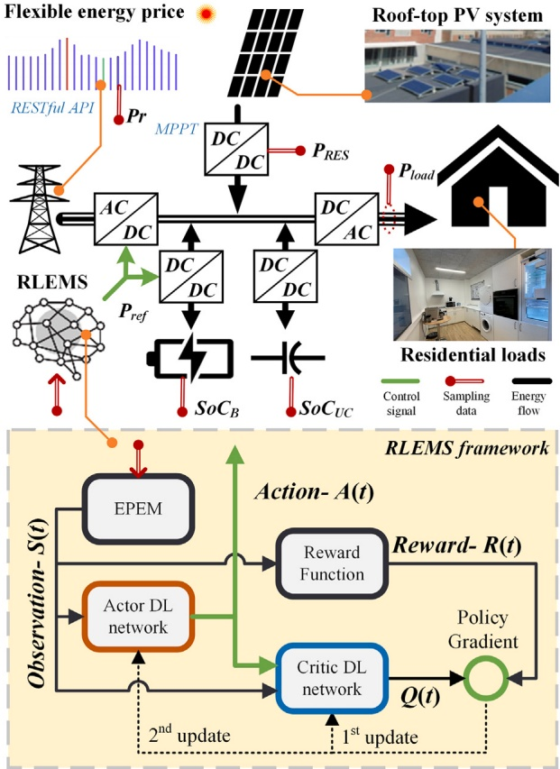

Fig. 1. Topology of the Multi-Energy Microgrid and interface of the RLEMS.

## 2 . The topology of the proposed RLEMS and MG

MGs are essential units in modern power systems to integrate dis tributed generators. Most sustainable generation sources, for instance, PV systems, batteries, fuel cells, and UC, are naturally DC sources, while AC loads dominate the demand side. Hence, a DC bus is implemented to integrate the power suppliers as shown in Fig. 1. The utility grid, connected to the DC bus via a DC-AC converter, and the battery, interfaced through a bidirectional boost converter, are regulated by the RLEMS. The PV system is deployed via a maximum power point tracking (MPPT)-regulated boost converter. Residential loads consume power from the AC bus through an inverter. The bidirectional converter for UC maintains the DC bus voltage with a droop logic to guarantee the power balance on the DC bus. In this sense, the UC provides the dynamic energy buffer to mitigate transient power oscillations and inertia for energy dispatching, enhancing the resilience of the MG system.

In the proposed MG architecture, the uncertainty is injected through multiple aspects. The PV system injects uncertainty from local weather. The residential loads are affected by stochastic user actions. The flexible energy price is determined by the global weather, climate, and supply–demand relationship. The renewable generation $( P _ { R E S } )$ , consumption $( P _ { l o a d } ) _ { z }$ state of charge of the battery $( S o C _ { B } ) _ { : }$ , and $\mathrm { U C }   ( S o C _ { U C } )$ are sampled by embedded smart meters or sensors and transmitted through a local IoT communication network. The proposed RLEMS collects real-time energy prices, marked as ${ P r } _ { \flat }$ from the website of the energy supplier and system data from a local network, through a Representational State Transfer (RESTful) application programming interface (API). The power flow of the MG system is regulated by the power reference matrix $( P _ { r e f } )$ generated through the RLEMS.

In this MG system, data from sensors with different collection frequencies are reorganized into several resolutions by rolling window averaging and interpolation in the IoT database. The RLEMS accesses the minute-resolution data series. The normally distributed data errors caused by communication latency or measurement issues are filtered through the data reorganization process.

The RLEMS framework is presented in the yellow area in Fig. 1. The sampled signals are preprocessed by the EPEM, which provides a longterm assessment of the local energy system. The optimization objectives are defined, and their priorities are determined by the reward function. The DDPG algorithm is deployed to establish the RL agent, including an actor and a critic. The RL agent is updated continuously according to the online reward. In this sense, the multi-objective optimization problem of the MG system is reformulated as an online power flow control framework.

## 3 . The proposed energy price evaluation model

Long-term optimization and real-time operation are considered separately in most existing EMS approaches, leading to information asymmetry and cooperation issues among different EMS layers. Existing research relies on prediction methods [28], stochastic models [29], or fuzzy logicbased evaluation to handle uncertainty from the weather and market sides. However, within the continuous operation in an MG, online corrections for evaluation results or thresholds are always necessary for deployment. Considering the dynamic states and flexible power operations during the continuous workflow, an EPEM is designed as a guide for economical operation to establish a long-term horizon in high-resolution online EMS. The EPEM consists of a dynamic energy price evaluation and an MG system status evaluation.

## 3.1 . Dynamic energy price evaluation

The dynamic energy price evaluation calculates the average price of electricity stored in the battery, marked as 𝜉. During the charging process, the incoming energy comes from the PV system or the grid, and the average price can be calculated by,

$$
\bar { P r } = \left\{ \begin{array} { l r } { P r \frac { P _ { g r i d } } { - P _ { E S S } } , } & { 0 < P _ { g r i d } < - P _ { E S S } , } \\ { P r , } & { 0 < - P _ { E S S } \leq P _ { g r i d } ; } \\ { 0 , } & { P _ { g r i d } \leq 0 . } \end{array} \right.\tag{1}
$$

in which $P _ { g r i d }$ and $P _ { E S S }$ represent the output power of the grid and the battery. $P r$ is the real-time electricity price. The average price of local energy storage in the battery can be calculated with,

$$
\xi ( t ) = \frac { S o C _ { B } ( t - 1 ) \xi ( t - 1 ) + \Delta S o C _ { B } \cdot \bar { P r } } { S o C _ { B } ( t ) }\tag{2}
$$

where the $\Delta S o C _ { B }$ represents the battery’s SoC differential during each sample. The eq. (2) could be simplified as,

$$
\Delta \xi = \frac { \Delta S o C _ { B } ( \bar { P r } - \xi ( t - 1 ) ) } { S o C _ { B } ( t ) }\tag{3}
$$

If the ESS was discharging, the $\xi$ should remain constant since

$$
\xi ( t ) = \frac { ( S o C _ { B } ( t - 1 ) + \Delta S o C _ { B } ) \cdot \xi ( t - 1 ) } { S o C _ { B } ( t ) }\tag{4}
$$

and

$$
\Delta \xi = 0\tag{5}
$$

In summary the $\xi$ could be described by the combination of Eq. (3) and (5),

$$
\xi ( t ) = \xi ( t - 1 ) + \Delta \xi\tag{6}
$$

$$
\Delta \xi = \left\{ \begin{array} { l l } { \displaystyle \frac { \Delta S o C _ { B } ( \bar { P r } - \xi ( t - 1 ) ) } { S o C _ { B } ( t ) } , } & { 0 < \Delta S o C , } \\ { 0 , } & { \Delta S o C \leq 0 . } \end{array} \right.\tag{7}
$$

The dynamic energy price evaluation 𝜉 is a complex inertia system involving uncertainty from the energy market. When the battery is charged with renewable energy or low-price energy, the 𝜉 decreases. A low 𝜉 indicates optimal charging operations of the battery [30]. However, optimal operations of the MG must consider global power balance and profits. Hence, the environmental evaluation is introduced into the assessment.

## 3.2 . MG environment status evaluation

The proposed RLEMS is independent of prediction methods, which significantly provides a global horizon for the operation. Hence, the future operation margin must be reserved for the battery, the extreme $S o C _ { B }$ is restrained by a gain function for 𝜉.

$$
K_{S}(t)=1-\left(\frac{SoC_{B}(t)-0.5}{MAX(|SoC_{B}-0.5|)}\right)^{2\sigma+1}\tag{8}
$$

in which $K _ { S }$ represents the state gain considering the state of charge of the battery. The 𝜎 is a non-negative integer that adjusts the sensitivity of the function. When the $S o C _ { B }$ is around the center, the $K _ { S }$ has less effect on the decision-making; on the contrary, the discharging at low $S o C _ { B }$ and the charging at high $S o C _ { B }$ can be restrained by the function.

Apart from the local storage modification, it is essential to further take into account the broader global market environment. A rolling window mean is designed here to indicate the average energy price as,

$$
P r _ { A } ( t ) = \frac { 1 } { \mu } \sum _ { i = 0 } ^ { \mu - 1 } P r ( t - \frac { i } { f } ) .\tag{9}
$$

$$
\mu = T f .\tag{10}
$$

where ${ P r } _ { A }$ denotes the global average energy price, 𝑡 is the real time, 𝑇 represents the horizon, and 𝑓 is the operating frequency of the RLEMS.

The gain function considering the global energy market is designed as,

$$
K _ { P } ( t ) = \frac { P r _ { A } } { P r }\tag{11}
$$

In summary, the proposed EPEM is composed of a basic local price evaluation and two coefficients to include local storage and global market considerations.

$$
E P E M ( t ) = K _ { P } ( t ) \cdot K _ { S } ( t ) \cdot \xi ( t )\tag{12}
$$

The 𝐸𝑃 𝐸𝑀(𝑡) provides a quantitative psychological price for the RLEMS to determine whether the market price is cheap or expensive, considering multiple factors. The steady-state characteristic of the EPEM against battery SoC and electricity price within the charging and discharging workflow is presented in Fig. 2. Generally, the EPEM matches the trend of the electricity price, and is suppressed or enlarged by the battery states. The deep coupling of the proposed 𝐸𝑃 𝐸𝑀 function with the system operation and market uncertainty will be addressed using the RL algorithm.

In the RLEMS, the EPEM refines the effective information from the original sampling data to provide essential evaluation components to the reward function, improving the training and decision efficiency of the intelligent agent. Furthermore, the EPEM operates independently of the intelligent agent, thereby enhancing its adaptability to various data acquisition systems. The reward function can capture information from the EPEM according to its resolution.

## 4 . The framework of the reinforcement learning-based intelligent EMS agent

The intelligent operation of the MG system is realized through a DDPG-based RL algorithm. The connection between the RLEMS and the

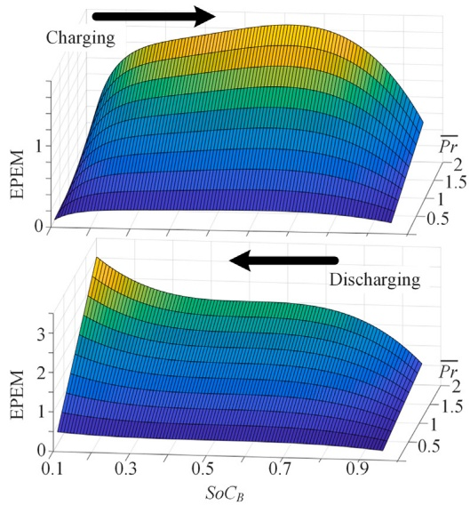

Fig. 2. Steady-state sensitivity of the EPEM by battery SoC and electricity price.

MG system is presented in Fig. 1. The framework of the RLEMS includes the reformulation of the system environment, the definition of the reward function, and the design of the DDPG algorithm.

## 4.1 . Environment reformulation

In the MG environment, the uncertainty sources, including PV generation, the dynamic loads, and the flexible energy price, are realized through numerical models. The time series of the PV power and loads are sampled in a realistic IoT laboratory and the energy price sequence of the same duration is downloaded through a RESTful API. In this way, the uncertainty from the weather, random user actions, and the global energy market is introduced into the research.

In this framework, the RLEMS receives online responses from the environment and adjusts the operational logic accordingly. The essential factor is that the model in the environment should match the external characteristics of the implemented system. Considering that the battery and UC have been assigned different objectives, the minor energy loss of UC and Lithium-ion batteries is not specifically modeled in the environment. Hence, the battery model is defined as,

$$
\begin{aligned} &S o C _ { B } = S o C _ { B } ^ { 0 } + \int P _ { B } / C _ { B } d t , \\&S o C _ { B } ^ { M I N } < S o C _ { B } < S o C _ { B } ^ { M A X } ,\\ \end{aligned}\tag{13}
$$

where ${ \cal S } o C _ { B } ^ { 0 }$ represents the initial 𝑆𝑜𝐶 of the battery. The $P _ { B }$ is the output power of the battery, which will follow the reference from the RLEMS and be limited by the SoC. $C _ { B }$ is the capacity of the battery. Constraints are set for the battery SoC to restrain the degradation. The UC model is similarly designed as,

$$
SoC_{UC} = SoC^0_{UC} + \int P_{UC}/C_{UC}dt, 0 < SoC_{UC} < 1\tag{14}
$$

in which the $S o C _ { U C } ^ { 0 }$ is the initial state of the UC. $C _ { B }$ is the capacity of the UC. The output power of the UC, marked as $P _ { U C } ,$ compensates for the power demand in the MG system to ensure the internal power balance.

The economic expense of the electricity is calculated through a power meter as,

$$
C o s t = \int P _ { g r i d } \cdot P r d t , 0 < P _ { g r i d }\tag{15}
$$

The data and signal exchange between the RL algorithm and the environment are the observation (𝑆) and action (𝐴). The 𝑆(𝑡) represents

the state space of the environment,

$$
S(t) = \left[SoC_{B}(t),SoC_{UC}(t), EPEM(t), P_{RES}(t), P_{load}(t), Pr, \xi(t)\right]\tag{16}
$$

in which $S o C _ { B } ( t ) ,   S o C _ { U C } ( t ) ,   P _ { R E S } ( t ) ,$ and $P _ { l o a d } ( t )$ are the real-time sampled data of the system status. The $P r$ is the flexible energy price. The 𝐸𝑃 𝐸𝑀(𝑡) and 𝜉(𝑡) are evaluation parameters.

The action space is the output of the RL algorithm, which provides the power reference value for the battery converter and grid converter. Hence the 𝐴(𝑡) can be defined as,

$$
A ( t ) = [ P _ { B } ^ { * } ( t + 1 ) , P _ { g r i d } ^ { * } ( t + 1 ) ]\tag{17}
$$

In the environment, it is assumed that the output power of the grid converter and battery converter will quickly track the power reference when the SoC limitation of the battery is not triggered. The sampling delay is considered in the environment. The numerical models of the PV generation and loads are in minute resolution, while the price model is updated hourly according to the energy contract.

## 4.2 . Reward function

The reward function defines the optimization target in the RL algorithm. In the proposed RLEMS, the objectives are system power balance and minimum energy expense. The system power balance reward $R _ { S }$ is indicated by,

$$
R _ { S } ( t ) = - ( \lambda ( S o C _ { U C } ( t ) - 0 . 5 ) ) ^ { 2 W _ { S } }\tag{18}
$$

where 𝜆 affects the sensitive margin of the function, $W _ { S }$ affects the weight of the component.

The SoC of the battery is regulated by the RLEMS, and an alarm for overcharging and over-discharging is incorporated into the reward function.

$$
R _ { A } ( t ) = - ( \gamma ( S o C _ { B } ( t ) - 0 . 5 ) ) ^ { 2 W _ { A } }\tag{19}
$$

where $\gamma$ affects the sensitive margin of the function, and $W _ { A }$ is the weight.

The economic reward $R _ { E }$ is defined by the trading profit $\mathbf { a } \mathbf { s } _ { z }$

$$
R _ { E } ( t ) = \left\{ \begin{array} { l l } { P _ { g r i d } ( t ) ( E P E M ( t ) - P r ) , } & { 0 \leq P _ { g r i d } , } \\ { P _ { g r i d } ( t ) ( E P E M ( t ) - P r _ { S } ) , } & { P _ { g r i d } < 0 . } \end{array} \right.\tag{20}
$$

in which ${ P r } _ { S }$ represents the price of selling energy back to the utility grid.

The overall reward function is defined by the sum of the components as,

$$
R ( t ) = R _ { S } ( t ) + R _ { E } ( t ) + R _ { A } ( t )\tag{21}
$$

By adjusting the weights and margin parameters, the priorities of the optimization objectives are defined.

## 4.3 . Reinforcement learning algorithm

A DDPG framework with four deep neural networks—two actor and two critic networks—is used for the RL algorithm. The deep neural network structures are presented in Fig. 3.

The actor deep neural network takes observations as input and expands the hidden layer through two fully connected (FC) and Rectified Linear Unit (ReLU) layers. The output 𝐴(𝑡) is resized by an FC layer, and a hyperbolic tangent function scales its amplitude. The critic deep neural network has two inputs: the observation is expanded through an FC-ReLU layer and regulated to the same dimension as the expanded action by an FC layer. Then the two layers are summed to obtain a new combined layer. The criticism is further calculated by a combined ReLU-FC layer. The DL networks are trained with 24-hour data of the

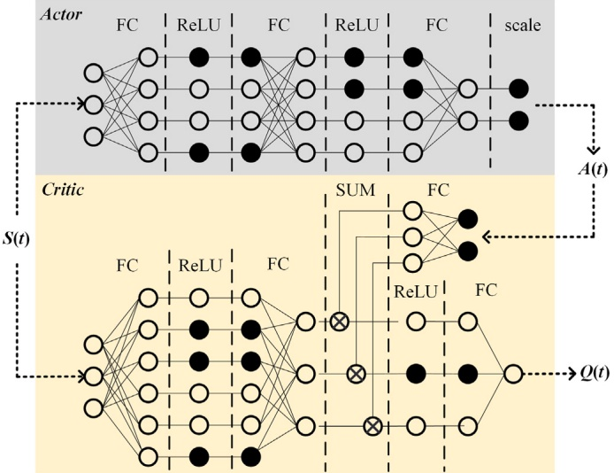

Fig. 3. Deep neural network structures and internal connections.

MG. The optimal parameters, 𝜃, 𝜙, $\theta _ { t } ,   \phi _ { t } ,$ , will be achieved for online implementation.

The iterative process of the proposed RLEMS is presented in Algorithm 1. The input contains reward, LEPM, and system state space, the output is the estimated battery and grid power. After the initialization of the RLEMS algorithm, the mini-batch size is set to $T ,$ and the total episodes 𝑀 can be determined according to the maximum iterations. In each episode, the value function target $\chi$ is initialized first to generate the experience. The Ornstein-Uhlenbeck model is deployed to produce a noise, which is $N ,$ for the actor to explore the environment. The exploration will generate another reward 𝑅 and observation $S ^ { \prime } ,$ which become the experience together with the original observation 𝑆 and action $A . ~ \chi$ is determined and stored in each iteration, 𝛾 is introduced as the discount factor for the weight of future rewards. Each episode will output an experience matrix for parameter optimization. The loss 𝐿 can be calculated with $\chi$ and criticism $Q ,$ and the optimal $\phi$ can be achieved by minimizing the 𝐿. The optimal 𝜃 is obtained by maximizing the expected discounted reward. The action without noise is related to 𝑆 and 𝜃, hence the policy gradient can be calculated for the optimization process. The parameters for the target actor and critic are updated based on the optimal 𝜙 and 𝜃. A smooth factor is employed here to adjust the slope of $\phi _ { t }$ and $\theta _ { t }$ during the iterative process [31].

The deep neural networks of the actors and critics are trained offline using historical data and implemented online for the real-time operation of the MG system.

## 5 . Numerical experiments

The proposed RLEMS is validated in the environment shown in Fig. 1. The configuration of the MG is presented in Table 2. Constraints for the $S o C _ { B }$ are defined to prolong the lifecycle of the battery. The residential loads include a coffee machine, refrigerators, ovens, TVs, workstations, laptops, and some cooking staff. The appliances are used randomly by the user working in the laboratory. In this way, the uncertainty from user actions is introduced into the validation. The uncertainty from the renewable generation and energy market is introduced by the realistic data of PV power and energy prices. The experimental dataset is pre-sented in Fig. 4. The feasibility of the proposed RLEMS is verified in both winter and summer scenarios. The winter case is shown in Fig. 4(a), which indicates a high energy price and low PV generation. The summer case presented in Fig. 4(b) demonstrates low prices and high renewable energy.

Configuration of main devices in the MG system.

| Power PV rated power (1000𝑊∕𝑚2,25◦𝐶 ) | 3 kW |
| --- | --- |
| BESS maximum charging power | 2.5 kW |
| BESS maximum discharging power | 2.5 kW |
| UC maximum charging power | 5 kW |
| UC maximum discharging power | 5 kW |
| Energy BESS capacity | 5 kWh |
| BESS maximum SoC | 95 % |
| BESS minimum SoC | 10 % |
| UC capacity | 0.1 kWh |

Algorithm 1 DDPG algorithm for online RLEMS.
Input: Observation $\overline { { ( S ( t ) ) } }$ and Reward (𝑅(𝑡)): $S o C _ { B } ( t ) , S o C _ { U C } ( t ) ,$
$P _ { R E S } ( t ) ,   P _ { l o a d } ( t ) ,   E P E M ( t ) ,   \xi ( t ) ,   P r ,   R ( t )$
Output:  BESS operating power: $P _ { B } ^ { * } , P _ { g r i d } ^ { * }$
1: Initialize $\phi$ and $\phi _ { t }$ with the same random parameters;
2: Initialize 𝜃 and $\theta _ { t }$ with the same random parameters;
3: for episode $= 1$ to 𝑀 do
4: Initialize the value function target $\chi ;$
5: for train step $t = 1$ to 𝑇 do
6: Select action $A = \pi ( S ; \theta ) + N$ according to the current observa-
tion $S ;$
$7 ;$ Execute action 𝐴 and obtain the reward 𝑅 and the next obser-
vation $S ^ { \prime } ;$
8: Store the $( S , A , R , S ^ { \prime } )$ as experience;
9: Calculate the $\chi = R + \gamma Q _ { t } ( S ^ { \prime } , \pi _ { t } ( S ^ { \prime } , \theta _ { t } ; \phi _ { t } ) ) ;$
10: end for
11: Optimize the critic parameters by minimizing the loss: $L ~ =$
$\frac { 1 } { 2 T } \sum _ { i = 1 } ^ { T } { ( \chi ( i ) - Q ( S ( i ) , A ( i ) ; \phi ) ) ^ { 2 } } ;$
12: Optimize the actor parameters with the sampled policy gradient
to maximize the expected discounted reward: $\nabla _ { \theta } J \approx \frac { 1 } { T } \sum _ { i = 1 } ^ { T } \nabla _ { \theta } A _ { i }$
$\nabla _ { A } Q ( S ( i ) , A ; \phi ) ;   A = \pi ( S ( i ) ; \theta ) ;$
13: Update the target actor and critic parameters: $\phi _ { t } = \tau \phi + ( 1 - \tau ) \phi _ { t } ;$
$\theta _ { t } = \tau \theta + ( 1 - \tau ) \theta _ { t } ;$
14: end for

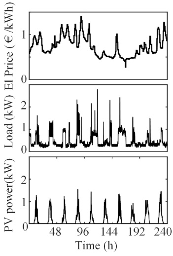

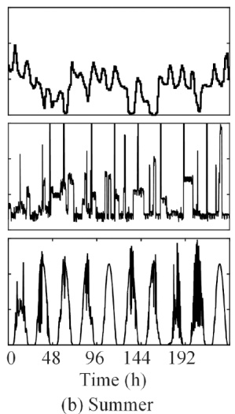

Fig. 4. Energy price, load, and PV generation of the experimental a) winter b) summer case.

The two scenarios include two extreme phenomena that represent the short-supply and over-supply situations. The winter case emphasizes the energy trading between the local MG and the utility grid. Since the PV generation could hardly cover the power demand. In the summer case, the RLEMS focuses on the daily renewable energy allocation, and the energy market has minimal influence on the optimal operation of the MG.

The MG is operated by the same RLEMS in the two scenarios, and the DDPG algorithm is trained with 24-hour data and validated in 10-day scenarios. In continuous operations, the trained agent can self-adjust against seasons, weather, loads, and market changes, since these factors usually evolve gradually and smoothly at minute resolutions. The retraining process actually initializes the RLEMS agent based on the training dataset. The transferability of the proposed RLEMS is considered through improving the deployment efficiency. Compared to conventional EMS methods, the retraining and deployment work of the proposed RLEMS is efficient and timely, providing considerable transferability for the proposed RLEMS. In this sense, the DDPG agent for each season is trained independently, considering that the two scenarios are not continuous.

## 5.1 . Performance of the proposed RLEMS in different scenarios

The decision-making results and the response of the MG system are presented in Fig. 5. The blue area represents the input power of the grid converter, the green area shows the output power of the battery.

In the winter scenario, the PV generation is insufficient. The RLEMS purchases energy to charge the battery when the price is low and limits the grid power when the price is high. By comparing the blue zone and red curve in Fig. 5(a), it can be found that the RLEMS can effectively detect the low-price period with the proposed EPEM. In the summer scenario, the PV energy is sufficient but unevenly distributed during each day. In this sense, the operation logic of the RLEMS is changed. The green area and power demand curve $( P _ { l o a d } - P _ { R E S } )$ in Fig. 5(b) indicate that the RLEMS controls the battery converter to charge the battery when the PV power exceeds the local loads, and discharge the battery to support the demand side at night. The grid power purchasing is activated after the battery is over-discharged. It can be concluded from the SoC curve of the battery that the capacity of the ES is fully utilized for the economical operation of the MG.

The power balance of the MG system is demonstrated by the $S o C _ { U C }$ curve. The internal power balance of the MG system will be broken when the energy buffer is overcharged or over-discharged, and the embedded droop control in the converters will be activated as secondary protection, which indicates that the power flow control is taken over by primary control, and the EMS is unstable. Hence, the $S o C _ { U C }$ should touch the upper and lower bands as little as possible. In Fig. 5, the $S o C _ { U C }$ is restrained within the stable margin in most situations. The oscillation of the power demand might lead to the $S o C _ { U C }$ reaching the upper band, and the response of the RLEMS is quick. The $S o C _ { U C }$ never stays on the unstable band for a long duration.

## 5.2 . Ablation experimental validation

To illustrate the performance of the DDPG algorithm, a PPO algorithm is also designed as a comparison. The hyperparameters of the two algorithms are presented in Table 3. The definition of empirical parameters in the reward function is further discussed in the Appendix. Both RL algorithms are implemented in the environment equipped with the proposed EPEM and the same reward function, indicating similar optimal operation logic. DDPG and PPO agents are actor-critic RL algorithms, differing primarily in their exploration strategies and output formats. DDPG explores the environment by an Ornstein-Uhlenbeck noise model and outputs a constant, and the PPO algorithm uses a Gaussian noise model and provides a random number expressed by its mean and standard deviation.

The training process of the DDPG and PPO agents is shown in Fig. 6. The blue curve represents the DDPG agent and the red one represents the PPO. Both agents stabilize within 200 episodes and explore the economical operation logic in the following episodes. The oscillation during the training process is affected by the exploration algorithm and DL network structures. The DDPG algorithm can provide a stable reward during the training, but the critic network is suffering from dramatic oscillations. Compared to the PPO algorithm, the exploration range of the DDPG algorithm is limited and might not reach an extremely high reward. However, the actor network of the DDPG agent can converge to the optimal reward more easily than the PPO algorithm in these two scenarios.

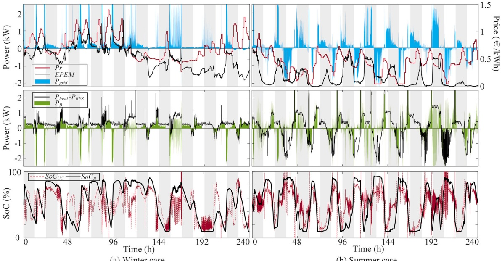

(a) Winter case

(b) Summer case

Fig. 5. The decision-making results of RLEMS and response of MG system in a) Winter case and b) Summer case.

Table 3

Hyperparameters of the RL algorithms.

| System parameters | EPEM parameter: 𝜎 = 1,𝑇 = 24 ∗ 60. Reward: 𝑊𝑆 = 4,𝑊𝐴 = 6,𝜆 = 3,𝛾 = 3. |
| --- | --- |
| Actor network (DDPG) | FC[256] - ReLU - FC[256] - ReLU - FC[1] - scale. learning rate = 10-4. |
| Actor network (PPO) | root: FC[64] - ReLU - FC[128]; branch: FC[256] - ReLU - FC[1] - scale; branch: FC[256] - ReLU - FC[1] - scale. learning rate = 10-4. |
| Critic Network (DDPG) | branch: FC[512] - ReLU - FC[256]; branch: FC[256]; root: add - ReLU - FC[1]. learning rate = 10-3. |
| Critic Network (PPO) | FC[64] - ReLU - FC[64] - ReLU - FC[64] - ReLU - FC[1]. learning rate = 10-3. |
| Training parameters | Sample time = 1 min. Discount factor = 0.95. look ahead steps = 5. |

The output actions of the two agents are presented in Fig. 7. The blue curve represents the DDPG agent and the red one represents PPO. The trend of the actions indicates similar operational logic. However, the PPO algorithm generates more oscillations in the actions, leading to frequent power direction switching of the battery and grid converter.

The daily energy cost of the two agents is shown in Fig. 8. The blue bar represents the DDPG agent and the red one represents PPO. With similar operational logic, both algorithms yield close daily costs. The total cost of the DDPG agent is 52.49 in the winter case and 30.35 in the summer case, while the PPO algorithm brings 52.54 and 32.97, respectively.

The stability of the RLEMS is evaluated by the $S o C _ { U C } ,$ the distribution of which is presented in Fig. 9. The blue dots represent the DDPG agent, and the red for PPO. The width of the shape demonstrates the proportion. The DDPG algorithm can fully utilize the capacity of UC in the operations and achieve better stability than the PPO agent.

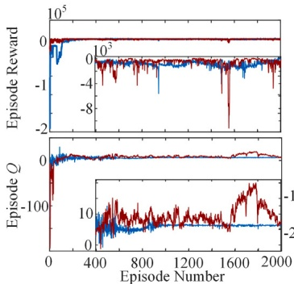

(a) Winter case convergence trend

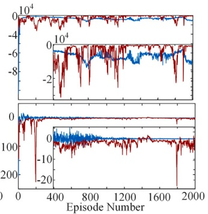

(b) Summer case convergence trend

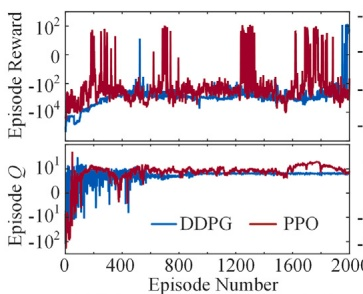

(c) Winter case oscillation analysis

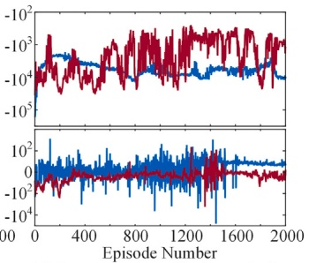

(d) Summer case oscillation analysis

Fig. 6. Actor and critic network training process of the RL algorithms in a) winter convergence trend b) summer convergence trend c) winter oscillation b) summer oscillation.

In summary, it can be concluded that the proposed EPEM can effectively evaluate the energy market and guide the decision-making process for intelligent online EMSs. The operation logic in the MG system can be solved by RL-based algorithms. Considering the output oscillation, EMS stability, and total economic profits, the DDPG algorithm is more appropriate for the RLEMS in the proposed MG environment.

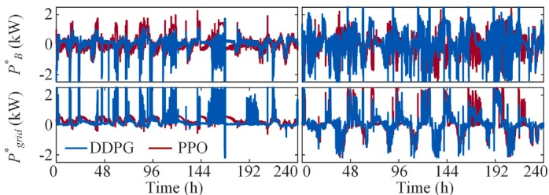

(a) Winter case

(b) Summer case

Fig. 7. Output actions of the RL algorithms in a) winter, b) summer case.

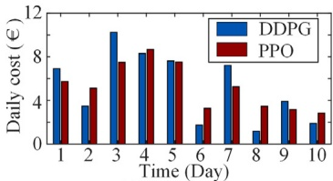

(a) Winter case

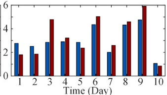

(b) Summer case

Fig. 8. Daily energy cost of the RL algorithms in a) winter, b) summer case.

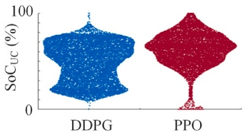

(a) Winter case

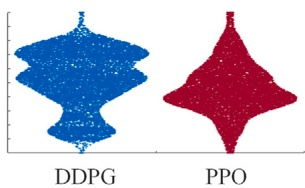

(b) Summer case

Fig. 9. The SoC distribution of UC with the RL algorithms in a) winter, b) summer case.

## 5.3 . Comparative experiments

The economic performance of the proposed RLEMS is further verified by comparing it with existing methods in real-world applications: PSO-based day-ahead EMS, LP-MPC online EMS, and grid-connected MG without ES. In this paper, prediction results with distinct accuracy, 100 %, and 80 %, will be fed to the PSO algorithm to consider the complete performance range of traditional EMS. LP-MPC will be fed with ideal prediction results, where the LP is applied for dayahead optimization, and MPC focuses on system stability with a 10-step look-ahead.

The total energy expenses with different methods are shown in Fig. 10. The daily energy cost is presented in Table 4. The proposed RLEMS cannot achieve the lowest daily expense compared with existing approaches. However, the total energy expense is the lowest. The reason for this phenomenon can be explained by two perspectives: 1) The proposed RLEMS works with dynamic horizons defined by online system states. Hence, RLEMS do not outperform existing methods within each daily case. 2) The proposed RLEMS is not within the framework of traditional EMS approaches. The different decision logic leads to unique operation points, resulting in oscillations and disturbances in short-term economic evaluation. In this sense, the economic cost is evaluated by long-term expense.

For PSO-based day-ahead EMS, the horizon is fixed and discrete, making the EMS unable to react to system dynamics and transient uncertainty. Besides, the performance of the PSO-based approach degrades as the prediction accuracy decreases. The LP-MPC approach, as a typical multi-layer EMS framework, effectively compensates for the dynamic oscillations during online workflow. However, the fixed horizons of the upper layers and online controllers are still facing challenges in information updating and layer interactions. On the contrary, the proposed RLEMS is independent of the prediction methods, and the proposed EPEM provides the long-term horizon for the RLEMS, making the RLEMS intelligent and stable enough to cope with complex system status. The operation logic defined by the proposed EPEM, together with the reward function, is verified economically in Fig. 10. Compared with common real-world applications, the proposed RLEMS achieves a 10.2 % cost-saving in the winter case and 33 % in the summer case.

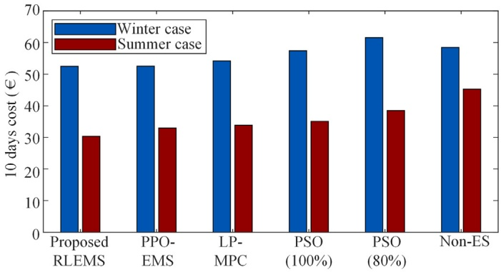

Fig. 10. Total energy expenses of the proposed RLEMS and existing methods.

The electricity cost (€) of the EMS methods.

<table><tbody><tr><td rowspan="2">Methods</td><td rowspan="2">Non-ES</td><td rowspan="2">PSO(100 %)</td><td rowspan="2">PSO(80 %)</td><td rowspan="2">LP-MPC</td><td rowspan="2">RLEMS</td></tr><tr></tr><tr><td>Winter 1</td><td>6.44</td><td>5.98</td><td>6.78</td><td>7.12</td><td>6.91</td></tr><tr><td>Winter 2</td><td>5.67</td><td>6.35</td><td>6.32</td><td>6.25</td><td>3.48</td></tr><tr><td>Winter 3</td><td>8.03</td><td>8.42</td><td>9.06</td><td>8.36</td><td>10.24</td></tr><tr><td>Winter 4</td><td>8.68</td><td>8.13</td><td>8.62</td><td>8.02</td><td>8.30</td></tr><tr><td>Winter 5</td><td>7.84</td><td>7.01</td><td>7.53</td><td>7.35</td><td>7.61</td></tr><tr><td>Winter 6</td><td>3.71</td><td>3.56</td><td>3.85</td><td>3.52</td><td>1.73</td></tr><tr><td>Winter 7</td><td>5.82</td><td>5.13</td><td>5.38</td><td>5.52</td><td>7.21</td></tr><tr><td>Winter 8</td><td>3.25</td><td>3.35</td><td>3.61</td><td>3.57</td><td>1.17</td></tr><tr><td>Winter 9</td><td>3.66</td><td>2.77</td><td>3.48</td><td>3.25</td><td>3.91</td></tr><tr><td>Winter 10</td><td>5.32</td><td>2.30</td><td>6.94</td><td>6.79</td><td>1.89</td></tr><tr><td>Total</td><td>58.46</td><td>57.41</td><td>61.57</td><td>54.16</td><td>52.49</td></tr><tr><td>Summer 1</td><td>4.78</td><td>4.33</td><td>5.09</td><td>4.40</td><td>2.76</td></tr><tr><td>Summer 2</td><td>2.15</td><td>1.26</td><td>1.31</td><td>1.18</td><td>2.50</td></tr><tr><td>Summer 3</td><td>5.11</td><td>3.91</td><td>4.23</td><td>4.02</td><td>2.85</td></tr><tr><td>Summer 4</td><td>4.85</td><td>3.41</td><td>4.08</td><td>3.34</td><td>2.89</td></tr><tr><td>Summer 5</td><td>4.53</td><td>3.81</td><td>4.06</td><td>3.67</td><td>2.84</td></tr><tr><td>Summer 6</td><td>5.22</td><td>3.90</td><td>4.32</td><td>3.90</td><td>4.34</td></tr><tr><td>Summer 7</td><td>3.68</td><td>2.97</td><td>3.11</td><td>2.96</td><td>2.01</td></tr><tr><td>Summer 8</td><td>5.93</td><td>4.84</td><td>4.91</td><td>4.74</td><td>4.31</td></tr><tr><td>Summer 9</td><td>6.28</td><td>4.73</td><td>5.14</td><td>4.68</td><td>4.75</td></tr><tr><td>Summer 10</td><td>2.70</td><td>1.87</td><td>2.14</td><td>0.95</td><td>1.05</td></tr><tr><td>Total</td><td>45.27</td><td>35.02</td><td>38.39</td><td>33.84</td><td>30.35</td></tr></tbody></table>

## 6 . Conclusions

A multi-objective RLEMS is proposed in this paper to realize the intelligent real-time power flow control in a converter-interfaced MG. The main works can be summarized as follows.

1. A novel online RLEMS framework is proposed to realize the multi-objective optimization of MGs with a high proportion of uncertainty. The RLEMS decouples the multi-dimensional system states with the optimal power flow operations with few-shot datasets through a DDPG algorithm, further decreasing the deployment cost and enhancing the feasibility of centralized EMS.

2. An innovative EPEM is designed to provide online economic evaluations, transferring global market uncertainty to the RLEMS timescale and MG scope. Based on the proposed EPEM, the uncertainty, the system power balance, and the economic cost are jointly considered in one reward function with distinguished priorities.

3. Comprehensive validations are conducted to verify the performance and superiority of the proposed RLEMS. The ablation study indicates that the optimal operation logic defined by the proposed EPEM, together with the reward function, is economical and stable for the MG. The performance of the proposed RLEMS is validated by comparing it with existing methods and applications. The results demonstrate that the proposed RLEMS can ensure the stable operation of the MG system and obtain a 10.2 % to 33 % cost-saving in the economic aspect.

The RLEMS provides a novel framework to establish low datadependency EMS systems, further promoting the potential application of cutting-edge AI models in energy technologies. In future research, the generalization of the proposed approach to different MG configurations will be explored, and forefront AI models will be deployed within this framework through transfer learning and few-shot learning technologies.

## CRediT authorship contribution statement

**Jingxuan Wu:** Conceptualization, Formal analysis, Data curation, Algorithm design, Software, Investigation, Validation, Writing – original draft. **Shuting Li:** Methodology, Visualization, Writing – review and editing. **Yun Yu:** Writing – review and editing. **Yajuan Guan:** Resources, Writing – review and editing. **Baoze Wei:** Resources, Writing – review and editing. **Zhe Chen:** Resources, Writing – review and editing.

## Declaration of competing interest

The authors declare that they have no known competing financial interests or personal relationships that could have appeared to influence the work reported in this paper.

## Appendix

The empirical parameters in the reward function are further discussed to indicate the value definition in realistic applications. In the proposed reward function, $W _ { S }$ and $W _ { A }$ construct the variable-sensitivity weights for the penalty components, allowing these components to be activated by specific events. The 𝜆 and 𝛾 define the width of the hidden margin. In this sense, the operation logic of the proposed RLEMS can change within the continuous workflow. In Table 5, four extra cases are provided to compare the performance of the proposed RLEMS framework with different empirical parameter sets.

Table 5

The effect of empirical parameters on energy cost and UC SoC.

<table><tr><td>Cases</td><td colspan="2">SoCvc Distribution 1 10-day Cost (€)</td></tr><tr><td rowspan="2">Proposed:  $W_{S}=\frac{1}{4},\;W_{A}=6$   $\lambda = \gamma = 3$ </td><td>Winter 52.49</td><td></td></tr><tr><td>30.35 Summer</td><td></td></tr><tr><td rowspan="3"> $Case I:$   $W_{S}=4,\;W_{A}=6$   $\lambda = \gamma = 3 . 5$   $Case II:$ </td><td>Winter 59.26</td><td></td></tr><tr><td>36.51 Summer</td><td></td></tr><tr><td>Winter 49.4</td><td></td></tr><tr><td> $W_{S}=4,\;W_{A}=6$   $\lambda = \gamma = 2 . 5$   $Case III:$ </td><td>35.97 Summer</td><td></td></tr><tr><td rowspan="3"> $W_{S} = 3,   W_{A} = 5$   $\lambda = \gamma = 3$   $Case IV:$ </td><td>Winter</td><td>55.94</td></tr><tr><td>34.15 Summer</td><td></td></tr><tr><td>Winter 59.26</td><td></td></tr></table>

The hidden margin of the penalty components is narrowed in cases I and IV, while in cases II and III, the alarm is less sensitive. Hence, the cost in cases I and IV is increased due to less activated energy storage capacity; the UC is more likely to be overcharged or over-discharged in cases II and III. Jointly considering the economic performance and UC storage oscillations, the $W _ { S } ,   W _ { A } ,   \lambda ,$ and $\gamma$ definitions must match the penalty components with the $R _ { E }$ range. In this manuscript, the optimal value is presented in Table 3.

## Data availability

Data will be made available on request.

## References

[1] [Li S, Wu J, Agundis-Tinajero GD, Chaudhary SK, Vasquez JC, Guerrero JM. A decomposed harmonic current suppression method for vsg-based microgrids connected to distorted grids. IEEE Trans Ind Electron Sep. 2024;71(9):10669–80.](http://refhub.elsevier.com/S0306-2619%2825%2901953-1/sbr0005)

[2] [Saleh M, Esa Y, Mohamed AA. Communication-based control for DC microgrids. IEEE Trans Smart Grid Mar 2019;10:2180–95.](http://refhub.elsevier.com/S0306-2619%2825%2901953-1/sbr0010)

[3] [Cordova S, Canizares CA, Lorca A, Olivares DE. Frequency-constrained energy management system for isolated microgrids. IEEE Trans Smart Grid 2022.](http://refhub.elsevier.com/S0306-2619%2825%2901953-1/sbr0015)

[4] [Çimen H, Çetinkaya N, Vasquez JC, Guerrero JM. A microgrid energy management system based on non-intrusive load monitoring via multitask learning. IEEE Trans Smart Grid Mar 2021;12:977–87.](http://refhub.elsevier.com/S0306-2619%2825%2901953-1/sbr0020)

[5] [Jafari M, Malekjamshidi Z, Zhu J, Khooban MH. A novel predictive fuzzy logic-based energy management system for grid-connected and off-grid operation of residential smart microgrids. IEEE J Emerg Sel Top Power Electron Jun 2020;8:1391–404.](http://refhub.elsevier.com/S0306-2619%2825%2901953-1/sbr0025)

[6] [Zhao Z, Guo J, Luo X, Lai CS, Yang P, Lai LL, Li P, Guerrero JM, Shahidehpour M. Distributed robust model predictive control-based energy management strategy for islanded multi-microgrids considering uncertainty. IEEE Trans Smart Grid May 2022;13:2107–20.](http://refhub.elsevier.com/S0306-2619%2825%2901953-1/sbr0030)

[7] [van der Meer D, Wang GC, Munkhammar J. An alternative optimal strategy for stochastic model predictive control of a residential battery energy management system with solar photovoltaic. Applied Energy Feb 2021;283.](http://refhub.elsevier.com/S0306-2619%2825%2901953-1/sbr0035)

[8] [Liang X, Chen K, Chen S, Zhu X, Jin X, Du Z. Iot-based intelligent energy management system for optimal planning of HVAC devices in net-zero emissions pv-battery building considering demand compliance. Energy Convers Manag Sep 2023; 292.](http://refhub.elsevier.com/S0306-2619%2825%2901953-1/sbr0040)

[9] [Mohy-Ud-Din G, Muttaqi KM, Sutanto D. Adaptive and predictive energy management strategy for real-time optimal power dispatch from vpps integrated with renewable energy and energy storage. IEEE Trans Ind Appl May 2021;57:1958–72.](http://refhub.elsevier.com/S0306-2619%2825%2901953-1/sbr0045)

[10] [Gerlach L, Bocklisch T, Verweij M. Selfish batteries VS. Benevolent optimizers: an exploratory review of agent-based energy management with distributed storage in microgrids. Renewable Sustain Energy Rev May 2023;177.](http://refhub.elsevier.com/S0306-2619%2825%2901953-1/sbr0050)

[11] [Giraldo JS, Castrillon JA, Lopez JC, Rider MJ, Castro CA. Microgrids energy management using robust convex programming. IEEE Trans Smart Grid Jul 2019;10:4520–30.](http://refhub.elsevier.com/S0306-2619%2825%2901953-1/sbr0055)

[12] [Xing X, Xie L, Meng H, Guo X, Yue L, Guerrero JM. Energy management strategy considering multi-time-scale operational modes of batteries for the grid-connected microgrids community. CSEE J Power Energy Syst Mar 2020;6:111–21.](http://refhub.elsevier.com/S0306-2619%2825%2901953-1/sbr0060)

[13] [Huy THB, Dinh HT, Vo DN, Kim D. Real-time energy scheduling for home energy management systems with an energy storage system and electric vehicle based on a supervised-learning-based strategy. Energy Convers Manag Sep 2023;292.](http://refhub.elsevier.com/S0306-2619%2825%2901953-1/sbr0065)

[14] [Heleno M, Mashayekh S, Stadler M, Cardoso G, De Luís R. Optimal sizing and placement of distributed generation: MILP VS PSO comparison in a real microgrid application. In: 19th International Conference on intelligent system application to power systems; 2017.](http://refhub.elsevier.com/S0306-2619%2825%2901953-1/sbr0070)

[15] [Yousif M, Ai Q, Gao Y, Wattoo WA, Jiang Z, Hao R. An optimal dispatch strategy for distributed microgrids using PSO. CSEE J Power Energy Syst Sep 2020;6: 724–34.](http://refhub.elsevier.com/S0306-2619%2825%2901953-1/sbr0075)

[16] [Zhang X, Huang C, Shen J. Energy optimal management of microgrid with high photovoltaic penetration. IEEE Trans Ind Appl 2023;59(1):128–37.](http://refhub.elsevier.com/S0306-2619%2825%2901953-1/sbr0080)

[17] [Aguila-Leon J, Vargas-Salgado C, Chiñas-Palacios C, Díaz-Bello D. Energy management model for a standalone hybrid microgrid through a particle swarm optimization and artificial neural networks approach. Energy Convers Manag Sep 2022;267.](http://refhub.elsevier.com/S0306-2619%2825%2901953-1/sbr0085)

[18] [Raghav LP, Kumar RS, Raju DK, Singh AR. Optimal energy management of microgrids using quantum teaching learning based algorithm. IEEE Trans Smart Grid Nov 2021;12:4834–42.](http://refhub.elsevier.com/S0306-2619%2825%2901953-1/sbr0090)

[19] [Erdinç FG. Rolling horizon optimization based real-time energy management of a residential neighborhood considering PV and ESS usage fairness. Appl Energy Aug 2023;344.](http://refhub.elsevier.com/S0306-2619%2825%2901953-1/sbr0095)

[20] [Zhang B, Hu W, Ghias AMYM, Xu X, Chen Z. Two-timescale autonomous energy management strategy based on multi-agent deep reinforcement learning approach for residential multicarrier energy system. Appl Energy Dec 2023;351.](http://refhub.elsevier.com/S0306-2619%2825%2901953-1/sbr0100)

[21] [Aguilar J, Garces-Jimenez A, Rmoreno MD, García R. A systematic literature review on the use of artificial intelligence in energy self-management in smart buildings. Renewable Sustain Energy Rev Nov 2021;151.](http://refhub.elsevier.com/S0306-2619%2825%2901953-1/sbr0105)

[22] [Lu R, Bai R, Luo Z, Jiang J, Sun M, Zhang HT. Deep reinforcement learning-based demand response for smart facilities energy management. IEEE Trans Ind Electron 2022;69(8):8554–65.](http://refhub.elsevier.com/S0306-2619%2825%2901953-1/sbr0110)

[23] [Amer AA, Shaban K, Massoud AM. Drl-hems: deep reinforcement learning agent for demand response in home energy management systems considering customers and operators perspectives. IEEE Trans Smart Grid 2023;14(1):239–50.](http://refhub.elsevier.com/S0306-2619%2825%2901953-1/sbr0115)

[24] [Jendoubi I, Bouffard F. Multi-agent hierarchical reinforcement learning for energy management. Appl Energy Feb 2023;332.](http://refhub.elsevier.com/S0306-2619%2825%2901953-1/sbr0120)

[25] [Zhou Y, Ma Z, Zhang J, Zou S. Data-driven stochastic energy management of multi energy system using deep reinforcement learning. Energy Dec 2022;261.](http://refhub.elsevier.com/S0306-2619%2825%2901953-1/sbr0125)

[26] [Lee S, Seon J, Sun YG, Kim SH, Kyeong C, Kim DI, Kim JY. Novel architecture of energy management systems based on deep reinforcement learning in microgrid. IEEE Trans Smart Grid Mar 2024;15:1646–58.](http://refhub.elsevier.com/S0306-2619%2825%2901953-1/sbr0130)

[27] [Guo C, Wang X, Zheng Y, Zhang F. Real-time optimal energy management of microgrid with uncertainties based on deep reinforcement learning. Energy Jan 2022;238.](http://refhub.elsevier.com/S0306-2619%2825%2901953-1/sbr0135)

[28] [Kelepouris NS, Nousdilis AI, Bouhouras AS, Christoforidis GC. An energy management-based methodology for mutually beneficial interaction between prosumers and distribution system operator. Energy Convers Manag Dec 2025;346.](http://refhub.elsevier.com/S0306-2619%2825%2901953-1/sbr0140)

[29] [Selim A, Mo H, Pota H. Optimization framework for multi-vector energy communities with uncertainty-aware energy management. Appl Energy Oct 2025;395.](http://refhub.elsevier.com/S0306-2619%2825%2901953-1/sbr0145)

[30] [Wu J, Li S, Fu A, Cvetković M, Palensky P, Vasquez JC, Guerrero JM. Hierarchical online energy management for residential microgrids with hybrid hydrogen– electricity storage system. Appl Energy 2024;363:123020.](http://refhub.elsevier.com/S0306-2619%2825%2901953-1/sbr0150)

[31] Lillicrap TP, Hunt JJ, Pritzel A, Heess N, Erez T, Tassa Y, Silver D, Wierstra D. Continuous control with deep reinforcement learning. Sep 2015. [arXiv:1509.02971.](http://arxiv.org/abs/1509.02971)

## Author biography

**Jingxuan Wu** received the B.S degree in electrical engineering and automation in 2017 from Dalian Maritime University, Dalian, P.R. CHINA and the M.S degree in electrical engineering in 2020 from Fuzhou University, Fuzhou, P.R. CHINA. He worked as an R&D engineer for sensors technology in Nari Technology CO., LTD from 2020 to 2021. He receives his Ph.D degree from AAU Energy, Aalborg University, Denmark. He is working as a Postdoc researcher in Microgrids with the Center for Research on Microgrids (CROM), Aalborg University, Aalborg, Denmark. His main research interests include energy management systems (EMS) and machine learning.

**Shuting Li** received the B.S degree in electronic information engineering in 2016 from Southwest Jiaotong University, Chengdu, P.R. CHINA and the M.S degree in electrical engineering in 2019 from Southwest Jiaotong University, Chengdu, P.R. CHINA. She receives her Ph.D degree from AAU Energy, Aalborg University, Denmark. She is working as a Postdoc researcher at AAU Energy, Aalborg University, Aalborg, Denmark. Her main research interests include distributed generation and power quality enhancement.

**Yun Yu** received the B.S. degree from China University of Mining and Technology, Xuzhou, China, in 2016, the M.S. degree from Tianjin University, Tianjin, China, in 2019, both in electrical engineering, and the Ph.D. degree in energy technology from Aalborg University, Aalborg, Denmark, in 2023. Since 2023, he has been with Aalborg University, where he is currently a Postdoctoral Researcher. His research interests include modelling, stability, and control of power electronic-based systems.

**Yajuan Guan** received the B.S. degree and M.S. degree in electrical engineering from Yanshan University, Qinhuangdao, Hebei, China, and the Ph.D. degree in power electronics from the Aalborg University (AAU), Aalborg, Denmark, in 2007, 2010 and 2016 respectively. From 2010 to 2013, she was a Research Intern and then an Assistant Researcher at the Institute of Electrical Engineering, Chinese Academy of Sciences. From 2016 to 2022, she was a post-doctoral Fellow and then an Assistant Professor at Center for Research on Microgrids (CROM), AAU. She is currently an Associate Professor at CROM, AAU. Her research interests include microgrids, distributed generation systems, power converters for renewable energy generation systems, Internet of Things, grid-forming wind power systems, and maritime microgrids.

**Baoze Wei** received the B.S. degree in electrical engineering, the M.S. degree in power electronics and power drives from Yanshan University, Qinhuangdao, China, and the Ph.D. degree in power electronic systems from the AAU Energy, Aalborg University, Aalborg, Denmark, in 2010, 2014, and 2017, respectively. He is currently working with the AAU Energy as an associate professor. His research interests include power distribution system for all/more electric aircraft, reliability study of electronic based system, hydrogen/fuel cell based multi-energy system, as well as microgrids, microgrid clusters, modular power inverters for uninterruptible

power system, photovoltaic generation system, paralleling power converter for renewable generation systems, power quality, as well as the applications of distributed control.

**Zhe Chen** received the B.Eng. and M.Sc. degrees in electrical engineering from Northeast China Institute of Electric Power Engineering, Jilin, China, in 1982 and 1986, the M.Phil. degree in power electronic from Staffordshire University, Staffordshire, U.K., in 1993, and the Ph.D. degree in power and control from the University of Durham, Durham, U.K., in 1997. Since 2002, he has been a Full Professor with the Department of Energy Technology, Aalborg University, Aalborg, Denmark. He is the Leader of Wind Power System Research program with the Department of Energy Technology, Aalborg University. His research interests include wind power, power electronics, power systems, and multi energy systems. Dr. Chen was an Associate Editor of IEEE TRANSACTIONS ON POWER ELECTRONICS, a member of Editorial Boards for many international journals, a fellow of the Institution of Engineering and Technology, and a Chartered Engineer in the U.K.