**Research paper**

# Meta-reinforcement learning for multi-energy building microgrids: Curriculum design, rapid adaptation, and scalable deployment

**Sai Sasidhar Punyam Rajendran** ∗**, Alemayehu Gebremedhin**

**Department of Manufacturing and Civil Engineering, Norwegian University of Science and Technology, Teknologivegen 22, Gjøvik, 2815, Norway**

## A R T I C L E I N F O

**Keywords: Building microgrids Multi-energy systems Reinforcement learning Meta-learning Adaptive energy management Curriculum learning**

## A B S T R A C T

**Multi-energy building microgrids meeting local demands is a promising solution for sustainable and self-sufficient energy communities. However, consumption diversity across heterogeneous buildings creates a deployment bottleneck that requires an adaptive and scalable energy-management strategy. A novel metareinforcement learning framework was proposed in this study that integrates an enhanced reptile-based meta-learning algorithm with Proximal Policy Optimization (PPO) to learn a generalized policy capable of rapid building-specific personalization. Two curriculum learning approaches were applied to assess the impact of task organization on meta-learning outcomes, focusing on seasonal variations and building diversity. Rigorous hyperparameter optimization was performed to identify high-performance models (three per curriculum) for comprehensive deployment analysis.**

**The trained meta-policies were deployed on five unseen test buildings across four seasons. The adapted policies achieved a mean reward improvement of 23.9% over the trained meta-policy, with constraint violations reducing by 38% and daily operating costs decreasing by 12.2%, statistically validated through a Wilcoxon signed-rank test** $( \mathsf { p } = 1 . 1 1 \times 1 0 ^ { - 2 0 } )$ **. Curriculum-2 (progressive building diversity) outperformed Curriculum-1 (seasonal progression) by 53% in mean adaptation improvement, demonstrating that learning building heterogeneity is more valuable than mastering seasonal patterns for adaptive energy management. Future research directions include hardware-in-the-loop validation, adaptive curricula, and multi-agent coordination for community-scale deployment.**

## 1. Introduction

**Relying on the traditional centralized grid infrastructure is challenging because the ever-increasing energy demand requires upscaling of the grid and adding additional generation sources. Energy stakeholders introduced microgrids, distributed energy resources installed close to the demand points to meet the demand locally, thereby reducing the strain on the primary grid [1]. However, designing multi-energy microgrids that can efficiently meet electrical, heating, cooling, and transportationdemand is challenging because of high installation cost, intermittent renewable generation, complex energy coupling, and diverse energy consumption characteristics [2].**

**Multi-energy microgrids operate at different scales from individual buildings and residential communities to large industrial complexes. Residential buildings account for approximately 30% of global energy consumption and 27% of greenhouse gas emissions to meet electrical, heating, and cooling demands [3]. Hence, the substantial carbon footprint in the residential energy sector represents a critical challenge for** **sustainability efforts. However, there is also a tremendous opportunity by transforming residential buildings into energy-independent entities through building-level microgrids, reducing the dependence on centralized infrastructure while improving resilience and sustainability [4, 5].**

**Energy-independent communities leverage local renewable generation (primarily rooftop PV), energy storage systems, and intelligent energy management to minimize grid interactions and maximize self-consumption. The concept extends beyond mere self-sufficiency to encompass broader goals of sustainability, resilience, and economic efficiency [5]. When considering cold countries, approximately 65%–75% of residential energy consumption is heating. However, with multi-energy microgrids can achieve significantly higher self-sufficiency and efficiency than single-vector approaches. The coupling between electrical and heating networks creates system flexibility to convert the excess electricity into heat to store and use it later to offset heating energy needs [6].**

<small>∗ Corresponding author.</small>

<small>E-mail address: [sai.s.p.rajendran@ntnu.no](mailto:sai.s.p.rajendran@ntnu.no) (S.S. Punyam Rajendran).</small>

<small>[https://doi.org/10.1016/j.enconman.2026.121652](https://doi.org/10.1016/j.enconman.2026.121652)</small>

<small>Available online 22 May 2026</small>

<small>Received 4 December 2025; Received in revised form 26 April 2026; Accepted 14 May 2026</small>

<small>0196-8904/© 2026 The Authors. Published by Elsevier Ltd. This is an open access article under the CC BY license ([http://creativecommons.org/licenses/by/4.0/](http://creativecommons.org/licenses/by/4.0/)).</small>

| Acronym | Definition |
| --- | --- |
| ANN | Artificial neural network |
| BESS | Battery Energy Storage System |
| CHIL | Controller Hardware-in-the-Loop |
| COP | Coefficient of performance |
| CV | Coefficient of variation |
| DDPG | Deep Deterministic Policy Gradient |
| DMDPG | Deep meta-deterministic policy gradient |
| DRL | Deep reinforcement learning |
| DRTOP | Dynamic Real-Time Operation |
| ELU | Exponential Linear Unit |
| EMA | Exponential Moving Average |
| EMA-DMAC | Evolutionary Multi-Agent Deep Meta-Actor-Critic |
| ESS | Energy Storage System |
| EV | Electric vehicles |
| FOMAML | First-order Model-Agnostic Meta-Learning |
| GAE | Generalized Advantage Estimation |
| GNN | Graph Neural Networks |
| HIL | Hardware-in-the-loop |
| HP | Heat pump |
| HPC | High Performance Computing |
| HVAC | Heating, Ventilation, and Air Conditioning |
| IQR | Interquartile range |
| LSTM | Long Short-Term Memory |
| MAML | Model-Agnostic Meta-Learning |
| MDP | Markov decision process |
| Meta-RL | Meta-reinforcement learning |
| MILP | Mixed-integer linear programming |
| MPC | Model Predictive Control |
| NTNU | Norwegian University of Science and Technology |
| OEMS | Optimal Energy Management System |
| PCNN | Physically consistent neural network |
| PHIL | Power Hardware-in-the-Loop |
| PPO | Proximal Policy Optimization |
| PV | Photovoltaic |
| ReLU | Rectified Linear Unit |
| RL | Reinforcement learning |
| SAC | Soft Actor-Critic |
| SARE | Self-Adaptive Random Exploration |
| SIL | Software-in-the-Loop |
| SOC | State of charge |
| V2G | Vehicle-to-grid |

## 1.1. Literature review

**Multi-energy microgrid design has three stages: planning, energy management and control, and deployment. Energy management focuses on optimizing the energy resources available to meet the demand reliably and efficiently [2]. Energy management involves designing a framework that optimizes a target objective subjected to system constraints such as operation limits, energy balance, energy storage dynamics, and ramp-up/ramp-down limits [7,8].**

**Traditional microgrid optimization has relied on mixed-integer linear programming (MILP), dynamic programming, and meta-heuristic algorithms, with MILP providing optimal solutions when problems are accurately formulated with known parameters [9]. However, these methods struggle becasue of non-linear behaviors arising from battery efficiency, heat pump performance (COP), and CHP operation significantly.**

**Although genetic algorithms and other metaheuristic approaches can handle non-linear and multi-objective formulations, they require extensive function evaluations leading to high computational costs and limiting real-time applications. Moreover, the algorithms generate static solutions based on forecasted conditions rather than adapting to evolving situations [7]. These limitations are particularly more pronounced in residential microgrids, where building demand patterns exhibit high variability and diversity making the forecasting accuracy more error prone and challenging to optimize.**

**Reinforcement Learning (RL) and Deep Reinforcement Learning (DRL) approaches have been adopted for microgrid energy management due to its ability to adapt to complex and dynamic environments [7,10]. These methods enable agents to learn optimal policies directly from environmental interactions without requiring explicit system models or precise prior knowledge of system dynamics [11,12]. Through trial-and-error learning, RL algorithms continuously refine strategies and adapt to changing microgrid conditions and market dynamics [13]. DRL further enhances these capabilities by integrating deep neural networks to process high-dimensional data and learn complex patterns for improved decision-making. Once trained, RL policies can make rapid real-time decisions and develop robust policies that perform well across varying operating conditions [10].**

**A comprehensive systematic review by [14] highlights the role of deep neural networks in managing distributed energy sources while emphasizing the need for trustworthy AI solutions that ensure explainability, robustness, and fairness in critical infrastructure applications. Authors in [15] developed a risk-aware deep reinforcement learning approach to optimize energy prices in demand response programs, achieving 30% cost reduction and 32% emissions reduction. Multi-agent Deep Deterministic Policy Gradient (DDPG) was integrated with LSTM forecasting in [16] to optimize pricing and battery usage and manage uncertainties in smart grids, enhancing system stability through reduced peak-to-average ratios. Authors in [17] proposed a physically consistent neural network (PCNN)-assisted Hierarchical Model Predictive Control framework for grid-interactive residential buildings to ensure fair compensation, achieving up to 37.8% energy cost reduction and 82.1% improved grid service performance while maintaining end-user comfort.**

**Researchers in [18] developed a multi-agent reinforcement learning framework with Self-Adaptive Random Exploration (SARE) for distributed automatic generation control, demonstrating enhanced frequency stability in systems with high renewable penetration. Extending these concepts to networked environments, authors in [19] proposed a two-stage multi-agent deep reinforcement learning approach combining Optimal Energy Management System (OEMS) with Dynamic Real-Time Operation (DRTOP), effectively managing 300-600kW consumption patterns across multiple microgrids while minimizing operating costs and handling operational uncertainties through dynamic pricing mechanisms.**

**Authors in [20] developed a transfer learning framework to scale DRL controllers across different buildings, achieving 10% cost reduction and 10%–40% fewer temperature violations. In contrast, the study in [21] proposed model-based reinforcement learning for improved sample efficiency in microgrid operations. However, standard reinforcement learning approaches still face significant challenges in residential applications due to diverse energy consumption, making it difficult to find the optimal policy working across all buildings without significant re-training [22].**

**In this light, meta-learning addresses these limitations by enabling models to learn a generalized policy and rapidly adapting policies to specific building characteristics with minimal additional data [23]. Meta-reinforcement learning has been applied in various applications such as control strategies [24], load frequency control [25–28], service restoration [29], resilience [30], forecasting models [31,32], stochastic power-dispatch [33,33] and energy management [34–38]. Some of the popular meta-reinforcement learning algorithms used are Reptile [39],** **first-oder MAML (FOMAML) [30], LSTM-based model [36], MAML [31, 38] and in-case of multi-agent systems the commonly used algorithms were deep meta-deterministic policy gradient (DMDPG) [25,26,34,40].**

**Authors in [35] proposed a two-level Evolutionary Multi-Agent Deep Meta-Actor-Critic (EMA-DMAC) framework for load frequency control, improving convergence and robustness while enabling rapid adaptation across multi-area microgrids. Similarly, the study [24] applied meta-learning with Deep Q-Networks for battery, creating autonomous agents that optimize operations across diverse scenarios with minimal training data. The deployment advantages become particularly evident in [38], where Model-Agnostic Meta-Learning (MAML) enables rapid optimal policy generation during early microgrid operation stagesreducing the data requirements and operational costs through quick adaptation. Authors in [41] further demonstrated metalearning’s superiority with a framework outperforming traditional RL by 20%–50% while providing interpretability through Shapley Value analysis, enabling rapid online adaptation after offline multi-task training.**

**Researchers in [39] focused on the temporal adaptability in home energy management, using auto-encoders to detect seasonal context shifts and adapt policies accordingly. However, the single-building focus limits exploration of building diversity. These studies collectively demonstrate meta-learning’s ability to create easily deployable, rapidly adaptable energy management systems that generalize across diverse operational environments with minimal site-specific training.**

## 1.2. Contributions

**Based on the literature, considerable attention has been dedicated to buildingenergy management , as shown in Table 1. However, a significant gap exists for large-scale community-level deployment. Four key areas that need further analysis are**

**• limited adaptation and scalability across diverse building energy characteristics**

**• poor training efficiency and high data requirements for buildingspecific deployment**

**• insufficient integration of multi-energy coupling dynamics**

**• simplified reward design lacking multi-objective representation**

**Hence, the primary research objective in this study is to develop a novel meta-reinforcement learning framework for building multi-energy microgrid management that coordinates electrical and thermal systems through heat pump integration. Through meta-policy training with adaptation, the framework rapidly adapts to diverse building characteristics using minimal data, improving sample and training efficiency. In contrast, traditional RL methods require extensive perbuilding training, making deployment across building communities computationally prohibitive for practical applications. The framework employs curriculum learning with progressive complexity to achieve robust performance across diverse buildings and seasonal conditions. The key contributions of this study are as follows:**

**• Developed a meta-learning framework for multi-energy building microgrids that rapidly adapts to diverse buildings with minimal data.**

**• Enhanced the Reptile algorithm with adaptive gradient aggregation to improve meta-policy generalization across diverse building profiles.**

**• Designed integrated management for coupled heating-electrical systems (heat pumps, batteries, PV) balancing multiple objectives.**

**• Implemented curriculum learning with progressive complexity and conducted hyperparameter optimization to identify optimal architectures for model deployment.**

**• Deployed trained meta-policy (generalized-policy) on unseen buildings for a personalized/adapted policy.**

**The proposed framework fundamentally changes how building microgrids join energy communities. By learning transferable representations of multi-energy dynamics across diverse buildings, new buildings can join an energy community as active prosumers with minimal deployment overhead, eliminating the retraining burden and data requirement that limits the scalability of conventional energy management approaches.**

## 2. Methodology

**The Fig. 1 shows the meta-reinforcement learning framework designed for the adaptive energy management of multi-energy building microgrids. Each building’s energy system characteristics are considered a distinct task in the meta-learning task distribution. During training, the system samples diverse building tasks and trains a metapolicy to learn generalizable energy management strategies. The inner loop adapts to building tasks by modeling energy components (demand, capacity, multi-energy systems) and receiving performance rewards. In contrast, the outer loop updates the meta-policy based on experience across multiple buildings. This dual-loop architecture enables the system to learn efficient energy management rather than memorizing building-specific patterns, discussed more in Section 2.1.**

**The curriculum scheduler ensures the model is exposed to diverse seasonal patterns, staging task sampling across different times of year to capture varying heating and energy demands. The meta-iteration checkpoint monitors whether the meta-policy achieves stable performance across these diverse conditions. The framework can rapidly deploy and adapt the learned meta-policy to new buildings without extensive retraining, effectively handling heterogeneous consumption patterns while maintaining computational efficiency.**

## 2.1. Meta-reinforcement learning

**Meta-reinforcement learning (meta-RL) aims to learn reinforcement learning algorithms through machine learning rather than human engineering. While traditional RL learns a policy presented in Appendix, meta-RL learns the algorithm** 𝑓 **that produces the policy. This approach shifts human effort from direct algorithm design to developing training environments and parameterizations needed for data-driven algorithm learning [23].**

**Meta-RL employs a two-level architecture: an inner-loop performs adaptation to the specific buildings, and an outer-loop that learns to adapt quickly. Typically, these tasks share state space**  **and action space**  **but differ in reward function** $R ( s , a )$ **, dynamics** $P ( s ^ { \prime } | s , a ) ,$ **and initial state distributions** $P _ { 0 } ( s _ { 0 } )$ **. Meta-training proceeds by sampling tasks, running the inner-loop, and optimizing the algorithm to improve resulting policies. The inner-loop’s interaction with a task during adaptation is called a lifetime or trial, which may consist of multiple episodes.**

**The inner-loop** $f _ { \theta }$ **is generally parameterized with meta-parameters** $\theta ,$ outputting parameters of the base policy $\pi _ { \phi }$ **directly:** $\phi = f _ { \theta } ( D )$ **. Some policy parameters are adapted by the inner-loop (adapted policy parameters), while others are meta-parameters updated only in the outerloop, resulting in a policy** $\pi _ { \phi , \theta } .$ **Here,**  **represents a meta-trajectory containing multiple episodes. Some meta-RL algorithms apply** $f _ { \theta }$ **to map**  **to** 𝜙 **at every MDP step, while others do so less frequently.**

**Meta-RL performance is measured by returns achieved by policies** $\pi _ { \phi }$ **produced during trials on tasks sampled from the distribution. Formally, the meta-RL objective is:**

$$
\mathcal { J } ( \boldsymbol { \theta } ) = \mathbb { E } _ { \mathcal { M } ^ { i } \sim p ( \mathcal { M } ) } \left[ \mathbb { E } _ { \mathcal { D } } \left[ \sum _ { \tau \in D _ { K : H } } G ( \tau ) | f _ { \boldsymbol { \theta } } , \mathcal { M } ^ { i } \right] \right] ,\tag{1}
$$

**where** $\begin{array} { r } { G ( \tau ) = \sum _ { t = 0 } ^ { T } \gamma ^ { t } r _ { t } } \end{array}$ **is the discounted return in MDP** $\mathcal { M } ^ { i }$ **along** trajectory $\tau ,   H$ **is the task-horizon (trial length), and** $D _ { K : H }$ **refers to trajectories in the meta-trajectory starting from index** 𝐾 **(the shot).**

Table 1

Comparison of meta-reinforcement learning frameworks for scalable building and microgrid energy management.

| Ref. | Objective | Elec. | Ther. | Algorithm | Contribution |
| --- | --- | --- | --- | --- | --- |
| [38] | Real-time microgrid scheduling under data scarcity | 1 |  | MAML + SAC | Achieved superior energy utilization and cost reduction over standard SAC; dynamic learning rate adjustment and residual connections improved adaptation speed. No building |
| [20] | Scale DRL controllers across heterogeneous buildings | √ |  | SAC + Online Transfer Learning | diversity or thermal coupling. Heterogeneous transfer learning for building HVAC control; cross-building deployment without surrogate models. PV and BESS present but not jointly controlled within DRL |
| [37] | Microgrid energy management under extreme weather events |  | × | Dual-loop Meta-RL | framework. Meta-RL enabling cross-scenario adaptation under extreme weather variability; improved generalization over standard RL, but limited to |
| [22] | Meta-RL generalization across unseen buildings in multiple climate zones |  |  | Actor-critic + Meta-RL | electrical microgrid operation. Dual-level meta-RL adaptation across unseen buildings; validated across four climate zones. Reward based on cost minimization and load smoothing; no explicit modeling of storage degradation, grid export or renewable |
| [39] | Few-shot multi-objective adaptation for residential energy management |  | × | Reptile + GPI-MORL + AE | utilization. Few-shot multi-objective adaptation with unsupervised context-shift detection; significant reduction in training data requirements. Single residential building; no thermal coupling or |
| [36] | Transferable energy scheduling across customers and seasons | V |  | Meta-RL + LSTM | cross-building adaptation. LSTM-enhanced meta-RL capturing temporal dependencies with explicit cross-season transfer capability. Limited building diversity; no |
| [41] | Adaptive ESS control under dynamic microgrid scenarios |  | × | Meta-RL + PPO + Shapley | thermal coupling. Meta-RL with Shapley-value interpretability for ESS control; stable performance across volatile pricing and renewable scenarios. Single electrical microgrid; no thermal coupling or building diversity. |
| Current work | Scalable meta-RL for multi-energy building microgrids with rapid adaptation across diverse buildings | √ | 1 | Enhanced Reptile + PPO + adaptive gradient aggregation | Meta-RL integrating coordinated electrical-thermal multi-energy dispatch; curriculum-structured training across diverse buildings; multi-objective reward design balancing cost, comfort, renewable utilization, battery operation, and bidirectional grid interaction. |

**Setting** 𝐾 = 0 **corresponds to no free exploration episodes. Trajectories** 𝜏 **are sampled using policy** $\pi _ { \phi }$ **with parameters produced by** $f _ { \theta } ( D )$

**This meta-RL objective is evaluated over samples from the task distribution** $p ( \mathcal { M } )$ **. During meta-training, samples are drawn without assuming access to the true distribution, creating a generalization problem in meta-testing when testing tasks may differ from training tasks. This problem worsens when meta-testing task distributions do not share support with training task distributions—a common concern in meta-RL research.**

## 3. Multi-energy building microgrid

**A cold climatic region, such as Norway, was considered as the case study owing to the seasonal variations and significant mismatch between energy generation and demand. The energy demand dataset designed by the authors in [42] by collecting smart meter data from 99 buildings in the Tronødelag neighborhood was used. The authors applied k-means clustering to the hourly consumption data to identify four distinct load profile groups (A-D), representing buildings with similar consumption patterns. However, demand data was normalized for data security purpose and the hourly demand is multiplied by a scaling factor given by Eq. (2), where the total demand was estimated from the source [43]. The energy demand dataset was segregated into electrical and heating demand using k-means clustering based on the correlation between outdoor temperature and high energy demand, as discussed in detail in [44]. Fig. 2 shows the electrical and heating demand profiles of five households for one year. This section presents the comprehensive** **design of the reinforcement learning environment (inner-loop of meta-RL) for multi-energy building microgrid management, detailing the component modeling, state–action formulation, and reward structure that enables effective policy learning.**

$$
scaling factor  = \frac{ total\_energy\_demand }{\sum  distribution\_profile }\tag{2}
$$

## 3.1. Multi-energy system modeling

**The building multi-energy microgrid environment was modeled using the Gymnasium [45] Python module that included energy component modeling the interactions and operational constraints.**

## 3.1.1. Photovoltaic generation modeling

**Rather than relying on simplified analytical models, the system employs an artificial neural network (ANN) trained on comprehensive meteorological and irradiance data to predict solar generation output developed by researchers in [46]. The ANN model deploys a three-layer architecture that considers seasonal, daily, and weather-induced fluctuations in solar irradiance, demonstrating robust predictive performance (R**2**=0.873, RMSE=0.069, MAE=0.0302, MSE=0.0048), with complete model validation reported in [46]. This data-driven approach ensures that the training environment reflects realistic PV generation patterns, crucial for developing practical energy management policies.**

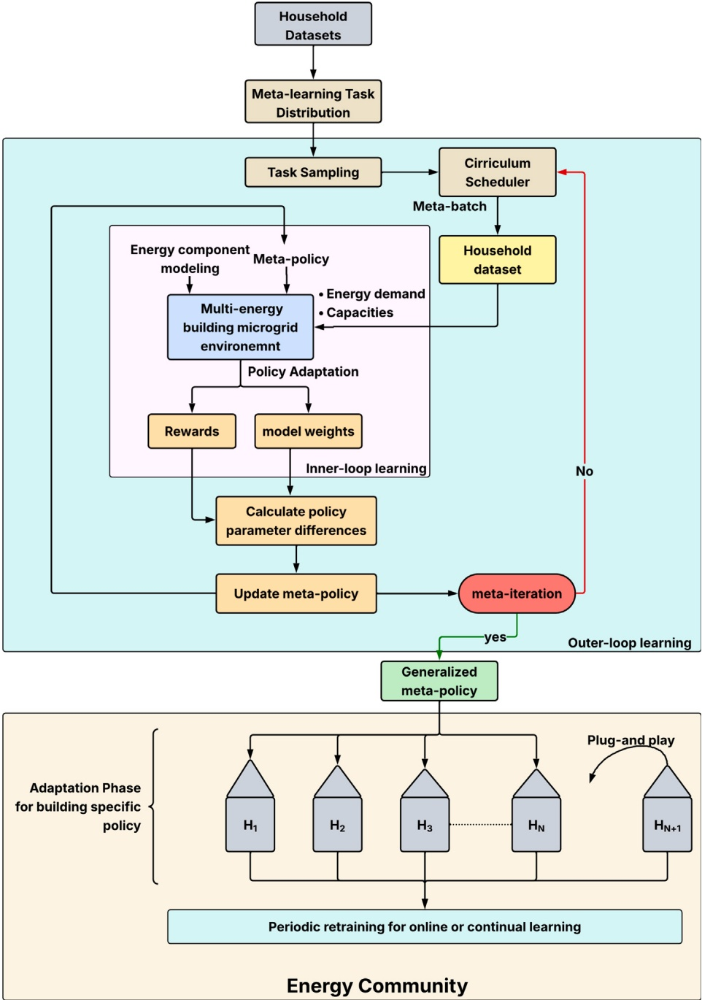

Fig. 1. Meta-RL framework showing data processing, training, and deployment for multi-energy building microgrid energy management.

## 3.1.2. Battery energy storage systems

**The battery was modeled using a simplified state-of-charge (SOC) model [44] shown below,**

$$
\mathrm{SOC}(t + 1) = \mathrm{SOC}(t) + \frac{\eta_{\mathrm{ch}} P_{\mathrm{ch}}(t) - P_{\mathrm{dis}}(t) / \eta_{\mathrm{dis}}}{E_{\mathrm{bat}}^{\mathrm{cap}}} \Delta t\tag{3}
$$

**where** $\eta _ { \mathrm { c h } }$ **and** $\eta _ { \mathrm { d i s } }$ **represent charging and discharging efficiencies,** $P _ { \mathrm { c h } } ( t )$ and $P _ { \mathrm { d i s } } ( t )$ **are charging and discharging powers, and** $E _ { \mathrm { b a t } } ^ { \tt c a p }$ is the battery **cap**acity. The model enforces physical constraints:

$$
0 \leq \operatorname { S O C } ( t ) \leq 1\tag{4}
$$

$$
0 \leq P_{\mathrm{ch}}(t) \leq \min(P_{\mathrm{bat}}^{\max}, (1 - \mathrm{SOC}(t)) \times E_{\mathrm{bat}}^{\mathrm{cap}} / \Delta t)\tag{5}
$$

$$
0 \leq P_{ dis }(t) \leq \min(P_{bat }^{ max },  SOC (t) \times E_{bat }^{ cap } / \Delta t)\tag{6}
$$

## 3.1.3. Heatpump

**Heatpump was modeled with performance characteristics adapted from [47]. The coefficient of performance (COP) varies with ambient temperature given by the following equation,**

$$
\mathrm{COP}(T_{\mathrm{amb}}) = 6.08 - 0.0941 \times \Delta T + 0.000464 \times \Delta T^2\tag{7}
$$

**where** $\Delta T = T _ { \mathrm { s i n k } } - T _ { \mathrm { a m b } }$ **represents the temperature lift between the heat sink (typically** $4 0 \; ^ { \circ } \mathbf { C }$ **for space heating) and ambient temperature. The electrical power consumption of the heat pump is expressed as,**

$$
P_{\mathrm{HP,elec}}(t)=\frac{Q_{\mathrm{HP}}(t)}{\mathrm{COP}(T_{\mathrm{amb}}(t))}\tag{8}
$$

**where** $Q _ { \mathrm { H P } } ( t )$ **is the thermal output and** $P _ { \mathrm { H P , e l e c } } ( t )$ **contributes to the total electrical load of the microgrid.**

**The environment captures critical electrical-thermal coupling effects where heat pump operation contributes to electrical loads and** **thermal comfort requirements. Battery storage decisions must consider immediate electrical demands and anticipated thermal loads.**

Household-D2 (29.0 MWh/year)

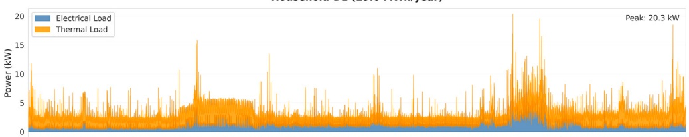

Household-D11 (21.2 MWh/year)

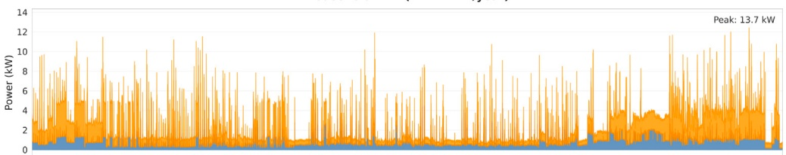

Household-A30 (24.6 MWh/year)

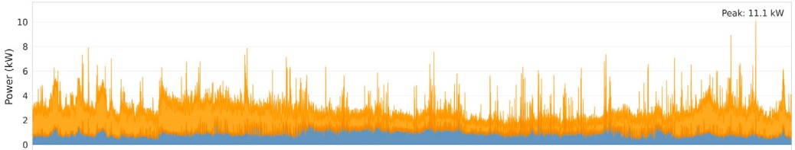

Household-A6 (30.5 MWh/year)

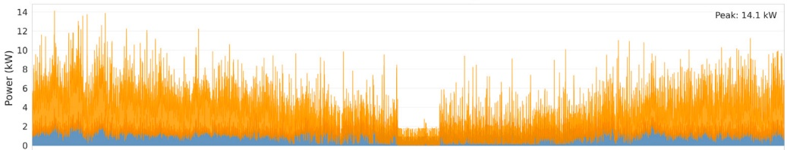

Household-C8 (28.6 MWh/year)

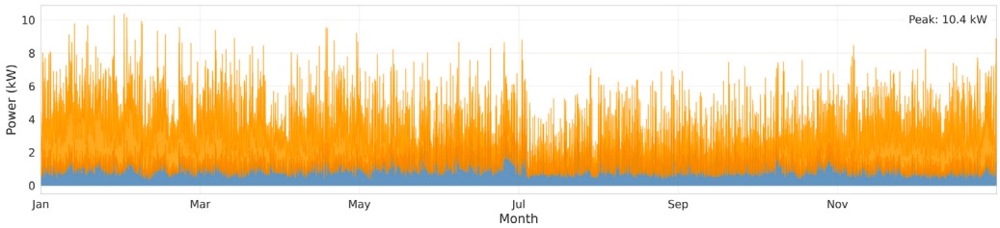

Fig. 2. Electrical (blue) and thermal (orange) annual load profiles for five representative Norwegian households. Labels denote the k-means consumption profile group (A–D) and household ID within that group (e.g., D2, A30), with selected households spanning multiple groups to reflect diverse consumption behaviors [42].

## 3.2. State space design and observability

**The observation space was designed to provide the RL agent with comprehensive situational awareness, while maintaining computational tractability. The 18-dimensional state vector** $\mathbf { s } _ { t } \in \mathbb { R } ^ { 1 8 }$ **is structured as a dictionary of continuous values, enabling the use of multi-input policy architectures.**

## 3.2.1. Core system state variables

**The immediate physical and economic states are captured as follows:**

$$
\mathbf{s}_{ core } = \left[ P_{ PV }(t), P_{ load }(t), Q_{ heat }(t), \lambda(t), SOC (t) \right]^T\tag{9}
$$

**where** $P _ { \mathrm { P V } } ( t ) \in [ 0 ,$ ∞) **represents PV generation,** $P _ { \mathrm { l o a d } } ( t ) \in [ 0 , \infty )$ **is electrical demand,** $Q _ { \mathrm { h e a t } } ( t ) \in [ 0 , \infty )$ **denotes thermal demand,** 𝜆(𝑡) ∈ [0, ∞) **is the electricity price signal, and** $\mathrm { S O C } ( t ) \in [ 0 , 1 ]$ **represents the normalized battery state of charge.**

## 3.2.2. Temporal and contextual features

**To enable time-aware decision-making and seasonal adaptation, the state includes encoded temporal information as follows:**

$$
\mathbf { s } _ { \mathrm { t e m p o r a l } } = \left[ h ( t ) , s ( t ) , m ( t ) , T _ { \mathrm { a m b } } ( t ) \right] ^ { T }\tag{10}
$$

**where** $h ( t ) \in [ 0 , 2 3 ]$ **represents the hour of the day,** $s ( t ) \in \{ 0 , 1 , 2 , 3 \}$ en**codes the season winter,spring,autumn,summer,** $m ( t ) \in [ 1 , 1 2 ]$ **indicates the month, and** $T _ { \mathrm { a m b } } ( t ) \in [ - 5 0 , 5 0 ]$ captures the **amb**ient tempera**ture. Temporal encoding enables agents to learn daily, seasonal, and weather-dependent patterns.**

## 3.2.3. Historical action feedback

**The state space incorporates feedback from previous actions to improve learning stability and enable sequential decision-making.**

$$
\mathbf { s } _ { \mathrm { h i s t o r y } } = [ \mathbf { a } _ { t - 1 } , \mathbf { P } _ { \mathrm { a c t u a l } , t - 1 } ] ^ { T }\tag{11}
$$

where $\mathbf { a } _ { t - 1 } = [ a _ { \mathrm { g r i d } , t - 1 } , a _ { \mathrm { b a t } , t - 1 } , a _ { \mathrm { h p } , t - 1 } ] ^ { T }$ represents the previous normalized actions, and $\mathbf { P } _ { \mathsf { a c t u a l } , t - 1 }$ contains the resulting actual power flows (battery charge/discharge, **grid** import/export, heat pump gen**eration/consumption).**

**Historical feedback provides information about action effectiveness, stabilizes training, and learns system dynamics and constraints through experience.**

## 3.3. Action space formulation

**The action space** $\mathcal { A } \subset \mathbb { R } ^ { 3 }$ **is designed as a continuous, normalized space that enables direct policy gradient updates. The three**dimensional action vector $\mathbf { a } _ { t }   =   [ a _ { \mathrm { g r i d } } , a _ { \mathrm { b a t } } , a _ { \mathrm { h p } } ] ^ { T }$ **provides control over energy interactions:**

$$
a _ { \mathrm { g r i d } } \in [ - 1 , 1 ] \quad \mathrm { ( G r i d ~ p o w e r ~ c o n t r o l ) }\tag{12}
$$

$$
a _ { \mathrm { b a t } } \in [ - 1 , 1 ] \quad \mathrm { ( B a t t e r y ~ p o w e r ~ c o n t r o l ) }\tag{13}
$$

$$
a _ { \mathrm { h p } } \in [ 0 , 1 ] \quad \mathrm { ( H e a t ~ p u m p ~ c a p a c i t y ~ f a c t o r ) }\tag{14}
$$

**The normalization to unit intervals enables the use of standard activation functions (e.g.,** tanh **for bidirectional actions and sigmoid for unidirectional actions) and facilitates stable policy learning. The normalized control actions were scaled to physical power values by the environment:**

$$
P _ { \mathrm { g r i d } } ( t ) = a _ { \mathrm { g r i d } } \times P _ { \mathrm { g r i d } } ^ { \mathrm { m a x } }\tag{15}
$$

$$
P _ { \mathrm { b a t } } ( t ) = a _ { \mathrm { b a t } } \times P _ { \mathrm { b a t } } ^ { \mathrm { m a x } }\tag{16}
$$

$$
Q_{\mathrm{hp}}(t) = a_{\mathrm{hp}} \times Q_{\mathrm{hp}}^{\max}\tag{17}
$$

**where positive values indicate import/charging and negative values indicate export/discharging for bidirectional components. The heat pump action directly controls thermal output, with electrical consumption determined by the temperature-dependent COP model in 3.1.3. The continuous action formulation enables fine-grained control for pre-cise power management and economic optimization while promoting smooth policies that improve system stability. The bounded normalized action space facilitates efficient exploration and ensures policy transferability across different system capacities.**

## 3.4. Multi-objective reward function design

**The reward function addresses the inherent multi-objective nature of microgrid optimization through a weighted combination of specialized reward components, each targeting specific operational objective.**

## 3.4.1. Economic reward component

**The total economic reward given by Eq. (18),** $R _ { \mathrm { e c o n } } ( t ) ,$ **, comprises three fundamental elements. The revenue generated from grid exports given by Eq. (19), costs incurred from grid imports given by Eq. (20), and savings achieved through local energy utilization to satisfy demand given by Eq. (21).**

$$
R _ { \mathrm { e c o n } } ( t ) = R _ { \mathrm { e x p o r t } } ( t ) - C _ { \mathrm { i m p o r t } } ( t ) + S _ { \mathrm { l o c a l } } ( t )\tag{18}
$$

**where**

$$
R _ { \mathrm { e x p o r t } } ( t ) = \lambda _ { \mathrm { e x p o r t } } ( t ) P _ { \mathrm { e x p o r t } } ( t )\tag{19}
$$

$$
C _ { \mathrm { i m p o r t } } ( t ) = \lambda _ { \mathrm { i m p o r t } } ( t ) P _ { \mathrm { i m p o r t } } ( t )\tag{20}
$$

$$
S_{ local }(t) = \lambda_{ import }(t)\left[P_{ PV  \rightarrow  load }(t) + P_{bat  \rightarrow  load }(t)\right]\tag{21}
$$

**where** $\lambda _ { \mathrm { i m p o r t } } ( t )$ **and** $\lambda _ { \mathrm { e x p o r t } } ( t )$ **are the import and export price at time** $t ,$ and $P _ { \mathrm { i m p o r t } } ( t )$ and $\bar { P _ { \mathrm { e x p o r t } } } ( t )$ denotes the power **import**ed and **export**ed from the grid. The variables $P _ { \mathrm { P V \rightarrow l o a d } } ( t )$ **and** $P _ { \mathrm { b a t } \rightarrow \mathrm { l o a d } } ( t )$ **represent the power flows from photovoltaic and battery systems to the load, respectively.**

## 3.4.2. Energy balance and system stability

**The energy balance reward** $R _ { b a l a n c e } ( t )$ **ensures fundamental energy conservation and system stability:**

$$
\begin{aligned}R_{ balance }(t) = -\alpha_{1}\left(\frac{E_{ excess }(t)}{P_{ ref }}\right)^{2} - \alpha_{2}\left(\frac{E_{ shortage }(t)}{P_{ ref }}\right)^{2} \\- \beta_{1}\left(\frac{Q_{ excess }(t)}{Q_{ ref }}\right)^{2} - \beta_{2}\left(\frac{Q_{ shortage }(t)}{Q_{ ref }}\right)^{2}\end{aligned}\tag{22}
$$

**(23)**

**where** $E _ { \mathrm { e x c e s s / s h o r t a g e } }$ **and** $Q _ { \mathrm { e x c e s s / s h o r t a g e } }$ **represent electrical and thermal energy imbalances, normalized by reference powers** $P _ { \mathrm { r e f } }$ **and** $Q _ { \mathrm { r e f } } .$ **The quadratic penalty structure provides increasingly severe penalties for larger violations. Energy balance was modeled as a reward rather than a hard constraint since hard constraints could create infeasible action spaces that limit exploration and destabilize training. Moreover, the reward function incorporates a quadratic penalty term that penalizes larger violations while maintaining tolerance for minor deviations, enabling trade-off analysis.**

## 3.4.3. State-of-charge maintenance reward function

**The SOC maintenance reward function** $R _ { S O C } ( t )$ provides soft con**straints that guide battery operation toward mid-SOC ranges, minimizing capacity fade and cycle aging. This complements the hard constraints** $0 \leq \mathsf { S O C } \leq 1$ **by balancing energy availability with battery health by avoiding degradation-inducing boundary conditions.**

**The SOC reward function operates in a three-zone piecewise struc**ture: optimal range $( 0 . 4 \leq \mathrm { S O C } \leq 0 . 6 )$ **with** maximum reward, acceptable ranges $( ( 0 . 2 \leq \mathrm { S O C } < 0 . 4$ **and** $0 . 6 < \mathrm { S O C } \leq 0 . 8 ) )$ **with** linear penalties, and violation zones $( \mathrm { S O C } < 0 . 2$ or $\mathsf { S O C }   >   0 . 8 )$ with **quadratic penalties, enabling performance-longevity trade-offs through gradient-based optimization.**

$$
\begin{aligned} &R_{ SOC }(t)=\left\{\begin{aligned}\\ &R_{\max } & &  if   S_{L} \leq S \leq S_{H} \\&R_{\max } \cdot \frac{S-S_{\min }}{S_{L}-S_{\min }} & &  if   S_{\min } \leq S < S_{L} \\&R_{\max } \cdot \frac{S_{\max }-S}{S_{\max }-S_{H}} & &  if   S_{H} < S \leq S_{\max } \\&-R_{ penalty }\left(\frac{S_{\min }-S}{S_{\min }}\right)^{2} & &  if   S < S_{\min } \\&-R_{ penalty }\left(\frac{S-S_{\max }}{1-S_{\max }}\right)^{2} & &  if   S > S_{\max }\\ &\end{aligned}\right.\\ \end{aligned}\tag{24}
$$

**where** $S = \mathrm { S O C } ( t ) ,   [ S _ { L } , S _ { H } ] = [ 0 . 4 , 0 . 6 ]$ **(optimal range),** $[ S _ { \mathrm { m i n } } , S _ { \mathrm { m a x } } ] =$ [0.2, 0.8] **(acceptable limits),** $R _ { \operatorname* { m a x } } = 1 . 0 ,$ and $R _ { \mathrm { p e n a l t y } } = 0 . 5 .$

## 3.4.4. Renewable energy maximization reward

**The renewable maximization reward function** $R _ { \mathrm { r e n e w } } ( t )$ **promotes efficient PV utilization and self-consumption to reduce grid dependency. This component guides the agent toward policies that maximize renewable energy usage while prioritizing local consumption over grid export, supporting energy autonomy goals.**

**The renewable reward function quantifies PV utilization efficiency through a two-component structure:**

$$
R_{\mathrm{remew}}(t)=\frac{P_{\mathrm{PV,util}}(t)}{P_{\mathrm{PV}}(t)}+\gamma\cdot\frac{P_{\mathrm{PV,self}}(t)}{P_{\mathrm{PV}}(t)}\tag{25}
$$

**where the** $\mathbf { p v }$ **power allocation components are defined as:**

$$
P _ { \mathrm { P V , u t i l } } ( t ) = P _ { \mathrm { P V \rightarrow l o a d } } ( t ) + P _ { \mathrm { P V \rightarrow b a t } } ( t ) + P _ { \mathrm { P V \rightarrow g r i d } } ( t )\tag{26}
$$

$$
P_{\mathrm{PV,self}}(t) = P_{\mathrm{PV \to load}}(t) + P_{\mathrm{PV \tobat}}(t)\tag{27}
$$

**The reward structure combines PV utilization with weighted self-consumption, where parameter** $\gamma$ enables tunable preference for en**ergy autonomy. This differentiable formulation supports gradient-based learning while encouraging policies that maximize renewable energy capture and minimize curtailment.**

## 3.4.5. Action correction and constraint guidance

**The action correction component** $R _ { \mathrm { a c t \_ c o r r e c t } } ( t )$ provides guided learn**ing by penalizing physically infeasible or suboptimal actions:**

$$
R _ { \mathrm { a c t \_ c o r r e c t } } ( t ) = - \sum _ { i } \omega _ { i } \left( \frac { V _ { i } ( t ) } { P _ { \mathrm { r e f } } } \right) ^ { 2 }\tag{28}
$$

**where** $V _ { i } ( t )$ **represents various violation types (excess/shortage in grid import/export, battery charge/discharge) and** 𝜔𝑖 **are component-specific penalty weights. This ‘‘training wheels’’ approach accelerates learning by providing immediate feedback on action quality.**

## 3.4.6. Composite reward function

**The total reward combines all components through predefined weights:**

$$
\begin{aligned}R_{ total }(t) = & w_{ economic }R_{ economic }(t) + w_{ balance }R_{ balance }(t) + w_{ SOC }R_{ SOC }(t) \\& + w_{ren }R_{ recent }(t) + w_{ corner }R_{ act , correct }(t)\end{aligned}\tag{29}
$$

**The multi-component reward structure enables multi-objective optimization through weighted combinations that balance competing objectives (economics, reliability, sustainability) according to system priorities. Action correction penalties guide the agent toward feasible action spaces while providing dense reward signals that mitigate sparse reward issues and facilitate faster convergence.**

**Physical constraints for battery operation (SOC and charging/discharging limits), heat pump operation, and grid interaction (import/ export capacity) were enforced using dual mechanisms. Hard constraints (equipment power ratings and absolute SOC bounds) are implemented via action clipping at the environmental level to prevent physically impossible actions. Soft constraints (energy balance and preferred SOC operating ranges) are incorporated through quadratic penalty terms in the reward function (Section 3.4), enabling the agent to make economically justified trade-offs while maintaining operational safety for the gradient-based learning. This comprehensive design ensures learned policies maintain acceptable performance across all operational objectives, reflecting the complex nature of microgrid optimization.**

## 4. Meta-learning framework

**Meta-reinforcement learning for building microgrid energy management requires a fundamentally different approach compared to traditional single-task reinforcement learning. The workflow consists of three essential components: diverse task generation, meta-learning framework, and model adaptation, which are discussed in the following sections.**

## 4.1. Data engineering for meta-learning task

**An effective meta-learning framework for adaptive energy management relies on the design of a diverse distribution of related, but distinct, tasks. Each task represents a building with unique consumption patterns, preferences, and configuration. This diversity enables the model to learn generalizable adaptation strategies.**

**The task distribution pipeline shown in Fig. 3 transforms Norwegian building energy data into a meta-learning distribution dataset for building energy management. Buildings were configured with heterogeneous parameters: capacities of energy components, battery storage parameters, and heat pump specifications, creating diversity with unique state spaces and objectives. This diversity provides implicit guidance about promising approaches for different building types, reducing trial-and-error time by focusing on strategies likely to succeed. The training also prepares the system for variability in consumption patterns, equipment efficiency, and behavioral preferences rather than assuming idealized conditions.**

## 4.1.1. Curriculum learning

**Applying meta-reinforcement learning to multi-energy building microgrid management presents unique challenges. Traditional approaches that expose the meta-learning agent to the full complexity of the problem space from the outset often result in unstable training dynamics and high variance in adaptation performance. This instability is particularly pronounced in the current research settings because of the heterogeneity across buildings and drastic seasonal variations, causing a generation-demand mismatch.**

**Seasonal variation has been a critical challenge in building microgrid energy management. Winter heating demands follow inverse patterns with solar generation availability, requiring fundamentally different optimal policies across seasons. A straightforward approach is to use the complete annual cycles before meta-policy updates. However, that increases computational burdens with extremely slow learning progress and does not leverage the inherent problem structure to learn daily & weekend consumption and seasonal patterns from limited but efficient data.**

**To address these challenges, a structured curriculum learning approach was designed to progressively increase building diversity and seasonal variations . The curriculum design is motivated by the principle of compositional complexity, which states that complex behaviors can be more effectively learned by first mastering simpler component skills [40].**

**In this study, two contrasting curriculum approaches were designed to investigate optimal training strategies for meta-RL. Curriculum-1 (Table 2) employed a 7-stage seasonal progression, beginning with summer-only scenarios for 450 iterations before gradually introducing spring, autumn, and winter conditions, while simultaneously expanding the building pool from 15 to 60. The days-per-season parameter decreased from 8 to 2 across stages, ensuring that the horizon was constant for the entire training.**

**Conversely, Curriculum-2 (Table 3) implements a simple 3-stage approach with all four seasons present from the outset (fixed seven days each per season), focusing solely on building complexity progression from the easiest 20 to all 60 buildings. During the training period, a stochastic sampling method was used to expose the meta-learner to each training building in multiple seasonal contexts, weather conditions, and operational scenarios. This extensive sampling combined with disjoint validation ensures learned adaptation mechanisms generalize to unseen building characteristics rather than memorizing specific training patterns. The specific stage lengths and season/day selections were determined empirically through preliminary training runs, guided by observed meta-learning dynamics including gradient stability and performance progression across stages.**

**The rationale behind selecting these two approaches was to test whether meta-learning benefits from gradual seasonal complexity (curriculum-1) or full seasonal exposure with progressive building diversity (curriculum-2). Curriculum-1 allows incremental development of season-specific policies, potentially enabling better feature reuse, while Curriculum-2’s constant seasonal exposure may yield more robust policies at the cost of slower training.**

**The approach transforms the high-variance and unstable training into structured learning with lower variance and superior generalization. The curriculum manager, as shown in Fig. 3, samples the meta-task batch with the corresponding building energy system characteristics that the framework uses in the next stage for training and finding the optimal generalized meta-policy.**

## 4.2. Meta-learning training

**Recent theoretical analysis by [48] established that the Reptile algorithm converges to similar stationary points as MAML, validating the algorithmic choice from a theoretical perspective. Furthermore, Reptile-based meta-learning provides implicit regularization promoting the generalization across the diverse building distribution even with**

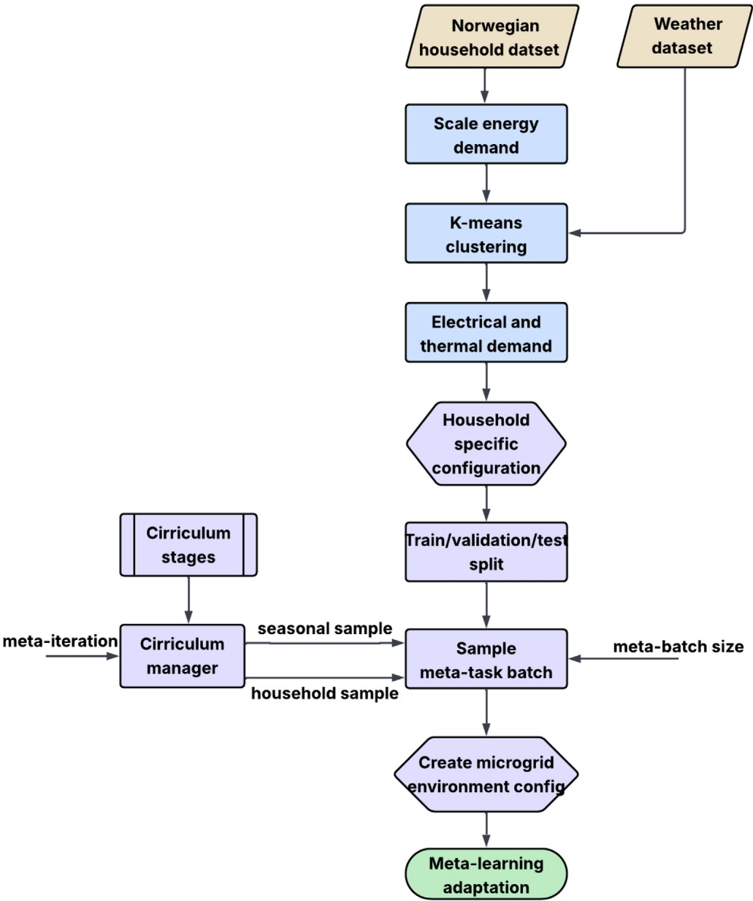

Fig. 3. Dataset processing, task distribution, and sampling pipeline for meta-learning framework.

Table 2

Curriculum-1: progressive seasonal complexity.

| Stage | Iterations | Buildings | Seasons | Days/Season | Objective |
| --- | --- | --- | --- | --- | --- |
| 1 | 0-250 | 15 | Summer | 8 | Foundation skills with high PV |
| 2 | 250-450 | 25 | Summer | 8 | Expanded building diversity |
| 3 | 450-700 | 30 | Summer, Spring | 4 | Multi-seasonal adaptation |
| 4 | 700-1000 | 45 | Spring, Autumn | 4 | Transitional season mastery |
| 5 | 1000-1400 | 60 (all) | Winter | 8 | Peak demand, no PV challenge |
| 6 | 1400-1700 | 60 (all) | Winter, Autumn | 4 | Rapid seasonal switching |
| 7 | 1700-2800 | 60 (all) | All seasons | 2 | Full complexity mastery |

Table 3

Curriculum-2: progressive building complexity.

| Stage | Iterations | Buildings | Seasons | Days/Season | Objective |
| --- | --- | --- | --- | --- | --- |
| 1 | 0-700 | 20 | All 4 seasons | 7 | Easy buildings |
| 2 | 700-1400 | 40 | All 4 seasons | 7 | Medium complexity buildings |
| 3 | 1400-2100 | 60 | All 4 seasons | 7 | Full building diversity |

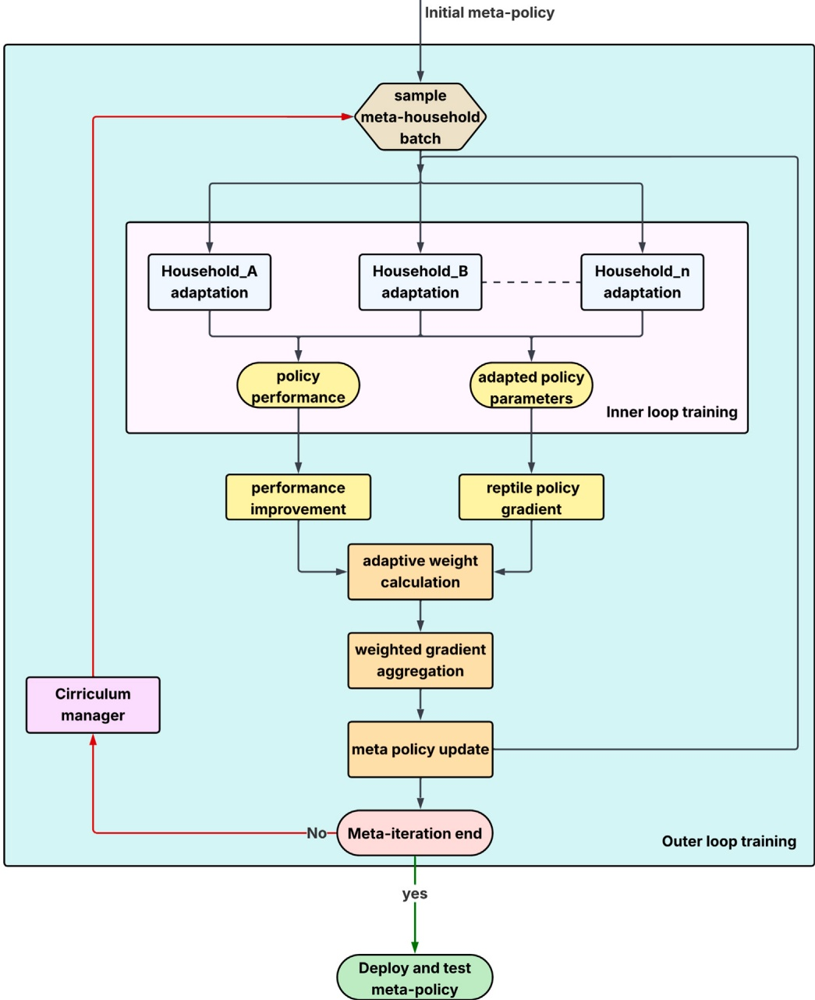

Fig. 4. Adaptive reptile meta-learning algorithm for multi-energy building microgrid energy management.

**limited data [39]. Hence, Reptile is used as the meta-learning algorithm, and the framework shown in Fig. 4 shows the meta-RL training to get the generalized optimal meta-policy.**

**The multi-energy building energy management problem is formulated as a distribution of tasks** $\begin{array} { r l r } { \mathcal { T } } & { { } = } & { \{ T _ { 1 } , T _ { 2 } , \ldots , T _ { N } \} } \end{array}$ **, where each task** $T _ { i }$ **represents a unique building characterized by building-specific characteristics** $H _ { i }$ and $S _ { i }$ **representing seasonal and weather conditions affecting energy dynamics**

$$
T _ { i } = \{ H _ { i } , S _ { i } \}\tag{30}
$$

**The meta-learning objective is to seek optimal meta-parameters** $\theta _ { \mathrm { m e t a } } ^ { * }$ **that minimize the expected loss** $\mathbb { E } _ { T _ { i } \sim \mathcal { T } }$ **across the task distribution after task-specific adaptation, given as follows:**

$$
\theta _ { \mathrm { m e t a } } ^ { * } = \arg \operatorname* { m i n } _ { \theta } \mathbb { E } _ { T _ { i } \sim \mathcal { T } } \left[ \mathcal { L } _ { T _ { i } } ( \theta _ { i } ^ { * } ( \theta ) ) \right]\tag{31}
$$

**where** $\mathcal { L } _ { T _ { i } } ( \theta _ { i } ^ { * } ( \theta ) )$ **is the loss function for task** $T _ { i }$ **evaluated at the adapted parameters,** $\theta _ { i } ^ { * } ( \theta )$ represents the adapted parameters obtained by fine**tuning the meta-parameters** $\theta$ **on task** $T _ { i } .$ **This bi-level optimization** **structure enables the framework to learn generalizable knowledge and rapid adaptation mechanisms.**

**For each building task** $T _ { i } ,$ **the inner loop performs** $K _ { \mathsf { a d a p t } }$ **s**teps **of gradient-based optimization using Proximal Policy Optimization (PPO) [49] given by Eq. (32).** $\theta _ { i } ^ { ( k + 1 ) }$ **represents the updated parameters for task** 𝑖 **after adaptation step** $k + 1$ **, while** $\theta _ { i } ^ { ( k ) }$ **denotes the current parameters for task** 𝑖 **at adaptation step** 𝑘**. The inner-loop learning rate at step** 𝑘 is $\alpha _ { \mathrm { i n n e r } } ^ { ( k ) } ,   \nabla _ { \theta } J _ { i } ( \theta _ { i } ^ { ( k ) } )$ **is the policy gradient for task** 𝑖 **(building) evaluated at current parameters, and** $J _ { i }$ **represents the task-specific objective function (expected reward for building** $i ) .$

$$
\theta _ { i } ^ { ( k + 1 ) } = \theta _ { i } ^ { ( k ) } - \alpha _ { \mathrm { i n n e r } } ^ { ( k ) } \nabla _ { \theta } J _ { i } ( \theta _ { i } ^ { ( k ) } )\tag{32}
$$

**Since the building adaptation in the inner-loop is computationally independent, the adaptation is parallelized through Ray’s distributed computing framework [50,51]. Hence, the training time is significantly reduced by transforming the sequential adaptation process using parallelization while maintaining the algorithm’s convergence and enabling efficient deployment at the community scale.**

Table 4

Adaptive weighting methods for gradient aggregation.

| Method | Weight Computation | Description |
| --- | --- | --- |
| Log_transform | $\varDelta _ { i } = J _ { i } ( \theta _ { i } ^ { \prime } ) - J _ { i } ( \theta _ { \mathrm { m e t a } } )$ $\tilde { \varDelta } _ { i } = \varDelta _ { i } - \operatorname* { m i n } _ { j } \varDelta _ { j } + \epsilon$ $\begin{array} { r } { w _ { i } ^ { \mathrm { r a w } } = \exp \left( \frac { \log ( \tilde { \lambda } _ { i } ) } { \tau / 1 0 } \right) } \end{array}$ $\begin{array} { r } { \hat { w } _ { i } = \frac { w _ { i } ^ { \mathrm { r a w } } } { \sum _ { j = 1 } ^ { N } w _ { j } ^ { \mathrm { r a w } } } } \end{array}$ | Applies logarithmic transformation to performance improvements; reduces influence of outliers while preserving relative ordering |
| rank_based | $r _ { i } = \mathrm { r a n k } ( \Delta _ { i } ) \in \{ 1 , 2 , \ldots , N \}$ $w _ { i } ^ { \mathrm { r a w } } = \sqrt { r _ { i } }$ $\begin{array} { r } { \hat { w } _ { i } = \frac { w _ { i } ^ { \mathrm { r a w } } } { \sum _ { j = 1 } ^ { N } w _ { j } ^ { \mathrm { r a w } } } } \end{array}$ | Uses ordinal ranking to compute weights; robust to extreme values and ensures stable gradient aggregation |
| Adaptive_softmax | $\mathrm { I Q R } = Q _ { 7 5 } ( \varDelta ) - Q _ { 2 5 } ( \varDelta )$ $\begin{array} { r } { \tau _ { \mathrm { a d a p t i v e } } = \tau \cdot \left( 1 + \frac { \mathrm { I Q R } } { \| \mathrm { m e d i a n } ( \varDelta ) \| + \epsilon } \right) } \end{array}$ $\tilde { \varDelta } _ { i } = \varDelta _ { i } - \mathrm { m e d i a n } ( \varDelta )$ $w _ { i } ^ { \mathrm { r a w } } = \exp \left( \frac { \tilde { \alpha } _ { i } } { \tau _ { \mathrm { a d a p t i v e } } } \right)$ $\begin{array} { r } { \hat { w } _ { i } = \frac { w _ { i } ^ { \mathrm { r a w } } } { \sum _ { j = 1 } ^ { N } w _ { j } ^ { \mathrm { r a w } } } } \end{array}$ | Dynamically adjusts temperature based on performance distribution; adapts to varying task difficulties automatically |

**For the meta-update, the gradients are computed as the displacement between adapted and initial parameters, given in Eq. (33). This formulation considers the direction and magnitude of parameter updates required for optimal performance on building** 𝑖**, encoding taskspecific knowledge in the gradient space.**

$$
\mathbf { g } _ { i } = \theta _ { i } ^ { \mathrm { a d a p t e d } } - \theta _ { \mathrm { m e t a } } ^ { ( t ) }\tag{33}
$$

**Standard Reptile employs uniform averaging across all buildings which may degrade meta-learner with noisy updates by equally weighing poorly-adapted and well-adapted buildings. Therefore an adaptive weighted aggregation strategy is developed, given by Eq. (34). The formulation prioritizes successful adaptations while down-weighting erratic or poor-performing outliers to create a more stable learning process. Table 4 shows the weighting strategies tested, which are discussed further in hyperparameter tuning.**

$$
\overline { { \mathbf { g } } } = \sum _ { i = 1 } ^ { N } \hat { w } _ { i } \mathbf { g } _ { i } ,\tag{34}
$$

**Additionally, to ensure numerical stability, aggregated gradients are** $\ell _ { 2 }$ **norm clipped as shown in Eq. (35)** $( \tau _ { \mathrm { c l i p } } ~ = ~ 1 . 0 )$ **, preventing catastrophic updates and divergence, while allowing higher learning rates to accelerate meta-learning.**

$$
\mathbf { \overline { { g } } } _ { \mathrm { c l i p p e d } } = \left\{ \begin{aligned} & \mathbf { \overline { { g } } } & & \mathrm { i f } \| \mathbf { \overline { { g } } } \| _ { 2 } \leq \tau _ { \mathrm { c l i p } } \\ & \mathbf { \overline { { g } } } \cdot \frac { \tau _ { \mathrm { c l i p } } } { \| \mathbf { \overline { { g } } } \| _ { 2 } } & & \mathrm { o t h e r w i s e } \end{aligned} \right.\tag{35}
$$

**The meta-policy update follows the Reptile formulation with clipped gradients:**

$$
\theta _ { \mathrm { m e t a } } ^ { ( t + 1 ) } = \theta _ { \mathrm { m e t a } } ^ { ( t ) } + \alpha _ { \mathrm { m e t a } } ^ { ( t ) } \bar { \mathbf { g } } _ { \mathrm { c l i p p e d } }\tag{36}
$$

**This update rule efficiently incorporates knowledge from multiple buildings simultaneously. Unlike second-order methods like MAML, Reptile uses only first-order gradients, making it computationally feasible for large-scale deployments. Despite this simplicity, the update direction implicitly captures information about the task distribution, building a meta-policy that understands the standard structure across diverse buildings while retaining the flexibility to adapt to specific building characteristics.**

## 5. Results & discussions

**A systematic ablation study was conducted with 10 weight configurations** $( W 1   -   W 1 0 )$ **to determine the optimal weights for the multi-objective reward proposed in Section 3.4.6. The configuration was tested using RL approach to ensure computational efficiency while maintaining scientific validity. The performance was evaluated using the balance score calculated using Eq. (37) and self-consumption rate, renewable utilization, energy independence, and cost efficiency as** **metrics. A higher score indicates balanced performance as shown in Fig. 5(a) for the weight configurations in 5(b).**

Table 5

Inner-loop PPO hyperparameters search range.

| Hyperparameter | Symbol | Search Space |
| --- | --- | --- |
| Inner Learning Rate | 𝛼inner | [1.0 × 10-4,5.0 × 10-3] |
| Inner Batch Size | 𝐵inner | {256,512,1024} |
| Inner Epochs | 𝐸inner | {3,5,7} |
| Clipping Parameter | 𝜖clip | [0.15,0.30] |
| Entropy Coefficient | 𝑐ent | [5.0 × 10-4,5.0 × 10-2] |
| Value Function Coefficient | 𝑐vf | [0.3,0.7] |
| Gradient Clipping Threshold | gradclip | [0.3,1.0] |
| Discount Factor | 𝛾 | [0.95,0.999] |
| GAE Lambda | 𝜆GAE | [0.9,0.98] |

$$
\mathrm { B a l a n c e \_ s c o r e } = 1 - \sigma ( \mathrm { n o r m a l i z e d \_ m e t r i c s } )\tag{37}
$$

## 5.1. Hyperparameter tuning

**Reinforcement learning agents learn from evolving policy-generated data, creating extreme sensitivity to hyperparameter choices through compounding feedback loops. In energy management applications, high variance in reward signals across seasonal patterns and building behaviors amplifies this sensitivity, making precise hyperparameter optimization essential for stable convergence. In addition, meta-reinforcement learning algorithms introduce additional complexity through hierarchical optimization, where inner-loop hyperparameters control taskspecific adaptation to individual buildings. Conversely, outer-loop hyperparameters govern meta-learning for general policy improvement. This dual optimization creates complex interactions where hyperparameter choices at each level profoundly influence model performance and generalization capabilities.**

## 5.1.1. Inner-loop hyperparameters

**Table 5 shows the search space of the inner loop hyperparameters** used for model tuning. The choice of inner-loop learning rate $( \alpha _ { \mathrm { i n n e r } } )$ **controls policy adaptation without overshooting optimal buildingspecific strategies during limited adaptation steps. Batch sizes(** $( B _ { \mathrm { i n n e r } } )$ and epochs $( E _ { \mathrm { i n n e r } } )$ **balance the sample efficiency with computational efficiency, ensuring sufficient gradient updates per building while maintaining feasible training times. One of the critical parameters that controls the exploration of the policy to prevent premature convergence is entropy coefficient** $( c _ { \mathrm { e n t } } ) .$ **The discount factor parameter** 𝛾 **controls whether the agent optimizes for immediate gains or long-term rewards, whereas GAE** 𝜆 **influences the learning stability across varying building consumption patterns. Hence, the inner-loop parameters collectively enable rapid and stable adaptation to building-specific energy profiles while maintaining the policy diversity necessary for effective meta-learning across heterogeneous microgrid control tasks.**

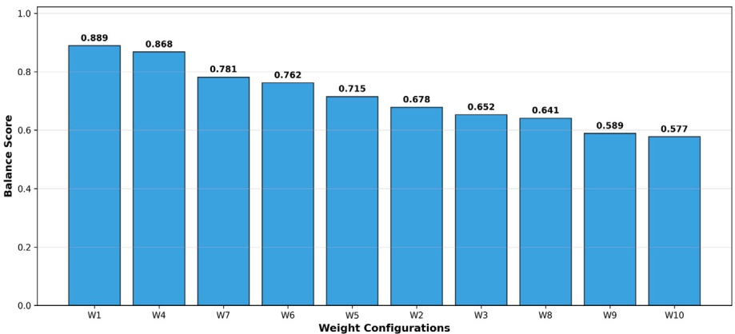

(a) Balance score comparison across weight configurations W1-W10

| Config | w_econ | w_ren | w_self | w_SOC | w_corr | w_balance |
| --- | --- | --- | --- | --- | --- | --- |
| W1 | 1.0 | 0.5 | 0.5 | 0.5 | 0.6 | 0.7 |
| W2 | 2.0 | 0.2 | 0.2 | 0.3 | 0.3 | 0.3 |
| W3 | 0.2 | 1.8 | 1.5 | 0.3 | 0.4 | 0.5 |
| W4 | 0.3 | 0.3 | 0.3 | 1.5 | 2.0 | 1.8 |
| W5 | 0.1 | 0.1 | 0.1 | 0.1 | 0.1 | 0.1 |
| W6 | 1.5 | 0.3 | 0.3 | 0.4 | 0.5 | 0.5 |
| W7 | 0.8 | 0.7 | 0.7 | 0.7 | 0.8 | 0.9 |
| W8 | 1.2 | 1.0 | 1.0 | 0.8 | 1.0 | 1.1 |
| W9 | 0.5 | 0.5 | 0.5 | 0.8 | 1.5 | 1.5 |
| W10 | 0.2 | 1.5 | 1.3 | 0.4 | 0.6 | 0.8 |

(b) Weight configuration matrix for ablation study testing.

Fig. 5. Balance score comparison across 10 weight configurations. W1 (current implementation) achieved the highest balance score of 0.889, demonstrating optimal multi-objective performance.

Table 6

Outer-loop meta-learning hyperparameters search range.

| Hyperparameter | Symbol | Search range |
| --- | --- | --- |
| Initial Meta Learning Rate | 𝛼mineitta | [5 × 10-6,5 × 10-4] |
| Minimum Meta Learning Rate | 𝛼mmeinta | [1 × 10-7,1 × 10-5] |
| Meta-Batch Size | \|meta\| | {2,4,8} |
| Adaptation Steps | 𝐾adapt | {8,12,16,20} |
| Gradient Aggregation Method | method | {Log, Rank, Softmax} |
| Temperature Parameter | 𝜏temp | [50,500] |
| Model Architecture | 𝜙arch | {[64], [128], [256], [64,64], [128,128],[256,256], [128,64], [64,128], [128,128,64],[64,128,64], [256,128,64]} |
| Activation Function | 𝜎act | {tanh, relu, elu} |

## 5.1.2. Outer-loop hyperparameters

$$
\alpha _ { \mathrm { m e t a } } ^ { ( t ) } = \alpha _ { \mathrm { m i n } } + \frac { 1 } { 2 } ( \alpha _ { \mathrm { i n i t i a l } } - \alpha _ { \mathrm { m i n } } ) \left( 1 + \cos \left( \frac { \pi t } { T _ { \mathrm { t o t a l } } } \right) \right)\tag{38}
$$

**Table 6 shows the outer-loop meta-learning hyperparameters to enable effective knowledge transfer across diverse building energy management tasks while maintaining training stability. The outer loop meta-learning rate used cosine annealing (Eq. (38)) from initial values** $( \alpha _ { \mathrm { m e t a } } ^ { \mathrm { i n i t } } )$ **t**o **min**imum thresholds $( \alpha _ { \mathrm { m e t a } } ^ { \mathrm { m i n } } ) ,$ **, ensuring aggressive early learning and gradually stabilizing as the meta-policy converges across** building types. The meta-batch size $( | \mathcal { B } _ { \mathrm { m e t a } } | )$ ensures balanced compu**tational efficiency with gradient variance, where larger batches provide more stable meta-updates and smaller batches enable faster iteration cycles. Adaptation steps** $( K _ { \mathrm { a d a p t } } )$ **determine the inner-loop budget for building-specific learning, requiring optimization between adaptation quality and computational cost per meta-iteration. The robust adaptive weighting strategies (log\_transform, rank\_based, adaptive\_softmax) discussed in Table 4 handle the heterogeneous building performance** distributions, with temperature parameters $( \tau _ { \mathrm { t e m p } } )$ controlling the bal**ance between exploiting high-performing adaptations and maintaining diversity across building types.**

Table 7

Meta-learning performance metrics.

| Symbol | Metric | Equation | Description |
| --- | --- | --- | --- |
| ī | Average Improvement | $\frac{1}{\left\| B_{\mathrm{metal}} \right\|} \sum_{i = 1}^{\left\| B_{\mathrm{metal}} \right\|} \left( J_{i}^{\mathrm{adapted}} - J_{i}^{\mathrm{initial}} \right)$ | Quantifies the adaptation of meta-policy to diverse buildings and higher values suggest stronger meta-learning. |
| $\sigma _ { I }$ | Standard Deviation of Improvement | $\sqrt { \frac { 1 } { \| B _ { \mathrm { m e t a } } \| } \sum _ { i = 1 } ^ { \| B _ { \mathrm { m e t a } } \| } ( I _ { i } - \bar { I } ) ^ { 2 } }$ | Measures adaptation consistency across buildings and lower values indicate robust and uniform meta-learning |
| IIII | Average Gradient Norm | $\begin{array} { r } { \frac { 1 } { \| B _ { \mathrm { m e t a } } \| } \sum _ { i = 1 } ^ { \| B _ { \mathrm { m e t a } } \| } \| \| \nabla _ { \theta } \mathcal { L } _ { i } ^ { \mathrm { a d a p t } } ( \theta ) \| \| _ { 2 } } \end{array}$ | Monitors learning signal magnitude; moderate values with good performance indicate stable meta-learning |

Table 8

Hyperparameter configurations for the selected models from different curriculum learning.

<table><tr><td rowspan="2">Hyperparameter</td><td colspan="3">C1: Seasonal Progression</td><td colspan="3">C2: Building Diversity</td><td rowspan="2">Summary</td></tr><tr><td>playful-glade</td><td>sage-silence</td><td>crimson-sun</td><td>youthful-brook</td><td>light-bird</td><td>dashing-bee</td></tr><tr><td>Meta-learning</td><td></td><td></td><td></td><td></td><td></td><td></td><td></td></tr><tr><td>Meta Batch Size</td><td>4</td><td>4</td><td>2</td><td>4</td><td>2</td><td>8</td><td>C2 varies more for building diversity</td></tr><tr><td>Meta LR (initial)</td><td>3.24e-4</td><td>7.23e-6</td><td>3.89e-5</td><td>1.41e-5</td><td>2.57e-4</td><td>3.50e-5</td><td>C2 lower rates for stable learning</td></tr><tr><td>Meta LR (min)</td><td>1.43e-6</td><td>9.32e-7</td><td>1.73e-6</td><td>1.35e-7</td><td>5.77e-7</td><td>1.36e-7</td><td>C2 avoids volatility with lower mins</td></tr><tr><td>Inner-loop</td><td></td><td></td><td></td><td></td><td></td><td></td><td></td></tr><tr><td>Adaptation Steps</td><td>8</td><td>16</td><td>16</td><td>8</td><td>12</td><td>12</td><td>C1 longer steps for sequential learning</td></tr><tr><td>Inner Batch Size</td><td>256</td><td>256</td><td>256</td><td>512</td><td>512</td><td>256</td><td>C2 larger batches for building diversity</td></tr><tr><td>Inner LR</td><td>9.89e-4</td><td>6.32e-4</td><td>1.45e-3</td><td>1.53e-4</td><td>4.03e-4</td><td>3.36e-4</td><td>C2 lower rates for stability</td></tr><tr><td>Inner Epochs</td><td>7</td><td>7</td><td>3</td><td>5</td><td>5</td><td>3</td><td>C1 more epochs for deep adaptation</td></tr><tr><td>Entropy Coeff</td><td>3.44e-3</td><td>5.35e-4</td><td>1.42e-2</td><td>7.52e-4</td><td>2.11e-2</td><td>2.24e-3</td><td>C2 higher entropy for exploration</td></tr><tr><td>Gamma</td><td>0.959</td><td>0.978</td><td>0.975</td><td>0.957</td><td>0.964</td><td>0.972</td><td>Similar long-term planning</td></tr><tr><td>Grad Clip</td><td>0.981</td><td>0.927</td><td>0.839</td><td>0.903</td><td>0.328</td><td>0.869</td><td>C2 light-bird uses aggressive clipping</td></tr><tr><td>Lambda</td><td>0.975</td><td>0.968</td><td>0.916</td><td>0.923</td><td>0.963</td><td>0.978</td><td>GAE parameter variation</td></tr><tr><td>VF Coeff</td><td>0.422</td><td>0.610</td><td>0.359</td><td>0.697</td><td>0.513</td><td>0.620</td><td>C2 prefers higher value emphasis</td></tr><tr><td>Model architecture</td><td></td><td></td><td></td><td></td><td></td><td></td><td></td></tr><tr><td>Architecture</td><td>[128]</td><td>[128, 128]</td><td>[64, 128]</td><td>[128, 128, 64]</td><td>[64, 128, 64]</td><td>[256, 128, 64]</td><td>C2 uses deeper networks for diversity</td></tr><tr><td>Activation</td><td>ELU</td><td>ELU</td><td>ReLU</td><td>ReLU</td><td>ELU</td><td>ReLU</td><td>C2 prefers ReLU</td></tr><tr><td>Temperature</td><td>109.1</td><td>166.7</td><td>397.6</td><td>265.6</td><td>183.5</td><td>387.0</td><td>C2 higher for constant exploration</td></tr><tr><td>Gradient Method</td><td>SOFTMAX</td><td>LOG</td><td>SOFTMAX</td><td>RANK</td><td>RANK</td><td>LOG</td><td>C2 favors RANK for normalization</td></tr></table>

**Meta-learning training and deployment depends on the model architecture and hence the search space explored diverse topologies from shallow single-layer networks ([64], [128], [256]) to deeper threelayer configurations ([256,128,64], [128,128,64]). Although shallow networks provide rapid adaptation owing to fewer parameters, they may lack the representational power to capture complex energy management patterns across diverse building types. In contrast, deeper architectures offer hierarchical feature extraction, where early layers can learn general energy dynamics and deeper layers specialize in management decisions, risking slower adaptation and potential overfitting to the meta-training distribution.**

**The activation function choices (ReLU, ELU, tanh) further control the learning dynamics of the network, with the sparsity of ReLU promoting faster adaptation and smooth gradients of ELU potentially improving the meta-gradient. Hence, the architectural decisions and outer-loop hyperparameters collectively determine the ability of metapolicy to serve as a practical initialization point for rapid buildingspecific adaptation while maintaining sufficient generality across the heterogeneous energy management domain.**

## 5.2. Model performance

**The hyperparameter search space was modeled using the Ray Tune library [52], deployed on a high-performance computing (HPC) cluster [53], and the training was monitored using the Wandb dashboard [54]. During model training, Average Improvement (**𝐼̄**) measures the meta-policy effectiveness to adapt to new buildings. The Standard** Deviation $( \sigma _ { I } )$ **reveals the consistency of the adaptation across diverse buildings and the Average Gradient Norm** $( \| \bar { \nabla } \| )$ **indicates the stability of the meta-gradient updates.**

**Ray Tune hyperparameter optimization evaluated multiple configurations based on the three meta-learning metrics described in Table 7.**

**Six high-performing models were selected: curriculum-1 (crimson-sun, playful-glade, sage-silence) and Curriculum-2 (dashing-bee, light-bird, youthful-brook-20). These models achieved the optimal balance of high average improvement with low variance while maintaining stable gradient norms. Table 8 shows the hyperparameter configurations of the selected models for each curriculum design, demonstrating the meta-learning performance throughout the training process.**

**The hierarchical optimization structure of the meta-RL framework incurs a training complexity of** $\mathcal { O } ( M \times N _ { \mathrm { m e t a } } \times K _ { \mathrm { i n n e r } } \times C _ { \mathrm { p p O } } ) ,$ **, where** 𝑀 **denotes meta-iterations,** $N _ { \mathrm { m e t a } }$ **the meta-batch size,** $K _ { \mathrm { i n n e r } }$ **inner adaptation steps, and** $C _ { \mathrm { P P O } }$ **the** per-update PPO cost. Critically, the **Reptile algorithm relies solely on first-order gradients, reducing the meta-update cost from** $\mathcal { O } ( | \theta | ^ { 2 } )$ **for second-order methods such as MAML to** (|𝜃|)**. In meta-RL, convergence at the outer loop is characterized by the stabilization of meta-gradients** $\| \bar { \nabla } \| _ { 2 }$ **as demonstrated in Figs. 6 and 7. The monotonically declining gradient norms of Curriculum-2 and the stage-wise recovery pattern of Curriculum-1, both stabilizing by the final training phase alongside consistent** 𝐼̄ **and low** $\sigma _ { I } ,$ **confirm convergence to robust meta-policy initialization points suitable for rapid building-specific adaptation.**

## 5.2.1. Curriculum performance

**Table 9 summarizes the how different models balance stability, exploration, and generalization under each curriculum. The two curricula produce fundamentally different meta-gradient landscapes (Figs. 6–7), and understanding the training dynamics is important for interpreting both the training behavior and the subsequent adaptation results.**

**The performance peaks in the winter stage for curriculum-1 models arise because Stage 5 exposes the meta-policy exclusively to winter conditions. A weak meta-policy baseline in the winter stage increases the adaptation gap, temporarily elevating** 𝐼̄**. As continued training incorporates winter into the meta-policy, the adaptation gap narrows,** **and** 𝐼̄ **stabilizes at a lower level. The progressive increase in gradient norms from early to mid-training across all curriculum-1 models reflects the meta-policy encountering increasing seasonal complexity at each curriculum stage and stabilization in late training indicates the meta-policy has learned a stable representation of the seasonal distribution.**

Training dynamics across selected models under both curriculum designs, highlighting the relationship between gradient behavior and generalization across seasonal and building diversity.

<table><tr><td>Curriculum</td><td>Model</td><td>Avg. improvement (ī)</td><td>Avg. gradient norm (∥∇∥I)</td><td>Std. dev. (σ1)</td><td>Meta-learning behavior</td></tr><tr><td rowspan="3">C1: Seasonal progression</td><td>playful-glade</td><td>~80 (stable throughout)</td><td>Low ~1.7-1.8</td><td>Stable (6–9)</td><td>Low σ, indicates stable adaptation; conservative gradients support cross-building generalization but limit exploration. High |∇|s with stable σ, indicates</td></tr><tr><td>sage-silence</td><td>~110; winter peak ~135-140</td><td>High ~3.7-4.2</td><td>Moderate (10–15)</td><td>sustained meta-learning; log-transform aggregation stabilizes reward scale variability across seasonal transitions without</td></tr><tr><td>crimson-sun</td><td>~115; winter peak ~155-165</td><td>High ~3.5–3.8</td><td>Moderate (8–12)</td><td>overfitting. High entropy sustains broad exploration across seasonal transitions; winter-stage σ, peaks reflect curriculum-induced shifts rather than instability.</td></tr><tr><td rowspan="3">C2: Building diversity</td><td>youthful-brook</td><td>~265; gradual decline from ~290</td><td>Very stable ~1.75-1.80</td><td>Moderate (25–40)</td><td>Most stable |V| across models; rank-based aggregation normalizes heterogeneous building signals, ensuring consistent meta-updates as diversity grows.</td></tr><tr><td>light-bird</td><td>~215; declining from ~230</td><td>Moderate ~2.7–2.9</td><td>Stable (15–25)</td><td>Lowest σ1 among C2 models; small meta-batch limits building coverage per update but ensures consistent adaptation throughout training. Declining σ, indicates progressive</td></tr><tr><td>dashing-bee</td><td>~260; gradual decline from ~265</td><td>Very stable ~2.5</td><td>Decreasing (~60→40)</td><td>consolidation of building-invariant representations; large meta-batch (8) averages diversity per update, driving convergence.</td></tr></table>

**Unlike Curriculum-1, Curriculum-2 exhibits no performance peaks — since all four seasons are present from the outset, the optimization landscape does not shift drastically across training stages. Instead,** 𝐼̄ **declines gradually across the three building diversity stages, which reflects a positive consolidation mechanism: as the meta-policy is exposed to progressively more diverse building profiles, it develops a stronger generalized initialization, improving the meta-policy baseline and consequently narrowing the adaptation gap. The stable gradient norms throughout training confirm that this declining** 𝐼̄ **indicates the meta-policy continues receiving consistent gradient signals while consolidating across the growing building distribution.**

**Together, these training dynamics confirm that both curricula produce well-formed meta-policies through structurally different learning pathways, with the adaptation results on unseen buildings determining which pathway yields superior generalization.**

## 5.3. Model adaptation

**The trained generalized meta-policy was deployed on unseen buildings to learn building-specific energy management characteristics through a limited number of adaptation episodes. To determine an appropriate episode count, a systematic evaluation was conducted using two representative meta-learning models: sage (Curriculum-1) and dashing\_bee (Curriculum-2). Each model was tested on 5 diverse households across winter and summer to capture contrasting operational conditions. The meta-policy was first evaluated without adaptation to establish the baseline performance, and then fine-tuned using** 𝑁 **(varied from 2.5 to 20 episodes) adaptation episodes of household-specific data. After each adaptation, the resulting policy was evaluated for three** **episodes to measure the performance improvement and adaptation efficiency (defined as the percentage improvement per episode).**

**Fig. 8(a) shows a clear positive relationship between adaptation episodes and performance improvement. Sage achieves improvements ranging from 2.7% (at 2.5 episodes) to 20.7% (at 20 episodes), while dashing\_bee demonstrates stronger adaptation capability with improvements from 5.4% to 48.6% over the same range. Fig. 8(b) reveals that adaptation efficiency peaks at seven episodes for both models; however, the five-episode case achieves 95% of this peak efficiency, indicating diminishing returns beyond this point.**

**Hence, five adaptation episodes were selected for the deployment analysis as they balance strong adaptation quality with computational efficiency. The six trained meta-policies were then adapted to five buildings completely unseen during the meta-training phase, with each building sampled for one week per season, yielding 28 days of operational data across the four seasons. The meta-policy and adapted policy performances were compared across all deployment conditions to assess both the impact of curriculum design and the effectiveness of the adaptation process.**

**Fig. 9 shows the distribution of policy performance across six operational metrics, comparing the meta and adapted policies for both the curricula. The adaptation produced consistent improvements across multiple objectives, with Curriculum-1 models achieving a mean reward improvement of 17.7% and Curriculum-2 models achieving 30.0%. The episode reward distributions shifted toward less negative values after adaptation, with Curriculum-2 exhibiting a tighter and more symmetric adapted distribution than Curriculum-1, indicating more predictable adaptation outcomes across unseen buildings.**

**The adapted policies demonstrated meaningful improvements, with total constraint violations decreasing by 33% for Curriculum-1 and 43% for Curriculum-2 after adaptation, while daily operating costs reduced by 8.0% and 17.4%, respectively. Moreover, Curriculum-2 meta-policy starts with fewer violations and lower energy shortage than Curriculum-1 even before adaptation, indicating that the curriculum design improves not only adaptation outcomes but also the quality of generalization.**

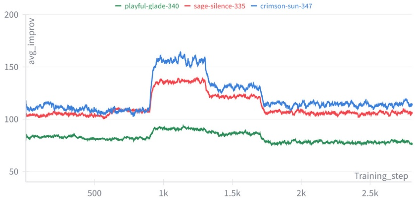

(a) Average improvement

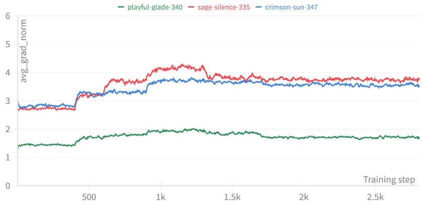

(b) Average gradient norm

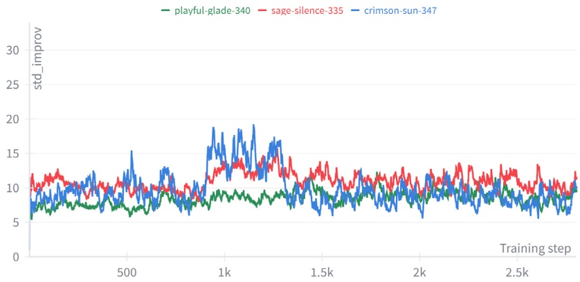

(c) Standard deviation of improvement

Fig. 6. Comparison of training metrics defined in Table 7 across three high-performing hyperparameter configurations (time weighted EMA smoothing) following curriculum design in Table 2.

**However, grid dependency increases (9.8 percentage points for Curriculum-1, 6.9 percentage points for Curriculum-2) with a slight decrease in renewable utilization (2.0 and 3.2 percentage points, respectively). This is because the adapted policy learns to supplement renewable generation with cost-effective grid imports to meet demand and reduce violations. This represents an economically rational strategy in which the agent prioritizes reliable energy delivery over renewable maximization when the two objectives conflict.**

**Across all six metrics, Curriculum-2 adapted distributions were more concentrated than Curriculum-1, with Curriculum-2 models** **achieving 53% higher mean adaptation improvement than Curriculum-1. This performance gap suggests that constant exposure to building diversity during meta-training produces a more robust initialization for building-specific adaptation than the seasonal progression approach adopted in Curriculum-1.**

**Fig. 10 shows the episode reward improvement distribution across four seasons for both curricula. Curriculum-2 outperforms Curriculum-1 in every season, most notably in spring (**+**29.1% and** +**13.6%) and summer (**+**36.0% and** +**21.0%), where higher PV availability and moderate heating demand provide the adapted policy with greater** **operational flexibility. Autumn shows strong and consistent gains for both curricula (Curriculum-1:** +**24.8%, Curriculum-2:** +**35.7%). Winter shows the lowest improvement (Curriculum-1:** +**11.5%, Curriculum-2:** +**19.3%), which is expected given the limited PV generation and peak heating demand that constrain the achievable improvement margins. Despite the lower reward gains, winter achieved the largest violation reduction (44%), indicating that the adapted policy prioritizes constraint adherence over reward maximization under the most demanding operational conditions.**

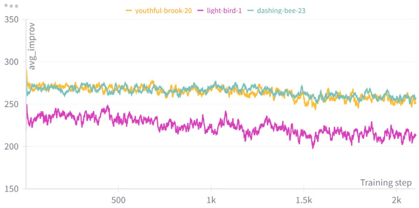

(a) Average improvement

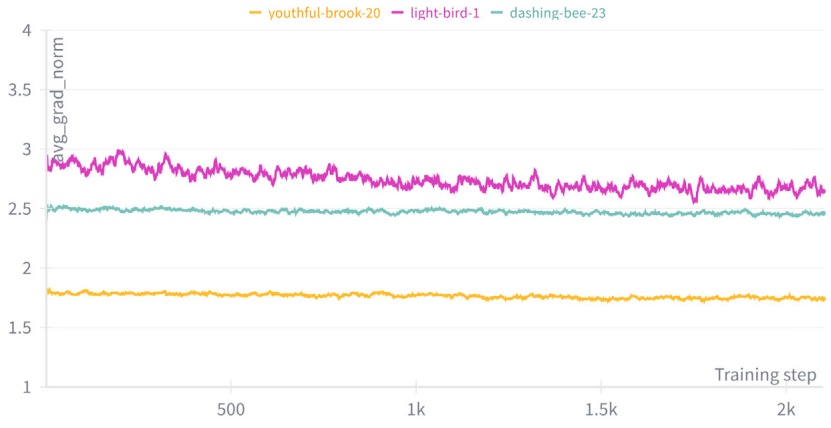

(b) Average gradient norm

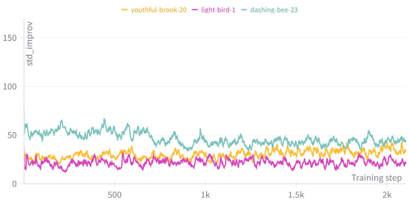

(c) Standard deviation of improvement

Fig. 7. Comparison of training metrics defined in Table 7 across three high-performing hyperparameter configurations (time weighted EMA smoothing) following curriculum design in Table 3.

**As shown in Fig. 11(a), Curriculum-2 models achieved a mean improvement of 8.9 episode reward units compared to 5.8 for Curriculum-1. Among individual models, dashing\_bee achieves the highest improvement (10.5) with the lowest coefficient of variation (CV=0.45), representing the best balance of performance and consistency. Youthful\_brook follows closely (9.5, CV=0.60), while sage demonstrates moderate improvement with strong consistency (5.9, CV=0.63). In contrast, crimson exhibits the weakest deployment performance (4.6) and the** **highest variability (CV=1.66), attributable to the training instability observed in Section 5.2.1.**

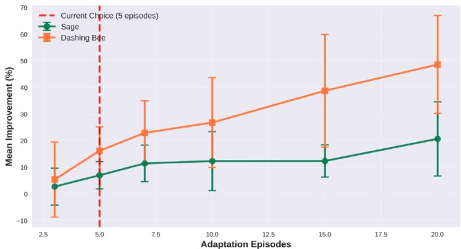

(a) Mean improvement vs Adaptation episodes

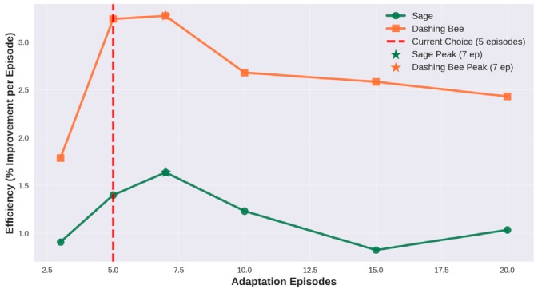

(b) Adaptation efficiency vs Adaptation episodes

Fig. 8. Adaptation episode analysis. Five adaptation episodes balance strong performance with high efficiency.

**Figs. 11(b) and 11(c) further illustrate this relationship: all three Curriculum-2 models cluster in the high-improvement, low-variability region of the performance-consistency space, whereas Curriculum-1 models exhibit wider spread. This correspondence between training stability and deployment reliability suggests that meta-training gradient dynamics serve as meaningful indicators of downstream adaptation quality, and that building operators selecting models for deployment should prioritize consistency alongside mean performance.**

**A Wilcoxon signed-rank test comparing the meta-policy and adapted policy rewards yielded** $W = 7 1 6 2$ **out of a maximum of 7260, with** $p =$ $1 . 1 1 \times 1 0 ^ { - 2 0 }$ . The $W$ **s**tatistic reaching 97.3% of its maximum indicates **that adaptation consistently produces substantial improvements rather than marginal gains under limited conditions. The bootstrap 95% confidence interval for the median reward gain of** [+16.50, +21.95] **reward units confirms that the adaptation benefit is both statistically robust and practically meaningful. Furthermore, a Mann–Whitney U test comparing Curriculum-1 and Curriculum-2 adapted policies yields** $U = 2 3 8 6$ out of a maximum of 3600 $(p=0.001)$ **, indicating that Curriculum-2 outperforms Curriculum-1 in 66.3% of all pairwise comparisons, confirming that curriculum design has a measurable impact on deployment quality. These results provide empirical evidence supporting meta-RL as a viable framework for scalable building energy management, where a single meta-policy can be rapidly adapted to diverse unseen buildings with minimal data.**

**While the preceding analysis statistically established the adaptation benefit across all deployment conditions, Fig. 12 provides operational insight into adaptation for a representative test building (dashing\_bee model) across all four seasons. The adapted policy captures the seasonal variation in energy flows: higher PV utilization and battery cycling during summer and increased grid imports and heat pump operation during winter.**

**The battery SOC profiles in Fig. 12(d) show occasional deviations beyond the preferred operating range (0.2–0.8) into the soft constraint zones (0–0.2 and 0.8–1.0), reflecting deliberate economic tradeoffs while remaining within the hard safety limits (0.0–1.0). Winter heating demand remains the most challenging operational condition, with occasional thermal shortfalls consistent with the lower winter reward improvements shown in Fig. 10. This single-building illustration complements the aggregate statistical results by demonstrating how the meta-learned policy translates into physically interpretable energy-management decisions across seasonal operating conditions.**

## 5.3.1. Deployment considerations

**The proposed framework primarily uses a simulation environment, and deploying it directly in a grid without additional validation is risky and expensive. Hence, Hardware-in-the-loop (HIL) acts as a crucial safety buffer between software simulation and real-world deployment, ensuring that the control algorithms are validated under real-time and hardware constraints before dealing with actual grid integration [55]. Software-in-the-Loop (SIL) tests if the control algorithm can execute on target hardware, establishing computational feasibility. Controller Hardware-in-the-Loop(CHIL) ensures the controller can operate within the desired time through communication protocols. Power Hardwarein-the-Loop (PHIL) testing incorporates equipment and validates the controller’s response to power dynamics and transients [55].**

**HIL testing provides valuable insights by systematically introducing constraints such as sensor noise, network communication delays, and hardware limitations. Moreover, control algorithms that excel under simulation conditions may struggle during communication latencies, limited processing power, or incomplete state information during critical control decisions. The most widely used HIL platforms are OPAL-RT [56], dSPACE, MATLAB/Simulink-RT, NovaCor RTDS [57], and Hypersim [58]. HIL platforms also provide environments for analyzing system vulnerabilities, such as component failures [56] and cyber-attacks [58] that cannot be practically tested on microgrids.**

**The rapid adaptation capability of the meta-RL framework requiring only five episodes is particularly valuable in HIL frameworks where testing time directly translates to higher costs and slower deployment. Moreover, the lightweight and enhanced Reptile meta-RL algorithm further reduces the computational requirements. In addition, online learning ensures the controller learns through the accumulated operational data, thereby providing advantages over static optimization approaches. The HIL framework could also showcase the communitylevel scalability of meta-RL application, where new building microgrids could be integrated into the network, and the system can adapt quickly without requiring complete system retraining or reconfiguration.**

## 5.4. Limitations & future directions

**The research scope was intentionally bounded by computational tractability and available resources, resulting in certain limitations that are discussed below alongside corresponding future research directions.**

## 5.4.1. Reward design

**The proposed reward function adopts a multi-objective formulation, balancing short-term priorities — operating costs, system stability, and renewable utilization — against long-term battery health/storage optimization objectives. However, coordinating multiple building microgrids with high PV penetration introduces grid stress risks, as simultaneous peak generation across buildings can result in excessive aggregate export that the local grid may not manage. Therefore, future studies can focus on developing an advanced reward structure that incorporates time-varying export penalties to mitigate grid stress without compromising building self-sufficiency or inducing unnecessary curtailment.**

**Reward weight selection presents a fundamental challenge in multi-objective reinforcement learning. However, identifying optimal weights** **requires extensive experimentation that may not generalize across diverse building types in meta-learning. This study used fixed weights after a preliminary exploration (Fig. 5) to balance the energy costs, comfort violations, and renewable utilization. Future work could explore evolutionary algorithms or multi-objective Bayesian optimization for automated weight-tuning. However, this introduces substantial computational overhead, and the trade-off between reward engineering effort and performance gains remains an open challenge in reinforcement and meta-learning.**

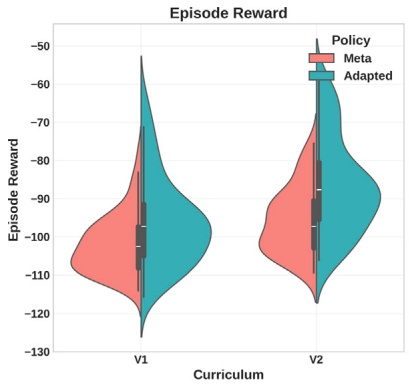

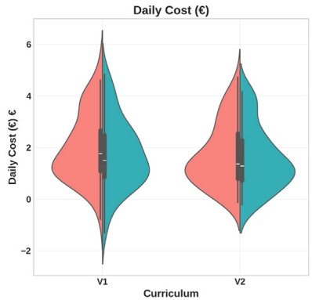

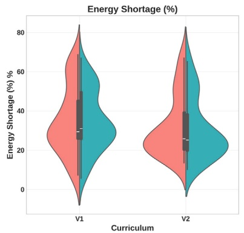

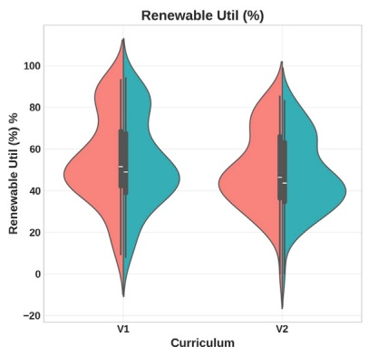

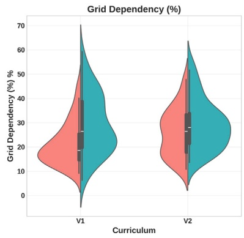

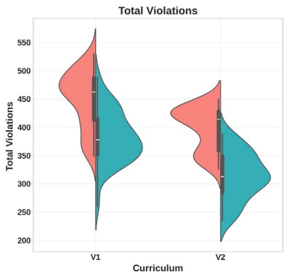

Fig. 9. Distribution of policy performance across six key metrics comparing Meta (red) and Adapted (teal) policies for Curriculum-1 and Curriculum-2.

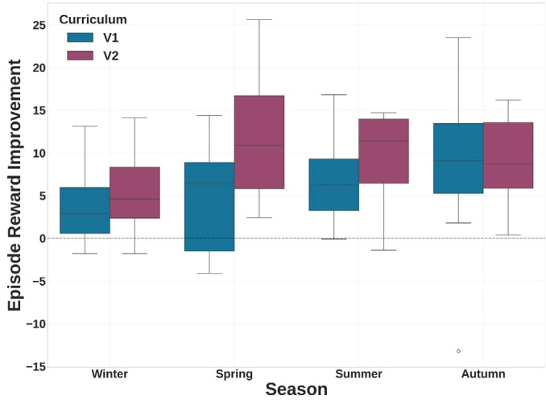

Fig. 10. Episode reward improvement distribution across four seasons for both curricula.

**Reward weights were kept uniform across all training buildings to ensure stable meta-gradient aggregation during Reptile updates. In contrast, heterogeneous reward compositions across buildings may introduce conflicting update directions, destabilizing the meta-policy rather than converging to a robust shared initialization. Extending the formulation to user-defined reward preferences through reward-conditioned** **meta-RL, where weights are provided as task context inputs, represents a promising future direction.**

## 5.4.2. Curriculum engineering

**One intriguing research finding was the influence of curriculum engineering on meta-learning effectiveness. The current curriculum design follows a fixed difficulty progression; however, an adaptive design that adjusts task complexity based on training performance metrics could further improve model performance. The design could consider a performance-triggered progression threshold to allocate sufficient training time in a potentially challenging phase, thereby improving training and deployment efficiency.**

## 5.4.3. Framework applicability

**Although validated on Norwegian building energy data, the framework is designed for global applicability with minimal architectural modifications. The core algorithm remains unchanged, requiring only region-specific design of state/action spaces, reward coefficients, and task distributions. The meta-learning foundation further enables rapid onboarding of new buildings, alleviating the deployment bottleneck without extensive retraining. Therefore, the framework supports scalable global adoption through region-specific parameter tuning rather than fundamental algorithmic redesign. Additionally, systematic benchmarking against building-specific analytical baselines (MPC, MILP) remains valuable future work to quantify the performance trade-offs between learned generalization and tailored optimization. The pipeline can be further improved by integrating attention mechanisms for capturing temporal and seasonal dependencies, Graph Neural Networks for modeling complex building interrelations, and probabilistic architectures to improve robustness and deployment credibility.**

## 5.4.4. Peer-to-peer energy trading

**Peer-to-peer energy trading represents an interesting pathway to address the grid stress (or weak grid) problem discussed in Section 5.4.1, enabling excess PV generation to be redistributed among buildings before grid export. Multi-agent reinforcement learning provides a natural** **coordination framework as an extension, where the trained meta-RL policies serve as competent base agents, avoiding retraining from scratch and enabling sample-efficient community-scale coordination. However, establishing a fair trading market that balances individual building preferences with collective community goals while ensuring transparency and end-user privacy remains a significant open challenge.**

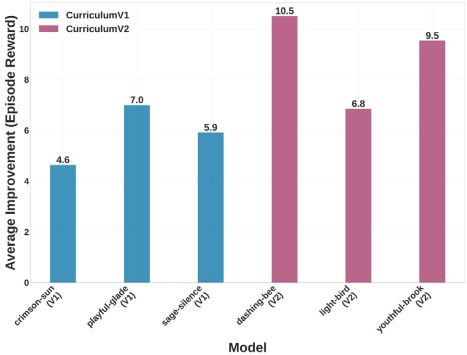

(a) Average model performance comparison.

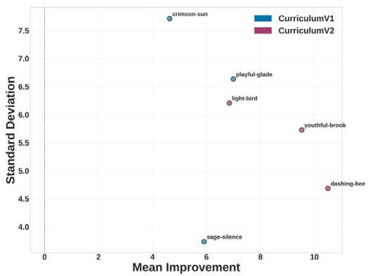

(b) Performance vs consistency trade-off for all six models.

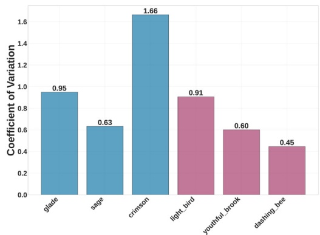

(c) Model consistency rankings measured by coefficient of variation

Fig. 11. Comprehensive Meta-RL model deployment analysis comparing curriculum-1 and Curriculum-2 performance characteristics across different evaluation metrics.

**The proposed framework establishes a foundation for a transformative vision of networks of self-sufficient buildings that collectively form resilient, sustainable, and energy-independent communities. The authors plan to extend the framework, as discussed in detail in [59], toward integrating meta-RL and MARL for coordinated peer-to-peer energy trading and enabling the transition to self-sufficient energy communities.. A single meta-policy that can be deployed across multiple buildings in the community, each adapting to local characteristics while benefiting from collective learning through multi-agent coordination. Although the results demonstrate feasibility, the full potential of metalearning in revolutionizing building energy management remains to be unlocked through collaborative research efforts that address these challenges and opportunities.**

## 6. Conclusion

**The primary objective of this study was to propose a comprehensive meta-reinforcement learning framework for the adaptive energy** **management of multi-energy building microgridbalancing electrical and heating loads. The framework integratesan enhanced reptile-based meta-learning algorithm and proximal policy optimization PPO to find a generalized policy for diverse buildings, capable of rapid personalization, improving the sample efficiency and ease of deployment. Two curriculum approaches were developed and compared: Curriculum-1 modeled progressive seasonal complexity, while Curriculum-2 focused on progressive building diversity with constant seasonal exposure. Extensive hyperparameter tuning revealed that models with deeper architectures and the hyperparameter combination significantly impacted learning and adaptation capabilities.**

**Six high-performing models (3 per curriculum) from the hyperparameter tuning were deployed on five test buildings. The adapted policies achieved a mean reward improvement of 23.9% over the trained meta-policy, with total constraint violations decreasing by 38% and daily operating costs by 12.2%. Curriculum-2 outperformed Curriculum-1 by 53% in terms of mean adaptation improvement and exhibited superior consistency (coefficient of variation** < **0.91). The adaptation benefit was statistically confirmed (Wilcoxon W=7162,** $\mathtt { p = 1 . 1 1 \times } 1 0 ^ { - 2 0 } )$ **, with Curriculum-2 outperforming Curriculum-1 across all seasons (19.3% to 36.0%), and winter achieving the largest violation reduction (44%) despite the lowest reward gains. These results demonstrate that learning to build heterogeneity through progressive diversity exposure is more valuable for generalization than sequentially** **mastering seasonal patterns. The adapted policies showed increased grid dependency as a trade-off for reduced electrical shortages and constraint violations, reflecting an economically rational strategy that prioritizes reliability.**

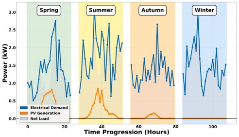

(a) Electrical demand, PV generation, and net load profiles.

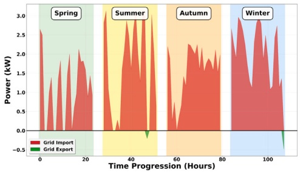

(b) Grid import and export power profiles.

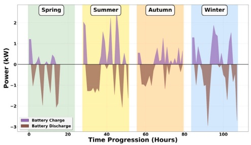

(c) Battery charging and discharging power profiles.

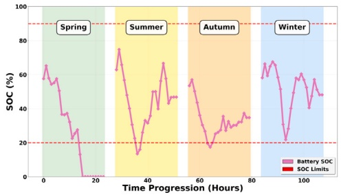

(d) Battery state of charge (SOC) profiles with operational limits.

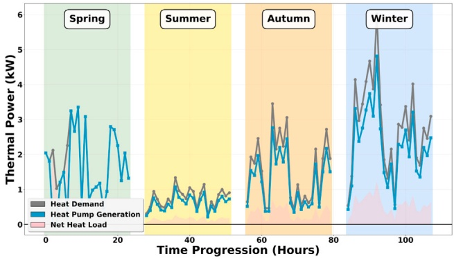

(e) Thermal power profiles: heat demand, heat pump generation, and net heat load.

Fig. 12. Seasonal energy management system profiles showing coordinated operation of renewable generation, battery storage, thermal systems, and grid interaction.

**Future work should consider adaptive reward weighting, Hardwarein-the-Loop validation to bridge the simulation-to-deployment gap, adaptive curricula that adjust task complexity based on training performance, and multi-agent coordination for community-scale energy management. A systematic comparison with analytical baselines (MPC, MILP) also represents valuable future work to quantify trade-offs between learned generalization and tailored optimization.**

## CRediT authorship contribution statement

**Sai Sasidhar Punyam Rajendran: Writing – original draft, Visualization, Validation, Software, Methodology, Investigation, Data curation, Conceptualization. Alemayehu Gebremedhin: Writing – review & editing, Supervision.**

## Declaration of competing interest

**The authors declare that they have no known competing financial interests or personal relationships that could have appeared to influence the work reported in this paper.**

## Acknowledgments

**The authors would like to extend their sincere gratitude to the Norwegian University of Science and Technology (NTNU) for their invaluable support in crafting this article, which includes providing access to relevant sources and computation resources.**

## Appendix. Reinforcement learning

**Reinforcement learning develops agents that learn optimal decision policies through environmental interaction. In this framework, agents take actions, observe state changes, and receive rewards, learning to maximize cumulative rewards by identifying optimal actions in various** **states. This approach excels in sequential decision-making problems like energy management in microgrids.**

**Formally, reinforcement learning operates within Markov decision processes (MDPs), defined as** $\mathcal { M } = \left\langle S , \mathcal { A } , P , P _ { 0 } , R , \gamma , T \right\rangle$ **, where**  **is the state space,**  **the action space,** $P ( s _ { t + 1 } | s _ { t } , a _ { t } )$ **the transition probability** function, $P _ { 0 } ( s _ { 0 } )$ **the initial state distribution,** $R ( s _ { t } , a _ { t } )$ the reward func**tion,** 𝛾 **the discount factor, and** 𝑇 **the time horizon. A policy** $\pi ( a | s )$ **maps states to action probabilities. The probability of a trajectory under policy** 𝜋 **is:**

$$
P ( \tau ) = P _ { 0 } ( s _ { 0 } ) \prod _ { t = 0 } ^ { T } \pi ( a _ { t } | s _ { t } ) P ( s _ { t + 1 } | s _ { t } , a _ { t } ) ,\tag{A.1}
$$

**The trajectory** $\tau = \{ s _ { t } , a _ { t } , r _ { t } , s _ { t + 1 } \} _ { t = 0 } ^ { T }$ **represents collected data during an episode. The RL objective is to maximize expected discounted return:**

$$
J ( \pi ) = \mathbb { E } _ { \tau \sim P ( \tau ) } \left[ \sum _ { t = 0 } ^ { T } \gamma ^ { t } r _ { t } \right]\tag{A.2}
$$

**With collected data** $\boldsymbol { \mathcal { D } } = \{ \tau ^ { h } \} _ { h = 0 } ^ { H }$ **from multiple episodes, an RL algorithm functions as** $f ( { \cal D } ) \; : \; ( ( \stackrel { n } { S \times { \cal A } } \times \mathbb { R } ) ^ { T } ) ^ { H } \; \rightarrow \; \varPhi$ **, mapping data to parameterized policies with parameters** $\phi \in \varPhi .$ **Training often employs exploratory intermediate policies rather than purely greedy approaches.**

## Data availability

**Data will be made available on request.**

## References

[1] [Darshi R, Shamaghdari S, Jalali A, Arasteh H. Decentralized energy management system for smart microgrids using reinforcement learning. IET Gener Transm Distrib 2023;17(9):2142–55.](http://refhub.elsevier.com/S0196-8904%2826%2900621-7/sb1)

[2] [Sasidhar PRS, Gebremedhin A, Norheim I. Multi-energy microgrid design and the role of coupling components—A review. Renew Sustain Energy Rev 2025;216:115540.](http://refhub.elsevier.com/S0196-8904%2826%2900621-7/sb2)

[3] [Quintana DI, Cansino JM. Residential energy consumption-a computational bibliometric analysis. Buildings 2023;13(6).](http://refhub.elsevier.com/S0196-8904%2826%2900621-7/sb3)

[4] [Bonfert B. ‘We like sharing energy but currently there’s no advantage’: Transformative opportunities and challenges of local energy communities in europe. Energy Res Soc Sci 2024;107:103351.](http://refhub.elsevier.com/S0196-8904%2826%2900621-7/sb4)

[5] [Laimon M, Yusaf T. Towards energy freedom: Exploring sustainable solutions for energy independence and self-sufficiency using integrated renewable energy-driven hydrogen system. Renew Energy 2024;222:119948.](http://refhub.elsevier.com/S0196-8904%2826%2900621-7/sb5)

[6] [Goyal A, Bhattacharya K. Optimal design of a decarbonized sectorcoupled microgrid: Electricity-heat-hydrogen-transport sectors. IEEE Access 2024;12:38399–409.](http://refhub.elsevier.com/S0196-8904%2826%2900621-7/sb6)

[7] [Mohammadi P, Darshi R, Shamaghdari S, Siano P. Comparative analysis of control strategies for microgrid energy management with a focus on reinforcement learning. IEEE Access 2024;12:171368–95.](http://refhub.elsevier.com/S0196-8904%2826%2900621-7/sb7)

[8] [Meydani A, Shahinzadeh H, Nafisi H, Gharehpetian GB. Optimizing microgrid energy management: Intelligent techniques. In: 2024 28th international electrical power distribution conference. EPDC, 2024, p. 1–18.](http://refhub.elsevier.com/S0196-8904%2826%2900621-7/sb8)

[9] [Sarwar FA, Hernando-Gil I, Vechiu I. Review of energy management systems and optimization methods for hydrogen-based hybrid building microgrids. Energy Convers Econ 2024;5(4):259–79.](http://refhub.elsevier.com/S0196-8904%2826%2900621-7/sb9)

[10] [Barbalho PIN, Moraes AL, Lacerda VA, Barra PHA, Fernandes RAS, Coury DV. Reinforcement learning solutions for microgrid control and management: A survey. IEEE Access 2025;13:39782–99.](http://refhub.elsevier.com/S0196-8904%2826%2900621-7/sb10)

[11] [Yu P, Zhang H, Song Y, Wang Z, Dong H, Ji L. Safe reinforcement learning for power system control: A review. Renew Sustain Energy Rev 2025;223:116022.](http://refhub.elsevier.com/S0196-8904%2826%2900621-7/sb11)

[12] [Zhang Y, Hu J, Min G, Chen X. Scalable and privacy-preserving distributed energy management for multimicrogrid. IEEE Trans Ind Informatics 2025;21(2):1439–48.](http://refhub.elsevier.com/S0196-8904%2826%2900621-7/sb12)

[13] [Stavrev S, Ginchev D. Reinforcement learning techniques in optimizing energy systems. Electronics 2024;13(8).](http://refhub.elsevier.com/S0196-8904%2826%2900621-7/sb13)

[14] [Bachoumis A, Mylonas C, Plakas K, Birbas M, Birbas A. Data-driven analytics for reliability in the buildings-to-grid integrated system framework: A systematic text-mining-assisted literature review and trend analysis. IEEE Access 2023;11:130763–87.](http://refhub.elsevier.com/S0196-8904%2826%2900621-7/sb14)

[15] [Jang D, Spangher L, Nadarajah S, Spanos C. Deep reinforcement learning with planning guardrails for building energy demand response. Energy AI 2023;11:100204.](http://refhub.elsevier.com/S0196-8904%2826%2900621-7/sb15)

[16] [Ghasemi A, Shojaeighadikolaei A, Hashemi M. Combating uncertainties in smart grid decision networks: Multiagent reinforcement learning with imperfect state information. IEEE Internet Things J 2024;11(13):23985–97.](http://refhub.elsevier.com/S0196-8904%2826%2900621-7/sb16)

[17] [Yu L, Chen Z, Yue D, Ye Y, Strbac G, Wang Y. Coordinated operation optimization of grid-interactive residential buildings based on neural networkassisted hierarchical model predictive control. IEEE Trans Autom Sci Eng 2025;22:13441–57.](http://refhub.elsevier.com/S0196-8904%2826%2900621-7/sb17)

[18] [Xi L, Quan Y, Liu Z, Li Y. A novel controllable bias reinforcement learning method for distributed automatic generation control integrated with large-scale electric vehicles. Electr Power Syst Res 2024;232:110425.](http://refhub.elsevier.com/S0196-8904%2826%2900621-7/sb18)

[19] [Hedayatnia A, Ghafourian J, Sepehrzad R, Al-Durrad A, Anvari-Moghaddam A. Two-stage data-driven optimal energy management and dynamic real-time operation in networked microgrid based on a deep reinforcement learning approach. Int J Electr Power Energy Syst 2024;160:110142.](http://refhub.elsevier.com/S0196-8904%2826%2900621-7/sb19)

[20] [Coraci D, Brandi S, Hong T, Capozzoli A. An innovative heterogeneous transfer learning framework to enhance the scalability of deep reinforcement learning controllers in buildings with integrated energy systems. In: Building simulation, vol. 17, (5):Springer; 2024, p. 739–70.](http://refhub.elsevier.com/S0196-8904%2826%2900621-7/sb20)

[21] [Yan D, Shi Z, Wang X, Gao Y, Pu T, Wang J. Efficient and stable learning for distribution network operation: A model-based reinforcement learning approach. CSEE J Power Energy Syst 2025;11(3):1080–92.](http://refhub.elsevier.com/S0196-8904%2826%2900621-7/sb21)

[22] Zhang BBH, Wu D, Zinflou A. Meta-reinforcement learning for building energy management system. 2025, Available from: [https://arxiv.org/abs/2210.12590](https://arxiv.org/abs/2210.12590).

[23] [Beck J, Vuorio R, Liu EZ, Xiong Z, Zintgraf L, Finn C, Whiteson S. A tutorial on meta-reinforcement learning. Found Trends Mach Learn 2025;18(2–3):224–384.](http://refhub.elsevier.com/S0196-8904%2826%2900621-7/sb23)

[24] [Messlem A, Messlem Y, Abdeslam DO, Safa A. Meta reinforcement learning for optimal control of battery energy storage systems in distributed energy resources. In: IECON 2024 - 50th annual conference of the IEEE industrial electronics society. 2024, p. 1–6.](http://refhub.elsevier.com/S0196-8904%2826%2900621-7/sb24)

[25] [Li J, Cui H. Cloud–edge cooperative load frequency control for isolated microgrid using emergent computation-based large-scale meta-machine learning. IEEE J Emerg Sel Top Ind Electron 2023;4(4):1278–90.](http://refhub.elsevier.com/S0196-8904%2826%2900621-7/sb25)

[26] [Li J, Cheng Y. Deep meta-reinforcement learning-based data-driven active fault tolerance load frequency control for islanded microgrids considering internet of things. IEEE Internet Things J 2024;11(6):10295–303.](http://refhub.elsevier.com/S0196-8904%2826%2900621-7/sb26)

[27] [Li J, Cui H. Knowledge prior deep meta-reinforcement learning-based load frequency control of isolated sustainable energy system considering electricity prosumers. J Clean Prod 2025;504:145410.](http://refhub.elsevier.com/S0196-8904%2826%2900621-7/sb27)

[28] [Li J, Dai J. Transfer multi-agent deep meta reinforcement learning method for load frequency control of performance market-based multi-area microgrid with prosumers. IEEE Trans Autom Sci Eng 2025;22:15687–700.](http://refhub.elsevier.com/S0196-8904%2826%2900621-7/sb28)

[29] [Fan B, Liu X, Xiao G, Yang X, Chen B, Wang P. Enhancing adaptability of restoration strategy for distribution network: A meta-based graph reinforcement learning approach. IEEE Internet Things J 2024;11(14):25440–53.](http://refhub.elsevier.com/S0196-8904%2826%2900621-7/sb29)

[30] [ul Abdeen Z, Zhang X, Gill W, Jin M. Enhancing distribution system resilience: A first-order meta-rl algorithm for critical load restoration. In: 2024 IEEE international conference on communications, control, and computing technologies for smart grids (smartGridComm). 2024, p. 129–34.](http://refhub.elsevier.com/S0196-8904%2826%2900621-7/sb30)

[31] [Tsoumplekas G, Athanasiadis C, Doukas DI, Chrysopoulos A, Mitkas P. Few-shot load forecasting under data scarcity in smart grids: A meta-learning approach. Energies 2025;18(3).](http://refhub.elsevier.com/S0196-8904%2826%2900621-7/sb31)

[32] [Boutahir MK, Hessane A, Farhaoui Y, Azrour M, Benyeogor MS, Innab N. Meta-learning guided weight optimization for enhanced solar radiation forecasting and sustainable energy management with VotingRegressor. Sustainability 2024;16(13).](http://refhub.elsevier.com/S0196-8904%2826%2900621-7/sb32)

[33] Huang Z, Yu T, Pan Z, Deng B, Zhang X, Wu Y, Ding Q. Stochastic dynamic power dispatch with high generalization and few-shot adaption via contextual meta graph reinforcement learning. Int J Electr Power Energy Syst 2024;162:110272, Available from: [https://www.sciencedirect.com/science/article/pii/S0142061524004940](https://www.sciencedirect.com/science/article/pii/S0142061524004940).

[34] [Li J, Zhou T, Keke H, Yu H, Du H, Liu S, Cui H. Distributed quantum multiagent deep meta reinforcement learning for area autonomy energy management of a multiarea microgrid. Appl Energy 2023;343:121181.](http://refhub.elsevier.com/S0196-8904%2826%2900621-7/sb34)

[35] [Li J, Zhou T. Evolutionary multi-agent deep meta reinforcement learning method for swarm intelligence energy management of isolated multi-area microgrid with internet of things. IEEE Internet Things J 2023;10(14):12923–37.](http://refhub.elsevier.com/S0196-8904%2826%2900621-7/sb35)

[36] [Xiong L, Tang Y, Liu C, Mao S, Meng K, Dong Z, Qian F. Meta-reinforcement learning-based transferable scheduling strategy for energy management. IEEE Trans Circuits Syst I Regul Pap 2023;70(4):1685–95.](http://refhub.elsevier.com/S0196-8904%2826%2900621-7/sb36)

[37] [Dang Y, Xu J, Li D. Meta reinforcement learning based energy management in microgrids under extreme weather events. In: 2023 4th international conference on advanced electrical and energy systems. AEES, 2023, p. 577–81.](http://refhub.elsevier.com/S0196-8904%2826%2900621-7/sb37)

[38] [Shen H, Shen X, Chen Y. Real-time microgrid energy scheduling using meta-reinforcement learning. Energies 2024;17(10).](http://refhub.elsevier.com/S0196-8904%2826%2900621-7/sb38)

[39] [Lu J, Mannion P, Mason K. A meta-learning approach for multi-objective reinforcement learning in sustainable home environments. 2024.](http://refhub.elsevier.com/S0196-8904%2826%2900621-7/sb39)

[40] [Li J, Zhou T. Active fault-tolerant coordination energy management for a proton exchange membrane fuel cell using curriculum-based multiagent deep meta-reinforcement learning. Renew Sustain Energy Rev 2023;185:113581.](http://refhub.elsevier.com/S0196-8904%2826%2900621-7/sb40)

[41] [Dang Y, Xu J, Yang F, Jiang C, Li D. Meta reinforcement learning based adaptive and interpretable energy storage control meets dynamic scenarios. IEEE Trans Sustain Energy 2025;1–13.](http://refhub.elsevier.com/S0196-8904%2826%2900621-7/sb41)

[42] [Berg K, Löschenbrand M. A data set of a norwegian energy community. Data Brief 2022;40:107683.](http://refhub.elsevier.com/S0196-8904%2826%2900621-7/sb42)

[43] Statistics Norway. Energy consumption in households. 2024, [https://www.ssb.no/en/energi-og-industri/energi/statistikk/energibruk-i-husholdningene](https://www.ssb.no/en/energi-og-industri/energi/statistikk/energibruk-i-husholdningene). [Accessed: 2024].

[44] [Punyam Rajendran SS, Gebremedhin A. Holistic planning framework for multi-energy microgrids: A multi-objective perspective on system optimization. Appl Energy 2025;392:125953.](http://refhub.elsevier.com/S0196-8904%2826%2900621-7/sb44)

[45] [Towers M, Kwiatkowski A, Terry J, Balis JU, Cola GD, Deleu T, Goulão M, Kallinteris A, Krimmel M, KG A, Perez-Vicente R, Pierré A, Schulhoff S, Tai JJ, Tan H, Younis OG. Gymnasium: A standard interface for reinforcement learning environments. 2024.](http://refhub.elsevier.com/S0196-8904%2826%2900621-7/sb45)

[46] [Punyam Rajendran SS, Gebremedhin A. Deep learning-based solar power forecasting model to analyze a multi-energy microgrid energy system. Front Energy Res 2024;Volume 12 - 2024.](http://refhub.elsevier.com/S0196-8904%2826%2900621-7/sb46)

[47] [Bogdanov D, Satymov R, Breyer C. Impact of temperature dependent coefficient of performance of heat pumps on heating systems in national and regional energy systems modelling. Appl Energy 2024;371:123647.](http://refhub.elsevier.com/S0196-8904%2826%2900621-7/sb47)

[48] Nichol A, Achiam J, Schulman J. On first-order meta-learning algorithms. 2018, CoRR [abs/1803.02999](http://arxiv.org/abs/1803.02999).

[49] Schulman J, Wolski F, Dhariwal P, Radford A, Klimov O. Proximal policy optimization algorithms. 2017, CoRR [abs/1707.06347](http://arxiv.org/abs/1707.06347).

[50] [Liang E, Liaw R, Nishihara R, Moritz P, Fox R, Goldberg K, Gonzalez JE, Jordan MI, Stoica I. RLlib: Abstractions for distributed reinforcement learning. In: International conference on machine learning (ICML). 2018.](http://refhub.elsevier.com/S0196-8904%2826%2900621-7/sb50)

[51] [Wu Z, Liang E, Luo M, Mika S, Gonzalez JE, Stoica I. RLlib flow: Distributed reinforcement learning is a dataflow problem. In: Conference on neural information processing systems (neurIPS). 2021.](http://refhub.elsevier.com/S0196-8904%2826%2900621-7/sb51)

[52] Liaw R, Liang E, Nishihara R, Moritz P, Gonzalez JE, Stoica I. Tune: A research platform for distributed model selection and training. 2018, arXiv preprint [arXiv:1807.05118](http://arxiv.org/abs/1807.05118).

[53] [Själander M, Jahre M, Tufte G, Reissmann N. EPIC: An energy-efficient, high-performance GPGPU computing research infrastructure. 2019.](http://refhub.elsevier.com/S0196-8904%2826%2900621-7/sb53)

[54] Biewald L. Experiment tracking with weights and biases. 2020, Software available from wandb.com. Available from: [https://www.wandb.com/](https://www.wandb.com/).

[55] [F. Patarroyo J, Pfannschmidt J, Amitkumar KS, Paquin J-N, Li W. Considerations for digital real-time simulation, control-HIL, and power-HIL in microgrids/DER studies. In: Microgrids. John Wiley & Sons, Ltd; 2024, p. 579–614.](http://refhub.elsevier.com/S0196-8904%2826%2900621-7/sb55)

[56] [Salvadori F, Leandro PGM, Soares MB, de Freitas IS, Cipriano dos Santos E. Hardware-in-the-loop (HIL) simulation: Modeling, characterization and analysis of a distributed energy resources in a microgrid network. In: IECON 2024 - 50th annual conference of the IEEE industrial electronics society. 2024, p. 1–6.](http://refhub.elsevier.com/S0196-8904%2826%2900621-7/sb56)

[57] [Davari M, Qasem O, Gao W, Blaabjerg F, Kotsampopoulos PC, Lauss G, Hatziargyriou ND. A reinforcement-learning, optimal approach to in situ power hardware-in-the-loop interface control for testing inverter-based resources: Theory and application of the adaptive dynamic programming based on the hybrid iteration to tackle uncertain dynamics. IEEE Trans Ind Electron 2025;72(6):5867–83.](http://refhub.elsevier.com/S0196-8904%2826%2900621-7/sb57)

[58] [Mukherjee S, Hossain RR, Mohiuddin SM, Liu Y, Du W, Adetola V, Jinsiwale RA, Huang Q, Yin T, Singhal A. Resilient control of networked microgrids using vertical federated reinforcement learning: Designs and real-time test-bed validations. IEEE Trans Smart Grid 2025;16(2):1897–910.](http://refhub.elsevier.com/S0196-8904%2826%2900621-7/sb58)

[59] [Punyam Rajendran SS, Gebremedhin A. A distributed hierarchical framework for self-sustaining and autonomous multi-energy microgrid communities. In: 2025 international conference on electrical and computer engineering researches. ICECER, 2025, p. 1–6.](http://refhub.elsevier.com/S0196-8904%2826%2900621-7/sb59)