# Deep reinforcement learning strategy integrating environmental perception and semantic masking for real-time operational optimization of building cluster microgrids

- 期刊：Energy
- DOI：10.1016/j.energy.2026.140676
- 版本：作者接受稿（含机构封面）
- 原文页数：40
- 文本解析：MinerU 4.0.12 / basic / 全文
- [原始 PDF](../../Deep Reinforcement Learning Strategy Integrating Environmental Perception and Semantic Masking for Real-Time Operational Optimization of Building Cluster Microgrids.pdf)
- [逐页截图](screenshots.html)

> 以下为机器解析的原文，未翻译、未改写。公式、表格和双栏阅读顺序可能存在识别误差，请以原始 PDF 和逐页截图为准。

## 论文首页

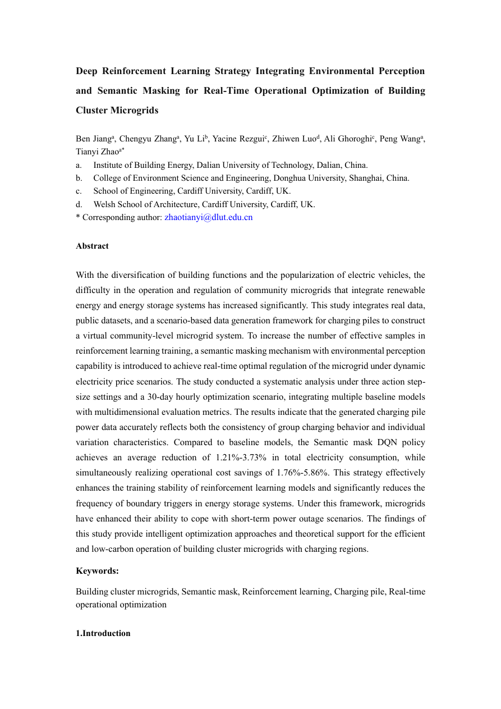

## 全文
This is an Open Access document downloaded from ORCA, Cardiff University's institutional repository:https://orca.cardiff.ac.uk/id/eprint/185781/

This is the author’s version of a work that was submitted to / accepted for publication.

Citation for final published version:

Jiang, Ben, Zhang, Chengyu, Li, Yu, Rezgui, Yacine , Luo, Zhiwen , Ghoroghi, Ali, Wang, Peng and Zhao, Tianyi 2026. Deep reinforcement learning strategy integrating environmental perception and semantic masking for real-time operational optimization of building cluster microgrids. Energy 349 , 140676. 10.1016/j.energy.2026.140676

Publishers page: https://doi.org/10.1016/j.energy.2026.140676

## Please note:

Changes made as a result of publishing processes such as copy-editing, formatting and page numbers may not be reflected in this version. For the definitive version of this publication, please refer to the published source. You are advised to consult the publisher’s version if you wish to cite this paper.

This version is being made available in accordance with publisher policies. See http://orca.cf.ac.uk/policies.html for usage policies. Copyright and moral rights for publications made available in ORCA are retained by the copyright holders.

Ben Jianga, Chengyu Zhanga, Yu Lib, Yacine Rezguic, Zhiwen Luod, Ali Ghoroghic, Peng Wanga, Tianyi Zhaoa\*

a. Institute of Building Energy, Dalian University of Technology, Dalian, China.

b. College of Environment Science and Engineering, Donghua University, Shanghai, China.

c. School of Engineering, Cardiff University, Cardiff, UK.

d. Welsh School of Architecture, Cardiff University, Cardiff, UK.

\* Corresponding author: zhaotianyi@dlut.edu.cn

## Abstract

With the diversification of building functions and the popularization of electric vehicles, the difficulty in the operation and regulation of community microgrids that integrate renewable energy and energy storage systems has increased significantly. This study integrates real data, public datasets, and a scenario-based data generation framework for charging piles to construct a virtual community-level microgrid system. To increase the number of effective samples in reinforcement learning training, a semantic masking mechanism with environmental perception capability is introduced to achieve real-time optimal regulation of the microgrid under dynamic electricity price scenarios. The study conducted a systematic analysis under three action stepsize settings and a 30-day hourly optimization scenario, integrating multiple baseline models with multidimensional evaluation metrics. The results indicate that the generated charging pile power data accurately reflects both the consistency of group charging behavior and individual variation characteristics. Compared to baseline models, the Semantic mask DQN policy achieves an average reduction of 1.21%-3.73% in total electricity consumption, while simultaneously realizing operational cost savings of 1.76%-5.86%. This strategy effectively enhances the training stability of reinforcement learning models and significantly reduces the frequency of boundary triggers in energy storage systems. Under this framework, microgrids have enhanced their ability to cope with short-term power outage scenarios. The findings of this study provide intelligent optimization approaches and theoretical support for the efficient and low-carbon operation of building cluster microgrids with charging regions.

## Keywords:

Building cluster microgrids, Semantic mask, Reinforcement learning, Charging pile, Real-time operational optimization

## 1.Introduction

### 1.1 Background

According to data from the World Meteorological Organization (WMO), the global average temperature has risen by 1.2°C over the past decade [1]. Addressing climate change, reducing greenhouse gas emissions, and ensuring sustainable energy supply have become the core drivers propelling a major transformation in the global energy sector [2]. With the continuous growth of social development and electricity demand, traditional fossil fuel power plants are increasingly struggling to meet the rising energy requirements. Expanding existing power grid systems not only requires massive investment but also entails additional greenhouse gas emissions, posing dual economic and environmental challenges [3]. In contrast, the application of renewable energy sources such as distributed photovoltaic (PV) power generation offers multiple advantages. Not only does it help reduce transmission losses and enhance grid reliability, but it also contributes to increasing grid resilience [4].

The trend toward electrification in transportation is gaining increasing attention, directly driving the widespread adoption of electric vehicles (EVs) [5]. Research indicates that by 2030, China's EV fleet is projected to reach 102 million units [6]. The development of infrastructure such as EV charging stations is precisely the key prerequisite for the large-scale adoption of EVs [7]. With the accelerated advancement of urbanization and the electrification of transportation, the energy consumption structure of various building complexes is becoming increasingly diverse, and real-time demand fluctuations are growing more pronounced. The large-scale integration of distributed PV power generation systems, charging stations, and energy storage systems is transforming traditional building complexes into localized energy communities capable of producing, storing, and consuming energy [8, 9]. The development of community-level microgrids can increase the utilization of renewable energy to a certain extent, reduce operational costs, enhance energy efficiency, and promote local economic development [10]. However, the increasing penetration of distributed PV systems, the rapid growth of EV charging demand, and the diverse energy profiles of multi-type buildings have also introduced significant challenges to local energy management. These developments have intensified shortterm fluctuations, increased operational uncertainty, and strengthened the coupling among PV generation, building demand, and EV charging behaviors. As these challenges become more pronounced, ensuring stable and reliable operation requires not only continuous upgrades to grid infrastructure, but also the integration of advanced management strategies and energy storage technologies [11]

### 1.2 Literature Review

Driven by carbon neutrality goals, the traditional centralized grid architecture reliant on fossil fuel power generation is accelerating its transition toward a distributed architecture that integrates renewable energy, energy storage technologies, and optimized energy management [12]. The Chinese government has set a clear goal of achieving carbon neutrality by 2060 and plans to deploy a cumulative total of 1,200 GW of solar PV and wind power capacity by 2030 [13]. In densely populated urban areas, PV is a more reliable clean energy source due to limited available space [14]. The application of rooftop PV systems is expected to reduce global temperatures by 0.05–0.13°C [15]. However, the uncertainty and intermittency of PV power generation make it impossible to meet the demand for stable electricity supply [16, 17]. Energy storage systems utilize fluctuations in electricity prices to enable charging and discharging, effectively addressing the challenges posed by the intermittent supply of PV power [18]. Integrating distributed energy systems with effective energy management in existing buildings can significantly enhance energy efficiency and flexibility [8].

This study reviews recent relevant research, as shown in the Table 1. Overall, photovoltaics and energy storage have become key components of energy management research. Meanwhile, as EVs become increasingly widespread and accepted, EV charging loads have become an indispensable component of community energy systems. According to statistics, by the end of 2022, the number of public charging stations for EVs worldwide had reached 2.7 million [19]. Most existing studies achieve the prediction or generation of real-time charging data for electric vehicles through methods such as typical parameters, probability density functions (PDF), and Monte Carlo simulations [20-22]. However, fixed EV charging modes overlook the uncertainty of actual user choices. Moreover, the daily travel distances of different vehicle types are not entirely identical [23]. This may affect its actual charging demand and frequency, and be reflected in the real-time load demand of the charging station. Selecting EV charging modes by fully considering user behaviors and types, while integrating multiple influencing factors, represents a modeling approach that better aligns with practical dispatch requirements[24, 25]. For certain actual charging piles load demand data, it aggregates the total electricity consumption of different users, thereby indirectly reflecting user charging behavior across different time periods. This study will utilize real-world datasets to model this behavior, generating real-time energy demand sequences for charging piles to serve as a portion of the total load.

Table 1 Articles on energy management system operation optimization

| Article | Power supply method | Main methods | Objective | Building type | Charging pile |
| --- | --- | --- | --- | --- | --- |
| [26] | PV, energy storage, power grid | MPC | Cost | Commercial building | No |
| [27] | PV, wind power, energy storage, power grid | Tunicate swarm algorithm | Cost and reliability | Campus buildings | No |
| [28] | PV, hybrid energy storage systems, power grid | Two-stage scheduling | Cost | Campus buildings | No |
| [29] | PV, single energy storage, hybrid energy storage, | Mixed-Integer Linear | Cost and load transfer ratio | Office buildings | No |
| [30] | power grid PV, energy storage, power | Programming Trnsys | Cost, PV output, | Campus | No |
|  | grid | simulation and optimization | environment | buildings |  |
| [31] | PV, wind power, biomass gasification, energy storage PV, wind power, hybrid | REMS, SSA | Cost, LPSP | Isolated communities | No |
| [32] | energy storage, Vehicle-to- Home (V2H), power grid | TS | Cost, supply rate, utilization rate | Residential buildings | Yes |
| [33] | PV, wind power, hybrid energy storage, power grid | MOWOA | Cost, utilization rate Cost, comfort | Commercial buildings | Yes |
| [34] | PV, energy storage, power grid | LearnAMR | level, self- sufficiency rate, self-consumption rate | Residential buildings | Yes |
| [35] | PV, energy storage, power grid | IPSO | Cost, utilization rate | Rural-level community | Yes |
| [36] | PV, energy storage, V2H, power grid | MAS | NPV, self- sufficiency Cost, self- | Residential buildings | Yes |
| [37] | PV, energy storage, power grid | CMIP, SOA | consumption rate, self-sufficiency rate | Residential community | Yes |

Efficient optimization strategy is an important prerequisite for achieving the economical and stable operation of energy system. Swarm search algorithms have become an important approach to addressing this issue. Shoaib Ahmed et al. [32], focused on residential microgrids in Egypt, adopted an energy architecture integrating photovoltaics, wind energy, hybrid energy storage, V2H, grid connection and reduced the cost by a maximum of 2.91% through the Transient Search (TS) algorithm combined with time-of-use electricity pricing. Sankar Natarajan et al. [33], targeting large-scale commercial buildings, applied the Multi-objective Whale Optimization Algorithm (MOWOA) in similar energy systems and achieved a maximum reduction of 57.9% in electricity purchase costs. An advanced hybrid framework integrating a One-to-One-Based Optimizer, K-means clustering, and artificial neural networks (ANN) effectively achieves multiple optimizations in microgrid energy management, including operational costs, carbon emissions, and real-time responsiveness [38]. Moreover, due to its ability to interact with the environment and learn autonomously, DRL is employed to address problems in complex scenarios. Liu et al. [34], proposed a learning-based adaptive model predictive control enhanced by reinforcement learning (LearnAMR). In the energy system composed of photovoltaics, energy storage, and power grids, they further considered the impact of thermal inertia, reduced energy consumption by 12.1%, and achieved cost savings. In the fields of smart building constructions that prioritize indoor environments, energy efficiency, and economic costs, as well as smart city development integrated with computer vision, deep reinforcement learning (DRL) has demonstrated significant practical value [39, 40]. However, the training stability and convergence efficiency of DRL still face challenges. Action masking enables the selection of safe actions from the original action space [41]. Reducing the action space to include only feasible actions can also save training time [42]. This approach has significantly optimized the performance of DRL in other tasks [43, 44]. The frequent occurrence of natural disasters and extreme events has further exacerbated grid instability and the risk of power outages [45]. This will not only result in massive economic losses but also severely impact critical infrastructure. Distributed energy systems can effectively reduce dependence on external power grids. Therefore, while ensuring the stable and economical operation of the energy system, the strategy must maintain a certain level of available energy reserves to address short-term power outages.

Data driven approaches rely more heavily on hidden connections between variables while lacking the ability to assess real-time scenarios, reducing their interpretability and training stability. Semantic rules may serve as an effective approach to address this issue. Some studies have attempted to incorporate semantic rule inference models to tackle the target problem [46-48]. Although action masking and semantic rule – based inference have demonstrated effectiveness in other sequential decision-making tasks, their integration into microgrid optimization remains limited. Existing DRL-based energy management studies typically rely on numerical states alone and lack mechanisms for embedding semantic rules or feasibility constraints.

### 1.3 Research Objectives

This study will establish a real-time load demand dataset for a virtual building cluster, primarily based on campus building energy consumption data and combined with EV charging load data and data from other types of buildings. Optimize the operation of energy management systems within power supply environments incorporating photovoltaics, energy storage, and the grid. The research content of this study is as follows.

(1) Building a framework for generating charging pile load datasets: This study will utilize historical electricity consumption data from multi-site charging regions. Based on the data’s distribution characteristics and time series features, it will select appropriate statistical modeling methods. By combining scenario settings and individual variations, a framework will be established to generate real-time charging region load datasets.

(2) Building a Semantic mask DRL architecture with integrated environmental perception: By precisely sensing key environmental information (e.g., real-time electricity prices) and encoding semantic rules, the system proactively trims ineffective action spaces and avoids physically infeasible decisions. This enhances the rationality of the DRL model’s decisionmaking and the stability of the training process. Ultimately achieve an energy management strategy that balances economic efficiency and stability while meeting operational constraints.

(3) A multidimensional analysis and evaluation process: To comprehensively and accurately assess optimization strategy overall performance, this study will quantify their economic and environmental benefits under dynamic electricity pricing via core metrics (total system operating costs, total grid electricity purchases). It will evaluate training stability and decision reliability by counting invalid actions and analyzing reward trends, and finally assess shortterm power outage response capacity based on real-time available residual power.

This study will be mainly divided into six parts. The second part will focus on data analysis, the charging pile data generation process, and environment construction. The third part will cover the description of microgrid operation optimization strategies and experimental design. The fourth part is the analysis of the generation and optimization results. The fifth and sixth parts will be the discussion and conclusion respectively.

## 2. Data Analysis and Modeling Process

### 2.1 Energy Consumption Data Sources and Analysis for Building Cluster Microgrids

Due to restrictions on the confidentiality of operational data, it is difficult to obtain power consumption data for different types of buildings and charging regions within the same timeframe and geographical area. To this end, this study will construct a virtual building cluster and conduct research on the operation optimization of community microgrids, with real-time data as the main source and public datasets as supplementary sources. Most building energy consumption data comes from campus buildings. Campus buildings, characterized by complex functionality, frequent fluctuations in energy demand, and high real-time consumption requirements, have become a key focus in current microgrid optimization research [49, 50].

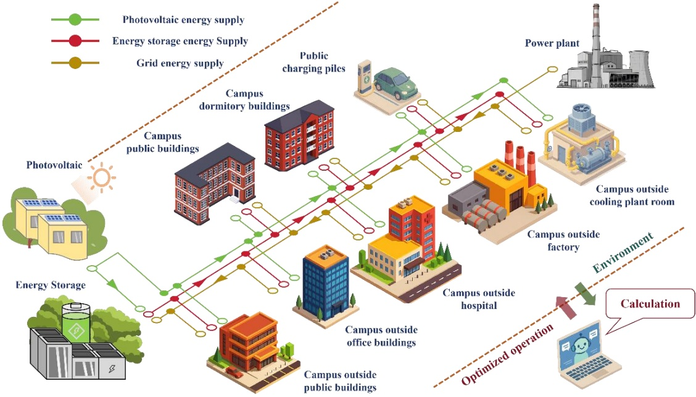

Fig.1 Composition of the virtual building cluster microgrid

As shown in the Fig.1, the following are the components of the entire virtual building cluster

microgrid. The data used include the 2021 real-time energy consumption data of 38 public buildings (B1) and 33 dormitory buildings (B2) in a university in Liaoning Province, the realtime equipment energy consumption data collected from 5 cooling plant room (B7) during different time periods in 2024 and the real-time energy consumption data of 3,196 charging piles covering 98 charging regions in June 2025. Due to practical requirements and cost constraints, certain equipment within the cooling plant room has not been effectively monitored. However, as core equipment, all chillers have been included in the statistics. The primary energy consumption sources for campus buildings and the cooling plant rooms are shown in the Table 2. To further enrich the functionality and diversity of the building cluster, this study additionally extracts real-time energy consumption data of 2 public buildings (B3), 7 office buildings (B4), 1 factory (B5), and 1 hospital (B6) from the open BDG2 dataset, so as to improve the functional of the virtual building cluster [51].

Table 2 The primary energy consumption sources for B1, B2 and B7

| Building Type | Primary sources of energy consumption |
| --- | --- |
| B1 (university public building, Dalian City, | Air conditioning, lighting, plug sockets |
| Liaoning Province) |  |
| B2 (university dormitory building, Dalian City, | Lighting, plug sockets |
| Liaoning Province) |  |
| Cooling plant room for an office building in | Chiller, chilled water pump, cooling water |
| Beijing (calculated in B7) | pump, cooling tower |
| Cooling plant room for an office building in | Chiller, chilled water pump, cooling water |
| Shenzhen (calculated in B7) | pump, cooling tower |
| Cooling plant room for a factory building in | Chiller, chilled water pump |
| Suzhou (calculated in B7) |  |
| Cooling plant room for an office building in | Chiller, chilled water pump, cooling water |
| Suzhou (calculated in B7) | pump, cooling tower |
| Cooling plant room for a commercial building in | Chiller, chilled water pump, cooling water |
| Yinchuan (calculated in B7) | pump, cooling tower |

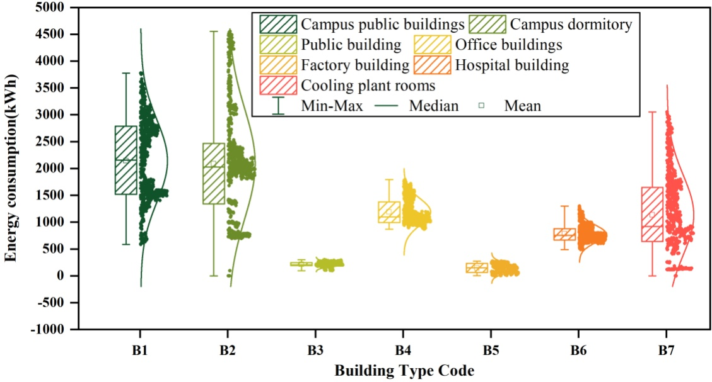

Fig.2 Real-time energy consumption distribution by building type

Most datasets cover relatively complete periods around June. Therefore, this study sets the research period to that month to ensure consistency in the scenario. Some building data lacks complete June figures. Data filling was performed using the nearest-time principle (shifting forward or backward by weekly intervals to ensure consistency between days of the week and time periods). A complete 30-day dataset was ultimately constructed. As shown in the Fig.2, hourly cumulative energy consumption by building type. Results show that due to a higher proportion in terms of quantity, campus buildings not only have a larger total amount of realtime cumulative energy consumption, but also a wider range of energy consumption distribution. In contrast, buildings selected from public datasets exhibit relatively lower electricity consumption and exhibit less volatility in energy demand.

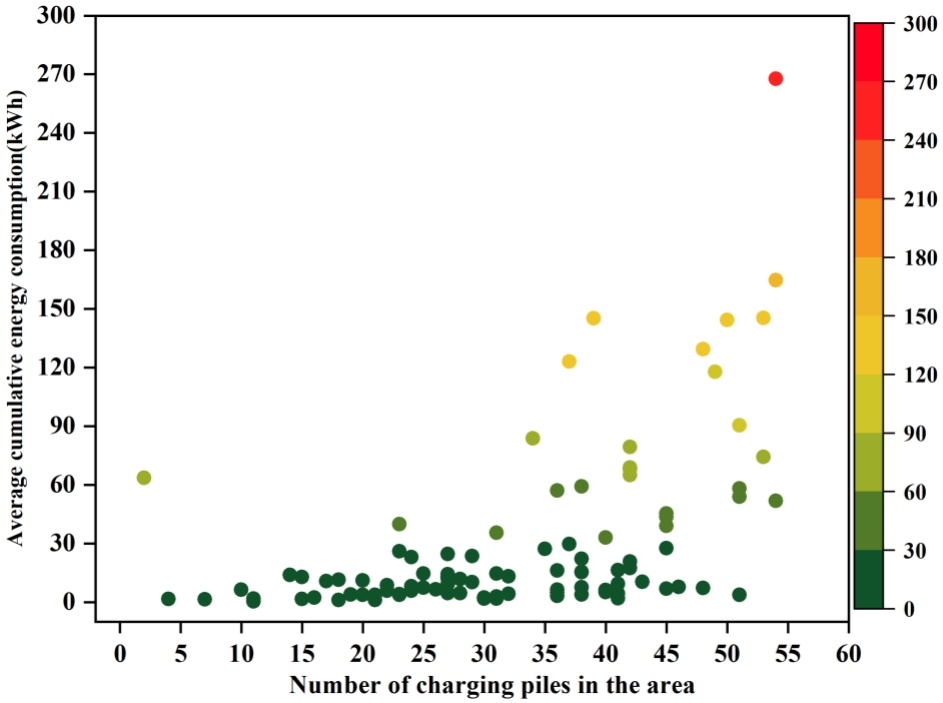

## Fig.3 Number of charging piles and average cumulative energy consumption

Based on the location of charging scenarios, charging stations can be categorized into home charging stations, workplace charging stations, and public charging stations [52]. The real-time electricity consumption data collected from charging regions in this study primarily originates from workplaces and public areas across multiple cities in China. However, due to location differences, there are significant variations in the usage frequency and real-time electricity consumption of individual charging piles [53]. As shown in the Fig.3, only a few areas exhibit higher average energy consumption for charging piles, which indirectly reflects that charging piles in these areas are used more frequently. Subsequently, a real-time electricity consumption model for charging stations will be constructed using actual data and deployed within a virtual building cluster. The entire community and microgrid will be set in the city with the largest building type in terms of electricity consumption (Liaoning Province, China). Environmental parameters such as temperature and solar radiation will utilize real-time data from the European Centre for Medium-Range Weather Forecasts (ECMWF).

### 2.2 Real-Time Data Generation Process for Charging Piles

Based on real operational data from charging piles, this study aims to develop an energy consumption data generation framework for charging piles that not only captures the collective energy consumption patterns of regional charging piles but also accommodates scenariospecific settings and individual heterogeneities among charging piles. The charging pile dataset collected in this study spans a 30-day period. Since the charging piles corresponding to this dataset are distributed across multiple cities in China, the data exhibits significant geographical heterogeneity, making direct fitting unable to characterize the typical charging behavior features of a single charging pile. Moreover, the data volume varies across different charging piles. Therefore, this study needs to categorize the data along the temporal dimension and calculate the mean values to construct a baseline energy consumption dataset for individual charging piles, which serves as the foundation for subsequent model fitting and data generation.

It is assumed in this study that all charging piles within the virtual building cluster exhibit consistency in their hourly energy consumption trends, which can approximately characterize the typical charging behavior features across different time periods. The variation in energy consumption among charging piles primarily stems from two factors: geographical location (charging region) differences and random individual variations at the level of individual charging piles. Based on this assumption, this study adopts two fitting paradigms for feature fitting on the standardized dataset. The first paradigm is hourly probability distribution fitting (one model per hour), which includes three methods, the Normal distribution, the Gaussian Mixture Model (GMM) and Kernel Density Estimation (KDE). The second paradigm is temporal trend fitting, which employs the Seasonal Autoregressive Integrated Moving Average (SARIMA) model.

Simulated power sequences matching the duration of the original data are generated based on each fitted model, and the method with the optimal fitting performance for the characteristic features of the original data is selected as the core method by calculating the Root Mean Square Error (RMSE). A global power adjustment coefficient and a scenario adjustment coefficient are assigned to each charging pile, and a systematic difference coefficient at the regional level is additionally introduced. Meanwhile, scenario no-charging probabilities differentiated by weekdays and weekends are synthesized based on the noisy-OR rule, which serves to determine whether a charging pile is in the charging state. The specific process is illustrated in the Fig.4, and the implementation logic of the four fitting methods and the configuration process of the scenario-based rules will be elaborated on in detail in the following sections. This study deploys 50 charging piles in a virtual urban area, which are evenly distributed across 10 charging regions.

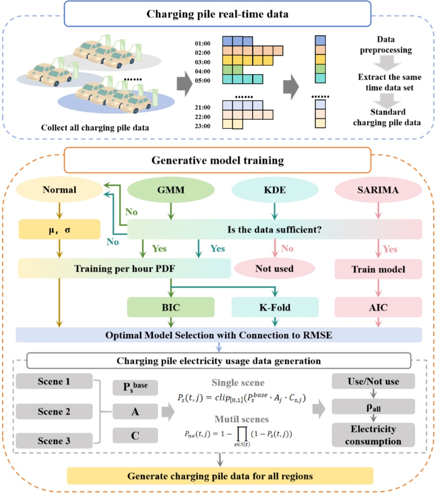

Fig. 4 Process for generating real-time electricity usage data for regional charging piles Normal distribution, GMM, and KDE are all commonly used to describe the probability density function of charging demand [54-58]. Among these, Normal distribution is a commonly used and straightforward method, with its formula shown below. Here, p and σ represent the daily average electricity consumption and variance at this moment, respectively.

$$
P ( p | h ) { \sim } N \big ( \mu _ { h } , \sigma _ { h } ^ { 2 } \big ) , \quad \mu _ { h } = m e a n \{ p _ { i } { : h o u r ( t _ { i } ) = h \} , \sigma _ { h } = s t d ( \cdot )\tag{[1]}
$$

A Gaussian Mixture Model (GMM) for each hour $( \mathsf { h } { = } 0 ,   1 ,   . . . ,   2 3 )$ is defined as a weighted sum of K Gaussian PDFs. For hourly data subsets, we perform Maximum Likelihood Estimation to fit the GMM parameters. Since analytical solutions for GMM parameter estimation cannot be obtained directly, we employ the Expectation-Maximization (EM) algorithm to solve the problem iteratively. The Bayesian Information Criterion (BIC) is employed to determine the optimal candidate parameter combination for each hourly GMM (candidate combinations are generated via grid search over hyperparameters). The calculation formula is as follows. Here, π represents the mixing coefficient, and the sum of all coefficients equals 1. L denotes the likelihood function, v represents the number of free parameters in the model, and Num indicates the amount of data contained in that hour. The optimal model result is sought among candidate parameter combinations by minimizing the BIC. When the data set contains fewer than 10 observations, the Normal distribution is still used to describe the data.

$$
\begin{array} { r } { P ( p | \theta _ { h } ) { \sim } \sum _ { k = 1 } ^ { K } \pi _ { h k } N \left( ( x | \mu _ { h k } ) , \sigma _ { k , h } ^ { 2 } \right) } \end{array}\tag{[2]}
$$

$$
\theta _ { h } = \left\{ \left( \pi _ { k , h } , \mu _ { k , h } , \sigma _ { k , h } ^ { 2 } \right) \right\} _ { k = 1 } ^ { K }\tag{[3]}
$$

$$
B I C ( \theta _ { h } ) = - 2 l n L ( \theta _ { h } ) + v l n N u m _ { h }\tag{[4]}
$$

KDE is a non-parametric method for estimating the PDF of hourly power load, based on observed samples from an unknown underlying distribution for each hour. It relies neither on prior data distributions nor imposes any assumptions about data distributions [57, 59]. The formula is as follows. Where $\phi$ denotes the Gaussian kernel, and b represents the bandwidth. Select the optimal bandwidth by maximizing the mean log-likelihood using K-fold cross-validation among candidate parameter combinations. Similarly, revert to the Normal distribution calculation when the number of candidate Num is too small.

$$
\begin{array} { r } { P _ { h } ( p ) = \frac { 1 } { N u m _ { h } b _ { h } } { \sum _ { n = 1 } ^ { N u m _ { h } } } \emptyset \left( \frac { p - p _ { n } ^ { h } } { b _ { h } } \right) } \end{array}\tag{[5]}
$$

The Autoregressive Moving Average Model (ARMA), Autoregressive Integrated Moving Average Model (ARIMA), and SARIMA have received attention in time series forecasting tasks [60, 61]. SARIMA enhances the accuracy of forecasting tasks by incorporating seasonal components into the ARIMA model [62]. Before use, normalization is performed on the time series. The Akaike Information Criterion (AIC) criterion is used in the candidate set to select the optimal combination, and denormalization is conducted to obtain the final result. The formula for AIC is as follows. Where k represents the number of parameters. For practicality, SARIMA will be skipped when the dataset spans fewer than 7 days.

$$
A I C = 2 k - 2 l o g L\tag{[6]}
$$

Normal, GMM, and KDE models will employ Monte Carlo simulation methods to generate real-time electricity consumption data for individual charging pile. SARIMA generates a dataset with a time interval of 720 steps. The generated data will be compared with the original data, and the model with the smallest RMSE will be selected for use in this study. The formula for RMSE is as follows. Where $\mathrm { y } ^ { * }$ denotes the generated data, y represents the real data, and T stands for the total number of data samples. This process is not intended to prove the superiority or inferiority of a single method, but rather a process of dynamically selecting a suitable model based on actual data.

$$
\begin{array} { r } { R M S E = \sqrt { \frac { 1 } { T } { \sum _ { t = 1 } ^ { T } ( y _ { t } ^ { * } - y _ { t } ) ^ { 2 } } } . } \end{array}\tag{[7]}
$$

Additionally, to account for scenario variations, this study established baseline non-charging probabilities for three distinct scenarios $( P _ { s } ^ { b a s e } )$

1) During nighttime hours (10pm – 5am), most public charging regions in urban areas experience low utilization rates, and vehicles already charging have typically completed their charging cycles. Therefore, an 80% probability of no charging activity is set.

2) During weekday morning and evening rush hours (7am–8am and 5pm–6pm), since most EV cars are on the road, the probability that charging regions are unavailable is set at 60%.

3) During daytime hours on weekends (8am-5pm), the probability that charging regions are not in use is set to 65%, as cars are often use on family trips or idle at home.

To account for real-time electricity consumption variations across different charging regions and charging piles, this study designed global adjustment coefficients and scenario adjustment coefficients $( \mathbf { A } _ { \mathbf { j } }$ and $\overline { { \mathbf { C } } } _ { \mathrm { s } , \mathrm { j } } )$ . The effective non-charging probability $\mathbf { P } _ { \mathrm { s } } ( \mathbf { t } , \mathbf { j } )$ for each pile can be expressed by the following formula.

$$
P _ { s } ( t , j ) = c l i p _ { [ 0 . 0 1 , 0 . 9 9 ] } ( P _ { s } ^ { b a s e } \cdot A _ { j } \cdot C _ { s , j } )\tag{[8]}
$$

Where clip is used for clipping to prevent the probability from exceeding 1. When the scenario is not triggered, thanks to the clipping mechanism, a 1% random non-charging probability is still retained.

In this study, there is no overlap of scenarios, but it integrates the process of calculating non-charging probabilities $( \mathbf { P } _ { \mathrm { n o } } ( \mathbf { t } , \mathbf { j } ) )$ for multiple scenarios using noisy-OR [63]. The formula is as follows, where S denotes the set of triggered scenarios.

$$
\begin{array} { r } { P _ { n o } ( t , j ) = 1 - \prod _ { s \in S ( t ) } ( 1 - P _ { s } ( t , j ) ) } \end{array}\tag{[9]}
$$

To ensure that regions and charging piles within the regions also have a certain degree of difference, a difference coefficient is set based on the charging pile IDs $( \rho _ { \mathrm { a r e a } } \mathrm { a n d } \rho _ { \mathrm { j } } )$ . The calculation formula is as follows. Where $\mathrm { { N u m } _ { a r e a } }$ denotes the area ID, and Numj represents the ID of charging piles within the area (numbering starts from 0). Finally, the total difference coefficient $\left( \mathrm { { \tt { p } } _ { a l l } } \right)$ is multiplied by the power consumption to obtain the real-time data of a specific charging pile. The parameters in the model and the variables and sets to be determined are shown in the Table 3.

$$
\rho _ { a r e a } = 0 . 0 2 \times N u m _ { a r e a }\tag{[10]}
$$

$$
\rho _ { j } = 0 . 0 5 + N u m _ { j } \times 0 . 0 3\tag{[11]}
$$

$$
\rho _ { a l l } = 1 + \rho _ { a r e a } + \rho _ { j }\tag{[12]}
$$

Table 3 Parameters related to charging pile generation model training

<table><tr><td>Type</td><td>Parameters</td><td>Value or range</td></tr><tr><td rowspan="5">Global parameters</td><td>Number of charging regions</td><td>10</td></tr><tr><td>Number of charging piles in the region</td><td>5</td></tr><tr><td>Simulated days/hours</td><td>30/720</td></tr><tr><td>Global adjustment coefficients (Aj)</td><td>[0.8,1.2]</td></tr><tr><td> $( \mathbf { C } _ { \mathrm { s , j } } )$  Scenario adjustment coefficients</td><td>[0.9,1.1]</td></tr><tr><td rowspan="3">GMM parameter tuning</td><td>Number of mixed components(K)</td><td>{1, 2, 3, 4}</td></tr><tr><td>Covariance type</td><td>full, tied</td></tr><tr><td>Covariance regularization</td><td> $1 0 ^ { - 4 }$   $1 0 ^ { - 6 } ,$ </td></tr><tr><td rowspan="2">KDE parameter tuning</td><td>Kernel density bandwidth (b)</td><td>{0.5, 1.0, 2.0}</td></tr><tr><td></td><td>((1,0,0), (1,0,0,24))</td></tr><tr><td rowspan="3">SARIMA parameter tuning</td><td rowspan="3"> $( \mathtt { p } , \mathtt { d } , \mathtt { q } ) , ( \mathtt { P } , \mathtt { D } , \mathtt { Q } , \mathtt { s } )$ </td><td></td></tr><tr><td>((0,1,1), (1,0,0,24)) ((1,1,1), (0,1,1,24))</td></tr><tr><td>((2,0,0), (1,0,0,24))</td></tr></table>

### 2.3 Modeling of PV Energy Storage Microgrids

Based on relevant literature, this study models PV and energy storage systems and determines their associated parameters [13, 64-66]. Distributed PV systems represent a vital clean energy technology for converting solar energy into electricity. They are widely adopted due to their economic benefits and environmental friendliness.

Lithium batteries, as high-energy electrochemical energy storage devices, can store highquality electrical energy and are effectively applied in distributed power grids. The energy storage system capacity configured in this study can meet at least two hours of average operational demand [65]. Meanwhile, the supply and demand of the power system will achieve balance at different times. The operational rule for PV power generation prioritizes supply to the user side, with surplus power fed into the energy storage system. However, PV output is far lower than the user-side energy demand, meaning PV power is exclusively used to supply the user side in practical operation. For details on the relevant modeling process, please refer to Appendix A. This study will primarily discuss the operational costs that can be reduced through optimization in microgrid systems. The total cost primarily includes electricity procurement costs, battery equivalent degradation costs, and fixed operation and maintenance costs for photovoltaic systems and energy storage systems.

Actual electricity consumption is continuous, but in this study, it is recorded hourly. Therefore, the electricity rate used is based on the rate within the preceding hour. If two different rates apply within that hour, the most recent rate is used for calculation. The electricity price ratio is 1.5:1:0.5, with the flat-rate electricity price set at \$0.1/kWh in this study. The equivalent degradation cost per unit energy of the battery will be determined based on relevant literature [67]. The service life of photovoltaic systems and energy storage systems shall be set according to the referenced literature [66]. The relevant cost calculation process is detailed in Appendix B.

## 3. Operation Optimization Methods

### 3.1 DRL Settings

## (1) State observation

The real-time state observation space for this study is illustrated below. Includes real-time photovoltaic power availability $( \mathrm { P ^ { P V } } )$ , load demand $( \mathrm { P _ { L o a d } } )$ , energy storage status (SOC), electricity rates (p), energy storage charge/discharge capacity $( \mathrm { P ^ { r e m a i n } } )$ , and valley value label.

$$
S _ { t } = [ P _ { t } ^ { P V } , P _ { L o a d } , S O C _ { t } , p _ { t } , P _ { t } ^ { r e m a i n , c h a r } , P _ { t } ^ { r e m a i n , d i s c } , v a l l e y _ { t } ]\tag{[13]}
$$

## (2) Action selection

Since this study primarily employs DQN deep reinforcement learning with actions defined as a discrete set, the energy storage system charge/discharge capacity limits will be partitioned into intervals at step sizes of 100, 80, and 50. The action space comprising 161, 201, and 321 feasible actions, respectively. Real-time actions (at) must comply with the maximum charge/discharge power limits for energy storage. Additionally, they require observing the current charge/discharge limit calculated from real-time SOC, as shown in the formula below. This is ultimately mapped to the actual execution power.

$$
P _ { t } ^ { B a t } = \left\{ \begin{aligned} m i n \{ P _ { t } ^ { B a t } , P _ { t } ^ { r e m a i n , c h a r } \} \quad & P _ { t } ^ { B a t } > 0 \\ m a x \{ P _ { t } ^ { B a t } , - P _ { t } ^ { r e m a i n , d i s c } \} \quad & P _ { t } ^ { B a t } < 0 \end{aligned} \right.\tag{[14]}
$$

## (3) Reward setting

In this study, rewards will be composed of multiple scenario components combined as follows. Includes operating costs $( \mathbf { C } _ { \mathrm { t o t a l } } )$ , valley charging incentives $( \phi _ { \mathrm { c h a r , v a l } } )$ , peak discharge incentives $( \phi _ { \mathrm { d i s c , v a l } } )$ , peak shaving incentives (ϕband), pre-peak incentives/penalties $\left( \phi_{ pre-peak } \right)$ , and energy storage charge and discharge matching incentives $( \phi _ { \mathrm { d a y } } )$

$$
R_{t} = - \lambda C_{total,t} + \phi_{total,val}(t) + \phi_{disc,peak}(t) + \phi_{band}(t) + \phi_{pre-peak}(t) + \phi_{day}(t)[15]
$$

$$
\phi _ { c h a r , v a l } ( t ) = k _ { g r i d } \varDelta p P _ { t } ^ { G r i d - B a t } + k _ { P V } P _ { t } ^ { P V - B a t }\tag{[16]}
$$

$$
\phi _ { d i s c , p e a k } ( t ) = k _ { p e a k } P _ { t } ^ { B a t - L o a d }\tag{[17]}
$$

$$
\phi _ { b a n d } ( t ) = k _ { b a n d } c l i p ( \frac { s _ { t } - s _ { l } } { s _ { u } - s _ { l } } , 0 , 1 ) P _ { B a t } ^ { r a t e d } \varDelta p \eta\tag{[18]}
$$

$$
\phi_{pre-peak}(t)=\left\{\begin{matrix}-k_{pen}(s_{prep}-s_{t})P_{Bat}^{rated}\Delta p\ s_{t}<s_{prep}\\0.5k_{pen}\min(s_{t}-s_{prep},0.05)P_{Bat}^{rated}\Delta p\ s_{t}\geq s_{prep}\end{matrix}\right.\tag{[19]}
$$

$$
\phi_{day}(t)=\left\{\begin{matrix}-120(0.45-s_{t})\ s_{t}<0.45\\-80(s_{t}-0.55)\ s_{t}>0.55\\0\ o t h e r\end{matrix}\right.\tag{[20]}
$$

We encourage charging during valley hours to store electricity for use during peak periods, while simultaneously utilizing all PV power in real time. In this study, 8:00 am and 5:00 pm mark the start of peak electricity pricing periods. Therefore, we require the SOC of the energy storage equipment to remain within the $[ \mathrm { s _ { l } , ~ s _ { u } } ]$ (morning [0.6, 0.8], night [0.55, 0.75]) during the preceding four hours (4-7 am, 1-4 pm). Since most of the morning falls within the low-rate pricing period, the target SOC is set slightly higher. When approaching peak pricing intervals, penalties are applied if the target lower limit $s _ { \mathrm { p r e p } }$ (0.65 morning, 0.7 night) is not met. Conversely, rewards are granted. In this study, the initial SOC of the energy storage system is set to 50%. To rationally plan the charging and discharging process of the energy storage system and reduce unreasonably unused energy, a penalty is therefore set for cases where the SOC is not within the range [0.45, 0.55] at 23:00 every day. In the formula, $\triangle \mathbf { p }$ denotes the price difference between peak and valley electricity prices. $\lambda$ and k represent weight coefficients, which need to be determined based on training results and real-time reward changes. This study constructs a interpretable reward function with a cost-oriented approach.

### 3.2 Environmental Perception and Semantic Masking DQN

## (1) Deep Q-networks

DQN represent an approach that combines reinforcement learning with artificial neural networks, primarily by extrapolating past experiences to new situations through interaction with the environment [68]. DQN use state and action spaces to determine optimal actions that maximize cumulative reward. Due to its simplicity and applicability, DQN has been refined and applied in numerous studies [69, 70]. For the detailed calculation process related to DQN, please refer to Appendix C.

## (2) Environmental perception and semantic masking

As a reinforcement learning architecture for discrete action spaces, DQN presents significant challenges in practical training when the action space is large. This leads to training processes containing numerous ineffective actions or actions that are ultimately pruned, severely impacting network stability and exploration costs. Therefore, to constrain the action space and enhance sampling efficiency without altering the DQN objective function or training workflow, this study introduces a semantic masking mechanism during the action selection phase.

First, the feasible power limits $( \mathrm { P ^ { r e m } } )$ for charging or discharging the energy storage system within one step are obtained through real-time SOC observation and power constraints. The formula is as follows.

$$
P_{char}^{rem}(t) = min\left(P_{char,non,Bat},max\Big(0,(SOC_{max} - SOC_{t})P_{Bat}^{rated}/\eta\Big)\right)\tag{[21]}
$$

$$
P_{disc}^{rem}(t)=min\big(P_{disc,non,Bat},max\;(0,(SOC_{t}-SOC_{min})P_{Bat}^{rated}\eta)\big)\tag{[22]}
$$

The semantic layer provides a desired central power $\mathsf { d } _ { \mathsf { t } }$ based on the electricity price label and state at the current time, which mainly consists of three types of intentions, energy supplementation during valley electricity prices, power reserve before peak electricity prices, and peak shaving during peak electricity prices. It undergoes gradual attenuation when approaching SOC boundaries. During execution, these scenarios will be gone through respectively based on the current electricity price to update the final $\mathbf { d } _ { \mathrm { t } } .$

During valley energy supplementation periods, set the target $\mathrm { S O C ^ { t g } }$ (0.52 before 6am, 0.48 after 6am). To smooth charging and discharging operations, a smoothing coefficient (H) is set to constrain the actions. Use the following formula to achieve the optimal charging power $\mathbf { d } ^ { \mathrm { v a l } }$ $\mathrm { H _ { v a l } }$ is the valley-time smoothing coefficient (1.4h).

$$
d_{t}^{val} = \frac{\max\left( 0,\left( SOC_{t}^{tg} - SOC_{t} \right) \right)P_{Bat}^{rate}}{\eta H_{val}}\tag{[23]}
$$

In the pre-peak power reserve scenario, the energy storage system must maintain at least 70% SOC reserve capacity before morning and evening peak periods. Therefore, during these peak periods when $\mathrm{SOC_{t}<0.7,H_{rep}}$ is set to 4h. The optimal charging power $\mathbf { d } ^ { \mathrm { p r e p } }$ is calculated using the following formula.

$$
d_{t}^{pre} = \frac{max(0,0.7 - SOC_{t})P_{Bat}^{rate}}{\eta H_{pre}}\tag{[24]}
$$

During peak electricity rates and when the SOC buffer margin exceeds 30%, the energy storage system is encouraged to discharge. Set Hpeak $\mathrm { H _ { p e a k } }$ is 1.6, with the formula shown below.

$$
d_{t}^{peak} = \frac{max(0,SOC_{t}-SOC_{buf})P_{Bat}^{rated}\eta}{H_{peak}}\tag{[25]}
$$

During peak nighttime electricity rates, a bias $( \mathbf { b } _ { \mathrm { l a t e } } )$ is superimposed to accommodate environments with higher nighttime electricity consumption. The formula is shown below. γ $\mathrm { p e a k }$ is a defined weighting factor that requires adjustment based on actual conditions. In this study, it is set to 0.4. A larger safety margin has been incorporated into the formula.

$$
b _ { l a t e } = \gamma _ { p e a k } \cdot m a x ( 0 , S O C _ { t } - 0 . 3 4 ) P _ { B a t } ^ { r a t e d } \eta / H _ { p e a k }\tag{[26]}
$$

If the current time period falls within the flat electricity rate period and the SOC margin exceeds 50%, configure the overlay discharge bias $\mathbf { b } _ { \mathrm { f l a t } }$ with $\mathrm { H _ { f i a t } }$ set to 4 hours. For non- valley periods where SOC exceeds 55%, configure the global discharge bias $( \mathbf { b } _ { \mathrm { s o c } } )$ . The formula is as follows.

$$
b _ { t } ^ { f l a t } = - \gamma _ { f l a t } ( S O C _ { t } - 0 . 5 ) \cdot P _ { B a t } ^ { r a t e d } \eta / H _ { f l a t }\tag{[27]}
$$

$$
b _ { s o c } = - 0 . 1 5 ( s _ { t } - 0 . 5 5 ) P _ { B a t } ^ { r a t e d } \eta / 2\tag{[28]}
$$

Simultaneously, to minimize the occurrence of SOC boundary triggering and clipping actions, the boundary bandwidth $\Delta \mathrm { s }$ is defined as 0.05. The results of d undergo linear attenuation based on distance from the boundary, with the coefficient ϕ(SOCt) calculated using the following formula.

$$
\phi(SOC_{t}) = \begin{cases}\frac{(SOC_{max} - SOC_{t})}{\Delta s} \quad d > 0 \; and \; SOC_{t} > SOC_{max} - \Delta s \\\frac{(SOC_{t} - SOC_{min})}{\Delta s} \quad d < 0 \; and \; SOC_{t} < SOC_{min} + \Delta s \\\quad 1 \; else\end{cases}\tag{[29]}
$$

The expected center power to a discrete index to obtain the target ID it. Calculate the feasible index interval [L0, L1] based on the set fundamental bandwidth radius h0. In this study, it is set to the number of actions that 1.5MWh (about 10% of the energy storage capacity) can accommodate. And $\mathbf { h } _ { \mathrm { m a x } }$ is the initial maximum bandwidth radius, and step is the action increment. The skew is an asymmetric bias set based on real-time electricity prices, enabling the candidate action range to shift toward more reasonable options by several increments.

$$
h _ { t } = m i n \left( h _ { m a x } , h _ { 0 } + | d _ { t } / s t e p | \right)\tag{[30]}
$$

$$
s k e w _ { t } = \left\{ \begin{aligned} + 3 \ t & = v a l l e y \\ - 3 \ t & = p e a k \\ - 2 \ t & = f l a t \; a n d \; S O C _ { t } > 0 . 5 \\ 0 \quad & e l s e \end{aligned} \right.\tag{[31]}
$$

$$
L _ { 0 } ( t ) = i _ { t } - \left( h _ { t } + m a x ( 0 , - s k e w ) \right)\tag{[32]}
$$

$$
L _ { 1 } ( t ) = i _ { t } + \left( h _ { t } + m a x ( 0 , s k e w ) \right)\tag{[33]}
$$

The action space $\mathrm { A _ { p h y s } }$ is constrained within a reasonable range through the aforementioned masking process, after which each candidate action undergoes physical feasibility filtering.

$$
A _ { t } ^ { p h y s } = \{ a _ { i } \colon \big ( a _ { i } \geq 0 \to a _ { i } \leq P _ { c h a r } ^ { r e m } ( t ) \big ) \cap ( a _ { i } < 0 \to | a _ { i } | \leq P _ { d i s c } ^ { r e m } ( t ) ) \}\tag{[34]}
$$

To minimize the occurrence of zero actions, configure the system to include zero actions only when the SOC is below 45% or nearing the boundary. Simultaneously, set the lower limit $\mathrm { N _ { m i n } }$ for optional actions. This study sets this value at approximately 10% of the number of actions in the action space for different step sizes. If the candidate set is too small, it reverts and increases $\mathbf { h } _ { \mathrm { m a x } }$ by two step sizes before recalculating. If it remains below the lower limit but there are still a small number of possible actions, use the 50% index of the rechargeable upper and lower limits. If no feasible actions are available, the energy storage system shall perform no operation at this time step. For a detailed description of the semantic mask process, please refer to the Appendix D.

## (3) Semantic mask DQN

This study constructs a virtual building cluster microgrid, and focuses on designing the interaction mechanism between the DQN with semantic masking (Semantic mask DQN) and the microgrid environment, and the specific process is shown in the Fig.5.

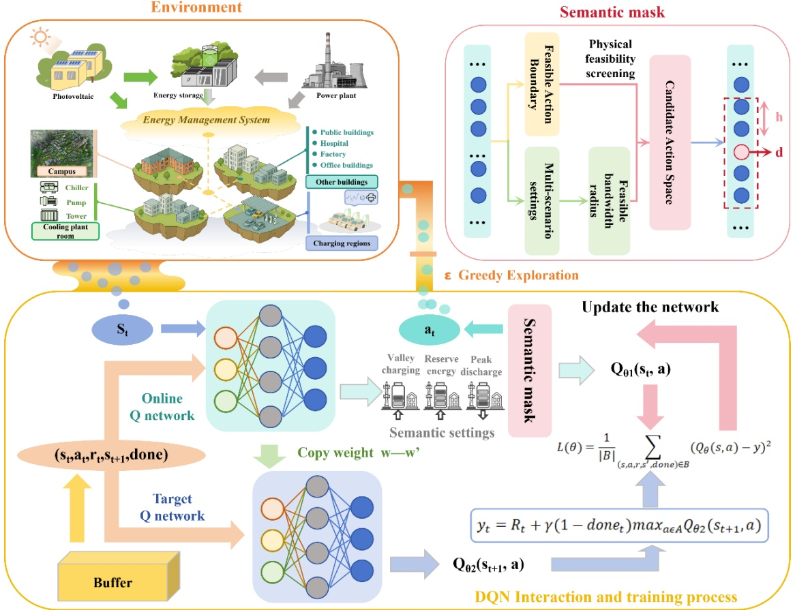

Fig. 5 Semantic mask DQN network interactive training process

First, environment initialization is performed. Real-time building loads, real-time charging pile loads, and physical parameters of the PV and energy storage systems are integrated to construct an interactive microgrid environment. During the operation of the environment, a normalized state vector is extracted in real time and input into the online Q-network, which then outputs the full set of initially set actions.

The semantic model initiates dynamic screening after receiving the full set of actions. Combining the characteristics of the current time period and the SOC state of the energy storage system, it calculates the desired central power that adapts to the operation objectives. Then, based on the current physical state of the energy storage system, it calculates the power feasibility limits and filters out invalid actions. With the action index corresponding to the desired central power as the core, a candidate action set is constructed according to the timeperiod asymmetric bias and preset bandwidth radius. Ultimately, the filtered candidate action indices are fed back to the online Q-network.

Subsequently, it enters the strategy execution phase. The DQN adopts a combination of the greedy strategy and maximum Q-value selection to determine the final action to be executed from the candidate action set. After action feed back to the microgrid environment, the environment performs secondary correction on the action based on the charging and discharging power limits of the energy storage system and SOC constraints, and updates the SOC state of the energy storage system. Meanwhile, the environment calculates the multi-objective reward according to the energy flow at the current time step.

In the feedback update phase, the system stores the current state, action, reward, new state, and terminal flag into the experience replay buffer, providing samples for the subsequent parameter update of the Q-network. Meanwhile, the environment transmits the updated operating context to the semantic model to prepare for action screening in the next time step. The entire process iterates in a loop until the environment triggers the termination signal, thus completing a full interaction cycle.

In this study, the maximum storage capacity of the experience replay buffer is set to 500,000 experiences, and the first training session is initiated when the number of experiences in the buffer reaches 320. During each training round, the agent completes 720 time-step interactions with the environment. To explore the adaptability of the DQN with semantic masking under different action spaces, the action step sizes are set to 100 kW, 80 kW, and 50 kW respectively. The remaining hyperparameters are determined through multiple rounds of experimental debugging, with specific values shown in the Table 4. The real-time power generation of the PV system is much lower than the demand. Therefore, it will be allocated according to the proportion of real-time energy demand of different types of buildings.

Table 4 Semantic mask DQN related hyperparameters

| Hyperparameters | Value |
| --- | --- |
| Input state dimension | 7 |
| Output action space dimension | 161，201，321 |
| Action step length | 100，80，50 |
| Total training rounds | 800，1000，1200 |
| Learning rate | 5e-5 |
| Discount factor | 0.98 |
| Greedy strategy initial exploration rate | 0.8 |
| Greedy strategy minimum exploration rate | 0.05 |
| Exploring the decay coefficient | 0.998 |
| Target Q network update frequency | 500 |
| Semantic mask maximum step radius | 16，19，30 |
| Minimum number of candidate actions | 21，25，37 |

### 3.3 Experimental Setup

The semantic masking mechanism proposed in this study is designed and implemented based on the DQN architecture. To verify the incremental value of this mechanism, a multi-dimensional comparison between the original DQN and the DQN with semantic masking is required. To ensure the fairness of experimental comparison and the reproducibility of results, both types of DQN models are trained with the same random seed, and all hyperparameters are kept completely consistent. To further validate the effectiveness and superiority of the proposed framework, Particle Swarm Optimization (PSO), Whale Optimization Algorithm (WOA) and Differential Evolution (DE) are additionally introduced as baseline models in this study. The PSO algorithm is implemented directly using the pyswarm library. Except for the hyperparameters requiring adjustment, all other parameters utilize the library's default configuration. The hyperparameters of all baseline algorithms are tuned and determined according to the convergence characteristics and variation amplitude of the optimal value of the objective function observed in real time. The results are shown in the Table 5. DQN takes maximizing the reward function as its optimization objective, while PSO, WOA, and DE all aim to minimize the objective function to obtain the globally optimal combination of energy storage actions. To ensure the consistency of optimization objectives among different algorithms and the rationality of comparison, this study uses the negative value of the DQN reward function as the objective function of these three algorithms, thus unifying the optimization direction of all comparative models.

Table 5 Semantic mask DQN related hyperparameters

| Strategy Hyperparameters | Value |
| --- | --- |
| Population size | 80 |
| PSO |  |
| Maximum number of iterations | 150 |
| Population size | 80 |
| Maximum number of iterations | 150 |
| WOA | Linearly decreases from 2 to 0 |
| Contraction factor | during iteration |
| Spiral update parameter | 1 |
| Population size | 80 |
| Maximum number of iterations | 180 |
| DE |  |
| Mutation factor | 0.5 |
| Crossover probability | 0.9 |

In the performance evaluation of all models, the total system operating cost $( \mathrm { O p e } _ { \mathrm { c o s t } } )$ and total grid electricity consumption $( \mathrm { T o t a l } _ { \mathrm { G r i d } } )$ serve as core focus metrics. These two factors directly correlate with the economic viability (operating costs) and environmental impact (grid dependency) of the microgrid during the experimental operation period. Secondly, the study aims to achieve cost reduction and grid electricity purchase reduction through the charging and discharging scheduling of energy storage systems, while ensuring that the energy difference between the initial and final states of energy storage approaches zero (energy storage state closed-loop). Therefore, the SOC status (Batdiff) (SOC at the end of the experimental period, the average and standard deviation SOC at 23:00 every day) is also an important comparative indicator for the energy storage system. To reduce the generation of useless actions during training and decrease the frequency of action clipping caused by violating physical constraints, the boundary trigger count of the energy storage system $\mathrm { ( B a t _ { b o u n d a r y } ) }$ (action exceeds the remaining chargeable or dischargeable capacity of the energy storage system/ discharging action exceeds the remaining load.) is incorporated into the evaluation system to reflect the operational safety of the strategy and the effectiveness of actions. Finally, considering the core operational requirement of discharging during peak electricity rates and charging during valley periods in microgrids, the amount of electricity purchased from the grid during peak pricing periods $( \mathrm { G r i d } _ { \mathrm { p e a k } } )$ serves as a key metric for evaluating the peak shaving effectiveness of strategies.

To further verify the optimization effect of semantic masking on the training process of traditional DQN, the study adds two supplementary evaluation dimensions from the perspective of training dynamic characteristics. The reward value in the initial training phase $( \mathrm { R } _ { \mathrm { I n i t i a l } } )$ is used to evaluate the initial learning efficiency of the strategy. The standard deviation of rewards in the last 100 training rounds $( \mathrm { R } _ { \mathrm { S t a n d a r d } } )$ is used to quantify the stability of the strategy in the late training stage. For the performance comparison between the group search algorithm and DQN, the evaluation dimensions $\mathrm { ( E v a _ { g r o u p } }$ and $\mathbf { E v a } _ { \mathrm { D Q N } } )$ are as follows.

$$
E v a _ { g r o u p } = \{ O p e _ { c o s t } , T o t a l _ { G r i d } , B a t _ { d i f f } , B a t _ { b o u n d a r y } , G r i d _ { p e a k } \}\tag{[35]}
$$

$$
E v a _ { D Q N } = \{ O p e _ { c o s t } , T o t a l _ { G r i d } , B a t _ { d i f f } , B a t _ { b o u n d a r y } , G r i d _ { p e a k } , R _ { I n i t i a l } , R _ { S t a n d a r d } \} [ 3 6 ]
$$

## 4. Results

### 4.1 EV Electricity Consumption Data Generation Results

Based on real data and the real-time charging behavior generation mechanism of charging piles, this study constructs an energy consumption dataset for 50 charging piles across 10 regions. By comparing the generation results of four methods with real data, the model with the smallest RMSE was selected as the optimal generation scheme.

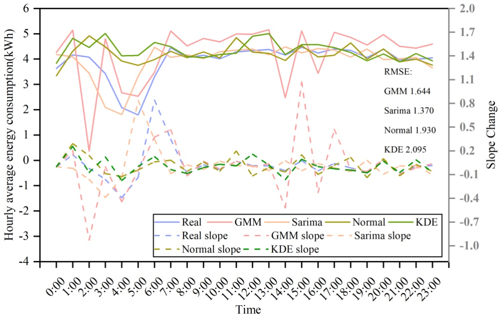

Fig. 6 Hourly averaged results for actual and generated data

As shown in the Fig.6, the data generated by the SARIMA model has the best trend consistency with real data, and its overall error indicators are significantly lower than those of the other three methods. Compared with the GMM, Normal Distribution, and KDE model, the RMSE is reduced by 16.7%, 28.4%, and 34.6% respectively. It should be specially noted that the GMM model generated an abnormally small value at 2:00 am. To ensure the readability of the figure, the trend slope corresponding to 3:00 was set to zero. Since the original data represents the averaged energy consumption of all charging piles, the average electricity usage data after 7:00 AM appears relatively stable. SARIMA attempts to capture this feature, so the resulting errors are small and relatively stable. Differentiation among charging piles will be achieved through scenarios and parameter settings.

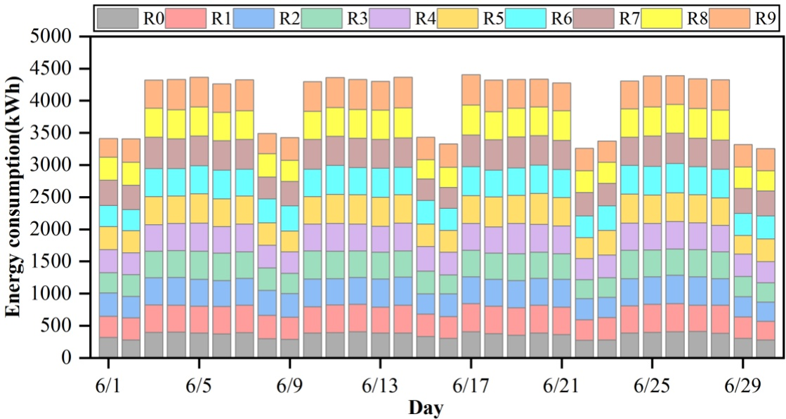

(a) Cumulative energy consumption by charging region per day

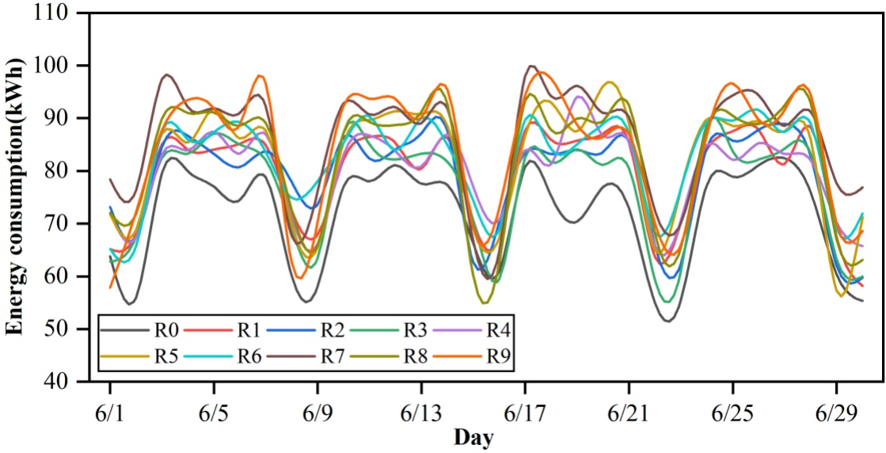

(b) Average cumulative energy consumption per charging pile within different charging regions

Fig. 7 Generation results for all charging pile energy consumption data

As illustrated in Fig. 7, the two subplots respectively depict the cumulative daily charging energy of each region and the average cumulative energy consumption curve for individual charging piles within each region. The results demonstrate that, by introducing a scenariospecific differentiation mechanism and individual adjustment coefficients for charging piles, the generated simulated data not only preserves the global patterns of charging behavior but also endows each charging pile with independent energy consumption characteristics. This effectively captures the independent operational traits of individual charging piles while aligning with the predetermined collective charging behavior patterns.

(a) 24-hour mean energy consumption on weekdays

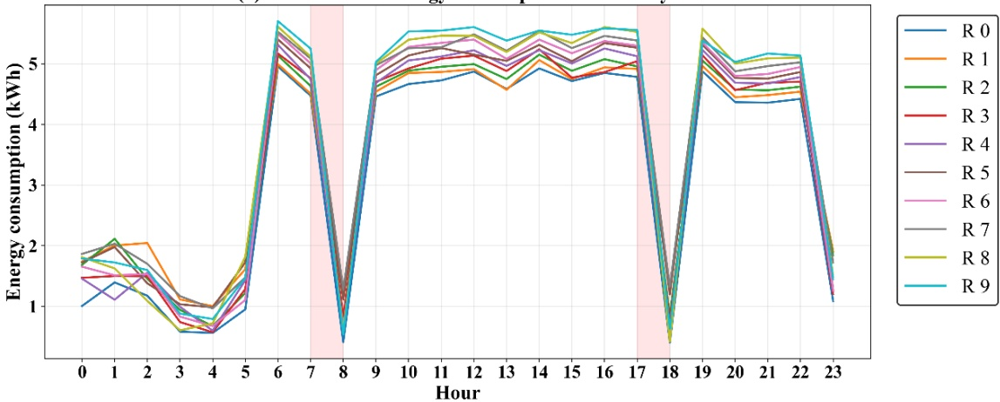

(b) 24-hour mean energy consumption on weekends

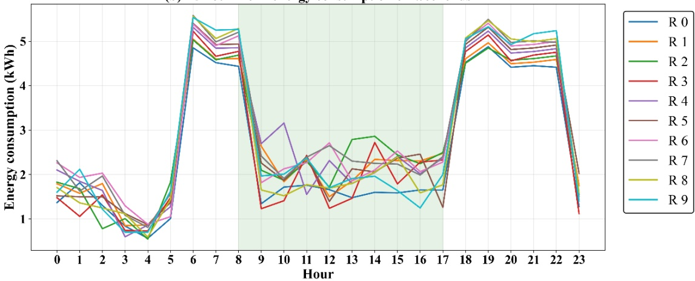

Fig. 8 Average hourly charging power for charging piles in different regions

This study further statistically analyzes the hourly average energy consumption of charging piles across 10 charging regions. As shown in Fig. 8, subfigures (a) and (b) correspond to the regional average energy consumption curves for weekday cases and weekend cases (selected one day), respectively. The core reason for the energy consumption difference between these two time periods stems from the differentiated settings of scenario coefficients. On workdays, due to the set high non-charging probability during morning and evening peak hours, the average energy consumption level of each region shows a significant downward trend. However, during daytime on weekends, the average energy consumption of each region exhibits richer fluctuation characteristics within a reasonable threshold range, which not only reflects the charging demand for family travel on weekends but also mirrors the usage differences between regions. By synthesizing the real-time energy consumption data of all charging piles, the maximum electricity demand is calculated to be 269.15 kWh.

### 4.2 Analysis of Optimization Results

This study takes campus buildings as the core, integrates real-time energy consumption data of other types of buildings and charging piles, and constructs a community-level microgrid system under the load matching mode of coordinated energy supply from PV, energy storage, and the power grid. To achieve operation cost optimization and ensure goal consistency, this study adopts an environmental perception and Semantic mask DQN reinforcement learning method.

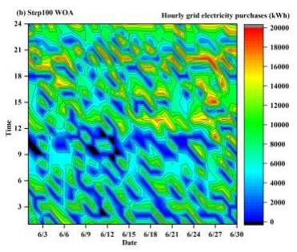

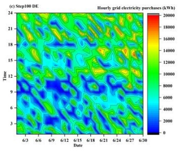

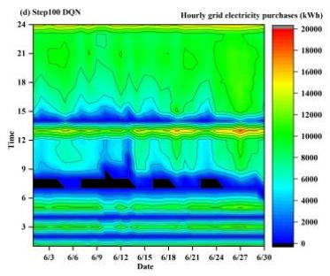

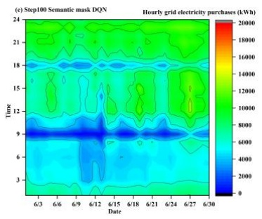

Fig. 9 Real-time grid power purchase when the action step size is 100

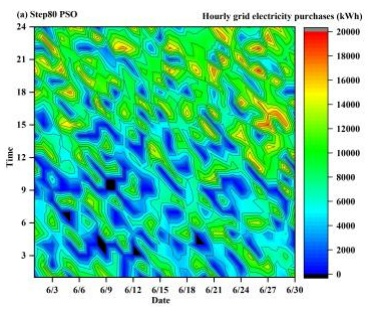

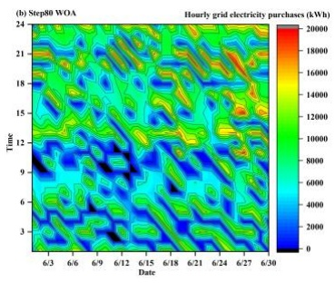

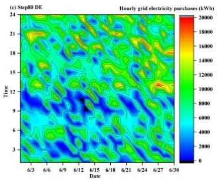

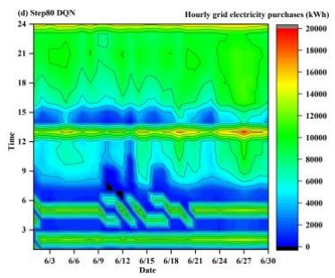

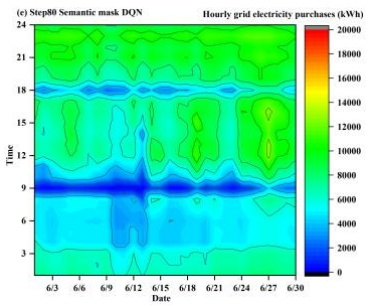

Fig. 10 Real-time grid power purchase when the action step size is 80

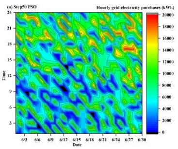

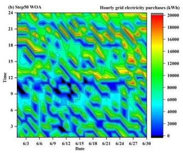

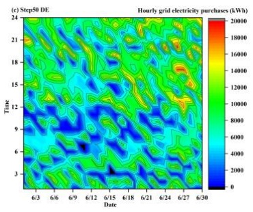

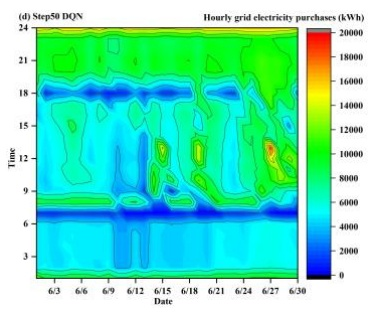

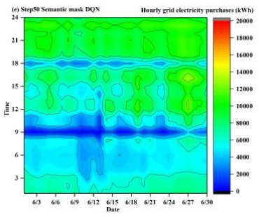

Fig. 11 Real-time grid power purchase when the action step size is 50

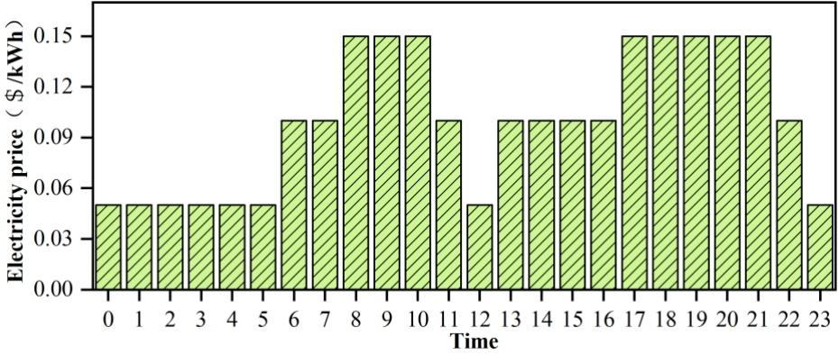

Fig. 12 Real-time electricity price fluctuations

As shown in the Figs.9-11, illustrates the distribution characteristics of real-time electricity purchases from the power grid on the energy consumption side under different action step sizes and optimization methods. The real-time electricity prices shown in Fig. 12. Among them, swarm intelligence optimization strategies conduct searches with the goal of global optimization, resulting in differences in the daily electricity purchase patterns. However, from the overall results, this type of method can still learn effective electricity purchase rules from the preset reward and target mechanisms.

From the results of the DQN algorithm, compared with swarm intelligence strategies, it not only maintains more optimal electricity purchase rules during morning peak electricity price periods but also further increases the number of days with reduced electricity purchases during evening peak electricity price periods. However, the DQN strategy consistently involves largescale short-term electricity purchases during the midday period across different operational time steps, creating significant strain on the power supply side of the grid. Moreover, due to the lack of semantic guidance, relatively low electricity purchases did not occur during nighttime peak pricing periods when the action step size was large. This phenomenon was only corrected when the step size was set to 50. The semantic masking DQN exhibits relatively low and stable electricity purchasing behavior during peak pricing periods. Purchasing patterns remain consistently stable during other periods, fully aligning with the anticipated optimization objectives.

As shown in the Table 6, this study statistically analyzes the total operating cost (including equipment maintenance), total electricity purchased from the grid, energy storage system endof-day status, and electricity purchased during peak electricity price periods. Compared with all swarm intelligence optimization algorithms (under different action step sizes), the Semantic mask DQN reduces the total electricity purchase volume by an average of 2.66%-3.73%. The reduction in energy consumption primarily stems from the frequent charging and discharging cycles of certain comparison strategies. Furthermore, since the energy storage system's initial state was 50%, most comparison strategies with step sizes of 100 and 80 resulted in average SOC values below 50% after the experiment completed (this penalty term was entirely ignored during DQN training). Therefore, the actual difference in electricity purchases should be even greater.

Table 6 The calculation results of the evaluation indicators

| Evaluation Step indicators | PSO | WOA | DE | DQN | Semantic mask DQN |
| --- | --- | --- | --- | --- | --- |
| Opecost(＄) | 525181.58 | 509445.38 | 504443.87 | 503967.89 | 496459.26 |
| TotalGrid | 5021028.42 | 5078587.11 | 5022136.88 | 4966130.00 | 4889809.44 |
| （kWh） |  |  |  |  |  |
| Batdiff(%) |  |  |  |  |  |
| 100 (mean/standard | 44/28/20 | 27/17/66 | 33/20/20 | 20/0/20 | 54/2/54 |
| deviation/final |  |  |  |  |  |
| SOC) |  |  |  |  |  |
| Gridpeak | 1762427.01 | 1541248.35 | 1531536.46 | 1898249.85 | 1554220.38 |
| （kWh） |  |  |  |  |  |
| Opecost(＄) | 525014.23 | 508614.10 | 504019.40 | 510212.33 | 495593.31 |
| TotalGrid | 5020566.43 | 5075445.52 | 5017249.42 | 4970159.23 | 4890714.90 |
| （kWh） |  |  |  |  |  |
| Batdiff(%) |  |  |  |  |  |
| 80 (mean/standard | 44/27/20 | 28/17/66 | 26/13/20 | 20/0/20 | 50/2/51 |
| deviation/final |  |  |  |  |  |
| SOC) |  |  |  |  |  |
| Gridpeak | 1758002.70 | 1544072.29 | 1587913.27 | 1899805.30 | 1545778.88 |
| （kWh） |  |  |  |  |  |
| Opecost(＄) | 531430.68 | 509641.68 | 507058.33 | 501461.08 | 496857.10 |
| TotalGrid |  |  |  |  |  |
| 50 | 5043554.21 | 5080421.04 | 5026921.57 | 4909079.12 | 4885058.29 |
| （kWh） |  |  |  |  |  |
| Batdiff(%) | 52/27/55 | 28/17/66 | 31/18/58 | 20/0/20 | 53/4/50 |

Although compared to WOA and DE, Semantic mask DQN did not significantly reduce the total electricity purchasing during peak hours. However, as shown in Figs. 9-11, both methods still exhibit relatively significant power purchase actions during certain peak periods. Compared to PSO, WOA, and DE, the semantic masking DQN reduces the standard deviation of peak-period electricity purchasing actions by an average of 35.02% to 48.11%. This makes electricity purchasing behavior more regular, enhancing the stability of grid operations. Even when compared with the basic DQN without semantic masking, its peak electricity purchases are still significantly reduced by 15.61% (with only a 1.21% difference in total electricity purchases).

Compared with various swarm intelligence algorithms, the Semantic mask DQN reduces the total operating cost by an average of 1.76%-5.86%. Compared to the baseline DQN algorithm, the cost reduction ranges from 0.92%-2.87% (average reduction of 1.76%). This verifies the comprehensive effectiveness of the strategy in achieving the dual goals of reducing operating costs and restricting electricity purchases during peak price periods.

### 4.3 Operation Process Analysis

The Fig.13 illustrates the hourly average charging and discharging actions of the energy storage system under different action step sizes. During peak electricity pricing periods (gray areas in the figure), the semantic mask DQN executes only discharge operations for the energy storage system across all operating conditions. Combining the peak-period discharge smoothing coefficient setting within the semantic mask, the Semantic mask DQN adopts a strategy prioritizing concentrated discharging with slow output. Charging activities during other periods are also relatively moderate, reducing pressure on the power grid.

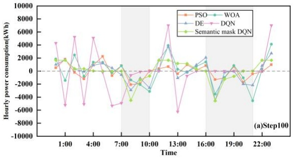

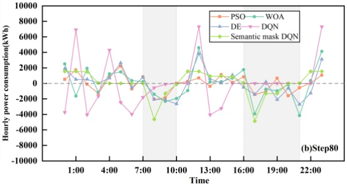

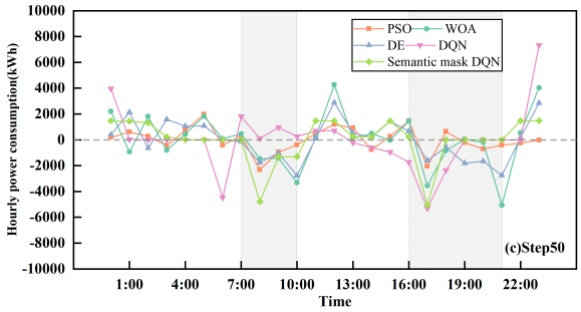

Fig.13 Average charge and discharge values at different times of the day

In this study, the power generation of the PV system is much lower than the actual energy consumption demand of buildings and charging piles. Therefore, there is no case where PV power is supplied to the energy storage system. Under these conditions, other comparison strategies still involve purchasing electricity from the grid during some peak hours to charge the energy storage system, which is inconsistent with the expected optimization direction.

Due to the lack of real-time environmental perception and action constraints in baseline strategies, energy storage boundary limits are frequently triggered throughout the experimental cycle. This not only disturbs the stable operation of the energy storage system but also seriously reduces the quality of effective data sampling for the basic DQN. In contrast, the Semantic mask DQN incorporates a linear decay mechanism near the boundary and charging/discharging smoothing coefficients. This design prevented the SOC from fully reaching the boundary throughout the entire experiment, and discharge actions rarely exceeded the remaining load demand. For a more stringent evaluation, the semantic mask DQN was assessed based on SOC values near the threshold (87%-90% or 20%-23%) and the number of discharge violations. The results are shown in the Table 7. The data indicates that it achieves a 50.78%-64.56% reduction in boundary triggers, significantly improving energy storage operation stability and model training efficiency.

Table 7 The number of triggers for the energy storage boundary

| Step | PSO | WOA | DE | DQN | Semantic mask DQN |
| --- | --- | --- | --- | --- | --- |
| 100 | 438 | 521 | 392 | 660 | 192 |
| 80 | 439 | 529 | 359 | 444 | 183 |
| 50 | 456 | 517 | 394 | 522 | 188 |

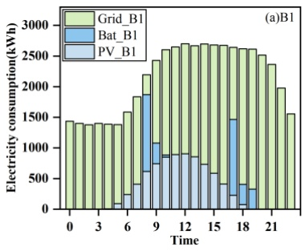

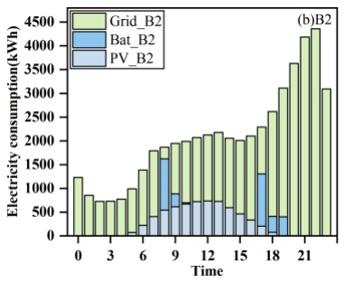

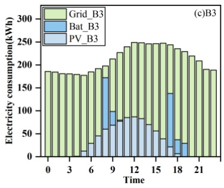

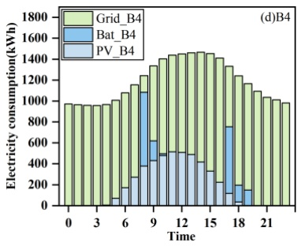

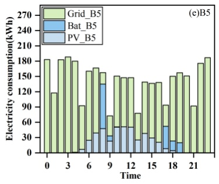

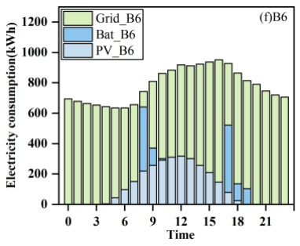

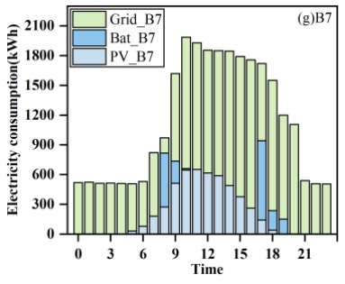

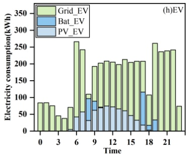

Fig.14 Average energy consumption sources of different types of buildings and EV charging piles (Step=80)

We further statistically analyzed the hourly average energy sources of different types of buildings under the strategy that achieved the minimum operating cost during the experimental cycle (Semantic mask DQN with an action step size of Step=80). As shown in the Fig.14, due to differences in functional attributes of different types of buildings, there are significant differences in their energy consumption peak periods. Semantic mask DQN achieves optimized behavior by establishing semantic rules (such as guiding rules that prioritize discharging during peak periods and orderly charging during valley periods) and fine-tuning numerous hyperparameters, enabling the concentrated release of energy from storage systems during peak electricity pricing periods. If the objectives, scenarios, or DRL methods are changed, the parameters in the semantic rules may need to be reconfigured.

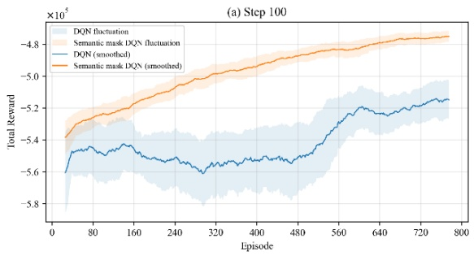

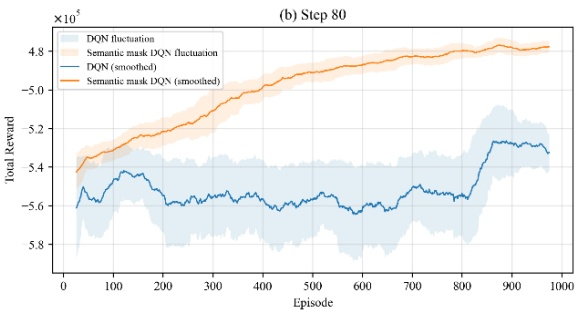

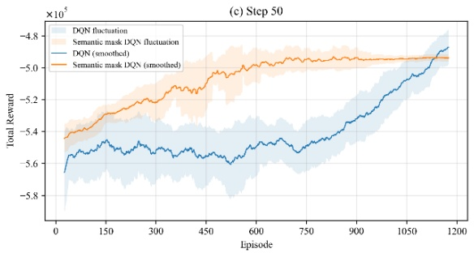

Fig.15 Distribution of total rewards for each round

To verify the positive effect of semantic masking on DRL training performance, we compared the trend of total reward change per training round between the basic DQN and the Semantic mask DQN under different action step sizes, and the results are shown in the Fig.15. The introduction of semantic masking significantly increases the initial training reward, with an increase range of 1.92%-6.0% and an average increase of 3.63%, laying a better foundation for subsequent training. To further quantify this stability advantage, we counted the standard deviation of rewards in the last 100 training rounds for both strategies under different action step sizes. The Semantic mask DQN has an average optimization range of up to 74.14%, which means it can greatly reduce random reward fluctuations during training and improve training efficiency. Although the DQN reward eventually surpassed that of Semantic Mask DQN under a step size of 50, this long-term unstable trend would significantly increase the cost of offline training.

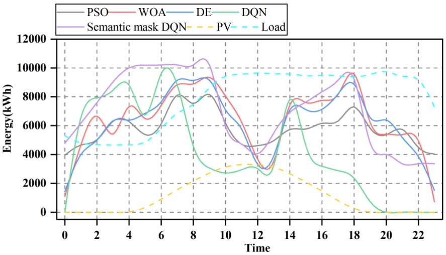

Fig.16 Average load demand and average available energy margin (mean values of results at different action steps)

As shown in the Fig.16, the statistical data presents the average available energy storage reserves (ensure SOC remains above 20% while considering efficiency), average load, and average photovoltaic power generation across different time periods. The Semantic mask DQN can maintain a stable SOC above 37% around the clock, and it consistently keeps a high level of remaining usable energy during non-peak load periods. This phenomenon is attributable to the regular discharge and recharge patterns generated by semantic guidance. In contrast, other methods achieve the objective function by frequently switching the charging and discharging states of the energy storage system. The traditional DQN strategy, relies on large-scale charging and discharging to pursue the reward, resulting in relatively low energy storage levels at night. Compared with the three swarm search algorithms, the Semantic Mask DQN increases the hourly average remaining energy by 16.29%, compared with the traditional DQN strategy, this increase reaches 72.45%. Implementing a Semantic mask DQN strategy to operate the clean energy system enables larger-scale power storage during specific time periods, thereby enhancing the ability of the microgrid in responding to short-term power outage scenarios.

## 5. Discussion

By combining real data and open datasets, this study constructs a virtual community-level microgrid environment and adopts environment perception semantic mask deep reinforcement learning to achieve operational optimization.

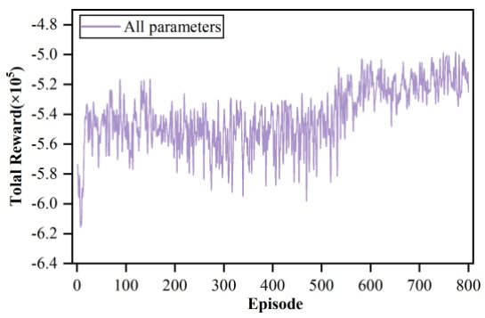

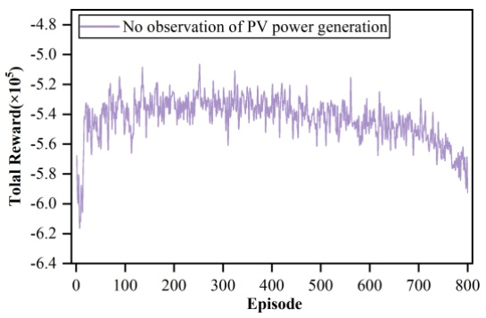

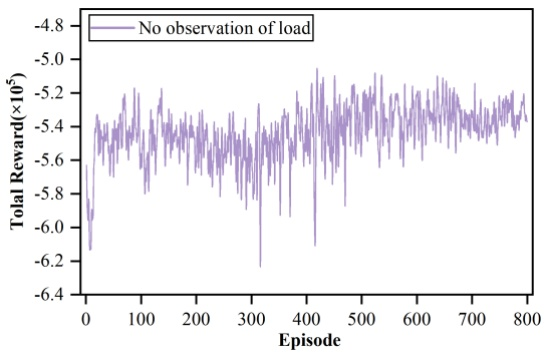

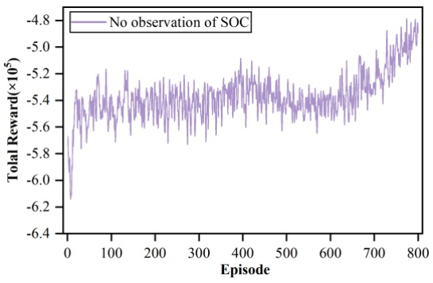

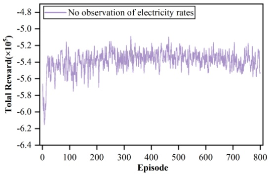

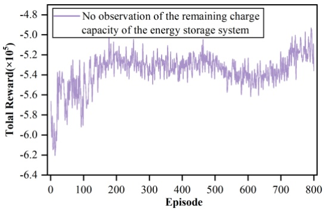

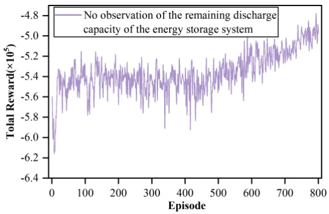

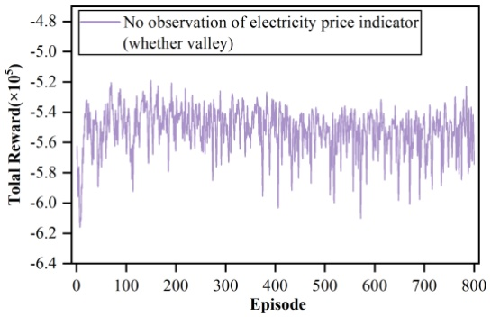

Fig.17 The effect of different observation metrics on reward fluctuations during training To verify the rationality of observation state parameter selection and its impact on experimental results, this study evaluates the rationality and necessity of each observation state parameter by eliminating the observation state parameters one by one and taking the DQN as the base model with a step size of 100, based on the fluctuation characteristics of the total reward during training. The results are presented in the Fig.17. It can be observed that the total reward exhibits significant fluctuations within the last 100 training steps when the SOC or realtime remaining charge/discharge capacity parameters are absent, indicating that such parameters are key factors for maintaining the stability of strategy decision-making. When the valley price period marker or electricity rate parameters are missing, the total reward curve remains stable overall but does not show the characteristic of a secondary increase and convergence to a steady state observed under full-state observation. This suggests that while these parameters do not affect decision stability, they are key elements for further enhancing strategy performance. When real-time load demand is unobservable, the final reward achieved is relatively lower, although the reward curve is similar in shape to that in the fully observable state scenario. When PV power generation is not observed, the total reward exhibits a significant decline trend over the final 100 training steps, indicating the direct impact of PV output on decision-making benefits. When different parameters are missing from the observation state, the standard deviation of rewards during the final 100 training steps decreases by an average of 22.56% compared to scenarios with complete parameter observations, significantly reducing the decision stability of the model. The above analysis demonstrates the critical role of all state parameters in this objective task. When the objective task or research subject changes, further screening of observation parameters is required to obtain stable results.

However, this study constructs a building cluster using buildings from different regions. The optimization strategy needs to be validated with more diverse datasets and environments. For each type of building, the designed semantic rules have achieved the goals of discharging during peak electricity price periods and charging during valley periods. However, to avoid operational losses of the energy storage system and comply with real-time charging and discharging constraints, the final results exhibit strong regularity and periodicity. This may be the optimal approach achievable under the current environment, but if it is necessary to increase the charging-discharging switching frequency of the energy storage system according to actual needs to adapt to new environments and goals, more semantic guidance can be added and constraints can be relaxed to test the outcome. Meanwhile, for different target tasks, it is necessary to enrich the semantic information and masking process and adjust the relevant parameters to realize the intended performance of the strategy.

This study has realized the generation of charging pile energy consumption data for the scenario of virtual building clusters. However, owing to the diverse sources, inconsistent lengths and short time durations of the dataset, only the aggregate energy consumption behavior has been derived based on standard charging piles, which limits the applicability of the proposed method in real-world scenarios. Meanwhile, this study does not consider the impact of differences in building functions on the energy consumption of charging piles, and only focuses on the charging process without modeling the discharging process, which weakens the energy consumption correlation between buildings and electric vehicles. For future research, we will optimize the fitting methods by collecting abundant charging data from a single region, adopt more advanced fitting approaches, and integrate regional energy consumption characteristics while enriching scenario-based settings to enhance the applicability of the framework.

## 6. Conclusion

This study focuses on real-time operation optimization for building complex microgrids, establishing an energy consumption data generation framework for charging piles and a Semantic mask DQN optimization strategy. Through multi-baseline model comparisons and multi-dimensional metric validation, the following core conclusions were drawn.

(1) The effectiveness of scenario-based data generation for charging piles

Based on real operational data, a 30-day hourly energy consumption dataset for 50 charging piles was successfully constructed. The generated results demonstrate that the real-time energy consumption data of all charging piles can accurately reproduce the characteristics of predefined scenarios. While retaining the common patterns of charging behavior, each charging pile generates a real-time charging power sequence with relatively independent features. This validates the effectiveness of the proposed data generation method and provides data support for microgrid optimization research.

(2) Global optimizations for performance

Under a 30-day hourly system optimization scenario, the DQN policy integrated with semantic masks demonstrated stable control performance. Compared with various swarm intelligence optimization algorithms, Semantic mask DQN reduced the microgrid's total electricity purchase by an average of 2.66%–3.73% while reinforcing the periodic characteristics of electricity purchasing behavior. Compared to the DQN while maintaining similar total electricity purchases, it significantly reduced peak-period electricity purchases by

15.61%. This demonstrates that the semantic masking mechanism enhances the goal execution efficiency of the DQN model and improves its responsiveness to peak-period electricity prices.

(3) Economic benefits and strategic operational stability

From an economic perspective, the Semantic mask DQN optimization strategy achieves 1.76%–5.86% savings in operational costs compared to baseline models, directly enhancing the economic benefits for microgrid operators. This strategy dynamically adjusts energy storage charging and discharging behavior based on time-of-use electricity pricing patterns, reducing the frequency of boundary triggers in the energy storage system. Increasing the number of effective environmental interaction samples elevates the average initial training reward by 3.63%, narrows reward fluctuation ranges, and reduces variability in optimization outcomes.

(4) Enhancing the emergency response capability of microgrids

In this task, the strategy can maintain the energy storage SOC at a stable level above 37%, significantly increasing the average remaining available energy while achieving economic optimization objectives. This enhances the emergency power supply capability of the microgrid to respond to short-term outages.

However, the operational strategy requires further evaluation in larger-scale scenarios, in conjunction with a comprehensive analysis of computational costs and practical performance. Furthermore, the applicability and scalability of the proposed strategy across diverse scenarios, as well as the refinement of considerations regarding the interests of multi-stakeholders, remain important aspects warranting further investigation.

## Acknowledgment

The authors are grateful for the financial support of the National Natural Science Foundation of China (Grant No. 52478080), the Postdoctoral Fellowship Program and China Postdoctoral Science Foundation (Grant No. BX20250055), the 2024 Dalian University of Technology - Cardiff University Cooperation and Exchange Foundation Project, 2025 International Exchange Foundation Project of "Co-Creation of Excellence Program" from Dalian University of Technology (Grant: DUTIO-ZG-202503), the Key Project of DUT for International Students Studying and Researching in China: Innovation and Practice of Talent Cultivation Model in the Field of Smart Buildings for the “Belt and Road" Initiative (Grant No. 1103–82120001), the Key Support Project for Foreign Experts for Northeast Special Project (Grant No. D20240082), Dalian University of Technology 2025 International Student Research Projects (Grant No.1100-82120006) and the Natural Science Foundation Joint Fund of Liaoning Province (Grant No. 2023-MSBA-023).

## References

[1] Alshareef R S, Maghrabie H M. Building-integrated photovoltaics with energy storage systems – A comprehensive review[J]. Journal of Energy Storage, 2025,116:115916.

[2] Arsecularatne B P, Rodrigo N, Chang R. Review of reducing energy consumption and carbon emissions through digital twin in built environment[J]. Journal of Building Engineering, 2024,98:111150.

[3] Elsir M, Al-Sumaiti A S, El Moursi M S. Towards energy transition: A novel day-ahead operation scheduling strategy for demand response and hybrid energy storage systems in smart grid[J]. Energy, 2024,293:130623.

[4] Yuan Z, Li J. Photovoltaic-penetrated power distribution networks’ resiliency-oriented dayahead scheduling equipped with power-to-hydrogen systems: A risk-driven decision framework[J]. Energy, 2024,299:131115.

[5] OUKHOUYA ALI Y, EL Haini J. Energy management strategies for grid-integrated photovoltaic and battery energy storage systems-enhanced electric vehicle charging stations: Classical approaches and neural network solutions[J]. Sustainable Energy, Grids and Networks, 2025,43:101926.

[6] Liu B, Song J, Wang Q, et al. Charging station forecasting and scenario analysis in China[J]. Transport Policy, 2023,139:87-98.

[7] Metais M O, Jouini O, Perez Y, et al. Too much or not enough? Planning electric vehicle charging infrastructure: A review of modeling options[J]. Renewable and Sustainable Energy Reviews, 2022,153:111719.

[8] Kaspar K, Ouf M, Eicker U. A critical review of control schemes for demand-side energy management of building clusters[J]. Energy and Buildings, 2022,257:111731.

[9] Nozarian M, Hajizadeh A, Fereidunian A. A methodological review on management of building cluster meso energy hubs in accordance with the agile framework: Exploring flexibility upward the building-cluster-city hierarchy[J]. Sustainable Energy Technologies and Assessments, 2024,67:103834.

[10] Rashid M M, Alotaibi M A, Chowdhury A H, et al. Home Energy Management for Community Microgrids Using Optimal Power Sharing Algorithm[J]. Energies, 2021,14(4).

[11] Kamali Saraji M, Streimikiene D. Challenges to the low carbon energy transition: A systematic literature review and research agenda[J]. Energy Strategy Reviews, 2023,49:101163.

[12] Pinto G, Wang Z, Roy A, et al. Transfer learning for smart buildings: A critical review of algorithms, applications, and future perspectives[J]. Advances in Applied Energy, 2022,5:100084.

[13] Dodo U A, Salami B A, Bashir F M, et al. Investigating the influence of erratic grid on stationary battery energy storage technologies in hybrid power systems: Techno-environeconomic perspectives[J]. Energy, 2024,304:132140.

[14] Liang Y, Li P, Su W, et al. Development of green data center by configuring photovoltaic power generation and compressed air energy storage systems[J]. Energy, 2024,292:130516.

[15] Zhang Z, Qian Z, Chen M, et al. Worldwide rooftop photovoltaic electricity generation may mitigate global warming[J]. Nature Climate Change, 2025,15(4):393-402.

[16] Ul Hassan M, Bremner S, Menictas C, et al. Assessment of hydrogen and Lithium-ion batteries in rooftop solar PV systems[J]. Journal of Energy Storage, 2024,86:111182.

[17] Jafarian M, Assareh E, Ershadi A, et al. Optimal integration of efficient energy storage and renewable sources in hybrid energy systems: A novel optimization and dynamic evaluation strategy[J]. Journal of Energy Storage, 2024,101:113880.

[18] Youssef A, Ahmed E, Tamou N, et al. Experimental Analysis of Efficient Dual-Layer Energy Management and Power Control in an AC Microgrid System[J]. IEEE Access, 2024,12:30577-30592.

[19] Dai Y, Liu X, Li H, et al. Building-related electric vehicle charging behaviors and energy consumption patterns: An urban-scale analysis[J]. Transportation Research Part D: Transport and Environment, 2025,141:104663.

[20] Liao W, Xiao F, Li Y, et al. A comparative study of demand-side energy management strategies for building integrated photovoltaics-battery and electric vehicles (EVs) in diversified building communities[J]. Applied Energy, 2024,361:122881.

[21] Xinwen N, Kwok L L. A Methodology to Model Daily Charging Load in the EV Charging Stations Based on Monte Carlo Simulation: 2020 International Conference on Smart Grid and Clean Energy Technologies (ICSGCE)[C], 2020.4-7 Oct 2020.

[22] Qiang G, Tao Z, Weijiang Z, et al. Charging Load Forecasting of Electric Vehicle Based on Monte Carlo and Deep Learning: 2019 IEEE Sustainable Power and Energy Conference (iSPEC)[C], 2019.21-23 Nov 2019.

[23] Li W, Wang M, Cheng X, et al. Travel intensity of private electric vehicles and implications for GHG emission reduction in China[J]. Environmental Impact Assessment Review, 2025,112:107770.

[24] Fan P, Yang J, Ke S, et al. A multi-layer intelligent control strategy for multi-regional power system with electric vehicles: A deep reinforcement learning approach[J]. Journal of Energy Storage, 2024,103:114381.

[25] Wu F, Yang J, Li B, et al. Uncertain scheduling potential of charging stations under multi-attribute uncertain charging decisions of electric vehicles[J]. Applied Energy, 2024,374:124036.

[26] Mbungu N T, Bansal R C, Naidoo R, et al. An optimal energy management system for a commercial building with renewable energy generation under real-time electricity prices[J]. Sustainable Cities and Society, 2018,41:392-404.

[27] Krishnakumar R, Ravichandran C S. Reliability and Cost Minimization of Renewable Power System with Tunicate Swarm Optimization Approach Based on the Design of PV/Wind/FC System[J]. Renewable Energy Focus, 2022,42:266-276.

[28] Bazdar E, Nasiri F, Haghighat F. Resilience-centered optimal sizing and scheduling of a building-integrated PV-based energy system with hybrid adiabatic-compressed air energy storage and battery systems[J]. Energy, 2024,308:132836.

[29] Wu Y, Liu Z, Li B, et al. Optimal storage capacity for building photovoltaic-energy storage systems considering energy flexibility management[J]. Energy and Buildings, 2025,338:115757.

[30] Haddad M, Javani N, Rezaie B. Energy storage management in a near zero energy building using Li-ion, lead-acid, flywheel, and photovoltaic systems with TRNSYS simulation[J]. Process Safety and Environmental Protection, 2025,196:106898.

[31] Modu B, Abdullah M P, Bukar A L, et al. Energy management and capacity planning of photovoltaic-wind-biomass energy system considering hydrogen-battery storage[J]. Journal of Energy Storage, 2023,73:109294.

[32] Ahmed S, Elkholy M H, Talaat M, et al. Dynamic hybrid energy management for self-sufficient residential microgrids: A flexibility-constrained approach with integration of hybrid backup storage systems[J]. Journal of Energy Storage, 2025,138:118745.

[33] Natarajan S, Rajan Singaravel M M, Alsenani T R. Optimal sizing of solar PV-wind systems, battery storage, and EV charging infrastructure for efficient energy management in large-scale commercial buildings[J]. Applied Energy, 2025,402:126865.

[34] Liu J, Wu B, Meng X, et al. LearnAMR: Learning-based adaptive model predictive control enhanced by reinforcement learning for optimizing energy flexibility in building energy systems incorporating demand-side management[J]. Applied Energy, 2025,401:126707.

[35] Wang H, Liao Y, Zhang J, et al. Optimization of shared energy storage configuration for village-level photovoltaic systems considering vehicle charging management[J]. Energy, 2024,311:133373.

[36] Hussain J, Han Y, Zalhaf A S, et al. A fully decentralized home energy management system for efficient energy management and photovoltaic with battery energy storage system sizing for grid connected home microgrid[J]. Journal of Cleaner Production, 2025,514:145768.

[37] Abdelhameed E H, Abdelraheem S, Mohamed Y S, et al. An enhanced energy management system for coordinated energy storage and exchange in grid-connected photovoltaic-based community microgrids[J]. Journal of Energy Storage, 2024,99:113311.

[38] Gbadega P A, Sun Y, Balogun O A. Optimized energy management in Grid-Connected microgrids leveraging K-means clustering algorithm and Artificial Neural network models[J]. Energy Conversion and Management, 2025,336:119868.

[39] Alharbi S. A Review of Deep Multi-Objective Reinforcement Learning and Vision-Based Systems for Smart Cities[J]. Informatica, 2025;49(20).

[40] Alotaibi B S. Context-aware smart energy management system: A reinforcement learning and IoT-based framework for enhancing energy efficiency and thermal comfort in sustainable buildings[J]. Energy and Buildings, 2025,340:115804.

[41] Lu P, Zhang S, Tan F, et al. An uncertainty-aware safe-evolving reinforcement learning algorithm for decision-making and control in highway autonomous driving[J]. Engineering Applications of Artificial Intelligence, 2025,161:112108.

[42] Ali M A, Luca T. Action Masked Deep Reinforcement learning for Controlling Industrial Assembly Lines: 2023 IEEE World AI IoT Congress (AIIoT)[C], 2023.7-10 June 2023.

[43] Wang Y, Chen J, Wu Z, et al. Efficient task migration and resource allocation in cloud–edge collaboration: A DRL approach with learnable masking[J]. Alexandria Engineering Journal, 2025,111:107-122.

[44] Ding W, Ming Z, Wang G, et al. System-of-systems approach to spatio-temporal crowdsourcing design using improved PPO algorithm based on an invalid action masking[J]. Knowledge-Based Systems, 2024,285:111381.

[45] Peixiao F, Shuangqi L, Siqi B, et al. Resilient Power Systems against Wildfire Risks: Towards a Human-Centric and Secure Future[J]. CSEE Journal of Power and Energy Systems, 2025,11(6):2553-2575.

[46] Li T, Zhao Y, Zhang C, et al. A semantic model-based fault detection approach for building energy systems[J]. Building and Environment, 2022,207:108548.

[47] Li J, Koo J, Lee J, et al. AI agent-based virtual model development, diagnosis, and calibration for building digital twins[J]. Journal of Industrial Information Integration, 2025:100990.

[48] Li J, Koo J, Lee J, et al. AI agent-driven virtual in-situ calibration for intelligent building digital twins[J]. Energy, 2025,339:138968.

[49] Huylo M, Taheri S, Novoselac A. Integration of renewable energy generation and storage systems for emissions reduction in an islanded campus microgrid[J]. Building and Environment, 2025,274:112736.

[50] Huang Y, Masrur H, Lipu M S H, et al. Multi-objective optimization of campus microgrid system considering electric vehicle charging load integrated to power grid[J]. Sustainable Cities and Society, 2023,98:104778.

[51] Miller C, Kathirgamanathan A, Picchetti B, et al. The Building Data Genome Project 2, energy meter data from the ASHRAE Great Energy Predictor III competition[J]. Scientific Data, 2020,7(1):368.

[52] Grote M, Preston J, Cherrett T, et al. Locating residential on-street electric vehicle charging infrastructure: A practical methodology[J]. Transportation Research Part D: Transport and Environment, 2019,74:15-27.

[53] Yi Z, Liu X C, Wei R. Electric vehicle demand estimation and charging station allocation using urban informatics[J]. Transportation Research Part D: Transport and Environment, 2022,106:103264.

[54] Yu W C, Behnam K, Chicheng C, et al. Electric Vehicle User Behavior Prediction Using Hybrid Kernel Density Estimator: 2018 IEEE International Conference on Probabilistic Methods Applied to Power Systems (PMAPS)[C], 2018.24-28 June 2018.

[55] Sadik K, Nuh E. Modeling and Data Analysis of Electric Vehicle Fleet Charging: 2022 IEEE/AIAA Transportation Electrification Conference and Electric Aircraft Technologies Symposium (ITEC+EATS)[C], 2022.15-17 June.

[56] Noraidah B M S, Mohammed A E, Liana C. Probabilistic analysis of electric vehicles charging load impact on residential Distributions Networks: 2016 IEEE International Energy Conference (ENERGYCON)[C], 2016.4-8 April.

[57] Jamali Jahromi A, Mohammadi M, Afrasiabi S, et al. Probability density function forecasting of residential electric vehicles charging profile[J]. Applied Energy, 2022,323:119616.

[58] Kaiwen S, Mushfiqur R S, Miguel A O. Statistical characterization of electric vehicle charging in different locations of the grid: 2015 IEEE Power & Energy Society General Meeting[C], 2015.26-30 July 2015.

[59] Han Q, Ma S, Wang T, et al. Kernel density estimation model for wind speed probability distribution with applicability to wind energy assessment in China[J]. Renewable and Sustainable Energy Reviews, 2019,115:109387.

[60] Kim Y, Kim S. Forecasting Charging Demand of Electric Vehicles Using Time-Series Models[J]. Energies, 2021,14(5):1487.

[61] Akshay K C, Grace G H, Gunasekaran K, et al. Power consumption prediction for electric vehicle charging stations and forecasting income[J]. Scientific Reports, 2024,14(1):6497.

[62] Shivangni J, Ranjeet S T, Santosh N. Time Series Analysis and Forecasting of Vehicular Network Communication Severity: A Comparative Study of ARIMA and SARIMA Models: 2025 Fourth International Conference on Smart Technologies, Communication and Robotics (STCR)[C], 2025.9-10 May 2025.

[63] Richens J G, Lee C M, Johri S. Improving the accuracy of medical diagnosis with causal machine learning[J]. Nature Communications, 2020,11(1):3923.

[64] Ahmad F, Ashraf I, Iqbal A, et al. Energy management strategies and cost benefits analysis at electric vehicle parking lots incorporating photovoltaic energy generation and energy storage system[J]. Journal of Energy Storage, 2024,92:112105.

[65] Guo J, Chen J, Wu H, et al. Optimized scheduling and performance evaluation of hybrid energy storage systems with power-based and energy-based storage[J]. Applied Energy, 2025,395:126200.

[66] Zhang C, Rezgui Y, Luo Z, et al. Simultaneous community energy supply-demand optimization by microgrid operation scheduling optimization and occupant-oriented flexible energy-use regulation[J]. Applied Energy, 2024,373:123922.

[67] Zakeri B, Syri S. Electrical energy storage systems: A comparative life cycle cost analysis[J]. Renewable and Sustainable Energy Reviews, 2015,42:569-596.

[68] Mnih V, Kavukcuoglu K, Silver D, et al. Human-level control through deep reinforcement learning[J]. Nature, 2015,518(7540):529-533.

[69] Cao C, Zhang Q, Li M, et al. Flame combustion state recognition in municipal solid waste incineration processes based on image multi-threshold segmentation and DQN-PL model[J]. Energy, 2025,331:136967.

[70] Xiao H, Fu L, Shang C, et al. Ship energy scheduling with DQN-CE algorithm combining bidirectional LSTM and attention mechanism[J]. Applied Energy, 2023,347:121378.
