# Toward resilient distribution system via microgrid formation: A safe hierarchical hybrid reinforcement learning approach

- 期刊：Applied Energy
- DOI：10.1016/j.apenergy.2026.128001
- 版本：出版社正式版
- 原文页数：16
- 文本解析：MinerU 4.0.12 / basic / 全文
- [原始 PDF](../../1-s2.0-S0306261926006537-main.pdf)
- [逐页截图](screenshots.html)

> 以下为机器解析的原文，未翻译、未改写。公式、表格和双栏阅读顺序可能存在识别误差，请以原始 PDF 和逐页截图为准。

## 论文首页

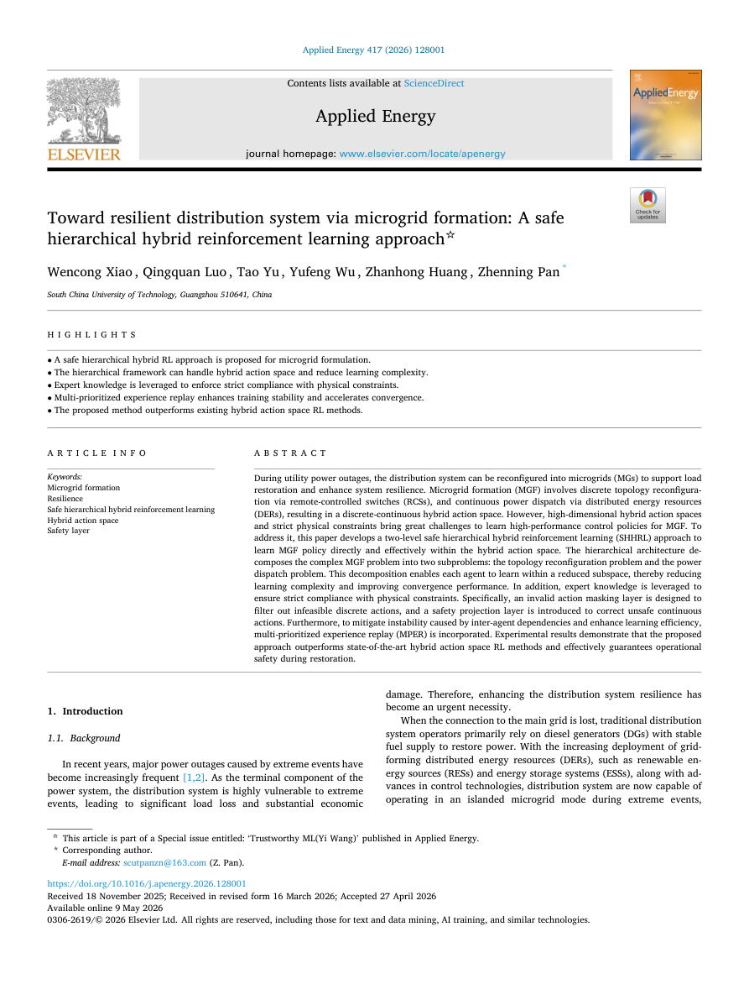

## 全文

Wencong Xiao , Qingquan Luo , Tao Yu , Yufeng Wu , Zhanhong Huang , Zhenning Pan

South China University of Technology, Guangzhou 510641, China

## H I G H L I G H T S

• A safe hierarchical hybrid RL approach is proposed for microgrid formulation.

• The hierarchical framework can handle hybrid action space and reduce learning complexity.

• Expert knowledge is leveraged to enforce strict compliance with physical constraints.

• Multi-prioritized experience replay enhances training stability and accelerates convergence.

• The proposed method outperforms existing hybrid action space RL methods.

## A R T I C L E I N F O

Keywords: Microgrid formation Resilience Safe hierarchical hybrid reinforcement learning Hybrid action space Safety layer

## Abstract

During utility power outages, the distribution system can be reconfigured into microgrids (MGs) to support load restoration and enhance system resilience. Microgrid formation (MGF) involves discrete topology reconfiguration via remote-controlled switches (RCSs), and continuous power dispatch via distributed energy resources (DERs), resulting in a discrete-continuous hybrid action space. However, high-dimensional hybrid action spaces and strict physical constraints bring great challenges to learn high-performance control policies for MGF. To address it, this paper develops a two-level safe hierarchical hybrid reinforcement learning (SHHRL) approach to learn MGF policy directly and effectively within the hybrid action space. The hierarchical architecture decomposes the complex MGF problem into two subproblems: the topology reconfiguration problem and the power dispatch problem. This decomposition enables each agent to learn within a reduced subspace, thereby reducing learning complexity and improving convergence performance. In addition, expert knowledge is leveraged to ensure strict compliance with physical constraints. Specifically, an invalid action masking layer is designed to filter out infeasible discrete actions, and a safety projection layer is introduced to correct unsafe continuous actions. Furthermore, to mitigate instability caused by inter-agent dependencies and enhance learning efficiency, multi-prioritized experience replay (MPER) is incorporated. Experimental results demonstrate that the proposed approach outperforms state-of-the-art hybrid action space RL methods and effectively guarantees operational safety during restoration.

## 1. Introduction

### 1.1. Background

In recent years, major power outages caused by extreme events have become increasingly frequent [1,2]. As the terminal component of the power system, the distribution system is highly vulnerable to extreme events, leading to significant load loss and substantial economic damage. Therefore, enhancing the distribution system resilience has become an urgent necessity.

When the connection to the main grid is lost, traditional distribution system operators primarily rely on diesel generators (DGs) with stable fuel supply to restore power. With the increasing deployment of gridforming distributed energy resources (DERs), such as renewable energy sources (RESs) and energy storage systems (ESSs), along with advances in control technologies, distribution system are now capable of operating in an islanded microgrid mode during extreme events, providing a promising alternative for localized load restoration [3–6]. Specifically, when a power outage occurs in the transmission network, the distribution system can be reconfigured into multiple islanded microgrids via remote-controlled switches (RCSs), each of which is energized by local DERs [7–8].

<small>\* Corresponding author.</small>

<small>☆ This article is part of a Special issue entitled: ‘Trustworthy ML(Yi Wang)’ published in Applied Energy.</small>

<small>E-mail address: [scutpanzn@163.com](mailto:scutpanzn@163.com) (Z. Pan).</small>

<table><tr><td colspan="2">Nomenclature</td><td> $r _ { i j , }   x _ { i j }$ </td><td>Resistance and reactance of line ij</td></tr><tr><td colspan="2"></td><td> $\delta _ { i }$   $\left\| \cdot \right\|$ </td><td>Binary: 1 if node i belongs to the set  $s ; 0$  otherwise</td></tr><tr><td colspan="2">Abbreviations</td><td> $M$ </td><td>Number of elements in a given set</td></tr><tr><td>MGF Microgrid formation DERs</td><td></td><td></td><td>large number</td></tr><tr><td colspan="2">Distributed energy resources</td><td colspan="2">Variables</td></tr><tr><td>DGs</td><td>Diesel generators</td><td></td><td>Binary: 1 if node i is energized at time step t; 0 otherwise</td></tr><tr><td>RESs</td><td>Renewable energy sources</td><td> $y _ { t , i }$ </td><td> $t ; 0$  Binary: 1 if line ij is closed at time step otherwise</td></tr><tr><td>ESSs</td><td>Energy storage systems</td><td> $z _ { t , \dot { y } }$   $P _ { t , i } ^ { \mathrm { L } } ,   Q _ { t , i } ^ { \mathrm { L } }$ </td><td>Active and reactive power of the load at node i and time</td></tr><tr><td>RCSs HRL</td><td>Remote-controlled switches Hierarchical reinforcement learning</td><td></td><td>step t</td></tr><tr><td> $S e t s$ </td><td></td><td> $P _ { t , i } ^ { \mathrm { D G } } , Q _ { t , i } ^ { \mathrm { D G } }$ </td><td>Active and reactive power of the DG at node i and time step</td></tr><tr><td colspan="2"> $T$ </td><td></td><td>t Active power of the RES and ESS at node i and time step t</td></tr><tr><td> $N _ { \mathrm { { } ^ { , } } } \varepsilon$ </td><td>Set of discrete time steps of the MGF process Set of nodes and lines in the network</td><td> $P _ { t , i } ^ { \mathrm { R E S } } , P _ { t , i } ^ { \mathrm { E S S } }$   $P _ { t , i } ^ { \mathrm { E S S , c } } , P _ { t , i } ^ { \mathrm { E S S , d } }$ </td><td>Charging and discharging active power of the ESS at</td></tr><tr><td colspan="2"> $S ,   L ,   G ,   R ,   M ,   D$  Set of substations, loads, DGs, RESs and ESSs, DERs</td><td></td><td>node i and time step t</td></tr><tr><td colspan="2">Parameters</td><td colspan="2"> $Q _ { t , i } ^ { \mathrm { E S S , c } } ,   Q _ { t , i } ^ { \mathrm { E S S , d } }$  Charging and discharging reactive power of the ESS at</td></tr><tr><td> $P_{i}^{\mathrm{DG},\min},P_{i}^{\mathrm{DG},\max}$ </td><td>Minimum and maximum active power output of the</td><td>node i and time step t</td><td></td></tr><tr><td> $Q_{i}^{\mathrm{DG}, \min}, Q_{i}^{\mathrm{DG}, \max}$ </td><td>DG at node i Minimum and maximum reactive power output of</td><td> $E _ { t , i } ^ { \mathrm { E S S } }$   $P _ { t , i } ,   Q _ { t , i }$ </td><td>State of charge of the ESS at node i and time step t</td></tr><tr><td></td><td>the DG at node i</td><td> $P _ { t , \bar { y } } ,   Q _ { t , \bar { y } }$ </td><td>Active and reactive power at node i and time step t Active and reactive power at line ij and time step t</td></tr><tr><td> $\eta _ { i } ^ { \mathrm { D G } }$ </td><td>Ramping capacity of the DG at node i</td><td> $V _ { t , i }$ </td><td>Voltage magnitude at node i and time step t</td></tr><tr><td> $\widehat { \boldsymbol { P } } _ { t , i } ^ { \mathrm { R E S } }$ </td><td></td><td> $f _ { t , \bar { y } } ^ { + } , f _ { t , \bar { y } } ^ { - }$ </td><td>Non-negative continuous auxiliary variables</td></tr><tr><td></td><td>Forecasted active power output of the RES at node i and time step t</td><td>oH  $\dot { t , o \mathrm { L } }   t$ </td><td>Observations of the high-level and low-level agent at time</td></tr><tr><td> $P _ { i } ^ { \mathrm { E S S , c , m a x } } , P _ { i } ^ { \mathrm { E S S , d , m a x } }$ </td><td>Maximum active charging and discharging</td><td></td><td>step t</td></tr><tr><td></td><td>power of the ESS at node i</td><td>aH  $t , a \mathbb { L }   t$   $r _ { \mathrm { { H } } } t , r _ { \mathrm { { L } } } t$ </td><td>Actions of the high-level and low-level agent at time step t Rewards of the high-level and low-level agent at time step t</td></tr><tr><td> $E _ { i } ^ { \mathrm { E S S , m i n } } , E _ { i } ^ { \mathrm { E S S , m a x } }$ </td><td>Minimum and maximum state of charge of the ESS at node i</td><td> $\overline { { a } } _ { t } ^ { \mathrm { L } }$ </td><td>Safety-projected continuous action obtained from the</td></tr><tr><td colspan="2"> $\eta _ { i } ^ { \mathrm { E S S , c } } , \eta _ { i } ^ { \mathrm { E S S , d } }$  Charging and discharging efficiency of the ESS at node i</td><td> $\overline { { P } } _ { t , i } ^ { \mathrm { D G } } , \overline { { P } } _ { t , i } ^ { \mathrm { R E S } } , \overline { { P } } _ { t , i } ^ { \mathrm { E S S } }$ </td><td>safety projection layer Safety-corrected active power of the DG, RES, ESS at</td></tr><tr><td> $\widehat { \boldsymbol { P } } _ { t , i } ^ { \mathrm { L } } ,   \widehat { \boldsymbol { Q } } _ { t , i } ^ { \mathrm { L } }$ </td><td>Forecasted active and reactive power of the load at node i</td><td></td><td>node i and time step t</td></tr><tr><td> $S _ { i j }$ </td><td>and time step t  $i j$  Capacity limit of line</td><td> $\overline { { P } } _ { t , i } ^ { \mathrm { E S S , c } } , \overline { { P } } _ { t , i } ^ { \mathrm { E S S , d } }$ </td><td>Safety-corrected charging and discharging active power</td></tr><tr><td colspan="2"> $V _ { i } ^ { \operatorname* { m i n } } ,   V _ { i } ^ { \operatorname* { m a x } }$  Minimum and maximum voltage magnitude of node i</td><td>of the ESS</td><td></td></tr></table>

MGF involves discrete topology reconfiguration via RCSs and continuous power dispatch via DERs. With the growing deployment of RCSs and DERs, MGF becomes a high-dimensional stochastic sequential decision-making problem characterized by a discrete-continuous hybrid action space, making it a highly challenging problem. Consequently, a safe, fast, and efficient algorithm capable of handling discretecontinuous hybrid action space is essential for MGF.

### 1.2. Literature review

Traditional optimization-based methods have been widely used to solve the MGF problem. The MGF problem is essentially a mixed-integer nonlinear programming (MINLP) problem. To enhance computational efficiency, the complex MINLP model is often relaxed and reformulated as a mixed-integer linear programming (MILP) [9–11], mixed-integer second-order cone programming (MISOCP) [12–13], or mixed-integer quadratic programming (MIQP) [14] problem. Optimization-based methods provide strict optimality guarantees and offer formulation flexibility. However, they have several limitations: 1) As the system scale expands, network topology becomes more complex, and controllable resources diversify, the computational complexity of the MGF problem increases significantly, leading to a substantial rise in solution time. 2) These algorithms rely on precise mathematical models, making them less reliable when system parameters are inaccurate or incomplete.

In recent years, deep reinforcement learning (DRL) has been widely applied to the MGF problem due to its model-free paradigm and high decision-making efficiency [5–25]. However, most existing RL algorithms in the context of DSR typically consider only a single type of action space. For instance, studies $[5-6,15-17]$ employ deep Q-network (DQN) and its variants to solve the MGF problem with a discrete action space by controlling the RCSs. In contrast, [25] applies the soft actorcritic (SAC) algorithm to optimize the continuous power output of DERs. These classical RL algorithms can only deal with a specific type of action space. To address this, hybrid action space RL approaches have been explored, which can be broadly categorized as follows: 1) Action space transformation: This approach maps one type of action space to another to fit traditional RL frameworks, including continuous relaxation of discrete actions [20] and discretization of continuous actions [26]. 2) Parameterized action space reinforcement learning (PARL): In this approach, each discrete action is associated with a set of continuous actions that provide additional control information. These parameters are activated only when the corresponding discrete action is selected. For example, the agent may choose between two discrete actions: charging or discharging. If the charging action is selected, a continuous parameter is used to determine the charging power level. Common algorithms, such as HDQN [27,28], HSAC [29], and HPPO [30,31], extend traditional RL methods by jointly optimizing discrete decisions and their corresponding continuous parameters.

There are still some technical issues with the existing hybrid action space RL research, which are summarized as follows: 1) Action space transformation modifies the original action space structure, which may lead to performance degradation and increased action space complexity. 2) PARL relies on the assumption that hybrid action spaces can be reformulated into a parameterized structure. However, in the MGF problem, the control of RCSs and DERs does not follow an actionparameter relationship. Due to the lack of inherent parameterized associations, PARL methods struggle to achieve effective coordination in MGF.

In practical MGF operations, dispatchers typically first control the switches and then adjust the power output of DERs based on the reconfigured network topology. This hierarchical decision-making process, where discrete actions are executed before continuous actions, motivates the adoption of hierarchical reinforcement learning (HRL) as a promising solution to the aforementioned challenges. HRL enhances conventional RL by adopting a divide-and-conquer strategy [32]. This method decomposes the complex and difficult into multiple subproblems, each of which is generally easier to solve [33]. Compared to traditional RL, HRL enables each agent to learn within a smaller and more task-specific subspace, significantly reducing problem complexity. This structure allows HRL to handle more complex and long-horizon tasks, thereby improving learning efficiency and improving convergence performance [34,35]. Recent studies have applied HRL to peer-to-peer energy trading problems [36] involving hybrid action spaces, aiming to mitigate computational burdens. However, to the best of our knowledge, HRL has not yet been explored for solving the MGF problem under a hybrid discrete-continuous action space.

Moreover, the classical DRL-based MGF strategies lack explicit consideration of system safety. As a result, the generated solutions may violate critical physical constraints of the distribution system, potentially leading to issues such as overloading or overvoltage. Existing safe reinforcement learning (SRL) approaches can be broadly classified into three categories: 1) Penalty-based reward shaping: Introducing penalty terms in the reward function to account for operational constraint violations [5,6], [37,38]. 2) Constrained policy optimization using CMDP: Leveraging constrained Markov decision process (CMDP) for policy optimization [39–41]. 3) Offline reinforcement learning: Training solely on offline datasets without interacting with the environment to completely avoid unsafe exploration [20].

The three aforementioned methods can be categorized as experiencedriven SRL, which primarily relies on long-term interaction to learn constraint-satisfying policies. However, they fail to guarantee strict safety compliance at every time step. This limitation undermines system operator confidence in such methods and significantly hinders their deployment in real-world power systems. Unlike existing approaches, expert knowledge-embedded reinforcement learning employs a prior constraint mechanism to proactively ensure safety during decisionmaking, fundamentally preventing unsafe actions. This provides a novel perspective for addressing the existing challenges. However, embedding expert knowledge from the MGF domain into DRL remains a challenging task.

### 1.3. Contributions and paper organization

This paper proposes a safe hierarchical hybrid RL (SHHRL) algorithm for MGF within a hybrid action space, while ensuring strict compliance with physical constraints. To the best of our knowledge, this is the first time a SHHRL algorithm has been developed and adopted to solve the MGF problem. The main contributions of this paper are summarized as follows:

1) A two-level SHHRL framework is proposed for MGF to enable synchronized learning of discrete topology reconfiguration and continuous power dispatch. The hierarchical structure significantly reduces learning complexity and improves convergence performance.

2) The proposed framework is adaptable and compatible with a wide range of DRL algorithms. In this implementation, the high-level agent utilizes double deep Q-networks (DDQN) to optimize discrete switching actions, whereas the low-level agent employs twin delayed deep deterministic policy gradient (TD3) to regulate continuous outputs of DERs.

3) Expert knowledge is embedded into the proposed framework to ensure strict compliance with operational constraints. Specifically, an invalid action masking (IAM) layer is designed to filter out infeasible discrete actions, and a quadratic programming (QP)-based safety projection layer is implemented to map unsafe continuous decisions onto a feasible region.

4) To address training instability arising from inter-agent dependencies in HRL, a multi-prioritized experience replay (MPER) mechanism is introduced. This approach enhances training stability and accelerates policy convergence.

This paper is organized as follows: Section 2 introduces the problem formulation of MGF. The proposed algorithm is mainly detailed in Section 3. The case studies are presented in Section 4. Finally, we conclude in Section 5.

## 2. Problem formulation of MGF

### 2.1. Objective

The goal of the MGF problem is to maximize load restoration during whole restoration period, denoted by discrete steps $\pmb { T }   = \{ 1 , 2 , . . . , T \}$ using RCSs and local DERs. The objective is formulated as follows.

$$
\operatorname* { m a x } { \sum _ { t \in \mathcal { T } } } { \sum _ { i \in \mathcal { L } } } P _ { t , i } ^ { \mathrm { L } }\tag{1}
$$

### 2.2. Constraints

The physical constraints that the MGF should obey can be classified into two categories: operational constraints and topological constraints.

1) Operational constraints: The operational constraints are formulated as follows.

• DG constraints: The DGs considered in this study are controllable units, such as fossil-fuel-based generators. It is assumed that their fuels are adequate during the restoration period. Constraints (2) and (3) limits the outputs of DGs. Constraint (4) limits the ramping capability of DGs.

$$
P _ { i } ^ { \mathrm { D G } , \mathrm { m i n } } \leq P _ { t , i } ^ { \mathrm { D G } } \leq P _ { i } ^ { \mathrm { D G } , \mathrm { m a x } } , t \in \mathcal { T } , i \in \mathcal { G }\tag{2}
$$

$$
Q _ { i } ^ { \mathrm { D G , m i n } } \leq Q _ { t , i } ^ { \mathrm { D G } } \leq Q _ { i } ^ { \mathrm { D G , m a x } } , t \in \mathcal { T } , i \in \mathcal { G }\tag{3}
$$

$$
- \eta _ { i } ^ { \mathrm { D G } } \leq P _ { t , i } ^ { \mathrm { D G } } - P _ { t - 1 , i } ^ { \mathrm { D G } } \leq \eta _ { i } ^ { \mathrm { D G } } , t \geq 1 , i \in \mathcal { G }\tag{4}
$$

• RES constraints: The uncertainty considered in this study arises from the load demand and the renewable generation. Note $\widehat { \cdot }$ is the symbol for forecasted values. Constraint (5) represents the active power output limits of RESs.

$$
0 \leq P _ { t , i } ^ { \mathrm { R E S } } \leq \widehat { P } _ { t , i } ^ { \mathrm { R E S } } y _ { t , i } , t \in \mathcal { T } , i \in \mathcal { R }\tag{5}
$$

• Load constraints: All of the loads connected to the de-energized nodes will be shed, as indicated by (6) and (7).

$$
P _ { t , i } ^ { \mathrm { L } } = \widehat { P } _ { t , i } ^ { \mathrm { L } } y _ { t , i } , t \in \mathcal { T } , i \in \mathcal { L }\tag{6}
$$

$$
Q _ { t , i } ^ { \mathrm { L } } = \widehat { Q } _ { t , i } ^ { \mathrm { L } } y _ { t , i } , t \in \mathcal { T } , i \in \mathcal { I }\tag{7}
$$

• ESS constraints: ESSs can adjust the net system load by modulating their charging and discharging power, thereby enhancing the restoration process. Constraints (8) and (9) define the upper limits for the active power during charging and discharging operations of ESSs. Constraints (10) and (11) impose similar limits on the reactive power exchange of ESSs. Constraints (12)–(15) define the upper and lower bounds of the state of charge (SoC). Constraint (16) ensures that ESSs cannot charge and discharge simultaneously.

$$
0 \leq P _ { t , i } ^ { \mathrm { E S S , c } } \leq P _ { i } ^ { \mathrm { E S S , c , m a x } } y _ { t , i } , t \in \mathcal { T } , i \in \mathcal { M }\tag{8}
$$

$$
0 \leq P _ { t , i } ^ { \mathrm { E S S , d } } \leq P _ { i } ^ { \mathrm { E S S , d , m a x } } y _ { t , i } , t \in \mathcal { T } , i \in \mathcal { M }\tag{9}
$$

$$
0 \leq Q _ { t , i } ^ { \mathrm { E S S , c } } \leq Q _ { i } ^ { \mathrm { E S S , c , m a x } } y _ { t , i } , t \in \mathcal { T } , i \in \mathcal { M }\tag{10}
$$

$$
0 \leq Q _ { t , i } ^ { \mathrm { E S S , d } } \leq Q _ { i } ^ { \mathrm { E S S , d , m a x } } y _ { t , i } , t \in \mathcal { T } , i \in \mathcal { M }\tag{11}
$$

$$
P _ { t , i } ^ { \mathrm { E S S } } = P _ { t , i } ^ { \mathrm { E S S , d } } - P _ { t , i } ^ { \mathrm { E S S , c } } , t \in \mathcal { T } , i \in \mathcal { M }\tag{12}
$$

$$
Q _ { t , i } ^ { \mathrm { E S S } } = Q _ { t , i } ^ { \mathrm { E S S , d } } - Q _ { t , i } ^ { \mathrm { E S S , c } } , t \in \mathcal { T } , i \in \mathcal { M }\tag{13}
$$

$$
E _ { i } ^ { \mathrm { E S S , m i n } } \leq E _ { t , i } ^ { \mathrm { E S S } } \leq E _ { i } ^ { \mathrm { E S S , m a x } } , t \in \mathcal { T } , i \in \mathcal { M }\tag{14}
$$

$$
E _ { t + 1 , i } ^ { \mathrm { E S S } } = E _ { t , i } ^ { \mathrm { E S S } } + P _ { t , i } ^ { \mathrm { E S S , c } } \eta _ { i } ^ { \mathrm { E S S , c } } - P _ { t , i } ^ { \mathrm { E S S , d } } / \eta _ { i } ^ { \mathrm { E S S , d } } , t \in \mathcal { T } , i \in \mathcal { M }\tag{15}
$$

$$
P _ { t , i } ^ { \mathrm { E S S , d } } \cdot P _ { t , i } ^ { \mathrm { E S S , c } } = 0 , t \in \mathcal { T } , i \in \mathcal { M }\tag{16}
$$

• Power flow constraints: Constraints (17)–(20) are the power balance limits. Constraints (21) represents the power flow equations based on the linearized DistFlow model. The power flow constraints are formulated as follows. Constraints (22) and (23) represent the voltage magnitude limits. Constraints (24) and (25) limit the capacity of the closed lines.

$$
\sum_{j:j \to i} P_{t,ji} - \sum_{k:i \to k} P_{t,ik} - P_{t,i} = 0, t \in \mathcal{F}, i \in \mathcal{N}\tag{17}
$$

$$
\sum_{j:j \to i} Q_{t,ji} - \sum_{k:i \to k} Q_{t,ik} - Q_{t,i} = 0, t \in \mathcal{T}, i \in \mathcal{N}\tag{18}
$$

$$
P _ { t , i } = P _ { t , i } ^ { \mathrm { D G } } + P _ { t , i } ^ { \mathrm { R E S } } + P _ { t , i } ^ { \mathrm { E S S } } - P _ { t , i } ^ { \mathrm { L } } , t \in \mathcal { T } , i \in \mathcal { N }\tag{19}
$$

$$
Q _ { t , i } = Q _ { t , i } ^ { \mathrm { D G } } + Q _ { t , i } ^ { \mathrm { E S S } } - Q _ { t , i } ^ { \mathrm { L } } , t \in \mathcal { T } , i \in \mathcal { N }\tag{20}
$$

$$
\begin{align*}M\big(1 - z_{t,ij}\big) \leq U_{t,i} - U_{t,j} - 2\big(r_{ij}P_{t,ij} + x_{ij}Q_{t,ij}\big) \leq M\big(1 - z_{t,ij}\big), t \in \mathcal{F}, ij \in \mathcal{E}\end{align*}\tag{21}
$$

$$
U _ { t , i } = V _ { t , i } ^ { 2 } , t \in \mathcal { T } , i \in \mathcal { N }\tag{22}
$$

$$
\left( V _ { i } ^ { \min } \right) ^ { 2 } \leq U _ { t , i } \leq \left( V _ { i } ^ { \max } \right) ^ { 2 } , t \in \mathcal { T } , i \in \mathcal { N }\tag{23}
$$

$$
- S _ { i j } z _ { t . i j } \leq P _ { t . i j } \leq S _ { i j } z _ { t . i j } , t \in \mathcal { T } , \dot { y } \in \mathcal { E }\tag{24}
$$

$$
\cdot S _ { i j } z _ { t . i j } \leq Q _ { t . i j } \leq S _ { i j } z _ { t . i j } , t \in \mathcal { T } , i j \in \mathcal { E }\tag{25}
$$

6) Topological constraints: Constraint (26) shows that all RCSs associated with lines are initially open. Constraint (27) ensures that all DG nodes remain energized. Constraint (28) limits that non-DG nodes can only be restored through line reconnection. Constraint (29) indicates that once a line is restored, both terminal nodes are also restored. Constraint (30) prohibits any RCS that has been closed from being opened again. Constraint (31) limits the switching actions by allowing at most one RCS to be closed at each time step. Since this study considers scenarios with main grid outages, constraints (32) prohibit the closure of lines directly connected to substation nodes. Constraint (33) requires that a line can only be restored if at least one of its terminal nodes is energized. Constraints (34) and (35) enforce the radial topology constraints of the distribution system.

$$
z _ { 0 , \vec { y } } = 0 , \vec { y } \in \mathcal { E }\tag{26}
$$

$$
y _ { t , i } = 1 , t \in \mathcal { T } , i \in \mathcal { T }\tag{27}
$$

$$
y _ { t , i } \leq \sum _ { i j \in \mathcal { E } } z _ { t , i j } , t \in \mathcal { T } , i \in \mathcal { N } \setminus \mathcal { G }\tag{28}
$$

$$
\left( 1 - z _ { t , i j } \right) \leq y _ { t , i } - y _ { t , j } \leq \left( 1 - z _ { t , i j } \right) , t \in \mathcal { T } , i j \in \mathcal { E }\tag{29}
$$

$$
z _ { t , i j } \geq z _ { t - 1 , i j } , t \geq 1 , i j \in \mathcal { E }\tag{30}
$$

$$
\sum _ { i j \in \mathcal { E } } \left( z _ { t , i j } - z _ { t - 1 , i j } \right) \leq 1 , t \geq 1\tag{31}
$$

$$
z _ { t , i j } \leq 1 - \delta _ { i } - \delta _ { j } , t \geq 1 , i j \in \mathcal { E }\tag{32}
$$

$$
z _ { t , i j } \leq y _ { t - 1 , i } + y _ { t - 1 , j } , t \geq 1 , i j \in \mathcal { E }\tag{33}
$$

$$
f _ { t , i j } ^ { + } + f _ { t , i j } ^ { - } = z _ { t , i j } , t \in \mathcal { T } , i j \in \mathcal { E }\tag{34}
$$

$$
\sum_{j:j \to i} f_{t,ji}^{+} + \sum_{k:i \to k} f_{t,ik}^{-} \leq \frac{|\mathcal{N}|}{|\mathcal{N}| + 1}, t \in \mathcal{T}, i \in \mathcal{N}\tag{35}
$$

## 3. Safe hierarchical hybrid reinforcement learning

HRL is proven to be a promising approach in extending traditional RL to handle complex problems by decomposing learning tasks, thereby reducing learning complexity and improving convergence performance. In this section, a two-level SHHRL algorithm is developed to effectively learn a control policy for MGF within a hybrid action space, while ensuring strict compliance to physical constraints.

### 3.1. Formulate MGF as a hierarchical partially observable MDP

In practice, while loads and RESs connected to energized nodes can be directly measured via intelligent grid-edge devices, the state information of loads and RESs at de-energized nodes are unobservable and must be estimated using forecasting. This partial observability motivates the adoption of a partially observable MDP framework. Note ̂⋅ is the symbol for forecasted values and ̃⋅ is the symbol for measured values. Meanwhile, the original MGF problem can be naturally decomposed into two interrelated subproblems: topology reconfiguration and power dispatch. Accordingly, this paper formulates the MGF task as a hierarchical partially observable MDP (H-POMDP).

A POMDP consists of six essential elements: state, action, observation, state transition probability, reward, and discount factor. The observation contains partial information of the state. In this paper, the MGF problem is decomposed into two levels of POMDPs.

1) The high-level POMDP: At the high level, the agent selects discrete switching actions to reconfigure the distribution system topology by closing RCSs.

• Observation $o _ { t } ^ { \mathrm { H } } ;$ The high-level observation $o _ { t } ^ { \mathrm { H } }$ at time step t consists of the following four parts (eq. (36)): a) Network topology status, including the switch state of each line $z _ { t - 1 , i j } ,$ and the energization status of each node $y _ { t - 1 , i } ;$ b) Load and RESs states $X _ { t - 1 , i } ,$ including active and reactive power loads $P _ { t - 1 , i } ^ { \mathrm { L } } ,   Q _ { t - 1 , i } ^ { \mathrm { L } } ,$ and the active power output of RESs $P _ { t - 1 , i } ^ { \mathrm { R E S } }$ . For energized nodes, real-time measurements are used. For deenergized nodes, forecasted values are applied; c) DGs and ESSs states, including active and reactive power outputs of DGs $( P _ { t - 1 , i } ^ { \mathrm { D G } } , Q _ { t - 1 , i } ^ { \mathrm { D G } } ) ,$ , active and reactive power outputs of ESSs $( P _ { t - 1 , i } ^ { \mathrm { E S S } } , Q _ { t - 1 , i } ^ { \mathrm { E S S } } ) ,$ and the SoC of ESSs

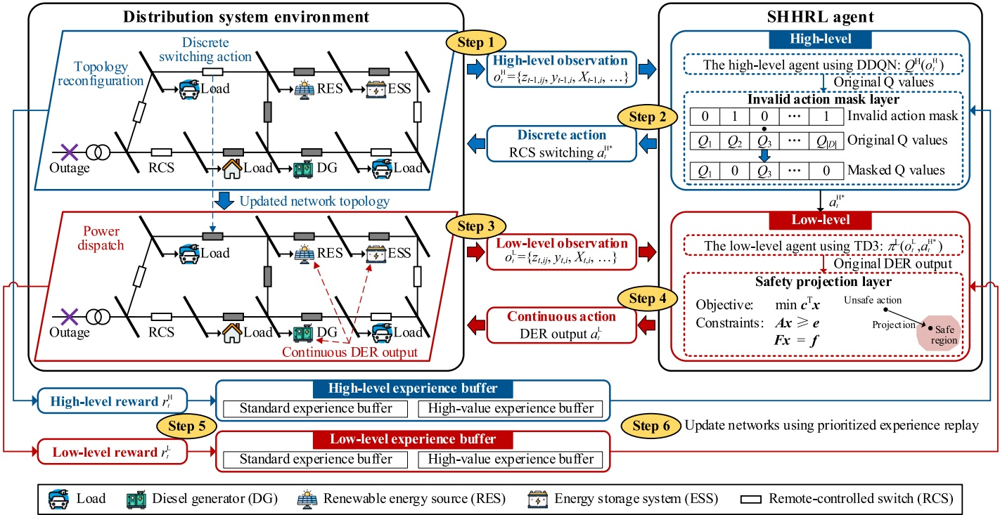

Fig. 1. The framework of the proposed SHHRL.

$E _ { t - 1 , i } ^ { \mathrm { E S S } } ;   \mathsf { d } )$ Electrical quantities, including node voltage magnitudes and both active and reactive power flows of lines.

(40)

$$
o_{t}^{\mathrm{H}} = \left\{ z_{t-1,\bar{y}}, y_{t-1,i}, X_{t-1,i}, P_{t-1,i}^{\mathrm{DG}}, Q_{t-1,i}^{\mathrm{DG}}, P_{t-1,i}^{\mathrm{ESS}}, Q_{t-1,i}^{\mathrm{ESS}}, E_{t-1,i}^{\mathrm{ESS}}, V_{t-1,i}, P_{t-1,\bar{y}}, Q_{t-1,\bar{y}} | t \in \mathcal{T}, \bar{y} \in \mathcal{E}, i \in \mathcal{N} \right\}\tag{36}
$$

$$
X_{t - 1,i} = \begin{cases} \widetilde{X}_{t - 1,i}, & y_{t - 1,i} = 1 \\ \widehat{X}_{t - 1,i}, & y_{t - 1,i} = 0 \end{cases}, X \in \left\{ P^{\mathrm{L}}, Q^{\mathrm{L}}, P^{\mathrm{RES}} \right\}\tag{37}
$$

As shown in eq. (37), the observations of loads and RESs connected to the network are represented by measured values $\tilde { X } _ { t - 1 , i ; }$ , while those of unconnected loads and RESs are represented by forecasted values $\widehat { X } _ { t - 1 , i } ,$

• Action $\boldsymbol { a } _ { t } ^ { \mathrm { H } } ;$ At each time step t, the high-level agent selects a switch to execute a closing operation $a _ { t } ^ { \mathrm { H } }$

$$
\mathbf{r}_{t}^{\mathrm{Load}} = \sum_{k \in f\left(a_{t}^{\mathrm{d}}\right)} P_{t, k}^{\mathrm{L}}\left(y_{t+1, k}-y_{t, k}\right)
$$

$$
\boldsymbol{a}_{t}^{\mathrm{H}} = \boldsymbol{w}_{t}, \boldsymbol{w}_{t} \in \mathcal{W}, \boldsymbol{f}(\boldsymbol{w}_{t}) = (\boldsymbol{i}_{w_{t}}, \boldsymbol{j}_{w_{t}}) \in \mathcal{E}\tag{38}
$$

which $w _ { t }$ denotes the index of the line associated with the selected RCS at time step t. The mapping function $f _ { \cdot } W \to \varepsilon$ associates each switch index with a corresponding pair of terminal nodes.

• Reward $r _ { t } ^ { \mathrm { H } } ;$ The high-level reward $r _ { t } ^ { \mathrm { H } }$ comprises two components: $r _ { t } ^ { \mathrm { L } }$ and $r _ { t } ^ { \mathrm { D E R } }$ , as shown in eq. (39). The first term $r_{t}^{\mathrm{L}} \left( \mathrm{eq.} (40) \right)$ quantifies the amount of active load restored by the switching action $a _ { t } ^ { \mathrm { H } } ,$ , encouraging the agent to prioritize load recovery. The second term $r _ { t } ^ { \mathrm { D E R } }$ (eq. (41)) represents the power output of newly connected DERs resulting from the switching action, promoting their effective utilization and enhancing power supply capability during the restoration process.

$$
\boldsymbol{r}_{t}^{\mathrm{H}}=\boldsymbol{r}_{t}^{\mathrm{Load}}+\boldsymbol{r}_{t}^{\mathrm{DER}}\tag{39}
$$

$$
r_{t}^{\mathrm{DER}} = \sum_{k \in f(w_{t})} \left( P_{t,k}^{\mathrm{DG}} + P_{t,k}^{\mathrm{RES}} + \frac{\overline{P}_{t,k}^{\mathrm{ESS},c} + \overline{P}_{t,k}^{\mathrm{ESS},d}}{2} \right)\tag{41}
$$

2) The low-level POMDP: At the low level, the agent controls the continuous outputs of DERs to perform power dispatch. Unlike singlestep dispatch, which optimizes decisions at each time step independently, the low-level agent must account for temporal coupling and future uncertainties in its decision-making. These include operational constraints such as DG ramping limits and the SoC constraint of ESSs. For instance, optimal ESS operation requires foresight. The agent should learn to charge the ESS during low-demand periods in anticipation of future high-load conditions, where discharging the stored energy can support system restoration. Such temporally coordinated behavior is essential for ensuring long-term efficiency and enhancing the resilience of the distribution system.

• Observation $o _ { t } ^ { \mathrm { L } } ;$ After the high-level agent executes a switching action, the corresponding lines and nodes are restored, resulting in a change in the network topology. Simultaneously, the state information of loads and RESs connected to the newly energized nodes transitions from forecasted values to real measurements. Accordingly, the low-level observation $o _ { t } ^ { \mathrm { L } }$ is derived by updating the high-level observation $o _ { t \mathrm { ~ 2 ~ } } ^ { \mathrm { H ~ } }$ , as defined in eq. (42). The updates consist of two parts: a) Network topology status: The switch states of each line is updated from $Z _ { t - 1 , \bar { y } } \mathrm { t o }   Z _ { t , \bar { y } }$ (eq. (43)), and the energization status of each node is updated from $. y _ { t - 1 , i }$ to yti (eq. (44)); b) Load and RES states: The load and RES information is updated from forecasted values $X _ { t - 1 , i }$ to measured values $X _ { t i } ,$ as shown in

eq. (45).

$$
\boldsymbol { o } _ { t } ^ { \mathrm { L } } = \left\{ \boldsymbol { z } _ { t , \bar { y } } , \mathbf { y } _ { t , i } , \boldsymbol { X } _ { t , i } , \boldsymbol { P } _ { t - 1 , i } ^ { \mathrm { D G } } , \boldsymbol { Q } _ { t - 1 , i } ^ { \mathrm { D G } } , \boldsymbol { P } _ { t - 1 , i } ^ { \mathrm { E S S } } , \boldsymbol { E } _ { t - 1 , i } ^ { \mathrm { E S S } } , \mathbf { V } _ { t - 1 , i } , \boldsymbol { P } _ { t - 1 , \bar { y } } , \boldsymbol { Q } _ { t - 1 , \bar { y } } | t \in \mathcal { F } , \bar { y } \in \mathcal { E } , i \in \mathcal { N } \right\}
$$

$$
z_{t,ij} = \left\{ \begin{aligned} 1, & \quad  if   (i,j)   is closed by   a_t^{\mathrm{H}} \\ z_{t-1,ij}, & \quad  otherwise  \end{aligned} \right. , \dot{\boldsymbol{y}} \in \mathcal{E}\tag{43}
$$

$$
y_{t,i} = \left\{ \begin{aligned} 1, & \quad  if   i \in f(a_t^{ H }) \\ y_{t-1,i}, & \quad  otherwise  \end{aligned} \right.\tag{44}
$$

$$
X_{t,i} = \begin{cases} \widetilde{X}_{t,i}, & y_{t,i} = 1 \\ \widehat{X}_{t,i}, & y_{t,i} = 0 \end{cases}, X \in \left\{ P^{\mathrm{L}}, Q^{\mathrm{L}}, P^{\mathrm{RES}} \right\}\tag{45}
$$

• Action $a _ { t } ^ { \mathrm { L } } ;$ Based on the updated observation, the low-level agent performs power dispatch decisions for the DERs. The action of the lowlevel agent at time step t is defined as follows:

$$
\begin{align*}a_{t}^{\mathrm{L}} &= \left\{ a_{t,i}^{\mathrm{DG}}, a_{t,i}^{\mathrm{RES}}, a_{t,i}^{\mathrm{ESS}} \mid -1 \right. \\& \left. \leq a_{t,i}^{\mathrm{DG}}, a_{t,i}^{\mathrm{RES}}, a_{t,i}^{\mathrm{ESS}} \leq 1, t \in \mathcal{F}, i \in \mathcal{D} = \mathcal{G} \cup \mathcal{R} \cup \mathcal{S} \right\}\end{align*}\tag{46}
$$

The action is then converted into the actual power output of the DERs through the post-processing procedure described in eq. (47)–(49):

$$
P_{t,i}^{\mathrm{DG}} = 0.5\left(a_{t,i}^{\mathrm{DG}} + 1\right)\left(P_{i}^{\mathrm{DG},\max} - P_{i}^{\mathrm{DG},\min}\right) + P_{i}^{\mathrm{DG},\min}\tag{47}
$$

$$
P _ { t , i } ^ { \mathrm { R E S } } = 0 . 5 \left( a _ { t , i } ^ { \mathrm { R E S } } + 1 \right) \widetilde { P } _ { t , i } ^ { \mathrm { R E S } }\tag{48}
$$

$$
P_{t,i}^{ ESS } = 0.5\left(a_{t,i}^{ ESS } + 1\right)\left(P_{i}^{ ESS , d , max } + P_{i}^{ ESS , c , max }\right) - P_{i}^{ ESS , c , max }\tag{49}
$$

• Reward $r _ { t } ^ { \mathrm { L } } ;$ The objective of the low-level agent is to satisfy the restoration demand while ensuring compliance with critical operational constraints. The reward function of the low-level agent is defined as follows:

$$
\mathbf{r}_{t}^{\mathrm{L}}=1-\left\|\bar{\mathbf{a}}_{t}^{\mathrm{L}}-\mathbf{a}_{t}^{\mathrm{L}}\right\|_{2} / 2 \sqrt{|\mathcal{D}|}\tag{50}
$$

where $\overline { { a } } _ { t } ^ { \mathrm { L } }$ denotes the safety-corrected actions obtained from the safety projection layer, which will be detailed in Section $3.4 ; \left| D \right|$ represents the dimensionality of $D _ { z }$ i.e., the size of the continuous action space. This reward function is designed to guide the lower-level agent toward selecting safe actions that closely approximate the original decisions while satisfying safety constraints. It also helps prevent significant deviations caused by the safety projection process, thereby maintaining policy stability.

### 3.2. SHHRL-based MGF framework

The framework of the proposed two-level SHHRL-based MGF strategy is illustrated in Fig. 1. The SHHRL framework demonstrates strong adaptability and can be seamlessly integrated with various DRL algorithms. Specifically, the high-level agent employs the DDQN, while the low-level agent adopts the TD3 algorithm. The sequence flow of SHHRL is illustrated as follows:

Step 1: The environment provides a local observation $o _ { t } ^ { \mathrm { H } }$ for the highlevel agent at each time step t, which includes the current status of lines and nodes, the measured values of restored loads and DERs, as well as the forecasted values of unrestored loads and DERs.

(42)

Step 2: Based on $a _ { t } ^ { \mathrm { H } } ,$ the high-level agent computes the Q-values for all switch operations and passes them to the IAM layer. The IAM layer filters out infeasible actions and selects the safe discrete switching action $a _ { t } ^ { \mathrm { H ^ { \star } } }$ with the highest Q-value among the remaining valid options.

Step 3: Upon the selected action $a _ { t } ^ { \mathrm { H ^ { \pm } } }$ , the environment closes the corresponding switch and updates the observation, including both network topology and power-related information. Specifically, the status of the restored lines and nodes is set to 1, and the forecasted values of restored loads and RES outputs are replaced with their corresponding measured values. The updated local observation $o _ { t } ^ { \mathrm { L } }$ is then provided to the low-level agent.

Step 4: Based on the updated observation $o _ { t } ^ { \mathrm { L } }$ , the low-level agent determines the continuous outputs of the DERs $a _ { t } ^ { \mathrm { L } }$ and passes them to the safety projection layer. The layer then outputs the corrected control actions $a _ { t } ^ { \mathrm { - L } }$

Step 5: After executing the continuous action $a _ { t } ^ { \mathrm { - L } }$ , the environment provides rewards $r _ { t } ^ { \mathrm { H } }$ and $r _ { t } ^ { \mathrm { L } }$ to the high-level and low-level agents, respectively, and transitions to the next observation $o _ { t + 1 } ^ { \mathrm { H } }$ . Subsequently, step $^ 2$ and step $^ 3$ are repeated to obtain the updated observation $o _ { t + 1 } ^ { \mathrm { L } }$ The tuple $( o _ { t } ^ { \mathrm { H } } , a _ { t } ^ { \mathrm { H } ^ { \star } } , r _ { t } ^ { \mathrm { H } } , o _ { t + 1 } ^ { \mathrm { H } } )$ is restored in either the standard experience buffer or the high-value experience buffer of the high-level agent, which will be detailed in Section 3.5. Similarly, the tuple $( o _ { t } ^ { \mathrm { L } } ,   a _ { t } ^ { \mathrm { L } } ,   r _ { t } ^ { \mathrm { L } } ,   o _ { t + 1 } ^ { \mathrm { L } } )$ is restored in the corresponding buffer of the low-level agent.

Step 6: Mini-batches are sampled from buffers $B _ { 1 }$ and $B _ { 2 }$ using prioritized experience replay to updated the policies of the high-level and low-level agents, respectively.

During the restoration process, the observation and action spaces of the low-level agent are dynamically constructed based on the discrete topology reconfiguration decisions made by the high-level agent. Specifically, once the high-level agent executes a safe switching action, the network topology is immediately updated and transmitted to the lowlevel agent. These updates are reflected in the low-level observation space, which includes the set of newly energized lines, the activated DERs, and the restored loads. For each activated DER and restored load, the forecasted values in the observation are replaced with real-time measurements to enhance accuracy and responsiveness. In addition, the high-level decisions directly influence the feasible action space of the low-level agent. DERs that are not activated by the topology configuration are excluded from the dispatchable set, and their power outputs are constrained to zero. This mechanism ensures that the low-level agent considers only feasible control actions consistent with the current network topology. By decomposing the complex MGF problem into two sub-tasks with reduced action spaces, the proposed SHHRL architecture significantly reduces learning complexity and enhances training efficiency.

Let $A _ { \mathrm { d } }$ denote the discrete action space corresponding to RCS operations, and $A _ { \mathrm { c } }$ denotes the continuous action space associated with DER dispatch. In conventional PARL frameworks, the agent must perform policy optimization over the joint action space $\mathbf { \mathit { A } } = \mathbf { \mathit { A } } _ { \mathrm { d } } \times \mathbf { \mathit { A } } _ { \mathrm { c } }$ . This results in a policy search complexity of $O ( | \mathbf { A } _ { \mathsf { d } } | \bullet | \mathbf { A } _ { \mathsf { c } } | )$ . As the distribution system grows in size and the number of controllable assets increases, the dimensionality of the joint action space becomes large. This leads to a substantial rise in computational complexity and impedes policy convergence. In contrast, the proposed SHHRL framework decomposes the decision-making process into two sequential and conditionally independent stages. First, the high-level agent selects a discrete switching action from $A _ { \mathrm { d } } .$ Then, conditioned on the updated topology, the low-level agent optimizes a continuous control policy over $A _ { \mathbb { C } } .$ This hierarchical structure converts the original joint optimization into a conditional optimization. As a result, the overall policy search complexity is reduced to $O ( | \pmb { A } _ { \mathrm { d } } | + | \pmb { A } _ { \mathrm { c } } | )$ , enabling more efficient learning.

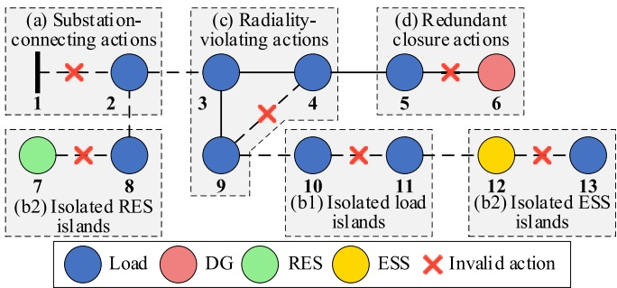

Fig. 2. Illustration of invalid actions in a MGF process.

### 3.3. Neural networks parameters optimization

The proposed SHHRL framework is highly adaptable and can be seamlessly integrated with a variety of DRL algorithms. In this study, DDQN is used for the high-level agent to optimize discrete switching actions, while TD3 is adopted for the low-level agent to control continuous DER outputs. Both agents are implemented using multi-layer neural networks.

DDQN enhances the original deep Q-network (DQN) by introducing two separate networks: the online Q-network and the target Q-network. The online network is used for action selection, while the target network is used for action evaluation. The parameters of the network are updated by minimizing the following loss function:

$$
L _ { Q } ( \theta ) = \left( Q ^ { \mathrm { H } } \left( o _ { t } ^ { \mathrm { H } } , a _ { t } ^ { \mathrm { H } } ; \theta ^ { 0 } \right) - \left( r _ { t } + \gamma Q ^ { \mathrm { H } } \left( o _ { t + 1 } ^ { \mathrm { H } } , \underset { a _ { t + 1 } ^ { \mathrm { H } } } { \arg \max } Q ^ { \mathrm { H } } \left( o _ { t + 1 } ^ { \mathrm { H } } , a _ { t + 1 } ^ { \mathrm { H } } ; \theta ^ { 0 } \right) ; \theta ^ { \mathrm { T } } \right) \right) \right) ^ { 2 }
$$

where $\theta ^ { 0 }$ and $\theta ^ { \mathrm { T } }$ denote the parameters of the online Q-network and the target Q-network, and $\gamma$ is the discount factor.

The TD3 algorithm consists of an actor network and its corresponding target actor, as well as two critic networks and their respective target critics. To improve training stability, TD3 incorporates a target policy smoothing regularization mechanism. This technique mitigates overfitting by adding clipped noise to the target policy, leading to smoother updates and enhanced robustness. Compared with the widely used deep deterministic policy gradient (DDPG) algorithm, TD3 provides better convergence and improved performance stability. To further address the overestimation bias inherent in Q-value estimation, TD3 maintains twin Q-networks. The minimum value between the two critics is used during the target update, effectively preventing overestimation of action values.

The critic networks are optimized by minimizing the following loss function:

$$
\begin{aligned}L_{\mathrm{critic}} &= \left( Q^{\mathrm{L}} \left( \boldsymbol{o}_t^{\mathrm{L}}, \boldsymbol{a}_t^{\mathrm{H}}, \boldsymbol{a}_t^{\mathrm{L}} | \boldsymbol{\theta}_i^0 \right) - y_t \right), i \in \{1, 2\}, \mathrm{where} y_t \\&= r_t + \gamma \min_{j=1,2} Q^{\mathrm{L}} \left( \boldsymbol{o}_{t+1}^{\mathrm{L}}, \pi^{\mathrm{L}} \left( \boldsymbol{o}_{t+1}^{\mathrm{L}}, \boldsymbol{a}_{t+1}^{\mathrm{H}} | \boldsymbol{\omega}^{\mathrm{T}} \right) | \boldsymbol{\theta}_j^{\mathrm{T}} \right)\end{aligned}\tag{52}
$$

where $\pi ^ { \mathrm { L } } \big ( \boldsymbol { o } _ { t + 1 } ^ { \mathrm { L } } , \boldsymbol { a } _ { t + 1 } ^ { \mathrm { H } } | \boldsymbol { \omega } ^ { \mathrm { T } } \big )$ denotes the smoothed target action generated by the target actor network with parameters $\omega ^ { T } ;$ θOi and $\theta _ { i } ^ { \mathrm { T } }$ represent the parameters of the i-th critic and its corresponding target critic network, respectively.

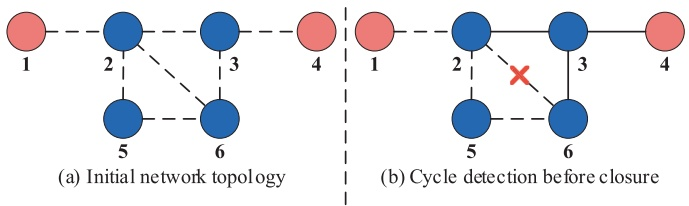

Fig. 3. Union-find-based cycle detection in a MGF process.

The actor network $\pi$ is updated less frequently than the critic and aims to maximize the estimated Q-value:

$$
L _ { \mathrm { a c t o r } } = - Q \left( o _ { t } ^ { \mathrm { L } } , a _ { t } ^ { \mathrm { H } } , \pi \left( o _ { t } ^ { \mathrm { L } } , a _ { t } ^ { \mathrm { H } } | \omega ^ { 0 } \right) | \theta _ { 1 } ^ { 0 } \right)\tag{53}
$$

where $\omega ^ { 0 }$ represents the parameters of the actor network.

### 3.4. Safety layer embedded with expert knowledge

Existing SRL methods cannot guarantee that the agent satisfies safety constraints at every timestep during exploration and deployment. To address this limitation, power system expert knowledge is embedded into the proposed HRL framework. Before executing decisions, pre-defined expert knowledge is used to proactively filter out unsafe actions or project them onto a safe action space. This ensures that the agent executes only decisions that comply with operational constraints.

The constraints in the MGF problem (2)–(35) are categorized into two types: those related to continuous actions (2)–(25) and those related to discrete actions (26)–(35). For discrete-action constraints, an IAM layer is designed to eliminate infeasible discrete actions. For continuousaction constraints, a safety projection layer is introduced to map unsafe continuous actions onto a feasible region.

(51)

1) IAM layer for discrete switching actions.

In the MGF problem, actions that violate operational constraints are defined as invalid actions, which not only degrade learning efficiency but also compromise the safety of the distribution system. To address this issue, an expert-knowledge-based IAM layer is designed to dynamically filter out infeasible actions before they are considered by the agent.

The implementation process of the IAM layer consists of the following steps: i) At each time step t, a Boolean invalid action mask vector is initialized: $\mathbf { m } _ { t } = [ m _ { 1 } , m _ { 2 } , . . . , m _ { | \varepsilon | } ]$ . The vector is initialized to zero, with each element corresponding to a switch action. If an action a is invalid, its corresponding mask value is updated to $m _ { a } = 1 . \mathrm { i i ) }$ Based on expert knowledge, invalid actions at the current time step are identified, and the corresponding entries in the invalid action mask are updated accordingly. iii) The action selection rule is modified to incorporate the invalid action mask, ensuring that infeasible actions are excluded from decision-making:

$$
a_{t}^{\mathrm{H}^*} = \operatorname{argmax}_{a_{t}^{\mathrm{H}}} \left( Q\left( s, a_{a_{t}^{\mathrm{H}}} \right) - \lambda m_{a_{t}^{\mathrm{H}}} \right)\tag{54}
$$

where $a _ { t } ^ { \mathrm { H ^ { \star } } }$ represents the optimal discrete action. λ is a large positive constant used to penalize invalid actions, ensuring they are not selected.

The key aspect of the IAM layer is how to identify invalid actions at each time step based on expert knowledge. As analyzed earlier, the constraints associated with discrete actions are defined by constraints (26)–(35), which can be further categorized as follows: Constraints (26) and (27) define the initial states of variables. Constraints (28)–(29) govern the state transition process of nodes and lines. Constraints (30)– (31) are implicitly satisfied during the construction of the discrete action space. Therefore, the topological constraints that must be explicitly enforced during the agent's decision-making process are constraints (32)–(35). Based on the analysis, the invalid actions in the MGF process and their filtering methods are as follows:

a) Substation-connecting actions: These actions violate constraints (32), which prohibit connecting any line directly to substation nodes under main grid outage scenarios, as illustrated in Fig. 2(a). The filtering method is as follows: For any line ${ i j } ,$ if either terminal node belongs to the substation node set $S , \mathrm { i . e . , } i \in S \mathrm { o r } j \in S ,$ , then closing the switch on line ij is classified as an invalid action.

b) Island-inducing actions: Such actions violate constraint (33), and may lead to two distinct types of network islands. The first type refers to isolated load islands that lack power supply, which hinders restoration efficiency, as illustrated in Fig. 2(b1). The second type involves isolated RES or ESS islands, which compromise the overall reliability of supply, as shown in Fig. 2(b2). The filtering method is as follows: For a given line ij, if both terminal nodes i and j are de-energized at time t, i.e. $y _ { t , i }   =$ 0 and $y _ { t , j } = 1$ ,then closing the switch on line ij is classified as an invalid action.

c) Radiality-violating actions: To ensure the radial topology of a distribution system, the following conditions must be satisfied: (i) The network graph must be acyclic; (ii) There is at most one substation node in each connected component of the graph. Since this study focuses on MGF under the assumption that the utility power from main grid is lost, condition (ii) is not applicable. Thus, it is only necessary to ensure

$$
\min \sum_{i \in \mathcal{I}} \left[ \left( \bar{P}_{t,i}^{\mathrm{DG}} - P_{t,i}^{\mathrm{DG}} \right)^2 + \left( \bar{P}_{t,i}^{\mathrm{RES}} - P_{t,i}^{\mathrm{RES}} \right)^2 + \left( \bar{P}_{t,i}^{\mathrm{ESS}} - P_{t,i}^{\mathrm{ESS}} \right)^2 + \left( \bar{P}_{t,i}^{\mathrm{ESS},d} + \bar{P}_{t,i}^{\mathrm{ESS},c} \right) \right]
$$

condition (i), meaning that if closing the switch of a given line creates a loop in the network graph, the action is classified as invalid, as illustrated in Fig. 2(c). To efficiently identify such violations, a union-findbased cycle detection algorithm is employed. In this disjoint-set structure, each subset represents a connected component of the current network. The algorithm proceeds in the following steps:

i) Initialize the union-find structure: At the beginning of the MGF process, all switches are open, and each node is assigned to an independent set. For instance, in Fig. 3(a), the disjoint sets are initialized as {{1},{2},{3},{4},{5},{6}}.

ii) Cycle detection before action execution: Before executing a switching action, the algorithm checks whether the two terminal nodes of the corresponding line belong to the same set. If they do, closing the switch would form a loop and is therefore identified as an invalid action. For example, in Fig. 3(b), the disjoint sets are $\{ \{ 1 \} , \{ 2 , 3 , 4 , 6 \} , \{ 5 \} \}$ . Line 2–6 connects two nodes already in the same set, so closing this line would create a loop and violate the radiality constraint.

iii) Set merging after valid action: If the terminal nodes of a line belong to different sets, the action is valid, and their respective sets are merged. For instance, after closing the line 5–6 in Fig. 3(b), the resulting disjoint sets become {1} and $\{ 2 , 3 , 4 , 5 , 6 \}$

d) Redundant closure actions: In addition to the aforementioned cases, switches that have already been closed should not be operated again, as illustrated in Fig. 2(d). Repeated closures introduce redundant computations and reduce learning efficiency. The filtering method is as follows: If the switch on line ij is already closed, i.e. $z _ { t , i j }   =   1$ , any subsequent attempt to reclose it is classified as an invalid action.

The above IAM mechanism performs deterministic, rule-based logical evaluations based on the network topology of the distribution system and the real-time status of nodes and branches at each time step. Under the assumption of accurate system modeling, this approach ensures complete coverage in identifying all infeasible discrete actions.

To assess the scalability and real-time applicability of the proposed IAM mechanism, a formal computational complexity analysis is conducted. The complexity of each rule-based filtering method is outlined as follows:

a) Substation-connecting and redundant closure checks are based on direct comparisons of node membership and binary switch statuses. These operations are executed over the entire set of switchable lines, resulting in a time complexity of $O ( | W | )$ per decision step, where |W| represents the number of controllable switches.

b) Island-inducing action detection requires verifying the energization states of both terminal nodes for each line, which also incurs a computational cost of O(|W|).

c) Radiality-violation detection is implemented using a union-findbased cycle detection algorithm. At each decision step, the algorithm checks whether the two nodes of a line belong to the same disjoint set. The complexity of this process is likewise $O ( | W | )$ .

In summary, the total computational cost of the IAM layer per decision step is bounded by O(|W|). This lightweight complexity renders the IAM mechanism suitable for real-time operation in distribution systems.

2) Safety projection layer for continuous DER outputs.

This part introduces an optimization-based safety projection layer to converts unsafe actions into safe ones. To prevent the safety projection layer from significantly altering the agent's decisions and disrupting its convergence, the objective function is designed to minimize the adjustments of continuous actions:

(55)

where $P _ { t , i } ^ { \mathrm { D G } } ,   P _ { t , i } ^ { \mathrm { R E S } }$ , and $P _ { t , i } ^ { \mathrm { E S S } }$ denote the active power outputs of the DG, RES, ESS at node i and time step t, as determined by the lower-level agent after processing through eqs. $(47) - (49); \overline{P}_{t,i}^{ DG }, \overline{P}_{t,i}^{ RES }$ , and $\overline { { P } } _ { t , i } ^ { \mathrm { E S S } }$ denote the corresponding safety-corrected active power; M denotes a large number; $\overline { { P } } _ { t , i } ^ { \mathrm { E S S , c } }$ and $\bar { P } _ { t , i } ^ { \mathrm { E S S , d } }$ denote the safety-corrected charging and discharging active power of the ESS. These variables satisfy the following relation:

$$
\overline { { P } } _ { t , i } ^ { \mathrm { E S S } } = \overline { { P } } _ { t , i } ^ { \mathrm { E S S , d } } - \overline { { P } } _ { t , i } ^ { \mathrm { E S S , c } }\tag{56}
$$

The first three terms inside the brackets in eq. (55) represent the adjustments applied to the continuous control actions. With respect to constraints (2)–(35), the discrete topology-related variables $z _ { t , \dot { y } }$ and $y _ { t , i j }$ are predetermined by the high-level agent after executing discrete switching actions. Consequently, constraints (26)–(35), which are associated with these discrete decisions, are already enforced at the high level and can therefore be excluded from the low-level safety projection layer. As a result, the safety layer only needs to consider constraints (2)– (25), among which only constraint (16) is nonlinear. This constraint prohibits the ESS from charging and discharging simultaneously. Traditional approaches typically handle this constraint by introducing additional binary variables, which substantially increase computational complexity. In contrast, the proposed method incorporates a relaxation term into the objective function of eq. (55), thereby eliminating the need for binary variables and reducing the computational burden of the safety projection layer. The proof of this relaxation can be found in Appendix $\mathbf { A } .$

Consequently, the final safety projection layer can be formulated as a quadratic programming (QP) problem, the general form of which is shown in (57)–(59):

$$
\min \frac{1}{2} \boldsymbol{x}^{\mathrm{T}} \mathbf{Q} \boldsymbol{x} + \boldsymbol{c}^{\mathrm{T}} \boldsymbol{x}\tag{57}
$$

$$
{ \mathrm { s . t . } } \mathrm { A } x \leq b\tag{58}
$$

$$
\mathtt { E } x = d\tag{59}
$$

where Q, A and E are coefficient matrices; c, b, and d are the coefficient vectors; x is the vector of continuous decision variables, and $\pmb { x } = [ \overline { { P } } _ { t , i } ^ { \mathrm { D G } } ]$ $\bar { P } _ { t , i } ^ { \mathrm { R E S } } , \bar { P } _ { t , i } ^ { \mathrm { E S S } } , \bar { P } _ { t , i } ^ { \mathrm { E S S , c } } , \bar { P } _ { t , i } ^ { \mathrm { E S S , d } } ]$

Accordingly, eq. (55) defines the objective function in the quadratic program (QP) formulation, corresponding to eq. (57). Constraints (2)– (5), (8)–(11), (14), and (23)–(25) correspond to the equality constraint described in eq. (58), while constraints (6)–(7), (12)–(13), (15), (19)– (20), and (22) correspond to the equality constraint in eq. (65).

By solving the QP problem defined by eqs. (57)–(59), the safetycorrected active power outputs of the DG, RES, and ESS are obtained. Based on eqs. (47)–(49), the corresponding safety-corrected actions $\overline { { a } } _ { t } ^ { \mathrm { L } }$ can be recovered through inverse mapping and are subsequently used to compute the reward for the low-level agent.

### 3.5. MPER for stabilizing learning

Although the proposed method improves learning efficiency, the interdependence between high- and low-level agents may lead to policy convergence instability. To address it, MPER is introduced to stabilize training and accelerate convergence.

Conventional DRL methods typically employ a single experience buffer from which samples are randomly drawn for training. However, due to its multi-level structure, HRL exhibits greater instability in experience data distribution. Using conventional experience replay in HRL may lead to unstable policy convergence and inefficient policy updates. To mitigate this issue, MPER enhances training stability and accelerates policy convergence in HRL by optimizing the selection and utilization of critical and high-value experiences. It incorporates two essential mechanisms: prioritized experience replay (PER) and multiple experience buffers.

1) Prioritized experience replay.

PER improves the conventional experience replay mechanism by assigning different sampling priorities to experience samples. Specifically, it evaluates the importance of each sample using the temporal difference (TD) error, where a larger TD error indicates a greater discrepancy between the predicted and actual rewards, contributing more significantly to policy updates. To ensure the agent prioritizes learning from the most informative experiences, these high-TD-error samples are assigned higher sampling probabilities, thereby accelerating policy convergence.

To ensure that newly generated samples are not ignored, all newly added experience samples are initially assigned the highest priority, guaranteeing that each sample is selected at least once. Additionally, to prevent samples with zero TD error from being completely discarded, a smoothed priority representation is employed to ensure that all experience samples retain a nonzero probability of being sampled. Each experience sample i is assigned a sampling probability defined as follows:

$$
P ( i ) = \frac { \left( \left| \delta _ { i } + \varepsilon \right| \right) ^ { \alpha } } { \sum _ { j } \left( \left| \delta _ { j } + \varepsilon \right| \right) ^ { \alpha } }\tag{60}
$$

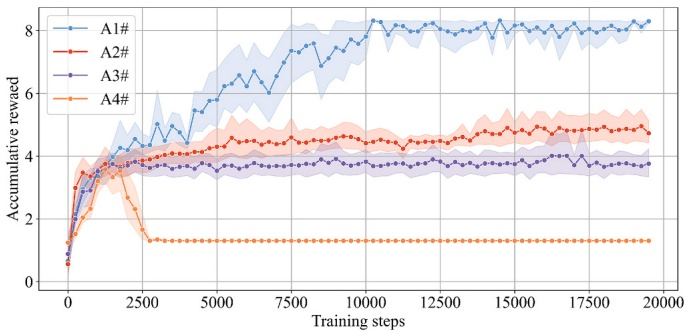

Fig. 4. Training curves of different algorithms in the modified 123- node system.

where δi represents the TD error, α is a constant controlling the impact of prioritization, and ε is a small positive constant.

2) Multiple experience buffers.

Building upon the standard experience buffer (SEB), this study further introduces a high-value experience buffer (HEB) to store highvalue experiences, thereby improving policy learning stability.

During each interaction with the environment, newly generated experiences are temporarily stored and evaluated at the end of the episode. If the agent successfully restores all distribution system loads in a given episode, the entire set of experiences from that episode is considered high-value and stored in HEB.

During training, experiences are sampled from SEB and HEB based on the PER mechanism to form a mini-batch for learning. Let k∈[0,1] denote the HEB sampling fraction and the SEB fraction is 1-k. At early training stages, we set k to a larger value to emphasize high-quality trajectories that successfully complete restoration tasks and thereby accelerate policy improvement. As training progresses and the policy stabilizes, k is gradually reduced while the SEB share 1-k increases. This design ensures a balanced utilization of both regular and high-value experiences, preventing critical experiences from being overwhelmed by low-value samples. As a result, it facilitates more stable and efficient policy learning.

$$
\mathbf{B} = \mathrm{PER}(\mathrm{SEB}, \boldsymbol{k}) + \mathrm{PER}(\mathrm{HEB}, \mathbf{1} - \boldsymbol{k})\tag{61}
$$

where B represents the minibatch.

## 4. Case studies

In this section, the training and application performance of the proposed method is demonstrated. We start by presenting the system and algorithm configurations. The training efficiency and practical performance are then demonstrated and compared with benchmark algorithms.

### 4.1. Case settings

Two systems are used: the modified IEEE 123-node system [9], which contains one DGs, two RESs, and one ESS; and a modified 356- node regional system in China with three DGs, two RESs and two ESSs. The original load demand and RES output datasets are provided in Appendix B. The concept of node cells (N–Cs) [42] is introduced to reduce the search space. The network topologies of both test systems are provided in Appendix B. $\eta ^ { \mathrm { E S S , d } }$ and $\eta ^ { \mathrm { E S S , c } }$ are both set to be $0 . 9 9 , \eta _ { i } ^ { \mathrm { D G } }$ is set to be 0.35PDG,max i. To generate load and RES profile for each episode, the original load demands and RES output are multiplied randomly from 0.7 to 1.3 p.u., in order to simulate stochastic fluctuations in load and renewable generation. The restoration process is simulated over 96 discrete time steps. The corresponding normalized power profiles for load demand and RES generation are presented in Appendix B. To emulate forecast uncertainties in load demand and RES output, Gaussian noise is introduced to their actual values. The observed values are modeled as $\widetilde{x} = \widehat{x} \bullet (1 + \varepsilon_t), \varepsilon_t \sim N(0, 0.15^2)$ , where $\varepsilon _ { t }$ denotes a zeromean Gaussian random variable with a standard deviation of 15%. This reflects typical levels of prediction uncertainty commonly encountered in practical power system operations.

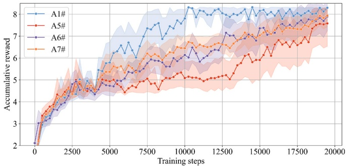

Fig. 5. Ablation study on MPER components.

Testing results in the modified 123-node system.

| Method | Average restored load | Average computation time (s) |
| --- | --- | --- |
| A1# | 99.843 ±1.789% | 0.051 |
| A2# | 81.497 ±4.361% | 0.048 |
| A3# | 73.960 ±4.679% | 0.041 |
| A4# | 21.148 ±1.317% | 0.013 |
| A5# | 91.820 ±8.347% | 0.049 |
| MILP | 100% | 31.490 |

The proposed method was implemented using Python 3.11, PyTorch $2 . 4 . 0 ,$ and GUROBI 12.0.1 for optimization. All simulations were conducted on a Linux-based system equipped with an Intel® Xeon® Platinum 8160 CPU (2.10GHz) and an NVIDIA GeForce RTX 2080 Ti GPU.

### 4.2. The modified 123-node system

We manually tune the hyper-parameters of different algorithms to obtain their best performance, and the detailed settings are provided in Appendix B.

1) Convergence of different algorithms.

The comparative methods include:

A1#: The proposed SHHRL approach, which adopts a hierarchical structure to efficiently solve the MGF problem with discrete-continuous hybrid action spaces.

A2#: Action space transformation, where the continuous action space is discretized into multiple evenly spaced discrete actions and optimized using the DDQN algorithm. As a result, the method operates solely within a discrete action space.

A3#: Parameterized Double Deep Q-Network (PDDQN) [27,28], an implementation of the parameterized action space reinforcement learning (PARL) framework.

A4#: Hybrid Soft Actor-Critic (HSAC) [29], another PARL-based algorithm. Both A3# and A4# represent concurrent action learning approaches, where the agent attempts to learn discrete and continuous control decisions in parallel using a single integrated policy.

The training curves of our solution and the benchmark algorithms are given in Fig. 4. For all algorithms, the solid lines represent the mean performance over multiple training runs, while the shaded regions represent the 95% confidence intervals around the mean.

As illustrated in Fig. 4, the proposed SHHRL method (A1#) consistently achieves the highest cumulative reward during training, outperforming all baseline methods. In contrast, the action space transformation approach (A2#) shows significantly degraded performance. This is primarily due to the discretization of continuous DER dispatch into a finite set of pre-defined actions, which reduces control granularity and impairs the agent's ability to generate precise restoration strategies.

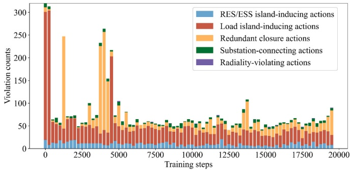

Fig. 6. Invalid action counts during the training process under PPO-Lag. (a) Average triggering frequency. (b) Average correction $L _ { 2 } \cdot$ norm.

Moreover, the PARL-based methods (A3# and A4#) also converge to suboptimal reward levels. The superior performance of the proposed hierarchical structure over these approaches can be attributed to several key factors. First, the MGF task is inherently a complex stochastic sequential decision problem involving a high-dimensional hybrid action space. Concurrent action learning methods attempt to optimize both action types simultaneously under a unified policy, which significantly increases learning difficulty. In contrast, the SHHRL framework decomposes the original complex task into two simpler sub-problems: discrete topology reconfiguration and continuous power dispatch. This decomposition enables each agent to operate within a smaller, more manageable action space, thereby improving learning ability. Second, the objective of MGF is to maximize the restored load while satisfying all operational constraints. In concurrent action learning, the reward function typically combines load restoration rewards and penalties for constraint violations. As discrete and continuous decisions are optimized jointly within a single policy network, their contributions to the final reward become entangled. This entanglement makes it difficult for the agent to assign proper credit to each action component, which leads to ambiguity in policy updates and degraded performance. This phenomenon is known as the credit assignment problem. In contrast, the proposed hierarchical design mitigates this issue by decoupling the learning processes. Specifically, the high-level agent is dedicated to maximizing load restoration through discrete topology decisions, while the low-level agent focuses on ensuring constraint satisfaction via continuous power dispatch. This separation allows for more accurate reward attribution, simplifies policy learning, and ultimately leads to superior performance in complex hybrid control tasks such as MGF.

2) Ablation study on the MPER mechanism.

To evaluate the individual contributions of each component in the proposed MPER mechanism, an ablation study is performed. The following variants are compared:

A1#: The proposed SHHRL approach, which adopts a hierarchical structure to efficiently solve the MGF problem with discrete-continuous hybrid action spaces.

A5# SHHRL without MPER.

A6#: SHHRL with only prioritized experience replay (PER), excluding the high-value buffer.

A7#: SHHRL with only multiple experience buffers, using uniform sampling.

As shown in ${ \operatorname { F i g . } } 5 ,$ the full MPER-enabled method (A1#) achieves the highest cumulative rewards and demonstrates the most stable convergence throughout training. In contrast, removing MPER (A5#) results in a noticeable decline in both training stability and final performance, highlighting the critical role of MPER in mitigating the instability introduced by interdependent hierarchical agents. Both A6# and A7# outperform the baseline A5#, confirming that each MPER component independently enhances learning effectiveness. Specifically, A7# achieves higher cumulative rewards than A6# during the early training stage, indicating that reusing high-return trajectories improves convergence stability. As training progresses, A6# gradually catches up with A7#, suggesting that prioritizing transitions based on temporaldifference errors can also enhances learning efficiency. Moreover, compared to A6# and A7#, the proposed A1# approach integrates both prioritized experience replay and multiple experience buffers under the MPER framework. This joint implementation leads to faster convergence and stabilizes performance at the highest reward level, demonstrating the complementary benefits of combining both mechanisms.

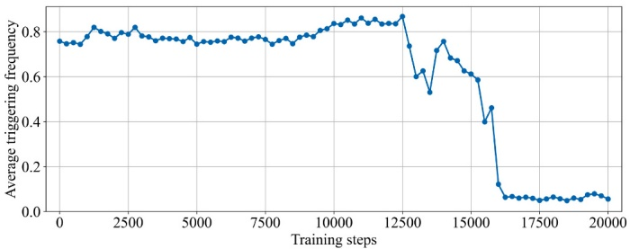

(a) Average triggering frequency.

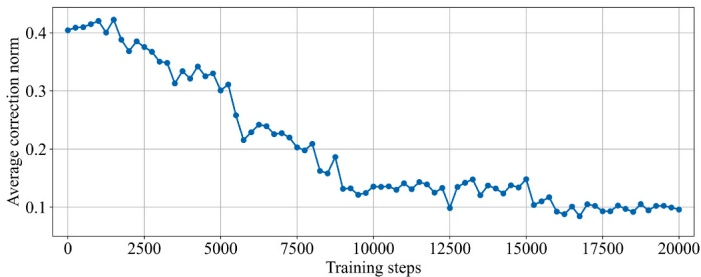

(b) Average correction $L _ { 2 } .$ -norm.

Fig. 7. Convergence of average triggering frequency and average $L _ { 2 } \cdot$ norm of correction for the safety projection layer during training.

Statistical performance of the safety projection layer in 100 testing scenarios.

| Method | Average triggering frequency | Average correction L2-norm |
| --- | --- | --- |
| SHHRL | 11.14% | 0.0570 |

3) Performance of different methods.

To validate the effectiveness and computational efficiency of the proposed SHHRL method, comparative numerical tests were conducted across 100 randomly generated scenarios. The MILP model described in Section 2 was also solved as a performance benchmark. The performance metrics include the average restored load percentage and the average computation time per scenario, as summarized in Table 1.

As shown in Table 1, the action space transformation method (A2#) exhibited a notable decline in accuracy. This performance degradation arises from discretizing the continuous DER active power outputs into a limited set of discrete levels, which significantly restricts the agent's capacity to perform fine-grained control. As a result, the derived policies tend to be suboptimal, leading to lower restoration effectiveness. While increasing the discretization resolution can enhance control granularity, it also causes a significant increase in the action space size, introducing the curse of dimensionality. The resulting high-dimensional space severely impairs exploration efficiency and slows convergence, ultimately degrading learning performance. These challenges reflect an inherent trade-off in the action space transformation approach between control fidelity and computational feasibility, making it ill-suited for real-time restoration tasks that require high-precision.

Similarly, the PARL methods (A3# and A4#) also demonstrated inferior performance. In particular, HSAC (A4#) yielded the lowest average restored load of only 21.148%. This performance drop is attributed to the lack of inherent parameterized structure between discrete and continuous actions in the MGF problem. Forcing a parameter-action formulation on inherently independent decision variables, such as discrete topology reconfiguration and continuous DER dispatch, leads to ineffective policy learning and coordination. Moreover, solving the hybrid action space MGF problem directly without decomposition increases the learning complexity.

In addition, as shown in Table 1, SHHRL without MPER (A5#) has markedly higher variability, with a standard deviation of 8.347% in the average restored load, which exceeds that of the other methods. This variability reflects the inherent training instability of hierarchical agents.

By contrast, the proposed SHHRL (A1#) achieves an average restored load of 99.843%, which is nearly identical to the MILP optimum of 100%, while reducing the average computation time from 31.490 s to 0.058 s. In addition, A1# yields a much smaller standard deviation in restored load (1.789%). This variance reduction is attributable to the MPER mechanism, which stabilizes training by balancing high-value and regular experiences. These findings highlight the SHHRL method's superior trade-off between restoration performance and computational efficiency, demonstrating its strong practical potential for real-time

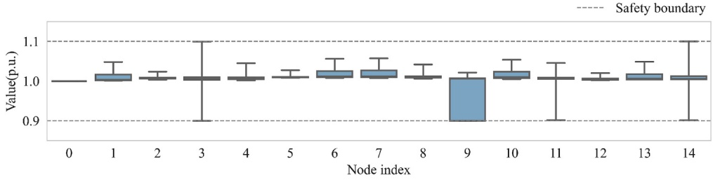

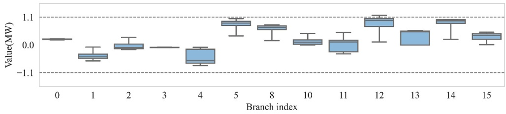

Fig. 8. Node voltage and branch active power flow in the testing scenarios of the modified IEEE 123-node system.

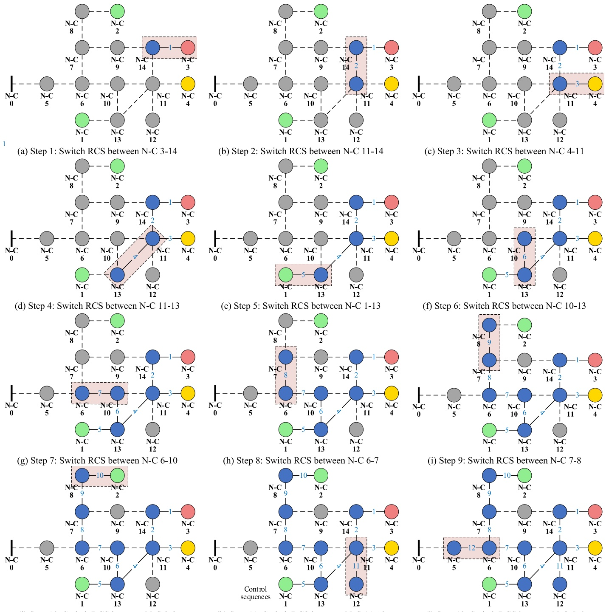

(j) Step 10: Switch RCS between N-C 2-8

(k) Step 11: Switch RCS between N-C 11-12

Fig. 9. Control sequence generated by the proposed SHHRL method for a representative scenario in the modified IEEE 123-node system. (a) Step 1: Switch RCS between N–C 3–14 (b) Step 2: Switch RCS between N–C 11–14 (c) Step 3: Switch RCS between N–C 4–11 (d) Step 4: Switch RCS between N–C 11–13 (e) Step 5: Switch RCS between N–C 1–13 (f) Step 6: Switch RCS between N–C 10–13 (g) Step 7: Switch RCS between N–C 6–10 (h) Step 8: Switch RCS between N–C 6–7 (i) Step 9: Switch RCS between N–C 7–8 (j) Step 10: Switch RCS between N–C 2–8 (k) Step 11: Switch RCS between N–C 11–12 (l) Step 12: Switch RCS between N–C 5–6.

distribution system restoration.

4) Effectiveness of the proposed safety layer.

To evaluate the effectiveness of the proposed IAM layer for discrete actions, a comparative method was constructed. Constrained policy optimization, in which the MGF problem is modeled as a CMDP and optimized using PPO-Lagrangian (PPO-Lag). Since PPO-Lag is inherently designed for continuous action spaces, we first relaxed the discrete switching actions into continuous representations before applying the algorithm. Fig. 6 illustrates the number of invalid actions executed by the PPO-Lag agent during training. Although the PPO-Lag method leads to a gradual reduction in constraint violations, the count remains considerably high even after convergence. Such persistent violations are unacceptable in real-world distribution systems, where operational safety must be guaranteed at every step. In contrast, the proposed SHHRL method, equipped with the IAM layer, effectively filters out infeasible discrete actions. As a result, the number of invalid actions remains strictly zero throughout training. This clearly demonstrates the superior capability of the proposed framework in maintaining constraint adherence from the early stages of learning.

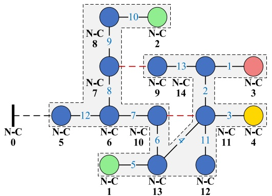

(a) Final MGF results obtained using the proposed SHHRL method

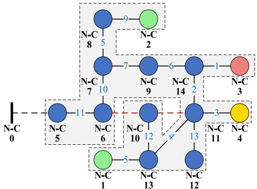

(b) Final MGF results obtained using the MILP method

Fig. 10. Comparison of control sequences and microgrid formation results for the 123-node system. (a) Final MGF results obtained using the proposed SHHRL method. (b) Final MGF results obtained using the MILP method.

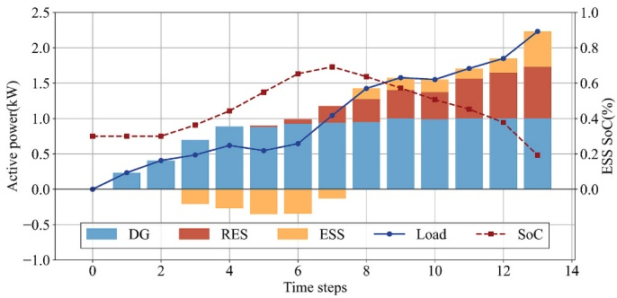

Fig. 11. Dispatch result of SHHRL in the modified IEEE 123-node system.

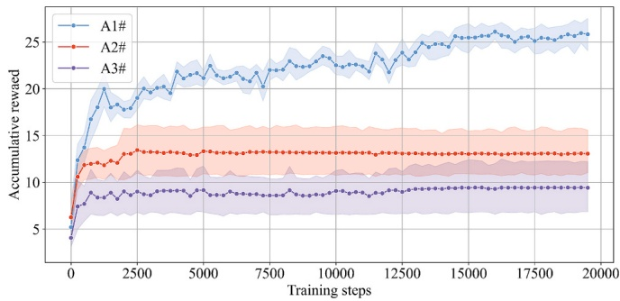

Fig. 12. Training curves of different algorithms in the modified 356- node system.

To further assess the performance of the proposed safety projection layer for continuous actions, the average triggering frequency and average correction L2-norm were recorded throughout the training and testing phases. Specifically, during training, the policy was evaluated every 250 steps over 20 random episodes to track these metrics. Fig. 7 illustrates the convergence of both metrics during training. In the initial exploration stage, the triggering frequency reaches approximately 90% with an average correction norm exceeding 0.4 p.u., indicating that stochastic explorations frequently lead to significant constraint violations. As training progresses, the SHHRL agent progressively internalizes these constraints through the safety-guided reward mechanism. Consequently, both metrics exhibit a consistent decline, ultimately stabilizing at a low level. In the testing phase, the proposed SHHRL method was validated across 100 stochastic scenarios, as summarized in Table. 2. Statistical results show an average triggering frequency of 11.14% per episode and an average correction norm of 0.0570 p.u. These results demonstrate that the trained agent can generate actions within or near the feasible region. This indicates that the proposed method, once fully trained, can make secure decisions with minimal intervention from the safety projection layer, thereby validating its efficacy in internalizing complex physical constraints.

Table 3

Testing results in the modified 356-node system.

| Method | Average restored load | Average computation time(s) |
| --- | --- | --- |
| A1# | 98.288 ±5.142% | 0.427 |
| A2# | 55.136 ±8.367% | 0.395 |
| A3# | 31.441 ±9.971% | 0.100 |
| MILP | / | Out of time (>1 h) |

Furthermore, the node voltage magnitudes and branch active power flows are recorded in Fig. 8. The results indicate that both node voltages and branch power flows remained within predefined safety limits. These results demonstrate that the proposed method effectively enforces power flow constraints during the MGF process, thereby ensuring operational safety throughout the restoration.

5) Demonstration of the proposed method in a single restoration scenario.

To clearly demonstrate the decision-making results of the proposed method, Fig. 9 illustrates the control sequence generated by the SHHRL algorithm for a representative scenario in the 123-node system. Fig. 10 presents the final microgrid formation results obtained using the proposed SHHRL and the MILP methods for comparison. The corresponding dispatch results of DERs during the restoration process are also depicted in Fig. 11.

As illustrated in Fig. 9 (a), the restoration process begins at the DG in N–C 3. The agent subsequently prioritizes reconnecting the ESS in N–C 4 at step 3 (Fig. 9 (c)), the RES in N–C 1 at step 5 (Fig. 9 (e)), and the RES in N–C 2 at step 10 (Fig. 9 (h)). This restoration sequence ensures sufficient power support across the system during the entire restoration process. As shown in Fig. 10 (a), all loads are fully restored without violating topological or operational constraints. This outcome demonstrates the effectiveness of the proposed IAM layer in filtering out infeasible discrete actions and the safety projection layer in correcting unsafe continuous actions, thus guaranteeing operational safety during microgrid formation. In Fig. 10 (b), both the proposed SHHRL method and the MILP benchmark exhibit similar restoration strategies, prioritizing the reconnection of the ESS in N–C 4 and the RESs in N–C 1 and N–C 2. The primary difference lies in the selected restoration paths. However, results from Table 1 show a significant advantage in computational efficiency. While the MILP method requires an average computation time of 31.490 s, SHHRL completes decision-making in only 0.051 s. These findings indicate that the proposed method is capable of learning near-optimal strategies comparable to those generated by the MILP solver, while offering substantially improved computational efficiency for real-time applications.

As shown in Fig. 11, with the given dispatch policy and safety projection layer for continuous actions, the distribution network can effectively maintain supply-demand balance during the restoration process. At step 3, the ESS at N–C 4 is reconnected, as shown in Fig. 9 (c). Subsequently, during steps 3–7, when the restored load demand remains relatively low, the algorithm strategically charges the ESS. Later, during steps 8–13, as load restoration progresses and system demand increases, the algorithm appropriately switches to discharging the ESS to meet the rising demand. This adaptive behavior not only highlights the future foresight of the proposed method but also confirms its capability for coordinated optimization between discrete switching actions and continuous DER outputs.

### 4.3. The modified 356-node regional system in China

To analyze the scalability, we test the proposed solution on the modified 356-node distribution system in China. The system consists of 47 N-Cs. As shown in Fig. 12, the proposed SHHRL method (A1#) demonstrates the fastest convergence and achieves the highest accumulative reward throughout the training process. In contrast, A2# and A3#, which represent ablated versions with partial or no constraint handling, converge to significantly lower reward levels and exhibit limited performance improvement over time.

The robustness of the learned policies is further validated through testing results, as summarized in Table 3. A1# restores on average 98.29% of the total load with a computation time of 0.522 s, striking an effective balance between restoration quality and decision speed. It is important to note that the reported computation time includes not only the decision time of the RL agent, but also the execution time of the proposed invalid action masking and safety projection layer. This confirms that the proposed method satisfies the real-time computational requirements for DSR. A2# restores only 55.14%, while A3# drops to 31.44%, highlighting the crucial role of hierarchical coordination and constraint filtering in complex MGF tasks.

Compared with the traditional MILP method, the results in Table 1 and Table 3 demonstrate that as the system scale increases from the 123- node to the 356-node network, the computation time of MILP grows exponentially, rising from 31.490 s to over one hour. In contrast, the proposed SHHRL method maintains low computational latency, increasing only from 0.051 s to 0.427 s. This efficiency is attributed to the RL agent's ability to internalize the optimal control policy into neural network parameters during the training phase. At inference time, decisions are generated through a single forward pass, enabling fast response. In comparison, optimization-based methods require solving the problem from scratch for each new scenario, which becomes computationally intractable as the system size grows. These results clearly demonstrate the superior scalability of the proposed SHHRL approach over the MILP-based method.

## 5. Conclusion

This paper presents a model-free two-level SHHRL-based scheme for MGF within a hybrid action space, while ensuring strict compliance of physical constraints. We demonstrated the effectiveness of SHHRL in comparison with other state-of-the-art algorithms. Main points drawn from simulations are outlined as follows:

1) The proposed hierarchical framework decomposes the complex MGF task into two subproblems: topology reconfiguration and power dispatch, enabling each agent to operate in a reduced subspace. This significantly improves learning efficiency and decision quality. Simulation results demonstrate that SHHRL consistently outperforms benchmark hybrid RL algorithms in restoration performance.

2) By leveraging the expert knowledge, the IAM layer filters out infeasible discrete switching actions, while the safety projection layer corrects unsafe continuous DER output. Together, these mechanisms ensure strict compliance with physical constraints, including both topological and operational constraints, thereby guaranteeing operational safety throughout the restoration process.

3) The MPER technique mitigate instability arising from agent interdependence during training. These enhancements accelerate policy convergence and contribute to improved policy robustness.

However, as the penetration of DERs continues to increase, distribution systems are subject to greater uncertainty. Rapid fluctuations in load demand and renewable generation, combined with sensor inaccuracies and communication delays, may compromise the reliability and adaptability of control policies trained using conventional RL methods. Therefore, enhancing policy robustness under scenarios with volatile source-load profiles and inaccurate measurements is of critical importance for the practical deployment of MGF strategies. Recent studies have demonstrated that using historical observation trajectories instead of single-step observations can substantially enhance policy robustness. These approaches often leverage temporal neural architectures, such as recurrent neural networks (RNNs) and graph neural networks (GNNs), to better capture latent patterns in noisy and uncertain measurement sequences. Furthermore, inspired by the sequence modeling capability of decision transformers (DTs), emerging research has explored reformulating MDP-based control problems as sequence prediction tasks. By applying supervised learning with decision transformer architectures, these methods have shown strong potential in improving generalization across diverse scenarios and enhancing resilience to sensor errors. Future work will explore the integration of these advanced sequence modeling techniques into the SHHRL framework, aiming to further improve its robustness and adaptability in complex, uncertain distribution system environments.

## CRediT authorship contribution statement

Wencong Xiao: Writing – original draft, Visualization, Software, Conceptualization. Qingquan Luo: Software, Resources, Methodology. Tao Yu: Validation, Supervision, Funding acquisition. Yufeng Wu: Writing – review & editing, Formal analysis. Zhanhong Huang: Writing – review & editing, Data curation. Zhenning Pan: Resources, Methodology.

## Declaration of competing interest

The authors declare that they have no known competing financial interests or personal relationships that could have appeared to influence the work reported in this paper.

## Acknowledgment

This work was supported by Smart Grid-National Science and Technology Major Project No.2024ZD0802200.

Appendix A. The original constraint (16) prohibits simultaneous charging and discharging of the ESS. It is formulated as a hard, non-convex constraint

$$
P _ { t , i } ^ { \mathrm { E S S , d } } \cdot P _ { t , i } ^ { \mathrm { E S S , c } } = 0 , t \in \mathcal { T } , i \in \mathcal { M }\tag{A.1}
$$

where $P _ { t , i } ^ { \mathrm { E S S , c } }$ and $P _ { t , i } ^ { \mathrm { E S S , d } }$ denote the charging and discharging active power of the ESS at node i and time step t, respectively. Enforcing constraint (A.1) typically requires introducing binary variables, which significantly increases computational complexity.

To avoid this, we relax constraint (A.1) by adding the following penalty term to the objective function (55) of the safety projection layer:

$$
\left( \overline { { P } } _ { t , i } ^ { \mathrm { E S S , d } } + \overline { { P } } _ { t , i } ^ { \mathrm { E S S , c } } \right) \Big / M\tag{A.2}
$$

where M is a sufficiently large constant. This term penalizes any simultaneous nonzero charging and discharging.

Let $P _ { t , i , 1 } ^ { \mathrm { E S S , c } }$ and $P _ { t , i , 1 } ^ { \mathrm { E S S , d } }$ denote the output of the low-level agent before safety correction; $P _ { t , i , 2 } ^ { \mathrm { E S S , c } }$ and $P _ { t , i , 2 } ^ { \mathrm { E S S , d } }$ denote the optimal safety-corrected output with (A.1) enforced; $P _ { t , i , 3 } ^ { \mathrm { E S S , c } }$ and $P _ { t , i , 3 } ^ { \mathrm { E S S , d } }$ denote the optima; safety-corrected output without enforcing (A.1). Since the first three terms of (55) penalize deviations from the original continuous actions, the net ESS output satisfies:

$$
P _ { t , i , 2 } ^ { \mathrm { E S S } } = P _ { t , i , 2 } ^ { \mathrm { E S S , d } } - P _ { t , i , 2 } ^ { \mathrm { E S S , c } } = P _ { t , i , 3 } ^ { \mathrm { E S S , d } } - P _ { t , i , 3 } ^ { \mathrm { E S S , c } } = P _ { t , i , 3 } ^ { \mathrm { E S S } }\tag{A.3}
$$

Assume there exists a deviation Δ such that:

$$
P _ { t , i , 3 } ^ { \mathrm { E S S , c } } = P _ { t , i , 2 } ^ { \mathrm { E S S , c } } + \Delta \geq 0\tag{A.4}
$$

$$
P _ { t , i , 3 } ^ { \mathrm { E S S , d } } = P _ { t , i , 2 } ^ { \mathrm { E S S , d } } + \Delta \geq 0\tag{A.5}
$$

Since constraint (A.1) requires $P _ { t , i , 2 } ^ { \mathrm { E S S , c } } \bullet P _ { t , i , 2 } ^ { \mathrm { E S S , d } } { = } 0$ , at least one of the terms is zero. Thus, both $P _ { t , i , 3 } ^ { \mathrm { E S S , c } }$ and $P _ { t , i , 3 } ^ { \mathrm { E S S , d } }$ become non-zero only if $\Delta \geq 0$ The penalty term (A.2) satisfies:

$$
P_{t,i,2}^{ ESS,c } + P_{t,i,2}^{ ESS,d } \leq P_{t,i,2}^{ ESS,c } + P_{t,i,2}^{ ESS,d } + 2\Delta = P_{t,i,3}^{ ESS,c } + P_{t,i,3}^{ ESS,d }\tag{A.6}
$$

Therefore, minimizing (A.2) forces $\Delta { \rightarrow } 0 ,$ , implicitly enforcing mutual exclusivity without explicit binary variables. This soft relaxation guarantees that simultaneous charging and discharging are penalized and effectively avoided.

The detailed datasets for load demand and RES output, the network topologies of the modified test systems, and the complete hyper-parameter configurations are available in the supplementary document at: https://github.com/maple-cyber/SHHRL-for-DSR

## Data availability

Data will be made available on request.

## References

[1] Hawker G, Bell K, Bialek J, MacIver C. Management of extreme weather impacts on electricity grids: an international review. Prog Energy 2024;6(3):032005. [https://doi.org/10.1088/2516-1083/ad3f6a](https://doi.org/10.1088/2516-1083/ad3f6a).

[2] [Gkika AV, Zacharis EA, Skikos DN, Lekkas EL. Battling the extreme: lessons learned from weather-induced disasters on electricity distribution systems and climate change adaptation strategies. Hydrol Res 2023;54(10):1196–226](http://refhub.elsevier.com/S0306-2619%2826%2900653-7/rf0010).

[3] Maharjan S, Bai C, Wang H, Yao Y, Ding F, Wang Z. Distribution system blackstart and restoration using DERs and dynamically formed microgrids. IEEE Trans Smart Grid 2025;16(3):2100–14. [https://doi.org/10.1109/TSG.2025.3536847](https://doi.org/10.1109/TSG.2025.3536847).

[4] Huang Y, Lei S, Liu J, Wang C, Tao J, Akang W. A frequency-secured load pickup strategy for black-start restoration in IBR-rich distribution systems under dynamic microgrid formation. Appl Energy 2025;401. [https://doi.org/10.1016/j.apenergy.2025.126752](https://doi.org/10.1016/j.apenergy.2025.126752).

[5] Huang Y, Li G, Chen C, Bian Y, Qian T, Bie Z. Resilient distribution systems by microgrid formation using deep reinforcement learning. IEEE Trans Smart Grid 2022;13(6):4918–30. [https://doi.org/10.1109/TSG.2022.3179593](https://doi.org/10.1109/TSG.2022.3179593).

[6] Zhao J, Li F, Mukherjee S, Sticht C. Deep reinforcement learning-based model-free on-line dynamic multi-microgrid formation to enhance resilience. IEEE Trans Smart Grid 2022;13(4):2557–67. [https://doi.org/10.1109/TSG.2022.3160387](https://doi.org/10.1109/TSG.2022.3160387).

[7] [Korkas CD, Baldi S, Kosmatopoulos EB. 9 - grid-connected microgrids: demand management via distributed control and human-in-the-loop optimization. Adv Renew Energy Power Technol 2018;2:315–44](http://refhub.elsevier.com/S0306-2619%2826%2900653-7/rf0035).

[8] [Korkas CD, Baldi S, Michailidis I, Kosmatopoulos EB. Occupancy-based demand response and thermal comfort optimization in microgrids with renewable energy sources and energy storage. Appl Energy 2016;163:93–104](http://refhub.elsevier.com/S0306-2619%2826%2900653-7/rf0040).

[9] Liu J, Qin C, Yu Y. A comprehensive resilience-oriented FLISR method for distribution systems. IEEE Trans Smart Grid 2021;12(3):2136–52. [https://doi.org/10.1109/TSG.2020.3047477](https://doi.org/10.1109/TSG.2020.3047477).

[10] Liu J, Qin C, Yu Y. Enhancing distribution system resilience with proactive islanding and RCS-based fast fault isolation and service restoration. IEEE Trans Smart Grid 2020;11(3):2381–95. [https://doi.org/10.1109/TSG.2019.2953716](https://doi.org/10.1109/TSG.2019.2953716).

[11] [Ye Z, Chen C, Chen B, Wu K. Resilient service restoration for unbalanced distribution systems with distributed energy resources by leveraging mobile generators. IEEE Trans Industr Inform 2021;17(2):1386–96](http://refhub.elsevier.com/S0306-2619%2826%2900653-7/rf0055).

[12] [Ma C, Wang D, Shan X, et al. A fault recovery strategy of distribution system based on mixed-integer second-order cone programming. In: Proc. 5th Asia Conf. Power Electr. Eng. (ACPEE), Chengdu, China; 2020. p. 1584–9](http://refhub.elsevier.com/S0306-2619%2826%2900653-7/rf0060).

[13] [Li Y, Xiao J, Chen C, Tan Y, Cao Y. Service restoration model with mixed-integer second-order cone programming for distribution network with distributed generations. IEEE Trans Smart Grid 2018;10(4):4138–50](http://refhub.elsevier.com/S0306-2619%2826%2900653-7/rf0065).

[14] Yang T, Guo Y, Deng L, Sun H, Wu W. A linear branch flow model for radial distribution systems and its application to reactive power optimization and network reconfiguration. IEEE Trans Smart Grid 2021;12(3):2027–36. [https://doi.org/10.1109/TSG.2020.3039984](https://doi.org/10.1109/TSG.2020.3039984).

[15] Zhao T, Wang J. Learning sequential distribution system restoration via graphreinforcement learning. IEEE Trans Power Syst 2022;37(2):1601–11. [https://doi.org/10.1109/TPWRS.2021.3102870](https://doi.org/10.1109/TPWRS.2021.3102870).

[16] Jacob RA, Paul S, Chowdhury S, et al. Real-time outage management in active distribution systems using reinforcement learning over graphs. Nat Commun 2024; 15:4766. [https://doi.org/10.1038/s41467-024-49207-y](https://doi.org/10.1038/s41467-024-49207-y).

[17] Vu L, Vu T, Vu TL, Srivastava A. Multi-agent deep reinforcement learning for distributed load restoration. IEEE Trans Smart Grid 2024;15(2):1749–60. [https://doi.org/10.1109/TSG.2023.3310893](https://doi.org/10.1109/TSG.2023.3310893).

[18] Wu T, Wang J, Lu X, Du Y. AC/DC hybrid distribution system reconfiguration with microgrid formation using multi-agent soft actor-critic. Appl Energy 2022;307: 118189. [https://doi.org/10.1016/j.apenergy.2021.118189](https://doi.org/10.1016/j.apenergy.2021.118189).

[19] Zhang Y, Qiu F, Hong T, Wang Z, Li F. Hybrid imitation learning for real-time service restoration in resilient distribution systems. IEEE Trans Ind Inform 2022;18 (3):2089–99. [https://doi.org/10.1109/TII.2021.3078110](https://doi.org/10.1109/TII.2021.3078110).

[20] Du Y, Wu D. Deep reinforcement learning from demonstrations to assist service restoration in islanded microgrids. IEEE Trans Sustain Energy 2022;13(2): 1062–72. [https://doi.org/10.1109/TSTE.2022.3148236](https://doi.org/10.1109/TSTE.2022.3148236).

[21] Xie H, Tang L, Zhu H, Cheng X, Bie Z. Robustness assessment and enhancement of deep reinforcement learning-enabled load restoration for distribution systems. Reliab Eng Syst Saf 2023;237:109340. [https://doi.org/10.1016/j.ress.2023.109340](https://doi.org/10.1016/j.ress.2023.109340).

[22] Fan B, Liu X, Xiao G, Yang X, Chen B, Wang P. Enhancing adaptability of restoration strategy for distribution system: a meta-based graph reinforcement learning approach. IEEE Internet Things J 2024;11(14):25440–53. [https://doi.org/10.1109/JIOT.2024.3396641](https://doi.org/10.1109/JIOT.2024.3396641).

[23] Zhang X, Eseye AT, Knueven B, Liu W, Reynolds M, Jones W. Curriculum-based reinforcement learning for distribution system critical load restoration. IEEE Trans Power Syst 2023;38(5):4418–31. [https://doi.org/10.1109/TPWRS.2022.3209919](https://doi.org/10.1109/TPWRS.2022.3209919).

[24] Zhao J, Li F, Chen X, Wu Q. Deep learning based model-free robust load restoration to enhance bulk system resilience with wind power penetration. IEEE Trans Power Syst 2022;37(3):1969–78. [https://doi.org/10.1109/TPWRS.2021.3115399](https://doi.org/10.1109/TPWRS.2021.3115399).

[25] Hosseini MM, Rodriguez-Garcia L, Parvania M. Hierarchical combination of deep reinforcement learning and quadratic programming for distribution system restoration. IEEE Trans Sustain Energy 2023;14(2):1088–98. [https://doi.org/10.1109/TSTE.2023.3245090](https://doi.org/10.1109/TSTE.2023.3245090).

[26] [Kanervisto A, Scheller C, Hautam¨aki V. Action space shaping in deep reinforcement learning. In: Proc. IEEE Conf. Games (CoG), Osaka, Japan; 2020. p. 479–86](http://refhub.elsevier.com/S0306-2619%2826%2900653-7/rf0130).

[27] Delalleau O, Peter M, Alonso E, Logut A. Discrete and continuous action representation for practical RL in video games. 2019. [arXiv:1912.11077](https://arxiv.org/abs/1912.11077).

[28] Fan X, Guo L, Hong J, Wang Z, Chen H. Constrained hierarchical hybrid Q-network for energy management of HEVs. IEEE Trans Transp Electrific 2024;10(4): 9579–90. [https://doi.org/10.1109/TTE.2024.3353765](https://doi.org/10.1109/TTE.2024.3353765).

[29] Wang Y, Qiu D, Teng F, Strbac G. Towards microgrid resilience enhancement via mobile power sources and repair crews: a multi-agent reinforcement learning approach. IEEE Trans Power Syst 2024;39(1):1329–45. [https://doi.org/10.1109/TPWRS.2023.3240479](https://doi.org/10.1109/TPWRS.2023.3240479).

[30] Qiu D, Wang Y, Zhang T, Sun M, Strbac G. Hybrid multiagent reinforcement learning for electric vehicle resilience control towards a low-carbon transition. IEEE Trans Ind Inform 2022;18(11):8258–69. [https://doi.org/10.1109/TII.2022.3166215](https://doi.org/10.1109/TII.2022.3166215).

[31] Yang L, Li X, Sun M, Sun C. Hybrid policy-based reinforcement learning of adaptive energy management for the energy transmission-constrained island group. IEEE Trans Ind Inform 2023;19(11):10751–62. [https://doi.org/10.1109/TII.2023.3241682](https://doi.org/10.1109/TII.2023.3241682).

[32] Hutsebaut-Buysse M, Mets K, Latre S. Hierarchical reinforcement learning: a survey and open research challenges. Mach Learn Knowl Extr 2022;4(1):172–221. [https://doi.org/10.3390/make4010009](https://doi.org/10.3390/make4010009).

[33] Pateria S, Subagdja B, Tan A-h, Quek C. Hierarchical reinforcement learning: a comprehensive survey. ACM Comput Surv 2022;54(5):109. [https://doi.org/10.1145/3453160](https://doi.org/10.1145/3453160).

[34] Yan L, Chen X, Chen Y, Wen J. A hierarchical deep reinforcement learning-based community energy trading scheme for a neighborhood of smart households. IEEE Trans Smart Grid 2022;13(6):4747–58. [https://doi.org/10.1109/TSG.2022.3181329](https://doi.org/10.1109/TSG.2022.3181329).

[35] Lu T, Hao R, Ai Q, He H. Distributed online dispatch for microgrids using hierarchical reinforcement learning embedded with operation knowledge. IEEE Trans Power Syst 2023;38(4):2989–3002. [https://doi.org/10.1109/TPWRS.2021.3092220](https://doi.org/10.1109/TPWRS.2021.3092220).

[36] Wu Y, Zhao T, Yan H, Liu M, Liu N. Hierarchical hybrid multi-agent deep reinforcement learning for peer-to-peer energy trading among multiple heterogeneous microgrids. IEEE Trans Smart Grid 2023;14(6):4649–65. [https://doi.org/10.1109/TSG.2023.3250321](https://doi.org/10.1109/TSG.2023.3250321).

[37] Wang W, Yu N, Gao Y, Shi J. Safe off-policy deep reinforcement learning algorithm for volt-var control in power distribution systems. IEEE Trans Smart Grid 2020;11 (4):3008–18. [https://doi.org/10.1109/TSG.2020.2975271](https://doi.org/10.1109/TSG.2020.2975271).

[38] Lee S, Choi D-H. Federated reinforcement learning for energy management of multiple smart homes with distributed energy resources. IEEE Trans Ind Inform 2022;18(1):488–97. [https://doi.org/10.1109/TII.2021.3069285](https://doi.org/10.1109/TII.2021.3069285).

[39] [Achiam J, Held D, Tamar A, Abbeel P. Constrained policy optimization. In: Proc. 34th Int. Conf. Mach. Learn. (ICML), Sydney, Australia; 2017. p. 22–31](http://refhub.elsevier.com/S0306-2619%2826%2900653-7/rf0195).

[40] [Tessler C, Mankowitz DJ, Mannor S. Reward constrained policy optimization. Representations (ICLR), New Orleans, USA: in Proc. Int. Conf. Learn; 2019](http://refhub.elsevier.com/S0306-2619%2826%2900653-7/rf0200).

[41] [Yang TY, Rosca J, Narasimhan K, Ramadge PJ. “Projection-based constrained policy optimization,” in proc. Int. Conf. Learn. Representations (ICLR), Addis Ababa, Ethiopia. 2020](http://refhub.elsevier.com/S0306-2619%2826%2900653-7/rf0205).

[42] [Chen B, Chen C, Wang J, Butler-Purry KL. Sequential service restoration for unbalanced distribution systems and microgrids. IEEE Trans Power Syst 2018;33 (2):1507–20](http://refhub.elsevier.com/S0306-2619%2826%2900653-7/rf0210).
