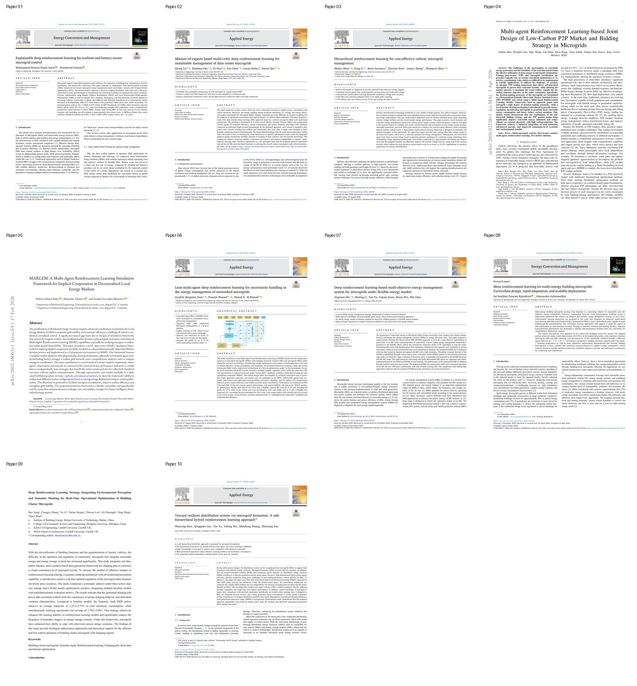

# 强化学习与微电网论文全文集

共 10 篇；源 PDF 保留在上级文件夹。

每篇包含格式化 Markdown、纯文本、离线 HTML 阅读版、逐页截图，以及原始 MinerU 解析结果。

- MinerU 4.0.12 本地 Basic 档；未上传远程服务。
- 正文不翻译、不改写；统一字重和标题层级，HTML 包含章节目录和离线 MathML 公式。
- 截图按源 PDF 物理页码排列；第 09 篇第 1 页为机构封面，第 2 页为论文首页。

> 机器解析可能存在公式识别、表格结构或阅读顺序误差；引用时请核对原始 PDF。

| 编号 | 论文 | 版本 | 页数 | 阅读版 | Markdown | 纯文本 | 截图 |
| --- | --- | --- | --- | --- | --- | --- | --- |
| 01 | Explainable deep reinforcement learning for resilient and battery-aware microgrid control | 出版社正式版 | 26 | [打开](01_Explainable_RL_battery_aware/paper.html) | [打开](01_Explainable_RL_battery_aware/paper.md) | [打开](01_Explainable_RL_battery_aware/paper.txt) | [逐页](01_Explainable_RL_battery_aware/screenshots.html) |
| 02 | Mixture-of-experts based multi-critic deep reinforcement learning for sustainable management of data center microgrids | 出版社正式版 | 15 | [打开](02_Mixture_of_experts_multi_critic/paper.html) | [打开](02_Mixture_of_experts_multi_critic/paper.md) | [打开](02_Mixture_of_experts_multi_critic/paper.txt) | [逐页](02_Mixture_of_experts_multi_critic/screenshots.html) |
| 03 | Hierarchical reinforcement learning for cost-effective railway microgrid management | 出版社正式版 | 18 | [打开](03_Hierarchical_RL_railway/paper.html) | [打开](03_Hierarchical_RL_railway/paper.md) | [打开](03_Hierarchical_RL_railway/paper.txt) | [逐页](03_Hierarchical_RL_railway/screenshots.html) |
| 04 | Multi-agent reinforcement learning-based joint design of low-carbon P2P market and bidding strategy in microgrids | 作者预印本 | 10 | [打开](04_MARL_P2P_market/paper.html) | [打开](04_MARL_P2P_market/paper.md) | [打开](04_MARL_P2P_market/paper.txt) | [逐页](04_MARL_P2P_market/screenshots.html) |
| 05 | MARLEM: A multi-agent reinforcement learning simulation framework for implicit cooperation in decentralized local energy markets | 作者预印本 | 32 | [打开](05_MARLEM/paper.html) | [打开](05_MARLEM/paper.md) | [打开](05_MARLEM/paper.txt) | [逐页](05_MARLEM/screenshots.html) |
| 06 | Lean multi-agent deep reinforcement learning for uncertainty handling in the energy management of networked microgrids | 出版社正式版 | 31 | [打开](06_Lean_MARL_networked_microgrids/paper.html) | [打开](06_Lean_MARL_networked_microgrids/paper.md) | [打开](06_Lean_MARL_networked_microgrids/paper.txt) | [逐页](06_Lean_MARL_networked_microgrids/screenshots.html) |
| 07 | Deep reinforcement learning-based multi-objective energy management system for microgrids under flexible energy market | 出版社正式版 | 10 | [打开](07_Multi_objective_EMS/paper.html) | [打开](07_Multi_objective_EMS/paper.md) | [打开](07_Multi_objective_EMS/paper.txt) | [逐页](07_Multi_objective_EMS/screenshots.html) |
| 08 | Meta-reinforcement learning for multi-energy building microgrids: Curriculum design, rapid adaptation, and scalable deployment | 出版社正式版 | 22 | [打开](08_Meta_RL_building_microgrids/paper.html) | [打开](08_Meta_RL_building_microgrids/paper.md) | [打开](08_Meta_RL_building_microgrids/paper.txt) | [逐页](08_Meta_RL_building_microgrids/screenshots.html) |
| 09 | Deep reinforcement learning strategy integrating environmental perception and semantic masking for real-time operational optimization of building cluster microgrids | 作者接受稿（含机构封面） | 40 | [打开](09_Perception_semantic_masking/paper.html) | [打开](09_Perception_semantic_masking/paper.md) | [打开](09_Perception_semantic_masking/paper.txt) | [逐页](09_Perception_semantic_masking/screenshots.html) |
| 10 | Toward resilient distribution system via microgrid formation: A safe hierarchical hybrid reinforcement learning approach | 出版社正式版 | 16 | [打开](10_Safe_hierarchical_hybrid_RL/paper.html) | [打开](10_Safe_hierarchical_hybrid_RL/paper.md) | [打开](10_Safe_hierarchical_hybrid_RL/paper.txt) | [逐页](10_Safe_hierarchical_hybrid_RL/screenshots.html) |

## 首页总览

